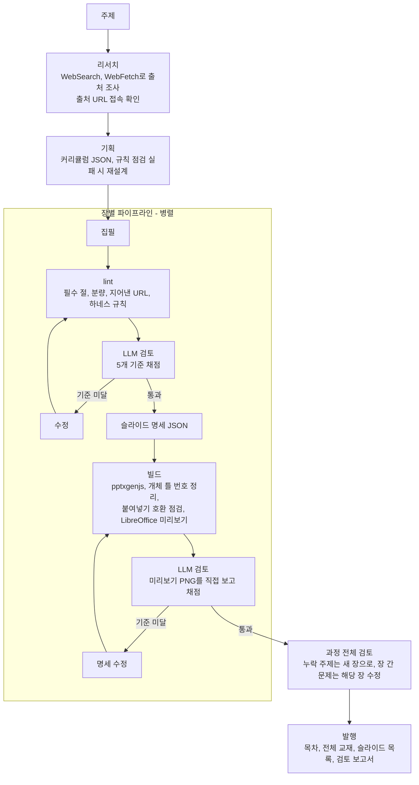
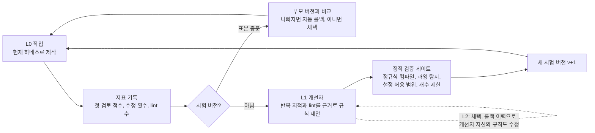

# 교재 제작 에이전트 (courseware_agent)

주제만 주면 에이전트가 스스로 조사하고, 커리큘럼을 짜고, 장별 교재(마크다운)와 강의 슬라이드(PPTX)를 만든 뒤, 기준을 넘길 때까지 검토하고 고칩니다. 그리고 그 실행 기록으로 **자기 하네스를 고치는 재귀적 자기 개선(RSI)** 을 이 PC에서 백그라운드로 계속 돌립니다.

- 지금 주제: **파이썬 AI 프로그램 하네스 엔지니어링** → [output/python-ai-harness-engineering](output/python-ai-harness-engineering/README.md)
- 작업이 생길 때마다 변경 요약을 `.env`의 SMTP 설정으로 `RECIPIENTS`에게 메일로 보냅니다
- 자기 개선 기록(사람이 보는 곳): [harness/RSI_REPORT.md](harness/RSI_REPORT.md), [harness/CHANGELOG.md](harness/CHANGELOG.md), `harness/logs/rsi.log`

## 빠른 시작

```bash
pip install -r requirements.txt
npm install
```

데몬 시작(창 없이 백그라운드, 세션이나 터미널을 닫아도 계속 실행):

```bash
powershell -ExecutionPolicy Bypass -File start_daemon.ps1
```

상태 확인과 주제 추가:

```bash
python run.py --status
```

```bash
python run.py --add-topic "쿠버네티스 운영" --audience "운영 담당 개발자"
```

멈추기(지금 하는 작업을 마치고 종료, `-Now`는 즉시 종료):

```bash
powershell -ExecutionPolicy Bypass -File stop_daemon.ps1
```

- 인증: Claude Agent SDK가 이 PC의 Claude Code CLI 로그인을 그대로 씁니다. 별도 API 키는 필요 없습니다.
- 필요 도구: Python 3.11+, Node 18+(pptxgenjs), LibreOffice(슬라이드 미리보기), PyMuPDF
- 로그인할 때 자동으로 시작하려면 `install_autostart.ps1`(작업 스케줄러 등록, `-Remove`로 해제)

## 실행 방법

| 명령 | 하는 일 |
|---|---|
| `python run.py --daemon` | RSI 데몬(보통은 `start_daemon.ps1`로 띄움) |
| `python run.py --add-topic "주제" [--audience ...] [--slug ...]` | 데몬 주제 대기열에 추가. 실행 중에도 다음 사이클에 반영 |
| `python run.py --remove-topic "주제"` | 데몬 대상에서 뺌(결과물은 유지) |
| `python run.py --status` | 데몬 상태, 주제별 진행, RSI 보고서 |
| `python run.py "주제"` | 데몬 없이 한 번 끝까지 제작(중단돼도 이어하기) |
| `python run.py "주제" --render-only` | LLM 없이 슬라이드 빌드와 목차만 다시 |
| `python run.py "주제" --text-only` | 본문만 제작 |
| `--no-improve` | 자기 개선 끄기 |
| `--audience`, `--model`, `--effort`, `--concurrency`, `--pass-score`, `--max-revisions` | 실행 설정 덮어쓰기 |

디렉토리 이름은 모두 영문입니다. 주제의 출력 폴더는 `output/<영문 슬러그>`이고, 슬러그는 `--slug`로 정하거나 생략하면 Claude가 주제를 영어로 옮겨 짓습니다(실패하면 로마자 표기). 주제와 슬러그의 대응은 `harness/daemon.json` 한 곳에서 관리합니다.

## 동작 방식

### 1. 교재 한 권 만들기 (L0)



- 통과 조건: 검토 점수가 기준 이상이고, major 지적과 lint 오류가 하나도 없어야 합니다. 끝내 못 넘기면 보고서에 "기준 미달"로 남깁니다.
- 교재의 모든 URL은 리서치에서 접속이 확인된 출처와 대조합니다.
- 하위 LLM 호출은 사용자와 프로젝트 설정(CLAUDE.md 등)을 읽지 않는 격리 모드로 실행합니다.

### 2. 슬라이드: `references/pptx-guide.md` 준수

가이드의 "명세 에이전트 + 빌더" 분리 구조를 따릅니다. LLM은 슬라이드마다 패턴과 글만 담은 **명세(JSON)** 를 쓰고, 좌표 계산과 코드 생성은 `pptx_builder.py`가 결정적으로 합니다.

| 가이드 항목 | 구현 |
|---|---|
| 16″×9″, 레이아웃 `내용_단쪽`, `masterName` 필수 | `defineLayout(16, 9)`, `defineSlideMaster({ title: "내용_단쪽" })`, 모든 `addSlide({ masterName: LAYOUT })` |
| 제목은 제목 개체 틀, 쪽 번호는 레이아웃 `slideNumber` | `pageHeader()`가 `placeholder: "title"` 사용, 글자 쪽 표시나 제목 밑줄을 그리지 않음 |
| 팔레트 상수, Pretendard, 최소 14pt | `C.*` 상수만 사용, 모든 글자에 `fontFace`, `fontSize`는 `fsMin()` 경유. 넘치면 글자를 줄이지 않고 오류로 돌려 명세를 고치게 함 |
| 패턴 A~E, 헤더 바, 넘버 배지, 틴트 박스, 다크 배지, 필 라벨, 콜아웃, 출처 줄 | `two_column`(A), `why_how_what`(B), `cards`(C), `table`(D), `agenda`(E) 외 `objectives`, `steps`, `code`, `summary` |
| 표지와 간지는 만들지 않음 | 첫 슬라이드는 학습 목표. 명세 `.md`에 `<!-- 간지: ... -->` 표시 |
| 가운뎃점 대신 뜻을 씀 | 명세 lint가 `·`를 찾아 수정을 요구 |
| 6-14 개체 틀 번호 정리, 6-13 붙여넣기 점검 | 빌드 직후 `fix_placeholders()`, `check_paste()` (OK가 아니면 lint 오류) |
| 미리보기는 LibreOffice만 | `scripts/render-pptx.py` 호출. 검토자는 "LibreOffice 미리보기"를 보고 채점 |

장마다 `slides/chNN.slides.json`(명세), `chNN.slides.md`(사람이 읽는 명세), `chNN.pptx`, `chNN.pdf`(미리보기), `build/chNN.build.js`(생성된 빌드 코드), `preview/chNN/slide-N.png`가 남습니다.

### 3. 재귀적 자기 개선 (RSI)

에이전트의 "하네스"(역할별 추가 프롬프트 규칙, 결정적 lint 규칙, 설정값)는 `harness/`에 버전으로 저장되고, 에이전트가 스스로 고칩니다.



- **L1**: 검토 루프 3번마다(그리고 데몬 사이클마다) 개선자가 실행 기록을 보고 1~4개 변경을 제안합니다. 생성 역할의 예방 규칙을 우선하고, 기계적으로 판별되는 문제는 lint 규칙으로 만듭니다.
- **안전 게이트**: 파이썬 코드는 고치지 않고 데이터만 바꿉니다. 코드에 들어 있는 기본 규칙(가이드 준수, 지어낸 URL 금지 등)은 지울 수 없고, 설정은 허용 범위(`CONFIG_BOUNDS`) 안에서만 바뀝니다. lint 규칙은 정규식 컴파일과 기존 결과물에 대한 과잉 탐지 점검을 통과해야 합니다.
- **시험과 롤백**: 새 버전은 "시험"으로 적용되고, 표본 3개가 쌓이면 품질(첫 검토 점수 − 0.3×수정 횟수 − 0.1×첫 lint 수)을 부모와 비교합니다. 0.25 넘게 나빠지면 자동으로 되돌립니다.
- **L2(재귀)**: 개선자 자신의 규칙(role=improver)도 하네스에 들어 있습니다. 개선자는 과거 제안의 채택과 롤백 이력을 보고 자기 제안 방식까지 고칩니다.
- **주제 간 공유**: 하네스는 모든 주제가 함께 씁니다. 개선자는 특정 주제에 묶이지 않는 일반 규칙만 만들도록 지시받습니다.

### 4. 데몬 (이 PC 전용, 백그라운드)

사이클마다 주제 하나를 골라 진행합니다. 미완성 주제(새로 추가한 주제)를 먼저 만들고, 모두 완성되면 가장 오래 손대지 않은 주제에서 **가장 약한 장을 현재 하네스로 다시 만들어** 더 나을 때만 교체합니다. 그래서 교재는 나빠지지 않고, 새 지표는 하네스 시험 판정에 쓰입니다.

| 안전장치 | 방법 |
|---|---|
| 이 PC에서만 | 처음 실행한 PC의 호스트 이름과 하드웨어 ID를 `harness/machine.json`에 기록하고, 다른 PC면 실행을 거부 |
| 한 개만 실행 | `harness/daemon.lock` 파일 잠금 |
| 비용 상한 | `harness/daemon.json`의 `daily_budget_usd`, `max_cycles_per_day`, `interval_minutes` |
| 실패 대응 | 연속 실패 시 대기 시간을 두 배씩 늘림(최대 16배). 오류는 로그에 남기고 계속 실행 |
| 정지 | `stop_daemon.ps1` 또는 `harness/STOP` 파일 |

### 5. 사람이 보는 기록

| 파일 | 내용 |
|---|---|
| `harness/RSI_REPORT.md` | 사이클마다 갱신: 데몬 상태, 주제별 진행, 현재 하네스 규칙, 버전별 품질 표, 제안과 채택/롤백 결과, 최근 사이클 |
| `harness/CHANGELOG.md` | 하네스 버전마다 무엇을 왜 바꿨는지(진단, 근거, 거부된 제안) |
| `harness/logs/rsi.log` | 전체 실행 로그(검토 점수, 수정, 빌드, 개선, 사이클) |
| `harness/cycles.jsonl`, `metrics.jsonl`, `proposals.jsonl`, `versions/` | 기계가 읽는 원본 기록 |
| `output/<slug>/reviews/final_report.md` | 주제별 장 점수, 남은 지적, 과정 검토, 진행 기록 |
| `harness/outbox/*.md` | 보낸 작업 변경 요약 메일의 사본 |

### 6. 작업 변경 요약 메일

데몬은 작업이 생길 때마다 변경 요약을 메일로 보냅니다. 저장소 루트의 `email_sender.py`를 그대로 쓰므로 `.env`의 `SMTP_SERVER`, `SMTP_PORT`, `SMTP_USER`, `SMTP_PASSWORD`로 `RECIPIENTS`에게 발송합니다.

| 보내는 때 | 내용 |
|---|---|
| 데몬 시작과 정지 | PC 이름, 하네스 버전 |
| 리서치, 기획 완료 | 출처 수, 장 목록 |
| 장 완성 | 본문 점수, 슬라이드 장수와 점수, 기준 미달 여부, 전체 진행 |
| 과정 검토 | 교재 전체 점수, 누락 주제, 장 간 이슈 |
| 하네스 개선과 판정 | 시험 버전에 넣은 규칙, 채택 또는 롤백과 품질 변화 |
| 리프레시 | 다시 만든 장과 교체 여부 |
| 사이클 끝, 오류 | 한 일, 결과, LLM 호출 수(오류와 사이클 끝은 즉시 발송) |

짧은 시간에 이벤트가 몰리면 `min_interval_minutes`(기본 10분) 간격으로 묶어 한 통으로 보냅니다. 메일 끝에는 현재 하네스 상태와 주제별 진행이 붙고, 발송에 실패한 이벤트는 다음 발송 때 다시 보냅니다. 설정은 `harness/daemon.json`의 `notify`(`enabled`, `min_interval_minutes`, `sender_name`, `subject_prefix`)에서 바꾸고, 데몬이 사이클마다 다시 읽습니다.

### 7. 주제 범위

주제마다 `scope`(무엇을 다루고 무엇을 빼는지)를 줄 수 있고, 리서치, 기획, 집필, 검토 프롬프트에 모두 들어갑니다. 지금 데몬의 주제는 **파이썬 AI 프로그램 하네스 엔지니어링**이고, 범위는 "파이썬으로 만드는 AI 프로그램에 하네스를 직접 구현하는 실습 중심, 코딩 에이전트 사용법은 배경으로만"입니다. 처음 해석으로 만들던 코딩 에이전트 중심 교재(`output/harness-engineering`)는 비활성 주제로 남아 있습니다.

```bash
python run.py --add-topic "주제" --audience "대상" --scope "다룰 범위와 뺄 범위" --slug english-name
```

## 구조

```
agent/harness-engineering/
├── run.py                      # CLI
├── start_daemon.ps1 · stop_daemon.ps1 · install_autostart.ps1
├── courseware_agent/
│   ├── config.py               # 설정, 영문 슬러그
│   ├── llm.py                  # Claude Agent SDK 호출(재시도, 타임아웃, 비용 집계)
│   ├── state.py                # 주제별 재시작 가능한 상태(state.json)
│   ├── prompts.py              # 역할별 시스템 프롬프트, 출력 스키마(개선자 포함)
│   ├── lint.py                 # 교재 결정적 점검
│   ├── pptx_builder.py         # 슬라이드 명세 → pptxgenjs → PPTX, 가이드 검증
│   ├── render.py               # 슬라이드 목록 페이지
│   ├── harness.py              # RSI 하네스 저장소(버전, 시험, 롤백, 보고서)
│   ├── notify.py               # 작업 변경 요약 메일(묶음 발송, 재시도, outbox 보관)
│   ├── orchestrator.py         # 제작 파이프라인 + 자기 개선 + 리프레시
│   └── daemon.py               # 이 PC 전용 백그라운드 데몬, 주제 대기열
├── harness/                    # 자기 개선 상태와 기록(모든 주제 공유)
├── tests/test_offline.py       # LLM 없이 도는 테스트
└── output/<slug>/
    ├── README.md · plan.json · state.json
    ├── research/               # brief.md, sources.json
    ├── textbook/               # README.md(목차), chNN.md, full-textbook.md
    ├── slides/                 # index.html, chNN.pptx / .pdf / .slides.json / .slides.md, build/, preview/
    ├── reviews/                # final_report.md, course_review_N.json
    └── logs/agent.log
```

## 테스트

```bash
python -m pytest
```
