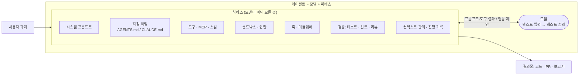
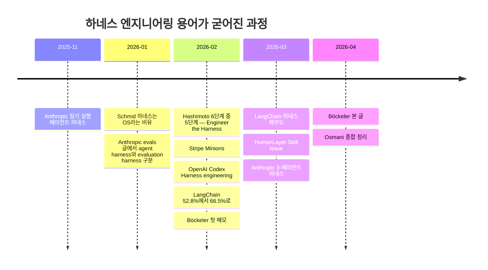
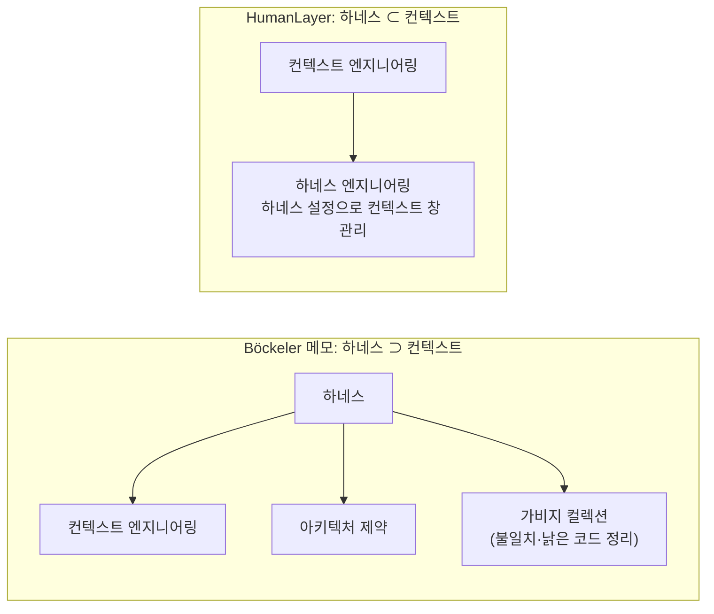
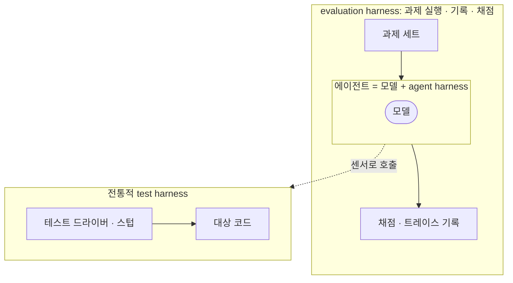

# 1장. 하네스 엔지니어링이란 무엇인가: Agent = Model + Harness

## 학습 목표

이 장을 마치면 다음을 할 수 있습니다.

- 'Agent = Model + Harness' 공식을 써서 같은 모델로도 결과가 달라지는 이유를 사례(LangChain 52.8%→66.5%)를 들어 설명할 수 있다.
- Hashimoto, OpenAI, LangChain, Böckeler, HumanLayer, Schmid의 정의를 표로 비교하고 각 관점의 초점을 한 문장으로 요약할 수 있다.
- agent harness, evaluation harness, 전통적인 test harness를 구분해 예시를 들 수 있다.
- 하네스 엔지니어링이 지금 중요해진 이유 네 가지(병목 이동, 사람 주의력 부족, 장시간 무인 작업, 조직 자산화)를 자기 팀 상황에 대입해 말할 수 있다.
- 이 분야의 근거가 대부분 벤더 자체 보고라는 한계를 짚고, 원칙과 측정 중심으로 접근해야 하는 이유를 설명할 수 있다.

## 도입 사례: 모델은 그대로인데 점수가 13.7%p 올랐다

2026년 2월 17일, LangChain은 자사 코딩 에이전트(deepagents-cli) 실험 결과를 공개했습니다. 모델은 `gpt-5.2-codex` 하나로 고정했습니다. 바꾼 것은 **세 가지 범주의 하네스 구성 요소(시스템 프롬프트·도구·미들웨어)와 추론 예산 배분**입니다. 여기서 미들웨어(middleware)는 모델 호출 앞뒤에 끼어들어 입력과 출력을 검사하거나 고치는 코드를 말합니다. 이렇게만 바꿨는데 터미널 작업 벤치마크인 Terminal Bench 2.0 점수가 **52.8%에서 66.5%로 13.7%p** 올랐고, 순위는 Top 30 밖에서 Top 5 안으로 올라갔습니다.

손댄 내용을 보면 대단한 기술은 아닙니다.

| 바꾼 것 | 하는 일 |
|---|---|
| 자기 검증 프롬프트 | 끝내기 전에 결과를 직접 확인하라고 지시 |
| PreCompletionChecklist 미들웨어 | 종료 직전에 체크리스트를 거치게 함 |
| LoopDetection 미들웨어 | 같은 파일을 계속 고치는 헛돌기를 감지 |
| LocalContext 미들웨어 | 작업 환경 정보를 미리 넣어 줌 |
| '추론 샌드위치'(추론 예산 배분) | 계획·검증 단계는 추론 강도\* `xhigh`, 구현 단계는 `high` |

\* 추론 강도(reasoning effort): 모델이 답하기 전에 얼마나 길게 생각할지 정하는 API 설정값입니다. `xhigh`는 `high`보다 한 단계 더 길게 생각하게 하는 값이라 더 신중하지만, 시간과 토큰이 더 듭니다.

마지막 항목이 흥미롭습니다. 전 구간을 `xhigh`로 돌렸더니 시간 초과가 나서 53.9%에 그쳤다고 합니다. "더 많이 생각하게 하면 낫다"는 직관도 하네스 설계에서는 측정해 봐야 안다는 뜻입니다.

같은 모델로 결과가 이만큼 달라졌다면, 차이는 모델이 아닌 곳에서 났다고 봐야 합니다. 그 '모델이 아닌 곳'을 부르는 이름이 **하네스(harness)**이고, 그곳을 일부러 설계하고 고쳐 나가는 일이 **하네스 엔지니어링**입니다.

## 하네스란 무엇인가: 모델을 제외한 모든 것

### Agent = Model + Harness

하네스는 원래 말에게 씌우는 마구(馬具)를 뜻합니다. 힘은 말이 내지만, 그 힘을 어디로 보낼지는 마구와 고삐가 정합니다. AI 에이전트도 비슷합니다. LangChain의 Vivek Trivedy는 이를 한 줄로 정리했습니다.

> **Agent = Model + Harness**
> 하네스는 모델이 아닌 모든 코드, 설정, 실행 로직이다.

원시 모델은 텍스트를 받아 텍스트를 돌려줄 뿐입니다. 상태를 기억하고, 도구를 실행하고, 결과를 다시 보여 주고, 위험한 행동을 막는 일은 모델 바깥에서 일어납니다. 하네스가 상태, 도구 실행, 피드백 루프, 강제할 수 있는 제약을 더해 줄 때 모델은 비로소 에이전트가 됩니다. Anthropic도 같은 대상을 "모델이 에이전트로 행동하게 해 주는 시스템"이라고 정의하고, scaffold(비계, 건물을 지을 때 주위에 세우는 임시 구조물)와 같은 말로 씁니다.



> **그림 속 용어 풀이**
> - **지침 파일**: 에이전트가 작업을 시작할 때 읽는 레포 규칙 문서(AGENTS.md, CLAUDE.md 등)입니다.
> - **MCP**(Model Context Protocol): 외부 도구와 데이터를 에이전트에 연결하는 표준 규약입니다.
> - **스킬**: 특정 작업 절차와 스크립트를 묶어 두고, 필요할 때만 불러 쓰게 한 패키지입니다.
> - **훅**(hook): 도구 실행 전후, 종료 직전 같은 특정 시점에 자동으로 실행되는 스크립트입니다. 그중 **정지 훅**(stop hook)은 에이전트가 종료하려 할 때 실행되는 스크립트입니다.
> - **미들웨어**: 모델 호출 앞뒤에 끼어드는 코드입니다. 훅과 비슷하지만 하네스 프레임워크 안의 코드로 작성한다는 점이 다릅니다.
> - **샌드박스**: 에이전트가 실행하는 명령을 격리된 환경에 가둬 바깥에 영향을 주지 못하게 하는 장치입니다.

구성 요소 하나하나는 2장에서 지도로 정리합니다. 여기서는 "모델을 뺀 나머지 전부"라는 경계선만 기억하면 됩니다.

### 코드로 보는 경계선

아래는 에이전트 루프를 가장 작게 줄인 예제입니다. 모델 자리는 동작을 확인할 수 있도록 미리 정한 응답을 돌려주는 가짜 함수로 채웠습니다. `python mini_agent.py`(macOS·Linux에서는 `python3 mini_agent.py`)로 바로 실행됩니다.

```python
# mini_agent.py - "Agent = Model + Harness"의 경계선을 눈으로 확인하는 최소 예제
import json
import subprocess

SYSTEM_PROMPT = "너는 저장소를 고치는 코딩 에이전트다. 행동은 JSON 한 줄로 낸다."  # 하네스: 시스템 프롬프트
ALLOWED_COMMANDS = {"pytest", "ls", "cat"}   # 하네스: 권한 정책(설명용 장난감. 아래 경고 참고)
MAX_STEPS = 5                                # 하네스: 종료·복구 정책


def call_model(messages):
    """모델 자리. 실제로는 LLM API를 호출한다. 여기서는 정해 둔 가짜 응답을 돌려준다."""
    scripted = [
        '{"tool": "run", "cmd": ["pytest", "--version"]}',
        '{"tool": "run", "cmd": ["rm", "-rf", "/"]}',   # 모델이 위험한 행동을 제안하는 상황
        '좋습니다. 이제 테스트를 실행하겠습니다.',         # 모델이 형식을 어기는 상황(JSON 아님)
        '{"tool": "finish", "summary": "환경 확인 완료"}',
    ]
    step = sum(1 for m in messages if m["role"] == "assistant")
    return scripted[min(step, len(scripted) - 1)]


def run_tool(action):
    """하네스: 도구 실행 + 권한 검사 + 출력 정책 + 실행 오류를 문장으로 바꾸기."""
    cmd = action.get("cmd")
    if not isinstance(cmd, list) or not cmd:
        return '형식 오류: "cmd"는 비어 있지 않은 리스트여야 합니다. 예: ["pytest", "-q"]'
    program = cmd[0]
    if program not in ALLOWED_COMMANDS:
        return f"거부됨: '{program}' 명령은 허용 목록에 없습니다. 허용: {sorted(ALLOWED_COMMANDS)}"
    try:
        r = subprocess.run(cmd, capture_output=True, text=True,
                           encoding="utf-8", errors="replace", timeout=30)
    except FileNotFoundError:          # 예: Windows에는 ls·cat이 없음, pytest 미설치
        return f"실행 오류: '{program}' 명령을 찾을 수 없습니다. 설치 여부와 OS를 확인하세요."
    except subprocess.TimeoutExpired:
        return "실행 오류: 30초 안에 끝나지 않아 중단했습니다. 범위를 좁혀 다시 실행하세요."
    out = (r.stdout + r.stderr).strip()
    if r.returncode != 0:
        return f"실패(exit={r.returncode}):\n{out}"   # 실패는 자세히
    return out[-200:] or "ok"                         # 성공은 짧게


def agent(task):
    messages = [{"role": "system", "content": SYSTEM_PROMPT},
                {"role": "user", "content": task}]
    for step in range(MAX_STEPS):
        reply = call_model(messages)                  # 모델은 이 한 줄뿐
        messages.append({"role": "assistant", "content": reply})
        try:                                          # 하네스: 오류를 모델에게 피드백
            action = json.loads(reply)
            tool = action["tool"]
        except (json.JSONDecodeError, KeyError, TypeError) as e:
            obs = (f'형식 오류({type(e).__name__}): 행동은 '
                   f'{{"tool": "run", "cmd": [...]}} 형태의 JSON 한 줄로 내세요.')
        else:
            if tool == "finish":
                return action.get("summary", "(요약 없음)")
            obs = run_tool(action) if tool == "run" else f"알 수 없는 도구 '{tool}'. 사용 가능: run, finish"
        print(f"[step {step}] {reply} -> {obs}")
        messages.append({"role": "user", "content": f"도구 결과:\n{obs}"})  # 하네스: 피드백 루프
    return "단계 상한에 도달해 사람에게 넘깁니다."     # 하네스: 복구 경로


if __name__ == "__main__":
    print(agent("개발 환경을 확인하고 끝내라"))
```

실행 결과는 다음과 비슷합니다. pytest 버전 숫자는 환경마다 다릅니다.

```text
[step 0] {"tool": "run", "cmd": ["pytest", "--version"]} -> pytest 8.3.4
[step 1] {"tool": "run", "cmd": ["rm", "-rf", "/"]} -> 거부됨: 'rm' 명령은 허용 목록에 없습니다. 허용: ['cat', 'ls', 'pytest']
[step 2] 좋습니다. 이제 테스트를 실행하겠습니다. -> 형식 오류(JSONDecodeError): 행동은 {"tool": "run", "cmd": [...]} 형태의 JSON 한 줄로 내세요.
환경 확인 완료
```

pytest가 설치되어 있지 않다면 step 0에 `실행 오류: 'pytest' 명령을 찾을 수 없습니다...`가 찍힙니다. 이때도 루프는 멈추지 않고 다음 단계로 넘어갑니다.

첫 명령은 실행되고, 두 번째 `rm -rf /`는 허용 목록에서 거부되며, 세 번째 형식 위반은 오류 메시지로 바뀌어 모델에게 되돌아가고, 네 번째에서 끝납니다. 모델 자리는 `call_model()` 한 줄뿐입니다. 나머지는 모두 하네스입니다. 시스템 프롬프트, 허용 목록, 단계 상한, 출력 정책, 결과를 대화에 되돌려 넣는 방식이 여기에 들어갑니다.

특히 `try/except` 부분을 눈여겨보십시오. 실제 LLM은 JSON 형식을 어기거나, 필요한 키를 빠뜨리거나, 없는 명령을 부르는 일이 드물지 않습니다. 이때 루프가 예외로 죽지 않고 **실패를 다음 입력으로 바꿔 모델에게 돌려주는 것**이 하네스의 핵심 기능 가운데 하나입니다. 모델을 바꾸지 않고 이 루프와 그 주변만 고쳐도 에이전트의 성공률과 동작 방식이 달라집니다. 도입 사례에서 LangChain이 바꾼 것도 모두 이 루프 주변이었습니다. 루프에 들어가는 프롬프트(자기 검증 지시), 종료 전 검사(체크리스트), 헛돌기 감지(루프 감지), 미리 넣어 주는 환경 정보, 단계별 추론 예산 배분을 바꿨습니다.

> ⚠️ **주의: 이 허용 목록은 안전장치가 아닙니다.**
> `ALLOWED_COMMANDS`는 경계선을 보여 주기 위한 장난감입니다. 프로그램 이름만 검사하므로, 목록에 `python`·`node`·`bash` 같은 인터프리터를 넣는 순간 `python -c "import shutil; shutil.rmtree(...)"`처럼 사실상 무엇이든 실행됩니다. 인터프리터가 아니어도 안심할 수 없습니다. `pytest`는 레포 안의 `conftest.py`를 실행하고, `cat`은 비밀 키 파일을 읽을 수 있습니다. 실제 안전성은 샌드박스, 컨테이너, 제품의 권한 모드 같은 **OS 수준 격리**로 확보해야 합니다. 이 내용은 샌드박스·권한을 다루는 뒤 장에서 자세히 설명합니다. 이 예제는 "위험한 요청을 하네스가 가로챌 수 있다"는 구조만 보여 줍니다.

### 또 다른 비유: 하네스는 에이전트를 돌리는 OS

Philipp Schmid(2026-01-05)는 컴퓨터에 빗댄 비유를 들었습니다.

| 컴퓨터 | 에이전트 시스템 |
|---|---|
| CPU | 모델 |
| RAM | 컨텍스트 창(모델이 한 번에 읽을 수 있는 입력 범위) |
| 운영체제(OS) | 하네스 |
| 애플리케이션 | 에이전트 |

여기서 미묘한 차이가 생깁니다. Trivedy의 공식에서는 하네스가 에이전트의 **일부**입니다. Schmid는 하네스가 **에이전트 그 자체는 아니고**, 에이전트를 돌리는 인프라라고 말합니다. 또 하네스를 레고 블록 같은 프레임워크보다 의견이 강하게 반영된 완성형 인프라로 봅니다. 그는 모델 간 격차가 줄어들수록 차이는 장시간 작업을 얼마나 버티는지(durability)에서 드러난다고 주장했습니다.

어느 쪽이 맞다고 정할 필요는 없습니다. 실무에서 중요한 점은 두 관점 모두 **같은 모델로도 결과가 크게 달라질 수 있고, 그 차이를 만드는 층을 설계할 수 있다**고 본다는 것입니다.

## 용어가 굳어진 과정: 2025년 말~2026년 초 연표

'agent harness'나 'scaffold'라는 말 자체는 그 전부터 에이전트 SDK, 소프트웨어 엔지니어링 벤치마크, 평가 문헌에서 쓰였습니다. 다만 **'하네스 엔지니어링'이 하나의 분야 이름으로 굳어진 것**은 2025년 11월 Anthropic의 장기 실행 하네스 글을 기점으로, 2026년 상반기의 몇 달 사이에 빠르게 일어난 일입니다.



| 날짜 | 누가 | 무엇을 | 이 교재에서 |
|---|---|---|---|
| 2025-11-26 | Anthropic | 여러 세션에 걸친 에이전트의 기억 단절을 initializer 에이전트, JSON 기능 목록, 진행 파일, git으로 해결 | 7장 |
| 2026-01-05 | Philipp Schmid | 모델=CPU, 컨텍스트=RAM, 하네스=OS | 1·9장 |
| 2026-01-09 | Anthropic | agent harness와 evaluation harness를 구분해 정의 | 1·9장 |
| 2026-02-05 | Mitchell Hashimoto | AI 도입 6단계 중 5단계를 "Engineer the Harness"로 명명 | 1·3장 |
| 2026-02 | OpenAI | 사람이 코드를 직접 쓰지 않고 약 5개월간 약 100만 줄 제품 개발(2차 사본 기준). 이후 Böckeler·Osmani 등 여러 글이 기준점으로 인용 | 3·10장 |
| 2026-02-09 | Stripe | 무인 에이전트 Minions로 주당 1,000건 이상의 PR 병합(리뷰는 사람) | 4·5·8장 |
| 2026-02-17 | LangChain | 하네스만 바꿔 Terminal Bench 2.0 52.8%→66.5% | 1·9장 |
| 2026-02-17, 04-02 | Birgitta Böckeler (Thoughtworks) | 가이드·센서 프레임, 사용자 측 하네스 | 2장 |
| 2026-03-10 | LangChain (Trivedy) | Agent = Model + Harness 공식, 하네스 해부도, 사후 학습과 과적합 | 1·2·9장 |
| 2026-03-12 | HumanLayer | 컨텍스트 관점에서 본 하네스 | 6장 |
| 2026-03-24 | Anthropic | 생성기·평가기 분리(3-에이전트 하네스) | 8장 |
| 2026-04-19 | Addy Osmani | 종합 정리 | 1장 |

흐름을 보면 처음에는 "긴 작업을 어떻게 버티게 하나"라는 구체적인 문제(Anthropic)에서 출발했습니다. 그 뒤 개인의 습관(Hashimoto), 대규모 팀의 실천(OpenAI, Stripe), 측정 가능한 개선(LangChain), 그리고 이를 정리하는 프레임(Böckeler, Trivedy의 해부도, Osmani의 종합)으로 넓어졌습니다. Hashimoto의 정의는 특히 실천적입니다. 에이전트가 실수할 때마다 **그 실수가 다시는 일어나지 않도록** AGENTS.md에 지침을 넣거나 검증 스크립트를 만든다는 것입니다. 이 습관은 이 교재 전체를 관통합니다.

## 출처마다 다른 정의

같은 단어를 쓰지만 출처마다 초점이 다릅니다. 이후 장을 읽을 때 "이 사람은 어떤 정의로 말하는가"를 의식하면 혼란이 줄어듭니다. 위의 연표 표와 아래 정의 비교표는 이 장 전반부를 한눈에 보는 요약으로 함께 보아도 됩니다.

| 관점 | 정의의 초점 | 한 문장 요약 |
|---|---|---|
| Hashimoto | 반응적 실천 | 실수 하나에 영구적인 해결책 하나(AGENTS.md 지침 또는 도구)를 만든다. |
| OpenAI | 환경 설계 | 사람은 환경을 설계하고 의도를 명시하며 피드백 루프를 만든다. 레포가 지식의 단일 출처다. |
| LangChain (Trivedy) | 모델이 아닌 모든 것 | 과제 성능, 토큰 효율, 지연시간을 최적화하려고 모델 주변을 만드는 일이다. |
| Böckeler (Thoughtworks) | 사용자 측 하네스 | 제품에 이미 들어 있는 하네스 바깥에 사용자가 덧붙이는 층이며, 가이드(피드포워드)와 센서(피드백)로 신뢰성을 높이고 리뷰 부담을 줄인다. |
| HumanLayer | 컨텍스트 엔지니어링의 부분집합 | 하네스 설정으로 컨텍스트 창을 관리하는 일이다. |
| Philipp Schmid | 에이전트를 돌리는 OS | 하네스는 에이전트 자체가 아니라, 프레임워크보다 의견이 강하게 반영된 완성형 인프라다. |

Böckeler의 범위 좁히기는 실무에서 특히 유용합니다. Claude Code나 Codex를 쓰는 개발자는 제품 내장 시스템 프롬프트나 기본 도구를 직접 고칠 수 없습니다. 우리가 실제로 손댈 수 있는 것은 그 바깥에 얹는 지침 파일, 스킬, 훅, 린트, 테스트, CI입니다. 이 교재의 실습 대부분도 이 사용자 측 층을 다룹니다.

### 포함 관계 논쟁: 하네스 ⊃ 컨텍스트인가, 하네스 ⊂ 컨텍스트인가

두 출처는 포함 관계를 정반대로 봅니다.



Böckeler는 OpenAI 사례를 정리하면서 그 하네스를 컨텍스트 엔지니어링, 아키텍처 제약, 가비지 컬렉션 세 갈래로 나눴습니다. 이 분류는 OpenAI 자신의 정의가 아니라 Böckeler가 사례를 읽고 세운 틀입니다. 여기서 말하는 **가비지 컬렉션**은 프로그래밍 언어의 메모리 GC와 다른 개념입니다. 에이전트가 코드를 쌓아 가면서 생기는 불일치, 낡은 코드, 문서와 실제 코드의 어긋남(드리프트)을 주기적으로 찾아 정리하는 작업을 가리킵니다. 이 관점에서 컨텍스트는 하네스의 한 부분입니다. 반면 HumanLayer는 에이전트가 받는 모든 것이 결국 컨텍스트 창에 들어간다는 점을 출발점으로 삼아, 하네스를 컨텍스트를 다루는 수단으로 봅니다.

이 논쟁은 아직 결론이 나지 않았습니다. 이 교재는 실무적인 기준을 하나 정해 두고 넘어갑니다. **"모델 가중치 밖에서 우리가 설계할 수 있는 모든 것"을 하네스라고 부르고, 컨텍스트 관리는 그중 중요한 한 영역으로 다룹니다(6장).** 팀 안에서도 이렇게 작업 정의를 하나 정해 두면 회의에서 용어 때문에 헛도는 일이 줄어듭니다.

## 왜 지금 중요한가: 네 가지 이유

### 1. 병목이 모델 밖으로 옮겨 갔다

도입 사례가 보여 주듯, 같은 모델이라도 하네스에 따라 벤치마크 점수와 순위가 크게 달라질 수 있습니다. 모델 성능이 상향 평준화될수록 차이는 모델 주변에서 납니다.

여기에 **하네스 과적합**(harness overfitting)이라는 현상도 겹칩니다. 과적합은 특정 환경에 지나치게 맞춰져 다른 환경에서는 잘 안 되는 상태를 말합니다. LangChain(Trivedy)은 하네스 해부도 글에서 Claude Code나 Codex 같은 제품의 모델이 자기 제품 하네스를 끼운 채로 사후 학습(post-training, 사전 학습을 마친 모델을 특정 행동과 용도에 맞게 추가로 학습시키는 단계)된다고 설명합니다. 이 설명대로라면 도구 구성을 바꿀 때 성능이 떨어지기도 하고, 거꾸로 다른 하네스에서 더 잘 나오기도 합니다. LangChain은 모델이 특정 패치 도구(`apply_patch`) 형식에 익숙해진 사례를 듭니다. 그래서 "어떤 모델이 제일 좋은가"라는 질문은 "어떤 하네스와 함께인가"를 빼면 답할 수 없습니다. 이식성 문제는 9장에서 자세히 다룹니다.

### 2. 사람의 주의력이 가장 희소한 자원이 됐다

에이전트가 하루에 PR을 대량으로 만드는 환경에서는 사람이 모든 줄을 읽을 수 없습니다. Böckeler는 좋은 하네스의 목표가 **사람을 빼는 것이 아니라 사람의 주의를 가장 중요한 곳으로 보내는 것**이라고 말합니다. 사람이 보기 전에 기계적으로 잡을 수 있는 오류는 하네스가 먼저 걸러야 합니다.

### 3. 장시간·무인 작업이 현실이 됐다

세션이 몇 시간씩 이어지면 새로운 종류의 실패가 체계적으로 나타납니다. 컨텍스트가 찰수록 판단이 흐려지는 현상(컨텍스트 부패), 너무 일찍 "다 했다"고 선언하는 현상, 자기 결과물을 후하게 평가하는 현상(자기 평가 편향)이 그 예입니다. 이런 실패는 프롬프트에 "꼼꼼히 해라" 한 줄을 넣는다고 막히지 않습니다. 진행 파일, 별도 평가기, 컨텍스트 리셋 같은 **구조**로 막아야 합니다(6·7·8장).

### 4. 조직 차원의 자산이 된다

하네스는 레포지토리 안에 파일과 코드로 남습니다. AGENTS.md, 린트 규칙, 훅 스크립트, CI 설정은 리뷰하고 버전을 관리하고 공유할 수 있습니다. Böckeler는 앞으로 서비스 템플릿처럼 '하네스 템플릿'이 표준화될 수 있다고 전망합니다(10장).

### 우리 팀에 대입하기

| 이유 | 스스로 던질 질문 | 예: "결제 API 팀" |
|---|---|---|
| 병목 이동 | 모델을 바꾸지 않고 설정만 바꿔 결과가 달라진 경험이 있는가? | CLAUDE.md에 테스트 명령을 적었더니 엉뚱한 테스트 실행이 사라짐 |
| 주의력 부족 | 에이전트 PR 리뷰에 주당 몇 시간을 쓰는가? 그중 기계가 잡을 수 있던 지적은 몇 %인가? | 리뷰 지적의 절반이 포맷·임포트 순서 |
| 장시간 무인 | 30분 넘게 혼자 돌린 작업이 있는가? 어디서 무너졌는가? | 마이그레이션 작업이 중간에 "완료"를 선언하고 멈춤 |
| 조직 자산화 | 잘 동작하는 설정이 특정 개인의 로컬에만 있는가? | 시니어 한 명의 개인 프롬프트를 팀원이 복사해서 씀 |

## 헷갈리기 쉬운 세 가지 하네스

'harness'라는 단어는 다른 맥락에서도 오래 쓰였습니다. 특히 다음 셋은 반드시 구분해야 합니다.

| 용어 | 뜻 | 예시 | 이 교재에서 |
|---|---|---|---|
| **agent harness** (= scaffold) | 모델이 에이전트로 행동하게 해 주는 시스템 | AGENTS.md, MCP 도구, 정지 훅, 샌드박스 | 교재 전체의 주제 |
| **evaluation harness** | 평가를 처음부터 끝까지 실행·기록·채점하는 인프라 | 과제 100개를 에이전트에 돌리고 통과율과 비용을 집계하는 스크립트 | 9장 |
| **전통적 test harness** | 소프트웨어 테스트에서 대상 코드를 구동하고 결과를 확인하는 드라이버·스텁 묶음 | pytest와 픽스처, 목(mock) 서버 | 에이전트의 센서로 쓰임(5장) |



Anthropic의 평가 글은 agent harness와 evaluation harness를 따로 정의하면서, 에이전트를 평가한다는 것은 **하네스와 모델을 하나의 시스템으로 함께 평가**하는 일이라고 짚습니다. 그래서 "모델 A가 B보다 낫다"는 평가 결과를 볼 때는 어떤 agent harness 위에서 측정했는지부터 확인해야 합니다.

팀 문서에서는 다음처럼 수식어를 붙여 쓰기를 권합니다.

- "에이전트 하네스에 정지 훅을 추가했다." (agent harness)
- "평가 하네스로 30개 과제를 돌려 보니 통과율이 4%p 올랐다." (evaluation harness)
- "결제 모듈 테스트 하네스의 목 서버를 고쳤다." (test harness)

## 이 교재의 관점: 실천 분야, 원칙과 측정

하네스 엔지니어링은 정립된 학문이 아닙니다. **2026년에 막 이름이 붙은 실천 분야**입니다. 이 점을 처음부터 분명히 해 두어야 합니다.

### 근거의 대부분은 벤더 자체 보고다

이 장에 나온 인상적인 수치는 대부분 그 기술을 만든 회사가 직접 보고한 것입니다.

| 사례 | 공개된 것 | 공개되지 않은 것 |
|---|---|---|
| OpenAI Codex 팀 | 약 5개월, 약 100만 줄, 3→7명, 1인당 하루 약 3.5 PR(2차 사본 기준) | 결함률, 비용, 사람 개입 빈도, 다른 팀으로의 전이 가능성 |
| Stripe Minions | 주당 1,000건 이상의 PR 병합(리뷰는 사람) | 결함률, 사고율, 총비용 |
| LangChain | 52.8%→66.5% | 다른 모델·과제로의 일반화 정도(본인들도 과제 과적합 위험을 경고) |

OpenAI 수치는 openai.com 원문이 아니라 원문을 옮겨 둔 2차 사본 페이지에서 확인한 값입니다. 인용할 때는 원문과 대조하는 것이 좋습니다. Böckeler는 OpenAI 글이 유지보수성 위주이고 기능·행위의 검증은 다루지 않으며, OpenAI가 이 결과를 보여 줄 이해관계가 있다고 지적했습니다.

기대보다 효과가 작다는 실증도 나오고 있습니다. ETH Zurich 연구(arXiv:2602.11988)는 레포 수준 컨텍스트 파일(AGENTS.md 등)의 효과를 작성 주체별로 나눠 보고했습니다. **LLM이 자동 생성한 파일은 과제 성공률을 오히려 소폭 낮췄고, 개발자가 직접 쓴 파일도 개선 폭이 작았으며, 두 경우 모두 추론 비용이 20% 넘게 늘었습니다.** 그래서 연구진은 사람이 쓰는 컨텍스트 파일에 꼭 필요한 최소 요구사항만 적으라고 권합니다. "지침 파일은 길고 많을수록 좋다"는 통념과는 다른 결과입니다. 지침 파일을 쓰지 말라는 뜻이 아니라, **사람이 직접, 짧게, 에이전트가 스스로 알아낼 수 없는 내용만** 쓰라는 뜻입니다. 3장에서 지침 파일을 다룰 때 이 권고를 기준으로 삼습니다.

### 그래서 원칙과 측정 습관을 중심에 둔다

특정 회사의 설정을 그대로 베끼면 그 회사의 모델, 코드베이스, 과제에 맞춘 결과를 가져오게 됩니다. 이 교재는 대신 여러 출처에서 공통으로 확인되는 원칙을 따릅니다.

1. **실패에서 출발한다.** 이상적인 하네스를 미리 설계하지 말고, 실제 실수 하나마다 해결책 하나를 더한다(Hashimoto, HumanLayer).
2. **가이드와 센서를 짝짓는다.** 행동 전 방향 제시(피드포워드)와 행동 후 검증(피드백)을 함께 둔다(Böckeler, 2장).
3. **결정적 검증을 먼저 둔다.** 테스트·린트·타입체크처럼 빠르고 싼 검사가 LLM 판단보다 앞선다(5장).
4. **지울 수 있게 만든다.** 모든 구성 요소는 "모델이 혼자 못 하는 것"에 대한 가정이며, 모델이 바뀌면 그 가정은 낡는다(Anthropic, Schmid, 9장).
5. **측정한다.** 추가한 것이 정말 효과가 있는지 평가 하네스와 트레이스(에이전트가 밟은 단계별 실행 기록)로 확인한다(9장).

이 원칙들을 쓰면 벤더 수치를 맹신하지도, 무시하지도 않고 "우리 환경에서 재현되는가"라는 질문으로 바꿀 수 있습니다. 벤더 사례 수치를 읽는 법은 10장에서 다시 다룹니다.

## 실습: 하네스 인벤토리와 실패 분류

이 실습 결과물은 이후 모든 장에서 계속 고쳐 쓰는 기초 자료가 됩니다.

### 준비물

- 지금 에이전트(Claude Code, Codex, Cursor 등)를 쓰고 있는 레포지토리 하나. 없으면 개인 프로젝트도 좋습니다.
- Python 3.9 이상
- 최근 2~4주 동안 에이전트가 저지른 실패의 기억, 또는 대화 기록

### 1단계: 파일로 드러난 하네스를 자동으로 찾기

아래 스크립트는 레포 안에서 하네스 구성 요소일 가능성이 높은 파일을 찾아 마크다운 표로 출력합니다. `os.walk`로 내려가면서 `node_modules` 같은 디렉터리는 **들어가기 전에** 잘라 내므로 큰 레포에서도 불필요한 탐색을 줄입니다. 지침 파일, 센서, 실행 환경 파일은 모노레포의 하위 패키지에 흩어져 있는 경우가 많아 어느 깊이에서든 찾습니다.

```python
#!/usr/bin/env python3
# harness_inventory.py - 레포 안의 '모델이 아닌 것' 후보를 찾아 마크다운 표로 출력
import argparse
import os
from fnmatch import fnmatchcase
from pathlib import Path

# "**/이름"은 어느 깊이에서든 파일 이름으로 찾는다(모노레포 하위 패키지 포함).
# 나머지는 레포 루트 기준 상대 경로로만 찾는다(.github/workflows처럼 위치가 정해진 설정).
CATEGORIES = {
    "지침 파일": ["**/AGENTS.md", "**/CLAUDE.md", "**/CLAUDE.local.md", "**/GEMINI.md",
                ".cursorrules", ".cursor/rules/*", ".github/copilot-instructions.md"],
    "도구·MCP": [".mcp.json", ".vscode/mcp.json", ".cursor/mcp.json"],
    "스킬·커스텀 명령": [".claude/skills/*/SKILL.md", ".claude/commands/*"],
    "서브에이전트": [".claude/agents/*.md"],
    "권한·훅 설정": [".claude/settings.json", ".claude/settings.local.json", ".claude/hooks/*",
                  ".codex/config.toml", ".gemini/settings.json", ".husky/*", ".githooks/*"],
    "센서(린트·타입·테스트)": ["**/eslint.config.*", "**/.eslintrc*", "**/tsconfig.json",
                          "**/pyproject.toml", "**/ruff.toml", "**/.pre-commit-config.yaml",
                          "**/pytest.ini"],
    "CI": [".github/workflows/*.yml", ".github/workflows/*.yaml", ".gitlab-ci.yml"],
    "실행 환경·샌드박스": ["**/Dockerfile", "**/docker-compose.yml", ".devcontainer/devcontainer.json"],
}
SKIP = {".git", "node_modules", ".venv", "venv", "dist", "build", "__pycache__", ".next", "target"}


def matches(rel: str, pattern: str) -> bool:
    if pattern.startswith("**/"):
        return fnmatchcase(rel.rsplit("/", 1)[-1], pattern[3:])
    return fnmatchcase(rel, pattern)


def scan(root: Path) -> dict:
    found = {category: [] for category in CATEGORIES}
    for dirpath, dirnames, filenames in os.walk(root):
        dirnames[:] = [d for d in dirnames if d not in SKIP]   # 내려가기 전에 가지치기
        for name in filenames:
            rel = Path(dirpath, name).relative_to(root).as_posix()
            for category, patterns in CATEGORIES.items():
                if any(matches(rel, p) for p in patterns):
                    found[category].append(rel)
    return found


def render(root: Path, found: dict) -> str:
    lines = [f"# 하네스 인벤토리: {root.name}", "",
             "| 범주 | 발견된 파일 | 바꿀 수 있음/없음 | 비고(직접 기입) |",
             "|---|---|---|---|"]
    for category, files in found.items():
        cell = "<br>".join(sorted(files)) if files else "(없음)"
        lines.append(f"| {category} | {cell} | | |")
    lines += ["",
              "> 지침 파일·센서·실행 환경은 하위 패키지까지 찾습니다. 도구·MCP, 스킬, 서브에이전트, "
              "권한·훅, CI처럼 위치가 정해진 설정은 레포 루트 기준으로만 찾습니다.",
              ">",
              "> 파일로 드러나지 않는 하네스(제품 내장 프롬프트, 사용자 전역 설정, 승인 습관 등)는 직접 추가하세요."]
    return "\n".join(lines) + "\n"


def main():
    parser = argparse.ArgumentParser(description="레포 안의 하네스 구성 요소 후보를 찾습니다.")
    parser.add_argument("root", nargs="?", default=".", help="검사할 레포 경로(기본: 현재 디렉터리)")
    parser.add_argument("-o", "--output", help="결과를 저장할 마크다운 파일 경로(UTF-8). 생략하면 화면에 출력")
    args = parser.parse_args()

    root = Path(args.root).resolve()
    text = render(root, scan(root))
    if args.output:
        # 셸 리디렉션(>)에 맡기지 않고 직접 UTF-8로 저장한다.
        with open(args.output, "w", encoding="utf-8", newline="\n") as f:
            f.write(text)
        print(f"저장했습니다: {args.output}")
    else:
        print(text, end="")


if __name__ == "__main__":
    main()
```

실행할 때는 `--output`으로 파일에 바로 저장합니다.

```bash
# Windows (PowerShell)
python harness_inventory.py C:\path\to\your-repo --output harness-inventory.md

# macOS / Linux (python 명령이 없으면 python3를 씁니다)
python3 harness_inventory.py /path/to/your-repo --output harness-inventory.md
```

Windows PowerShell 5.1에서 `> harness-inventory.md`처럼 리디렉션하면 파일이 UTF-16LE로 저장되어 마크다운 뷰어나 `git diff`에서 한글이 깨져 보일 수 있습니다. 그래서 `--output`을 권합니다. 꼭 파이프를 써야 한다면 `... | Out-File -Encoding utf8 harness-inventory.md`를 사용하십시오. 가지치기를 해도 파일이 수십만 개인 모노레포에서는 수십 초 걸릴 수 있습니다.

출력은 다음과 같은 모양입니다. 스크립트는 8개 범주를 모두 출력하며, 파일이 없는 범주에는 `(없음)`이 찍힙니다.

```markdown
# 하네스 인벤토리: payment-api

| 범주 | 발견된 파일 | 바꿀 수 있음/없음 | 비고(직접 기입) |
|---|---|---|---|
| 지침 파일 | AGENTS.md<br>services/billing/CLAUDE.md | | |
| 도구·MCP | (없음) | | |
| 스킬·커스텀 명령 | (없음) | | |
| 서브에이전트 | (없음) | | |
| 권한·훅 설정 | .claude/settings.json | | |
| 센서(린트·타입·테스트) | .pre-commit-config.yaml<br>pyproject.toml<br>services/billing/pyproject.toml | | |
| CI | .github/workflows/ci.yml | | |
| 실행 환경·샌드박스 | Dockerfile | | |

> 지침 파일·센서·실행 환경은 하위 패키지까지 찾습니다. 도구·MCP, 스킬, 서브에이전트, 권한·훅, CI처럼 위치가 정해진 설정은 레포 루트 기준으로만 찾습니다.
>
> 파일로 드러나지 않는 하네스(제품 내장 프롬프트, 사용자 전역 설정, 승인 습관 등)는 직접 추가하세요.
```

### 2단계: 파일로 드러나지 않는 하네스를 손으로 채우기

스크립트는 레포 안의 파일만 봅니다. 다음 항목은 직접 적어야 합니다.

- 사용자 전역 설정(예: 홈 디렉터리의 `~/.claude/settings.json`, 전역 CLAUDE.md)
- 켜 둔 MCP 서버와 그 출처(공식인지, 출처 불명인지)
- 권한 모드와 승인 습관(예: "파일 쓰기는 자동 승인, 셸 명령은 매번 확인")
- 사람이 매번 직접 붙여 넣는 프롬프트 조각
- 제품 자체에 들어 있어 바꿀 수 없는 부분(내장 시스템 프롬프트, 기본 도구)

마지막 항목은 Böckeler가 말한 "제품 하네스"와 "사용자 측 하네스"의 경계를 확인하는 단계입니다. 표의 `바꿀 수 있음/없음` 열에 각 항목을 표시하십시오.

### 3단계: 최근 실패 3건을 분류해 failures.md로 저장하기

최근 에이전트 실패 3건을 떠올려 아래 형식으로 적습니다. 판단 기준은 하나입니다. **"같은 모델에게 정보, 도구, 검증 수단을 더 주었다면 막을 수 있었는가?"** 그렇다면 하네스 문제로 분류합니다. 해결책 유형은 Hashimoto식 구분을 따라 **지침**(AGENTS.md 등에 적기), **도구**(스크립트·훅·MCP 제공), **검증**(테스트·린트·타입체크로 종료 전에 확인) 중에서 고릅니다.

| # | 날짜 | 실패 내용 | 분류 | 근거(한 줄) | 해결책 후보 | 해결책 유형 | 상태 |
|---|---|---|---|---|---|---|---|
| 1 | 2026-10-14 | `npm test`를 반복 실행했지만 이 레포는 pnpm 워크스페이스라 실패 | 하네스 | 테스트 명령이 어디에도 적혀 있지 않았다 | AGENTS.md에 테스트 명령 한 줄 + 잘못된 명령을 막는 훅 | 지침, 도구 | 열림 |
| 2 | 2026-10-21 | 타입 에러가 남은 채로 "완료" 선언 | 하네스 | 종료 전에 타입체크를 돌리는 장치가 없었다 | 정지 훅에서 `tsc --noEmit` 실행(5장) | 검증 | 열림 |
| 3 | 2026-10-28 | 정보가 충분히 주어졌는데도 복잡한 동시성 버그의 원인을 끝내 못 찾음 | 모델(잠정) | 로그·재현 스크립트를 모두 줬는데도 추론이 틀렸다 | 문제를 더 작게 쪼개는 방법이 있는지 재검토 | 지침(검토 중) | 재시도 예정 |

"모델 문제"로 분류할 때는 신중해야 합니다. HumanLayer는 에이전트 실패의 대부분이 모델 문제가 아니라 설정 문제라고 주장합니다. 모델 문제로 분류한 항목에는 "잠정"을 붙이고, 이후 장에서 하네스를 바꿔 다시 시도해 봅니다.

다 적었으면 레포 루트(또는 팀이 정한 문서 위치)에 **`failures.md`로 저장합니다.** 이후 장에서 해결책을 적용하거나 다시 시도할 때마다 이 파일에 행을 추가하고 `상태` 열을 갱신합니다. 상태는 `열림`, `해결책 적용`, `재시도 예정`, `해결됨`, `재발` 정도로 통일해 두면 나중에 흐름을 보기 쉽습니다. 아래 빈 템플릿을 복사해 시작하십시오.

```markdown
# 에이전트 실패 기록 (failures.md)

> 분류: 하네스 / 모델(잠정)
> 해결책 유형: 지침 / 도구 / 검증 (여러 개면 쉼표로 구분)
> 상태: 열림 / 해결책 적용 / 재시도 예정 / 해결됨 / 재발

| # | 날짜 | 실패 내용 | 분류 | 근거(한 줄) | 해결책 후보 | 해결책 유형 | 상태 |
|---|---|---|---|---|---|---|---|
| 1 | YYYY-MM-DD | | | | | | 열림 |
| 2 | YYYY-MM-DD | | | | | | 열림 |
| 3 | YYYY-MM-DD | | | | | | 열림 |

## 변경 이력

- YYYY-MM-DD #번호: (적용한 해결책과 재시도 결과)
```

### 기대 결과

- `harness-inventory.md`: 범주별로 하네스 구성 요소가 정리되고, 바꿀 수 있는지 여부가 표시된 표
- `failures.md`: 템플릿 형식을 따른 실패 3건과 날짜, 분류, 근거, 해결책 후보와 유형, 상태

### 확인 방법

- `harness-inventory.md`와 `failures.md`를 마크다운 뷰어나 `git diff`로 열어 한글이 깨지지 않는지 확인합니다.
- 인벤토리에서 `(없음)`이 나온 범주를 세어 봅니다. 대개 "센서"나 "권한·훅 설정"이 비어 있습니다. 2장의 가이드·센서 프레임으로 보면 어느 쪽이 약한지 바로 드러납니다. 다만 도구·MCP, 스킬, 서브에이전트, 권한·훅, CI 범주는 레포 루트만 검사합니다. 하위 패키지에 이런 설정을 따로 두는 레포라면 직접 확인한 뒤 판단하십시오.
- 실패 표의 모든 행에 "근거"가 한 줄씩 있는지, "해결책 유형"이 **지침, 도구, 검증** 중 하나 이상으로 채워져 있는지 확인합니다.
- 동료 한 명에게 실패 표를 보여 주고 분류에 동의하는지 물어봅니다. 의견이 갈리는 행이 바로 팀에서 하네스 정의를 맞춰야 할 지점입니다.

## 핵심 정리

1. 하네스는 AI 에이전트에서 **모델을 제외한 모든 것**입니다. 시스템 프롬프트, 지침 파일, 도구·MCP, 샌드박스, 훅, 검증 장치, 컨텍스트 관리가 모두 포함됩니다.
2. **Agent = Model + Harness**(Trivedy). LangChain은 모델을 고정한 채 프롬프트, 종료 전 검사, 헛돌기 감지, 환경 정보 주입, 추론 예산 배분만 바꿔 Terminal Bench 2.0 점수를 52.8%에서 66.5%로 올렸습니다. 실패를 다음 입력으로 되돌려 주는 루프와 그 주변이 하네스가 손대는 곳입니다.
3. '하네스 엔지니어링'이라는 분야 이름은 2025년 11월 Anthropic의 장기 실행 하네스 글을 기점으로 2026년 상반기에 빠르게 굳어졌습니다. 2026년 2월 OpenAI 글이 이후 여러 글에서 기준점으로 인용되었고, Stripe·LangChain·Böckeler·HumanLayer·Osmani가 실무 프레임과 정리를 더했습니다.
4. 정의는 출처마다 다릅니다. 반응적 실천(Hashimoto), 환경 설계(OpenAI), 모델이 아닌 모든 것(LangChain), 사용자 측 층(Böckeler), 컨텍스트의 부분집합(HumanLayer), 에이전트를 돌리는 OS(Schmid)입니다. 포함 관계 논쟁은 아직 결론이 나지 않았습니다.
5. 지금 중요한 이유는 네 가지입니다. 병목 이동(하네스 과적합 포함), 사람 주의력 부족, 장시간 무인 작업, 조직 자산화입니다.
6. agent harness, evaluation harness, 전통적 test harness는 서로 다른 개념입니다. 팀 문서에서는 수식어를 붙여 구분합니다.
7. 근거의 상당수가 벤더 자체 보고이고, 컨텍스트 파일의 효과가 기대보다 작다는 실증(ETH Zurich)도 있습니다. 그래서 실패에서 출발하기, 가이드·센서 짝짓기, 결정적 검증 우선, 지울 수 있게 설계하기, 측정하기를 원칙으로 삼습니다.

## 확인 문제

**1.** 두 팀이 같은 모델을 쓰는데 한 팀은 에이전트 PR의 CI 통과율이 40%, 다른 팀은 75%입니다. 'Agent = Model + Harness' 관점에서 가장 먼저 확인할 것은 무엇입니까?

<details><summary>정답</summary>

두 팀의 **하네스 차이**입니다. 지침 파일, 사용 가능한 도구, 종료 전 검증(타입체크·테스트를 돌리는 훅), 권한 설정, CI 피드백을 에이전트에 되돌려 주는 방식 등을 비교합니다. 모델이 같으므로 차이는 모델 바깥에서 났을 가능성이 높습니다. 근거로는 LangChain 사례를 들 수 있습니다. 모델을 고정하고 시스템 프롬프트·도구·미들웨어와 추론 예산 배분만 바꿔 52.8%→66.5%를 얻었습니다. 다만 두 팀의 과제 난이도가 다를 수도 있으므로, 같은 과제 세트로 비교하는 것(평가 하네스, 9장)이 이상적입니다.
</details>

**2.** 다음 설명과 출처를 짝지으십시오. 그리고 (다)의 관점을 Böckeler는 어떻게 반대로 보는지 한두 문장으로 쓰십시오.
(가) 하네스는 에이전트 자체가 아니라 에이전트를 돌리는 OS다.
(나) 실수 하나마다 다시는 그 실수가 나오지 않도록 해결책을 만든다.
(다) 하네스 엔지니어링은 컨텍스트 엔지니어링의 부분집합이다.
(라) 제품 바깥에 사용자가 덧붙이는 층이며, 가이드와 센서로 나뉜다.

<details><summary>정답</summary>

(가) Philipp Schmid, (나) Mitchell Hashimoto, (다) HumanLayer, (라) Birgitta Böckeler(Thoughtworks). 각 정의는 초점이 다릅니다. Schmid는 인프라, Hashimoto는 반응적 실천, HumanLayer는 컨텍스트 창 관리, Böckeler는 사용자가 실제로 손댈 수 있는 범위와 통제 방식에 초점을 둡니다.

Böckeler는 반대로 OpenAI 사례의 하네스를 컨텍스트 엔지니어링, 아키텍처 제약, 가비지 컬렉션(에이전트가 만든 불일치·낡은 코드를 주기적으로 찾아 정리하는 작업) 세 갈래로 나눕니다. 이 관점에서는 컨텍스트가 하네스의 일부입니다(하네스 ⊃ 컨텍스트). 포함 관계는 아직 합의되지 않았습니다. 어느 관점을 택하든 린터나 종료 전 검증 훅처럼 "컨텍스트에 무엇을 넣을지"만으로는 설명되지 않는 장치가 필요하다는 점이 실무에서는 더 중요합니다.
</details>

**3.** 다음 문장에서 'harness'는 각각 agent harness, evaluation harness, test harness 중 무엇입니까?
① "과제 50개를 매일 밤 자동으로 돌려 통과율과 토큰 비용을 기록하는 harness를 만들었다."
② "에이전트가 종료하기 전에 린트를 돌리도록 harness에 정지 훅을 넣었다."
③ "결제 모듈을 외부 PG 없이 검증하려고 목 서버가 들어간 harness를 썼다."

<details><summary>정답</summary>

① evaluation harness: 평가를 실행·기록·채점하는 인프라입니다.
② agent harness: 모델이 에이전트로 행동하는 방식을 바꾸는 장치입니다.
③ 전통적 test harness: 대상 코드를 구동하는 드라이버·스텁 묶음입니다. 이런 테스트는 agent harness 안에서 센서로 쓰일 수 있습니다.
</details>

**4.** 다음 네 상황이 하네스 엔지니어링이 중요해진 네 가지 이유(병목 이동, 사람 주의력 부족, 장시간 무인 작업, 조직 자산화) 중 각각 어디에 해당하는지 고르고, 근거를 한 줄씩 쓰십시오. 또 (가)가 일어날 수 있는 이유를 두 가지 이상 설명하십시오.
(가) 공개 벤치마크 1위 모델로 바꿨는데, 우리 팀 하네스에서는 이전 모델보다 성공률이 떨어졌다.
(나) 팀이 에이전트 PR 리뷰에 주당 15시간을 쓰는데, 지적의 절반이 포맷과 임포트 순서다.
(다) 4시간째 이어진 리팩터링 세션 후반부에 에이전트가 처음에 합의한 명명 규칙을 어기기 시작했다.
(라) 팀마다 AGENTS.md와 훅을 처음부터 따로 만들고 있어, 새 서비스를 열 때마다 같은 실수를 반복한다.

<details><summary>정답</summary>

- (가) **병목 이동(하네스 과적합)**: 성능이 모델만이 아니라 모델과 하네스의 조합에서 나옵니다.
- (나) **사람 주의력 부족**: 기계가 잡을 수 있는 지적에 사람의 리뷰 시간이 쓰이고 있습니다. 포매터·린터를 센서로 두어 사람이 보기 전에 걸러야 합니다.
- (다) **장시간 무인 작업**: 컨텍스트가 찰수록 판단이 흐려지는 컨텍스트 부패의 전형입니다. 진행 파일, 컨텍스트 리셋, 종료 전 검증 같은 구조로 막습니다.
- (라) **조직 자산화**: 하네스가 팀 단위로 흩어져 재사용되지 않고 있습니다. 공통 '하네스 템플릿'을 레포에 두고 버전을 관리하는 방향을 검토합니다.

(가)가 일어날 수 있는 이유는 다음과 같습니다. ① 벤치마크 점수는 특정 하네스 위에서 측정한 값이라, 우리 하네스에서는 재현되지 않을 수 있습니다(Anthropic: 에이전트 평가는 하네스와 모델을 함께 평가하는 일). ② LangChain의 설명대로 제품 모델이 자기 제품 하네스와 함께 사후 학습되었다면, `apply_patch` 같은 특정 도구 형식에 익숙해져 우리 도구 형식에서는 덜 능숙할 수 있습니다. ③ 우리 지침 파일과 프롬프트가 이전 모델에 맞춰 다듬어져 있었을 수 있습니다. 대응책은 같은 과제 세트를 평가 하네스로 돌려 두 모델을 비교하고, 실패 트레이스를 보며 도구 형식이나 지침을 조정하는 것입니다.
</details>

**5.** OpenAI의 "사람이 코드를 쓰지 않고 약 100만 줄" 사례를 팀 도입 근거로 쓰려 합니다. 보고서를 인용할 때 함께 밝혀야 할 한계는 무엇입니까?

<details><summary>정답</summary>

결함률, 비용, 사람 개입 빈도, 다른 팀으로의 전이 가능성이 공개되지 않았다는 점입니다. Böckeler는 이 글이 유지보수성 위주이고 기능·행위 검증을 다루지 않으며, OpenAI가 결과를 보여 줄 이해관계가 있다고 지적했습니다. 또 이 장의 수치는 2차 사본 기준이므로, 내부 문서에 인용하기 전에 원문과 대조해야 합니다. 따라서 수치 자체보다 원칙(목차형 AGENTS.md, 레포를 지식의 단일 출처로 삼기, 수정 방법이 담긴 린트 메시지 등)을 가져오고, 우리 환경에서 효과를 측정해 확인하겠다는 계획을 함께 제시해야 합니다.
</details>

**6.** 에이전트가 매번 `python manage.py test`를 실행하는데, 이 프로젝트는 `make test`로만 환경 변수가 올바르게 설정됩니다. 이 실패는 모델 문제입니까, 하네스 문제입니까? Hashimoto식 해결책을 두 가지 형태로 제시하십시오.

<details><summary>정답</summary>

하네스 문제입니다. 올바른 명령이 비표준이고 어디에도 안내되어 있지 않았으므로, 정보를 주었다면 같은 모델로도 막을 수 있었습니다. Hashimoto식 해결책은 두 가지 형태입니다.
- **지침:** AGENTS.md에 "테스트는 반드시 `make test`로 실행한다(환경 변수 설정 때문)" 한 줄을 사람이 직접 추가합니다. ETH Zurich 연구도 LLM이 자동 생성한 긴 파일보다, 이런 비표준 관행처럼 꼭 필요한 최소 요구사항만 사람이 직접 적으라고 권합니다.
- **도구:** 에이전트가 쓰기 쉬운 검증 스크립트를 만들거나, 잘못된 명령을 감지해 올바른 명령을 알려 주는 훅을 둡니다(5장).
</details>

## 참고 자료

- Anthropic Engineering (Justin Young), "Effective harnesses for long-running agents", 2025-11-26. https://www.anthropic.com/engineering/effective-harnesses-for-long-running-agents
- Anthropic Engineering (Prithvi Rajasekaran), "Harness design for long-running application development", 2026-03-24. https://www.anthropic.com/engineering/harness-design-long-running-apps
- Anthropic Engineering (Mikaela Grace 외), "Demystifying evals for AI agents", 2026-01-09. https://www.anthropic.com/engineering/demystifying-evals-for-ai-agents
- Birgitta Böckeler, "Harness engineering for coding agent users", martinfowler.com, 2026-04-02. https://martinfowler.com/articles/harness-engineering.html
- Birgitta Böckeler, "Harness Engineering - first thoughts", martinfowler.com, 2026-02-17. https://www.martinfowler.com/articles/exploring-gen-ai/harness-engineering-memo.html
- Mitchell Hashimoto, "My AI Adoption Journey", 2026-02-05. https://mitchellh.com/writing/my-ai-adoption-journey
- Vivek Trivedy, "Improving Deep Agents with harness engineering", LangChain Blog, 2026-02-17. https://www.langchain.com/blog/improving-deep-agents-with-harness-engineering
- Vivek Trivedy, "The Anatomy of an Agent Harness", LangChain Blog, 2026-03-10. https://www.langchain.com/blog/the-anatomy-of-an-agent-harness
- Alistair Gray, "Minions: Stripe's one-shot, end-to-end coding agents", Stripe Dot Dev Blog, 2026-02-09. https://stripe.dev/blog/minions-stripes-one-shot-end-to-end-coding-agents
- HumanLayer (Kyle), "Skill Issue: Harness Engineering for Coding Agents", 2026-03-12. https://humanlayer.dev/blog/skill-issue-harness-engineering-for-coding-agents
- Philipp Schmid, "The importance of Agent Harness in 2026", 2026-01-05. https://www.philschmid.de/agent-harness-2026
- Addy Osmani, "Agent Harness Engineering", 2026-04-19. https://addyosmani.com/blog/agent-harness-engineering/
- Gloaguen 외 (ETH Zurich / LogicStar.ai), "Evaluating AGENTS.md: Are Repository-Level Context Files Helpful for Coding Agents?", arXiv:2602.11988. https://arxiv.org/abs/2602.11988
- OpenAI(저자 미확인), "Harness Engineering: Leveraging Codex in an Agent-First World", 게시일 2026-02(2차 사본 기준). openai.com 원문은 직접 열람할 수 없어 2차 사본 페이지를 참고했습니다. 본문의 OpenAI 수치(약 100만 줄, 3→7명, 1인당 하루 약 3.5 PR)는 이 사본을 기준으로 하며, 출간 전 원문 대조가 필요합니다. https://ericfode.github.io/agent-harness-wiki/raw/articles/openai-harness-engineering
