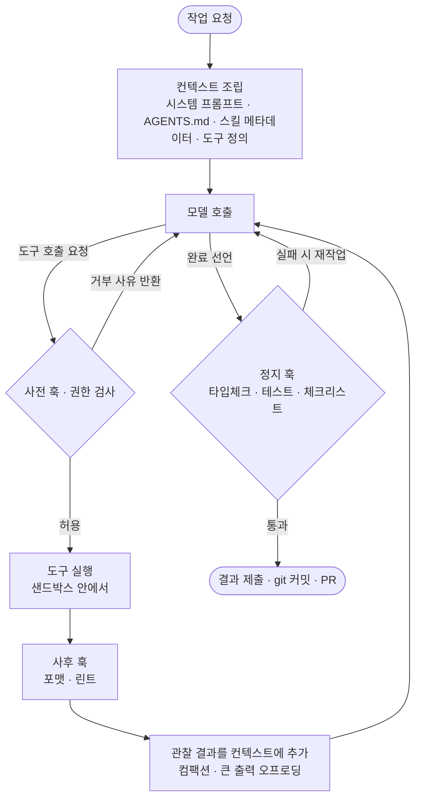
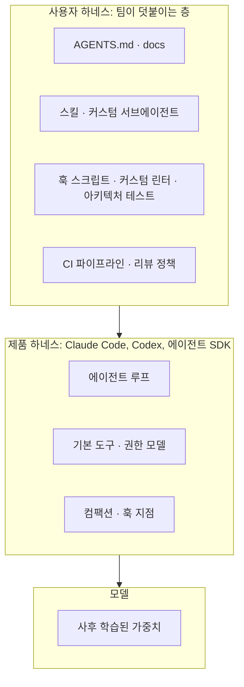
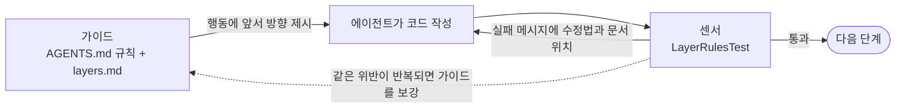

# 2장. 하네스 해부도: 구성 요소와 가이드·센서 프레임

## 학습 목표

- 하네스 구성 요소 8가지 이상을 나열하고 각각이 에이전트 루프의 어느 지점(행동 전, 행동 중, 행동 후)에 개입하는지 표시할 수 있다.
- 주어진 통제 장치(AGENTS.md, ArchUnit, LLM 코드 리뷰, 타입체커, 스킬 등)를 가이드/센서 × 계산적/추론적 2×2에 배치할 수 있다.
- 가이드만 있고 센서가 없거나, 센서만 있고 가이드가 없을 때 생기는 실패 양상을 예로 설명할 수 있다.
- 유지보수성, 아키텍처 적합성, 행위 하네스를 구분하고, 행위 하네스가 왜 아직 미해결 과제인지 설명할 수 있다.

## 도입 사례: 규칙은 있었는데 왜 계속 틀렸을까

1장에서는 "Agent = Model + Harness"라는 공식을 소개하고, 모델을 뺀 나머지 전부를 의도적으로 설계하는 일을 하네스 엔지니어링이라고 정의했습니다. 이 장에서는 하네스 안을 열어 어떤 부품이 어디에 붙어 있는지 살펴봅니다. 먼저 두 팀의 상황을 보겠습니다. 이해를 돕기 위해 꾸민 가상 사례입니다.

**A팀: 규칙만 있는 팀.** A팀의 AGENTS.md는 300줄이 넘습니다. "도메인 레이어는 인프라 레이어를 import하지 않는다", "모든 API 응답은 공통 에러 포맷을 따른다" 같은 규칙이 꼼꼼히 적혀 있습니다. 그런데 에이전트가 만든 PR을 열어 보면 이 규칙을 어긴 코드가 꾸준히 섞여 나옵니다. 위반은 사람이 리뷰하다가 눈으로 발견할 때만 드러납니다. 규칙이 지켜졌는지 확인하는 장치가 없기 때문입니다.

**B팀: 검사만 있는 팀.** B팀은 CI가 탄탄합니다. 린트, 타입체크, 테스트가 촘촘하게 돌아갑니다. 반면 에이전트에게 주는 사전 안내는 거의 없습니다. 에이전트는 매번 같은 린트 규칙에 걸리고, 에러를 보고 고친 뒤 다시 다른 규칙에 걸리기를 반복합니다. 결과물은 결국 통과하지만 그때마다 재시도에 시간과 토큰이 들고, 같은 실수는 다음 세션에서도 그대로 나옵니다.

두 팀 모두 하네스를 갖추긴 했습니다. 다만 한쪽 날개만 달고 있습니다. Thoughtworks의 Birgitta Böckeler는 이 상황을 **가이드(피드포워드)** 와 **센서(피드백)** 라는 말로 설명합니다. 가이드만 있으면 규칙이 지켜졌는지 아무도 확인하지 않고, 센서만 있으면 에이전트는 같은 실수를 되풀이합니다. A팀과 B팀의 문제를 진단하고 고치려면 하네스를 구성 요소 목록이 아니라 **어디에 개입해 무엇을 통제하는가**라는 지도로 볼 수 있어야 합니다. 이 장이 그 지도를 그립니다.

## 에이전트 루프: 하네스가 개입하는 자리

하네스의 부품을 살펴보기 전에, 부품이 붙는 뼈대부터 보겠습니다. 오늘날 코딩 에이전트는 대부분 다음 루프를 반복합니다.

1. **모델 호출**: 지금까지 쌓인 컨텍스트를 모델에 넣고 다음 행동을 고르게 합니다.
2. **도구 실행**: 모델이 파일 읽기, 명령 실행, 코드 수정 같은 도구 호출을 요청하면 하네스가 이를 실제로 실행합니다.
3. **관찰**: 실행 결과(출력, 에러, 테스트 결과)를 컨텍스트에 다시 넣습니다.
4. **반복**: 모델이 완료를 선언할 때까지 1~3을 되풀이합니다.

모델이 직접 하는 일은 1번뿐입니다. 2~4번, 그리고 1번에 무엇을 넣을지 정하는 일은 모두 하네스의 몫입니다. Philipp Schmid는 이를 컴퓨터에 빗대어 **모델은 CPU, 컨텍스트는 RAM, 하네스는 OS, 에이전트는 애플리케이션**이라고 설명합니다. CPU가 아무리 빨라도 OS가 메모리를 엉망으로 관리하고 프로세스를 제멋대로 죽이면 애플리케이션은 제대로 돌지 않습니다. 같은 모델이라도 하네스에 따라 결과가 크게 달라지는 이유가 여기에 있습니다.

아래 다이어그램은 이 루프에 하네스가 개입하는 지점을 표시한 것입니다.



이 그림을 기준으로 개입 지점을 세 가지로 나눕니다.

- **행동 전**: 모델이 첫 행동을 고르기 전에 방향을 잡아 줍니다. 시스템 프롬프트, 지침 파일, 스킬 목록, 도구 정의가 여기에 해당합니다.
- **행동 중**: 도구가 실행되는 순간과 루프가 도는 동안 개입합니다. 위험한 명령을 막는 사전 훅, 샌드박스, 같은 파일을 반복 수정하는지 감지하는 미들웨어, 컨텍스트가 찰 때 동작하는 컴팩션이 그 예입니다.
- **행동 후**: 결과를 검사하고 필요하면 루프로 되돌려 보냅니다. 린트, 테스트, 정지 훅, 리뷰 에이전트, 그리고 실패했을 때 돌아갈 복구 경로가 여기에 속합니다.

이 세 구분은 **언제** 개입하느냐를 나눈 것입니다. 뒤에서 볼 가이드·센서 구분은 **어떤 방식으로** 통제하느냐를 나누는 별개의 축이라는 점을 기억해 두세요.

## 구성 요소 지도

여러 출처가 하네스 구성 요소를 조금씩 다르게 나열합니다. LangChain의 Vivek Trivedy는 파일시스템과 git, bash와 코드 실행, 샌드박스, 메모리(AGENTS.md), 웹 검색, 컨텍스트 관리, 장기 실행 지원을 꼽습니다. Addy Osmani는 프롬프트, 도구, 컨텍스트 정책, 훅, 샌드박스, 서브에이전트, 복구 경로로 정리합니다. 이 교재는 두 목록을 합쳐 다음 10가지를 공통 어휘로 씁니다.

| 구성 요소 | 하는 일 | 주된 개입 지점 | 예시 | 자세히 |
|---|---|---|---|---|
| 시스템 프롬프트 | 에이전트의 역할, 작업 방식, 검증 습관을 정합니다 | 행동 전 | "완료 전에 반드시 테스트를 실행하라" 같은 자기 검증 지시 | 3장 |
| 지침 파일 | 세션마다 자동으로 주입되는 레포 수준 안내입니다 | 행동 전 | AGENTS.md, CLAUDE.md, 디렉터리별 규칙 파일 | 3장 |
| 스킬 | 특정 작업 절차를 묶은 지식 꾸러미입니다. 처음엔 요약만 보이고, 필요할 때 본문을 읽습니다 | 행동 전(필요 시 행동 중) | `skills/add-endpoint/SKILL.md` | 3장 |
| 도구·MCP | 에이전트가 세상에 손을 뻗는 수단입니다. MCP(Model Context Protocol)는 외부 도구를 에이전트에 연결하는 표준 규약입니다 | 행동 중 | bash, 파일 편집, gh CLI, Stripe의 사내 도구 모음 Toolshed처럼 많은 도구 중 작업에 맞는 일부만 골라 붙이는 구성 | 4장 |
| 파일시스템·git | 작업 결과와 진행 상태를 세션 밖에 남기는 저장소입니다 | 행동 중·후 | 진행 파일, JSON 기능 목록, 설명이 담긴 커밋 | 7장 |
| 샌드박스 | 에이전트가 일하는 격리된 작업장입니다 | 행동 중 | 프로덕션과 인터넷에서 분리된 devbox, 컨테이너 | 4장 |
| 훅·미들웨어 | 루프의 특정 시점에 끼워 넣는 결정적 코드입니다 | 행동 중·후 | 위험 명령 거부, 정지 시 타입체크, LoopDetection | 5장 |
| 서브에이전트 | 별도 컨텍스트에서 일부 작업을 처리하고 요약만 돌려줍니다 | 행동 중 | 코드베이스 탐색 전담 서브에이전트 | 6장 |
| 컨텍스트 정책 | 컨텍스트 창에 무엇을 넣고 뺄지 정합니다 | 행동 중 | 컴팩션, 큰 도구 출력 오프로딩, 점진적 공개 | 6장 |
| 복구 경로 | 실패했을 때 돌아갈 길입니다 | 행동 후 | git 이력으로 되돌리기, 재시도 상한, 사람에게 넘기기 | 5·7장 |

표만 보면 추상적이니, 이 구성 요소가 실제 레포에서 어떤 파일로 존재하는지 예를 들어 보겠습니다. Claude Code를 쓰는 TypeScript 프로젝트라고 가정합니다.

```text
my-service/
├── AGENTS.md                    # 지침 파일: 약 60~100줄 목차 (3장)
├── CLAUDE.md                    # AGENTS.md를 가리키는 한 줄짜리 파일로 두기도 함
├── docs/
│   ├── architecture/layers.md   # 지침 파일에서 링크하는 세부 지식
│   └── progress.md              # 장기 작업 진행 기록 (7장)
├── .claude/
│   ├── settings.json            # 훅, 권한 설정 (5장)
│   ├── skills/
│   │   └── add-endpoint/SKILL.md  # 스킬 (3장)
│   └── agents/
│       └── explorer.md          # 탐색 전담 서브에이전트 (6장)
├── .mcp.json                    # 연결할 MCP 서버 목록 (4장)
├── scripts/
│   ├── check.sh                 # 정지 훅이 호출하는 검사 스크립트 (내용은 5장)
│   └── deny-dangerous.sh        # 위험 명령 거부 스크립트 (내용은 5장)
└── .devcontainer/               # 샌드박스 정의 (4장)
```

훅 설정(`.claude/settings.json`)은 예를 들어 다음과 같습니다. 에이전트가 bash 명령을 실행하기 직전(행동 중)과 작업을 끝내려는 순간(행동 후)에 각각 결정적 스크립트를 끼워 넣습니다.

```json
{
  "hooks": {
    "PreToolUse": [
      {
        "matcher": "Bash",
        "hooks": [{ "type": "command", "command": "\"$CLAUDE_PROJECT_DIR\"/scripts/deny-dangerous.sh" }]
      }
    ],
    "Stop": [
      {
        "hooks": [{ "type": "command", "command": "\"$CLAUDE_PROJECT_DIR\"/scripts/check.sh" }]
      }
    ]
  }
}
```

설정할 때 주의할 점이 세 가지 있습니다.

- **경로**: `./scripts/check.sh` 같은 상대 경로는 훅이 실행되는 작업 디렉터리에 따라 파일을 찾지 못할 수 있습니다. 위 예처럼 프로젝트 루트를 가리키는 환경 변수 `$CLAUDE_PROJECT_DIR`를 붙이고, 경로에 공백이 있을 수 있으니 따옴표로 감쌉니다.
- **Windows**: 두 스크립트는 셸 스크립트이므로 Windows에서는 Git Bash나 WSL 같은 bash 환경이 있어야 실행됩니다. JSON에는 주석을 달 수 없으니, 팀 README나 AGENTS.md에 이 전제 조건을 적어 둡니다.
- **종료 코드**: 훅 스크립트가 종료 코드 2로 끝나면 PreToolUse에서는 명령이 차단되고, Stop에서는 종료가 막혀 에이전트가 작업으로 되돌아갑니다. 이때 스크립트가 표준 에러로 출력한 내용이 사유로 전달됩니다.

`check.sh`와 `deny-dangerous.sh`의 실제 내용과 설계 원칙은 5장에서 제공합니다. 여기서는 어느 시점에 무엇이 끼워지는지만 보면 됩니다.

이 레포 구조에서 눈여겨볼 점이 하나 있습니다. **하네스는 대부분 코드와 설정 파일로 레포 안에 남습니다.** 그래서 버전 관리와 리뷰, 공유가 가능한 팀 자산이 됩니다. 10장에서 다룰 하네스 템플릿도 이 성질 덕분에 가능합니다.

### Harness-as-a-Service: 제품 하네스와 사용자 하네스

위 구성 요소를 전부 팀이 직접 만들어야 하는 것은 아닙니다. Claude Code나 Codex 같은 제품, 그리고 각종 에이전트 SDK에는 이미 루프, 기본 도구, 컴팩션, 훅을 거는 지점이 들어 있습니다. 이 교재에서는 하네스의 상당 부분을 제품과 SDK가 기본으로 제공하는 이 흐름을 **Harness-as-a-Service**라고 부르겠습니다. 특정 저자의 정의를 옮긴 것이 아니라, '제품이 기본으로 제공하는 하네스'를 가리키는 이 교재의 작업 용어입니다.

Böckeler가 하네스 엔지니어링의 범위를 "코딩 에이전트 **사용자**가 덧붙이는 바깥 층"으로 좁힌 것도 이 구분과 맞닿아 있습니다. 대부분의 팀이 실제로 손댈 수 있는 곳은 제품 하네스 위에 올리는 층이기 때문입니다.



이 구분에는 실무적인 함의가 두 가지 있습니다. 첫째, 제품 하네스의 동작은 대부분 바꿀 수 없으니, 사용자 하네스는 그 위에서 **빈 곳을 메우는** 방향으로 설계해야 합니다. 둘째, LangChain의 Trivedy에 따르면 제품의 모델은 자기 제품 하네스를 끼운 채로 사후 학습되는 경우가 있어, 도구 구성을 크게 바꾸면 성능이 오히려 떨어질 수 있습니다(하네스 과적합). 이 문제는 9장에서 측정과 함께 다룹니다.

## 가이드와 센서: 피드포워드와 피드백

구성 요소 지도는 "무엇이 있는가"를 보여 줍니다. 그런데 A팀과 B팀의 문제를 진단하려면 "각 부품이 **어떤 방식으로** 통제하는가"를 봐야 합니다. Böckeler는 이를 두 축으로 나눕니다. 첫 번째 축이 가이드와 센서입니다.

- **피드포워드(feedforward)** 는 결과를 보기 **전에** 입력을 조정해 원하는 방향으로 이끄는 제어 방식입니다. 운전으로 치면 출발 전에 내비게이션이 경로를 알려 주는 것입니다. 하네스에서는 이런 장치를 **가이드**라고 부릅니다. 코딩 규약, AGENTS.md, 스킬, 코드모드(codemod, 정해진 규칙대로 코드를 자동 변환하는 도구. 예: OpenRewrite)가 여기에 속합니다.
- **피드백(feedback)** 은 결과를 **관찰한 뒤** 그에 맞춰 다음 행동을 교정하는 제어 방식입니다. 차선을 벗어나면 울리는 경고음에 해당합니다. 하네스에서는 **센서**라고 부릅니다. 테스트, 린터, 타입체커, 구조 테스트(ArchUnit), 리뷰 에이전트가 해당합니다.

여기서 '결과'는 완성된 코드만 뜻하지 않습니다. 모델이 방금 요청한 도구 호출, 같은 파일을 몇 번째 고치고 있는지 같은 루프의 진행 상태도 관찰 대상입니다. 그래서 센서는 행동 후뿐 아니라 **행동 중에도** 동작합니다. 가이드와 센서를 가르는 기준은 시점이 아니라 "관찰한 결과에 반응하는가"입니다.

### 짝이 없을 때 생기는 실패

가이드와 센서는 서로의 약점을 메웁니다. 한쪽만 있을 때 나타나는 실패 양상을 정리하면 다음과 같습니다.

| 상태 | 무슨 일이 생기는가 | 증상 | 흔한 잘못된 대응 |
|---|---|---|---|
| 가이드만 있음 | 규칙이 지켜졌는지 아무도 확인하지 않습니다 | 컨텍스트가 길어지거나 지침이 많아질수록 위반이 늘고, 사람이 리뷰에서 발견합니다 | 지침을 더 길게 쓰거나 "CRITICAL" 같은 강조 문구를 붙입니다. 어느 쪽도 규칙이 지켜졌는지 확인해 주지 않습니다 |
| 센서만 있음 | 에이전트가 무엇을 피해야 하는지 미리 모릅니다 | 같은 검사에 반복해서 걸리고, 재시도 비용이 쌓이고, 다음 세션에서 같은 실수를 또 합니다 | 재시도 횟수를 늘립니다 |
| 둘 다 있고 짝지어짐 | 가이드로 대부분 처음부터 맞게 만들고, 놓친 것은 센서가 잡습니다 | 센서 실패 메시지가 가이드 문서를 가리켜 스스로 고칩니다 | — |

가이드는 있다는 것만으로 효과가 보장되지도 않습니다. Gloaguen 외의 연구는 AGENTS.md 같은 레포 수준 지침 파일이 코딩 에이전트에 실제로 도움이 되는지를 실증적으로 평가했습니다. 이런 질문이 연구 주제가 된다는 사실 자체가, 가이드를 두었으면 그 효과를 확인할 센서도 필요하다는 점을 보여 줍니다. 연구 내용은 3장에서 지침 파일 설계와 함께 자세히 봅니다.

짝을 맞춘다는 것이 구체적으로 어떤 모습인지, A팀의 레이어 규칙으로 예를 들어 보겠습니다. 가이드는 AGENTS.md의 몇 줄과 세부 문서입니다.

```markdown
## 아키텍처
- 의존 방향: api → application → domain ← infrastructure
  - domain은 다른 레이어를 import하지 않습니다.
  - application은 domain만 import합니다(api·infrastructure 금지). 외부 기능은 domain/port 인터페이스로 씁니다.
  - 자세한 내용과 예시: docs/architecture/layers.md
- 검사: `./gradlew test --tests '*LayerRulesTest'`
```

센서는 이 규칙을 기계적으로 검사하는 ArchUnit 테스트입니다. 실패 메시지(`because`)에 **고치는 방법과 가이드 문서 위치**를 담아, 센서가 다시 가이드로 연결되게 합니다. OpenAI가 커스텀 린터의 에러 메시지에 수정 방법을 담은 것과 같은 발상입니다.

```java
import com.tngtech.archunit.junit.AnalyzeClasses;
import com.tngtech.archunit.junit.ArchTest;
import com.tngtech.archunit.lang.ArchRule;

import static com.tngtech.archunit.lang.syntax.ArchRuleDefinition.noClasses;

@AnalyzeClasses(packages = "com.example.shop")
class LayerRulesTest {

    @ArchTest
    static final ArchRule domain_must_not_depend_on_other_layers =
        noClasses().that().resideInAPackage("..domain..")
            .should().dependOnClassesThat()
            .resideInAnyPackage("..api..", "..application..", "..infrastructure..")
            .because("domain은 다른 레이어에 의존하지 않습니다. "
                   + "저장소나 외부 시스템이 필요하면 domain/port에 인터페이스를 선언하고 "
                   + "infrastructure에서 구현하세요. 예시: docs/architecture/layers.md");

    @ArchTest
    static final ArchRule application_must_only_use_domain =
        noClasses().that().resideInAPackage("..application..")
            .should().dependOnClassesThat()
            .resideInAnyPackage("..api..", "..infrastructure..")
            .because("application은 domain만 사용합니다. "
                   + "api의 요청·응답 타입은 application 쪽 명령 객체로 바꿔 받고, "
                   + "infrastructure 기능은 domain/port 인터페이스를 거쳐 쓰세요. "
                   + "예시: docs/architecture/layers.md");
}
```

이 예에서 중요한 점은 **센서의 검사 범위가 가이드와 같다**는 것입니다. 가이드에 의존 방향 전체를 적어 놓고 센서는 domain → infrastructure 하나만 검사한다면, 나머지 방향의 위반은 여전히 '가이드만 있는 상태'로 남습니다. 위 테스트는 가이드에 적은 두 규칙을 그대로 검사합니다. api가 infrastructure를 직접 쓰는지까지 포함해 레이어 전체의 의존 방향을 한 번에 검사하려면 ArchUnit의 `layeredArchitecture()`를 쓸 수 있으며, 5장에서 다룹니다.



점선 화살표에도 주목해 주세요. 센서가 같은 위반을 반복해서 잡는다면, 그것은 가이드가 부족하다는 신호입니다. Mitchell Hashimoto가 말한 "실수 하나에 영구적인 해결책 하나"는 바로 이 순환을 돌리는 일입니다.

## 계산적 통제와 추론적 통제

두 번째 축은 통제가 **무엇으로 실행되는가**입니다.

- **계산적(computational) 통제**는 CPU에서 도는 결정적 검사입니다. 결정적이라는 말은 같은 입력이면 항상 같은 결과가 나온다는 뜻입니다. 테스트, 린트, 타입체크가 대표적입니다.
- **추론적(inferential) 통제**는 LLM이 판단하는 방식입니다. AI 코드 리뷰나 LLM-as-judge(LLM을 채점자로 쓰는 방식)가 여기에 해당합니다.

| 비교 항목 | 계산적 통제 | 추론적 통제 |
|---|---|---|
| 비용 | 거의 들지 않습니다 | 호출마다 토큰 비용이 듭니다 |
| 속도 | 보통 수 초 이내. Stripe는 CI에 앞서 로컬에서 빠른 린트를 돌려 피드백을 앞당깁니다 | 모델 호출을 기다려야 하므로 대개 계산적 통제보다 훨씬 느립니다(모델과 입력 크기에 따라 크게 다름) |
| 결정성 | 같은 입력이면 같은 결과 | 실행할 때마다 결과가 다를 수 있음 |
| 판단 범위 | 규칙으로 표현할 수 있는 것만 | 의도, 가독성, 설계 적절성 같은 의미 수준까지 |
| 적합한 실행 빈도 | 모든 변경, 커밋 전마다 | 중요한 지점에서 선택적으로 |

두 방식은 대체 관계가 아닙니다. 계산적 통제는 싸고 믿을 수 있지만 규칙으로 적을 수 있는 것만 잡습니다. 추론적 통제는 "이 함수 이름이 하는 일을 제대로 설명하는가?" 같은 질문에 답할 수 있지만 비싸고 흔들립니다. 그래서 실무 원칙은 **계산적 센서를 먼저 깔고, 계산적으로 잡을 수 없는 것만 추론적 센서에 맡기는 것**입니다. 배치 전략은 5장에서 자세히 다룹니다.

가이드에도 같은 축이 적용됩니다. AGENTS.md나 스킬은 모델이 읽고 해석해야 효과가 나기 때문에, 이 교재에서는 **추론적 가이드**로 분류합니다. 반면 정해진 코드 골격을 생성하는 스캐폴딩 스크립트나 OpenRewrite 같은 코드모드는 모델의 해석과 상관없이 같은 결과를 만들므로 **계산적 가이드**입니다. 분류 기준을 한 문장으로 정리하면 "통제가 효과를 내는 과정에 LLM의 해석이나 판단이 끼어드는가?"입니다.

## 2×2 매트릭스로 통제 장치 배치하기

두 축을 겹치면 네 칸이 생깁니다. 이 2×2가 3장부터 이어지는 설계 작업의 기본 틀입니다.

| | 계산적 (결정적, 싸고 빠름) | 추론적 (LLM 판단, 의미 수준) |
|---|---|---|
| **가이드** (피드포워드: 행동에 앞서 방향 제시) | 스캐폴딩 스크립트, 서비스 템플릿, 코드모드(OpenRewrite), 언어 서버가 주는 타입 정보 | AGENTS.md/CLAUDE.md, docs/ 지식 베이스, 스킬, 시스템 프롬프트의 작업 지침, 완료 직전 체크리스트 상기(PreCompletionChecklist) |
| **센서** (피드백: 관찰한 결과로 교정, 행동 중·후) | 타입체커, 린터, 단위·통합 테스트, 아키텍처 테스트(ArchUnit, dependency-cruiser), 커스텀 린터, 위험 명령을 거부하는 PreToolUse 훅의 검사, 반복 편집 감지(LoopDetection) | LLM 코드 리뷰, 리뷰 서브에이전트, LLM-as-judge 평가기, Playwright로 앱을 조작하며 판단하는 평가 에이전트 |

가이드/센서 축과 행동 전·중·후 개입 시점은 서로 독립된 축입니다. 예를 들어 `rm -rf`를 거부하는 PreToolUse 훅은 모델이 요청한 명령을 관찰하고 반응하므로 센서이고, 결정적 스크립트로 판정하므로 계산적이며, 도구가 실행되기 직전에 동작하므로 개입 시점은 행동 중입니다. 즉 **행동 중에 동작하는 계산적 센서**입니다. LangChain이 소개한 LoopDetection 미들웨어도 같은 파일을 몇 번 고쳤는지 세어 보고 일정 횟수를 넘으면 접근을 바꿔 보라고 알립니다. 판정이 횟수 세기로 결정적이므로 역시 행동 중 계산적 센서입니다.

배치할 때 헷갈리기 쉬운 경우가 세 가지 있습니다.

**첫째, 훅과 미들웨어는 칸이 아니라 배선입니다.** 훅 자체는 "언제 실행할지"를 정하는 장치이고, 칸은 훅이 **무엇을 실행하느냐**로 정해집니다. 정지 훅이 `tsc --noEmit`을 돌리면 계산적 센서이고, 리뷰 서브에이전트를 부르면 추론적 센서입니다. 특히 헷갈리는 것이 LangChain이 도입한 PreCompletionChecklist입니다. 완료 직전에 끼어들기 때문에 센서로 착각하기 쉽지만, 이 미들웨어는 결과를 검사하지 않고 모델에게 점검 항목을 다시 상기시킵니다. 관찰한 결과에 반응하는 것이 아니라 다음 행동의 방향을 미리 제시하는 피드포워드이므로 **가이드**입니다. 그리고 그 효과가 모델이 체크리스트를 어떻게 해석하고 따르느냐에 달려 있으므로 **추론적**입니다. 개입 시점이 늦다고 해서 센서가 되는 것은 아니라는 좋은 예입니다.

**둘째, 서브에이전트도 역할에 따라 칸이 달라집니다.** 탐색 전담 서브에이전트는 컨텍스트 관리 장치이고(6장), 리뷰 전담 서브에이전트는 추론적 센서입니다.

**셋째, 하나의 규칙이 여러 칸에 걸칠 수 있습니다.** 앞의 레이어 규칙은 추론적 가이드(AGENTS.md)와 계산적 센서(ArchUnit)로 이미 두 칸을 차지합니다. 여기에 "인터페이스 이름이 도메인 언어를 따르는가"처럼 규칙으로 적기 어려운 부분만 리뷰 에이전트(추론적 센서)에 맡기면 세 칸을 쓰게 됩니다. 좋은 하네스는 중요한 규칙일수록 여러 칸에서 겹쳐 지킵니다.

## 규제 대상의 세 범주: 유지보수성, 아키텍처 적합성, 행위

2×2는 통제의 **방식**을 나눕니다. Böckeler는 여기에 통제의 **대상**이라는 관점을 하나 더 얹습니다. 하네스가 무엇을 지키려 하는가에 따라 세 범주로 나눕니다.

| 범주 | 지키려는 것 | 대표 가이드 | 대표 센서 | 성숙도 |
|---|---|---|---|---|
| 유지보수성 하네스 | 코드 스타일, 복잡도, 중복, 죽은 코드, 타입 안전성 | 코딩 규약, 포매터 설정 | 린터, 포매터, 타입체커, 복잡도 측정 | Böckeler에 따르면 현재 가장 쉬움 |
| 아키텍처 적합성 하네스 | 레이어 의존 방향, 모듈 경계, 관측성·성능 같은 구조적 요구 | 아키텍처 문서, 서비스 템플릿 | ArchUnit 같은 구조 테스트, 커스텀 린터 | 도구가 있으나 팀이 규칙을 직접 정의해야 함 |
| 행위 하네스 | 기능이 요구사항대로 올바르게 동작하는가 | 사양서, 완료의 정의, 인수 조건 | 기능 테스트, E2E 테스트, 평가 에이전트 | 미해결 |

OpenAI 사례가 좋은 예입니다. OpenAI는 단방향 레이어 의존을 커스텀 린터로 강제하고 '황금 원칙'과 백그라운드 에이전트로 엔트로피를 관리했습니다. 유지보수성과 아키텍처 적합성 하네스가 매우 두텁습니다. 하지만 Böckeler는 이 글을 읽고 남긴 첫 메모에서, 이 글이 유지보수성 위주이고 **기능과 행위의 검증은 다루지 않았다**고 지적합니다.

### 행위 하네스는 왜 아직 어려운가

행위 하네스가 미해결 과제로 남은 데는 구조적인 이유가 있습니다.

1. **정답 기준이 코드 밖에 있습니다.** 린트 규칙은 코드만 보고 판정할 수 있습니다. 하지만 "할인 쿠폰은 주문당 하나만 적용된다"가 맞는지는 요구사항을 알아야 판정할 수 있고, 요구사항은 자주 모호하거나 문서화되지 않습니다.
2. **센서를 누가 만드는가의 순환 문제가 있습니다.** 에이전트가 코드와 테스트를 함께 만들면, 테스트는 에이전트가 이해한 요구사항을 검증할 뿐입니다. 요구사항을 잘못 이해했다면 코드와 테스트가 함께 틀린 채로 통과합니다. "AI가 만든 테스트를 AI가 만든 코드의 센서로 믿어도 되는가"는 아직 합의된 답이 없는 질문입니다.
3. **센서의 침묵을 해석하기 어렵습니다.** Böckeler는 센서가 울리지 않는 것이 품질이 좋아서인지 탐지력이 약해서인지 어떻게 구분할지를 미해결 질문으로 남겼습니다. 행위 영역에서는 이 문제가 특히 심각합니다.
4. **자기 평가 편향이 있습니다.** Anthropic은 에이전트가 자기 결과물을 후하게 평가하는 경향을 보고했습니다. 같은 에이전트가 만들고 채점하면 행위 센서가 무뎌집니다.

그래서 현재의 대응은 완전한 해결이라기보다 부분적인 보강에 가깝습니다. Anthropic은 Puppeteer로 사람처럼 앱을 조작하는 E2E 검증을 넣자 품질이 크게 올랐다고 보고했지만, 브라우저 네이티브 alert 모달을 볼 수 없는 한계도 함께 밝혔습니다(7장). 또 생성기와 회의적으로 튜닝한 평가기를 분리하고, 코딩 전에 '완료의 정의'를 계약으로 합의하는 방식도 제안했습니다(8장). 행위 센서를 만드는 일은 결국 에이전트 평가(evals)를 설계하는 일과 맞닿아 있습니다. Anthropic은 에이전트 평가를 다룬 글에서 코드 기반 채점기, 모델 기반 채점기, 사람의 판단을 조합해 쓰는 방식을 설명하는데, 이는 이 장의 계산적·추론적 센서 구분과 겹치는 부분이 많습니다. 이런 방법은 행위 하네스를 강화하지만, 사람의 감독을 줄여도 될 만큼 믿을 수 있게 만드는 방법은 아직 열린 질문입니다.

Böckeler가 말하는 좋은 하네스의 목표도 이 맥락에서 읽어야 합니다. 목표는 사람을 빼는 것이 아니라 **사람의 주의를 가장 중요한 곳으로 보내는 것**입니다. 유지보수성과 아키텍처는 하네스가 최대한 걸러 내고, 사람은 행위의 올바름처럼 하네스가 아직 약한 곳에 주의를 쏟는 분업이 현실적인 그림입니다.

> Böckeler는 이 밖에도 Ashby의 필수 다양성 법칙(통제하는 쪽의 다양성이 통제받는 쪽의 다양성을 감당할 수 있어야 한다는 사이버네틱스 원리)을 끌어와, 기술 스택과 서비스 형태를 표준화해 통제할 대상의 다양성을 줄이는 방향을 논의합니다. 하네스 템플릿과 하네스 가능성은 10장에서 다룹니다.

## 이 틀이 이후 장에서 쓰이는 방식

이 장의 지도와 프레임은 이후 장의 설계 작업을 나누는 기준이 됩니다.

| 장 | 2×2와 범주 관점에서 다루는 것 |
|---|---|
| 3장 | 추론적 가이드(AGENTS.md, 스킬, 점진적 공개)를 짧고 근거 있게 설계하기 |
| 4장 | 도구·MCP·샌드박스: 행동 중 개입 지점과 보안 |
| 5장 | 계산적 센서 우선 배치, 백프레셔, 훅이라는 배선 |
| 6장 | 컨텍스트 정책과 서브에이전트: 행동 중 개입 |
| 7장 | 파일시스템·git·복구 경로를 이용한 장기 실행, E2E로 행위 하네스 보강 |
| 8장 | 추론적 센서(평가기)의 분리와 결정적 오케스트레이션 |
| 9장 | 각 칸의 구성 요소가 실제로 효과가 있는지 측정하고 덜어내기 |

## 실습: 현재 하네스 진단표 만들기

1장에서 만든 하네스 인벤토리를 2×2 매트릭스, 세 범주, 개입 시점에 옮겨 비어 있는 칸과 짝이 없는 통제 장치를 찾아냅니다.

### 준비물

- 1장 실습의 하네스 인벤토리. 없다면 지금 사용하는 레포에서 AGENTS.md/CLAUDE.md, 스킬, 훅 설정, CI 설정 파일, 린터·테스트 설정을 훑어 목록을 만듭니다.
- Python 3.8 이상
- 최근 2~4주 동안 에이전트가 저지른 실수 기록(PR 리뷰 코멘트, 실패한 CI 로그 등). 우선순위를 정할 때 근거로 씁니다.

### 단계별 절차

**1단계: 인벤토리를 CSV로 정리합니다.** 각 통제 장치를 한 행으로 쓰고 다섯 가지 속성을 붙입니다.

- `kind`: guide 또는 sensor (기준: 관찰한 결과에 반응하는가)
- `mode`: computational 또는 inferential (기준: LLM의 해석·판단이 끼어드는가)
- `category`: maintainability, architecture, behaviour 중 주된 하나
- `stage`: before, during, after. `kind`와는 따로 판단합니다. 예를 들어 PreToolUse 거부 훅은 sensor이면서 during입니다.
- `pairs_with`: 짝이 되는 반대 종류 장치의 id. 여러 개면 `;`로 구분하고, 없으면 비웁니다.

훅은 훅 자체가 아니라 **훅이 실행하는 검사**를 한 행으로 적습니다. Excel로 편집한다면 저장할 때 파일 형식을 'CSV UTF-8(쉼표로 분리)'로 고릅니다. 그냥 'CSV'로 저장하면 한국어 Windows에서는 CP949로 저장되어 스크립트가 읽지 못합니다. 다음은 TypeScript 서비스를 예로 든 `inventory.csv`입니다.

```csv
id,name,kind,mode,category,stage,pairs_with
G1,AGENTS.md 레이어 규칙,guide,inferential,architecture,before,S2
G2,AGENTS.md 검사 명령 안내,guide,inferential,maintainability,before,S1;S3
G3,스킬: API 엔드포인트 추가 절차,guide,inferential,architecture,before,
G4,AGENTS.md 의존성 추가 정책,guide,inferential,architecture,before,S6
S1,ESLint + Prettier (pre-commit),sensor,computational,maintainability,after,G2
S2,dependency-cruiser 레이어 검사,sensor,computational,architecture,after,G1
S3,tsc 타입체크 (정지 훅),sensor,computational,maintainability,after,G2
S4,LLM 코드 리뷰 봇 (PR),sensor,inferential,maintainability,after,
S5,단위 테스트 (에이전트 작성),sensor,computational,behaviour,after,
S6,PreToolUse 훅: 승인 목록 밖 패키지 설치 거부,sensor,computational,architecture,during,G4
```

**2단계: 진단 스크립트를 실행합니다.** 아래 스크립트를 `harness_diag.py`로 저장합니다. `encoding="utf-8-sig"`는 Excel 등이 파일 앞에 붙이는 BOM(바이트 순서 표시)을 자동으로 걸러 줍니다. BOM이 남아 있으면 첫 열 이름이 `id`로 읽히지 않아 `KeyError`가 납니다.

```python
"""하네스 인벤토리 CSV를 읽어 2x2 배치, 짝 없는 항목, 범주별·개입 시점별 분포를 출력합니다."""
import csv
import sys
from collections import Counter, defaultdict

KINDS = ("guide", "sensor")
MODES = ("computational", "inferential")
CATEGORIES = ("maintainability", "architecture", "behaviour")
STAGES = ("before", "during", "after")


def main(path: str) -> None:
    with open(path, encoding="utf-8-sig", newline="") as f:
        rows = list(csv.DictReader(f))
    by_id = {r["id"]: r for r in rows}

    print("## 2x2 매트릭스")
    cells = defaultdict(list)
    for r in rows:
        cells[(r["kind"], r["mode"])].append(r["name"])
    for kind in KINDS:
        for mode in MODES:
            items = cells[(kind, mode)]
            mark = "" if items else "  <-- 빈 칸"
            print(f"- {kind} x {mode}: {len(items)}개 {', '.join(items)}{mark}")

    print("\n## 짝 없는 항목")
    for r in rows:
        partners = [p.strip() for p in r["pairs_with"].split(";") if p.strip()]
        valid = [p for p in partners if p in by_id and by_id[p]["kind"] != r["kind"]]
        if not valid:
            print(f"- {r['id']} {r['name']} ({r['kind']})")

    print("\n## 범주별 개수")
    cnt = Counter((r["category"], r["kind"]) for r in rows)
    for cat in CATEGORIES:
        print(f"- {cat}: guide {cnt[(cat, 'guide')]} / sensor {cnt[(cat, 'sensor')]}")

    print("\n## 개입 시점별 개수")
    stage_cnt = Counter(r["stage"] for r in rows)
    stage_kind = Counter((r["stage"], r["kind"]) for r in rows)
    for st in STAGES:
        mark = "  <-- 개입 없음" if stage_cnt[st] == 0 else ""
        print(f"- {st}: {stage_cnt[st]}개 "
              f"(guide {stage_kind[(st, 'guide')]} / sensor {stage_kind[(st, 'sensor')]}){mark}")


if __name__ == "__main__":
    main(sys.argv[1])
```

Windows 콘솔에서 한글이 깨지면 `-X utf8` 옵션을 붙입니다.

```bash
python -X utf8 harness_diag.py inventory.csv
```

**3단계: 출력을 읽고 진단표를 작성합니다.** 빈 칸, 짝 없는 항목, 가장 약한 범주, 개입이 비어 있거나 얇은 시점을 진단표에 옮기고, 각 항목에 "왜 비어 있는가"를 한 줄씩 씁니다.

**4단계: 보강 우선순위 3가지를 정합니다.** 다음 순서로 판단합니다.
1. 실수 기록에 **실제로 반복해서 나타난** 문제와 연결된 빈칸인가? (실패에서 출발하기)
2. 계산적 센서로 메울 수 있는가? 그렇다면 추론적 장치보다 먼저 합니다.
3. 이미 있는 가이드에 센서만 붙이면 되는가? 짝 맞추기는 대개 가장 싸게 효과를 냅니다.

### 기대 결과

예시 CSV를 넣으면 다음과 같이 출력됩니다.

```text
## 2x2 매트릭스
- guide x computational: 0개   <-- 빈 칸
- guide x inferential: 4개 AGENTS.md 레이어 규칙, AGENTS.md 검사 명령 안내, 스킬: API 엔드포인트 추가 절차, AGENTS.md 의존성 추가 정책
- sensor x computational: 5개 ESLint + Prettier (pre-commit), dependency-cruiser 레이어 검사, tsc 타입체크 (정지 훅), 단위 테스트 (에이전트 작성), PreToolUse 훅: 승인 목록 밖 패키지 설치 거부
- sensor x inferential: 1개 LLM 코드 리뷰 봇 (PR)

## 짝 없는 항목
- G3 스킬: API 엔드포인트 추가 절차 (guide)
- S4 LLM 코드 리뷰 봇 (PR) (sensor)
- S5 단위 테스트 (에이전트 작성) (sensor)

## 범주별 개수
- maintainability: guide 1 / sensor 3
- architecture: guide 3 / sensor 2
- behaviour: guide 0 / sensor 1

## 개입 시점별 개수
- before: 4개 (guide 4 / sensor 0)
- during: 1개 (guide 0 / sensor 1)
- after: 5개 (guide 0 / sensor 5)
```

이 출력을 바탕으로 작성한 진단표 예시입니다.

```markdown
# 현재 하네스 진단표 (my-service, 2026-11)

## 요약
- 빈 칸: 계산적 가이드 (스캐폴딩·코드모드 없음)
- 짝 없는 가이드: G3 엔드포인트 추가 스킬 → 절차를 지켰는지 검사하는 센서 없음
- 짝 없는 센서: S4 리뷰 봇 → 리뷰 기준 문서가 없어 지적이 매번 달라짐
              S5 단위 테스트 → 무엇이 '올바른 동작'인지 정한 가이드 없음
- 가장 약한 범주: 행위 (가이드 0, 센서는 에이전트가 직접 쓴 단위 테스트뿐)
- 개입 시점: 행동 중 통제는 S6 하나뿐. 반복 편집 감지나 큰 출력 처리는
            제품 하네스의 기본 동작에 기대고 있는지 확인 필요

## 보강 우선순위
1. [행위 / 계산적 센서 + 추론적 가이드] 핵심 사용자 흐름(주문 생성) E2E 테스트 1개와
   인수 조건 문서 추가.
   근거: 최근 3주간 '테스트는 통과했지만 쿠폰 중복 적용' 버그 2건. (7·8장)
2. [아키텍처 / 계산적 센서] G3 스킬에 짝 센서 추가: 에러 응답이 공통 스키마를
   따르는지 검사하는 계약 테스트(또는 커스텀 린트)를 CI와 정지 훅에 연결.
   근거: 새 엔드포인트가 공통 에러 포맷을 어긴 PR 리뷰 코멘트 4건. (5장)
3. [아키텍처 / 계산적 가이드] 공통 에러 응답이 미리 들어간 엔드포인트 스캐폴딩
   스크립트를 작성하고 G3 스킬에서 호출.
   근거: 2번 위반의 대부분이 파일 골격 단계에서 발생. (3장)
```

### 확인 방법

- 2×2의 네 칸 개수를 더한 값과 개입 시점별 개수를 더한 값이 모두 CSV 행 수와 같은지 확인합니다. 다르면 `kind`, `mode`, `stage` 값에 오타가 있는 것입니다.
- 짝 없는 항목마다 "의도적으로 짝이 없는가, 빠뜨렸는가"를 한 줄로 답할 수 있어야 합니다.
- 보강 우선순위 3가지가 각각 실제 실수 기록 하나 이상과 연결되어 있는지, 제안한 센서가 그 실수를 직접 잡을 수 있는지 확인합니다. 근거 없이 "있으면 좋을 것 같은" 항목이 들어갔다면 빼고 다른 후보로 바꿉니다.
- 동료에게 진단표를 보여 주고, 동료가 알고 있는 통제 장치 중 인벤토리에서 빠진 것이 있는지 물어봅니다. 제품 하네스에 숨어 있는 기본 동작(예: 자동 컴팩션)도 이때 드러나는 경우가 많습니다.

## 핵심 정리

- 에이전트 루프는 모델 호출 → 도구 실행 → 관찰 → 반복이며, 모델이 직접 하는 일은 모델 호출뿐입니다. 나머지는 모두 하네스가 담당합니다. Schmid의 비유로는 모델이 CPU, 컨텍스트가 RAM, 하네스가 OS입니다.
- 하네스 구성 요소는 시스템 프롬프트, 지침 파일, 스킬, 도구·MCP, 파일시스템·git, 샌드박스, 훅·미들웨어, 서브에이전트, 컨텍스트 정책, 복구 경로이며, 각각 행동 전·중·후 가운데 개입하는 지점이 다릅니다.
- 제품에 들어 있는 하네스(이 교재의 용어로 Harness-as-a-Service)와 팀이 덧붙이는 사용자 하네스를 구분해야 합니다. 대부분의 팀이 설계할 수 있는 곳은 사용자 하네스입니다.
- 가이드(피드포워드)는 행동에 앞서 방향을 제시하고, 센서(피드백)는 결과를 관찰한 뒤 교정합니다. 이 축은 개입 시점과 독립적이어서, 도구 실행 직전에 명령을 거부하는 PreToolUse 훅은 행동 중에 동작하는 계산적 센서입니다.
- 가이드와 센서는 반드시 짝지어야 하고, 센서의 검사 범위는 가이드에 적은 규칙과 같아야 합니다. 센서의 실패 메시지가 가이드를 가리키도록 만들면 순환이 완성됩니다.
- 계산적 통제는 싸고 빠르고 결정적이며, 추론적 통제는 의미 수준까지 판단하지만 비싸고 결과가 흔들립니다. 계산적 센서를 먼저 깔고 나머지만 추론적 통제에 맡깁니다.
- 훅과 미들웨어는 2×2의 칸이 아니라 배선입니다. 칸은 훅이 무엇을 실행하느냐로 정해집니다.
- 규제 대상은 유지보수성, 아키텍처 적합성, 행위의 세 범주로 나뉩니다. 행위 하네스는 정답 기준이 코드 밖에 있고 AI가 만든 테스트를 믿을 수 있는지가 불분명해 아직 미해결 과제입니다.

## 확인 문제

**문제 1.** 다음 통제 장치를 가이드/센서 × 계산적/추론적 2×2에 배치하세요: ① AGENTS.md ② ArchUnit 테스트 ③ PR에 달리는 LLM 코드 리뷰 ④ 타입체커 ⑤ 스킬 ⑥ OpenRewrite 레시피

<details><summary>정답</summary>

- 추론적 가이드: ① AGENTS.md, ⑤ 스킬
- 계산적 가이드: ⑥ OpenRewrite 레시피
- 계산적 센서: ② ArchUnit 테스트, ④ 타입체커
- 추론적 센서: ③ LLM 코드 리뷰

해설: AGENTS.md와 스킬은 모델이 읽고 해석해야 효과가 나므로 추론적 가이드입니다. OpenRewrite는 정해진 규칙으로 코드를 결정적으로 변환해 에이전트가 따라야 할 형태를 미리 만들어 주므로 계산적 가이드입니다. ArchUnit과 타입체커는 결과를 결정적으로 검사하는 계산적 센서이고, LLM 코드 리뷰는 결과를 LLM이 판단하는 추론적 센서입니다.
</details>

**문제 2.** 다음 장치가 에이전트 루프의 어느 지점(행동 전, 행동 중, 행동 후)에 개입하는지 쓰세요: ① `rm -rf`를 막는 PreToolUse 훅 ② 세션 시작 시 주입되는 CLAUDE.md ③ 작업 종료 시 타입체크를 돌리는 정지 훅 ④ 컨텍스트가 일정 비율을 넘으면 동작하는 컴팩션. 그리고 ①과 ③이 2×2의 어느 칸에 속하는지도 쓰세요.

<details><summary>정답</summary>

개입 시점: ① 행동 중 ② 행동 전 ③ 행동 후 ④ 행동 중
2×2: ①과 ③ 모두 계산적 센서

해설: PreToolUse 훅은 도구가 실행되기 직전, 루프가 도는 도중에 개입합니다. CLAUDE.md는 모델이 첫 행동을 고르기 전에 컨텍스트에 들어갑니다. 정지 훅은 에이전트가 완료를 선언한 뒤 결과를 검사하고, 실패하면 루프로 되돌립니다. 컴팩션은 루프가 진행되는 동안 컨텍스트를 관리합니다. ①은 모델이 요청한 명령을 관찰해 결정적 스크립트로 거부하고, ③은 작성된 코드를 타입체커로 결정적으로 검사하므로 둘 다 계산적 센서입니다. 개입 시점은 달라도 같은 칸에 들어간다는 점에서, 가이드/센서 축과 개입 시점이 서로 독립된 축임을 알 수 있습니다.
</details>

**문제 3.** 어떤 팀의 AGENTS.md에는 "모든 외부 API 호출에는 타임아웃을 설정한다"는 규칙이 있습니다. 하지만 에이전트가 만든 코드에서 타임아웃 누락이 계속 발견되고, 팀은 규칙 앞에 "CRITICAL:"을 붙이려고 합니다. 이 상태를 진단하고 더 나은 대응을 제안하세요.

<details><summary>정답</summary>

가이드만 있고 센서가 없는 상태입니다. 규칙이 지켜졌는지 확인하는 장치가 없어 위반이 사람의 리뷰에서만 드러납니다. 강조 문구를 붙이면 지침을 더 세게 말할 뿐, 지켜졌는지는 여전히 아무도 확인하지 않으므로 근본 대응이 아닙니다. 더 나은 대응은 계산적 센서를 짝지어 주는 것입니다. 예를 들어 HTTP 클라이언트를 만들 때 타임아웃 인자가 없으면 실패하는 커스텀 린트 규칙을 만들고, 실패 메시지에 올바른 사용 예시와 AGENTS.md의 해당 문서 위치를 담습니다. 이 린트를 정지 훅이나 pre-commit에 연결하면 에이전트가 스스로 고칠 수 있습니다.
</details>

**문제 4.** 반대로 CI 린트가 촘촘하지만 사전 안내가 없는 팀에서는 어떤 실패 양상이 나타나나요? 그리고 가장 싸게 개선하는 방법은 무엇인가요?

<details><summary>정답</summary>

센서만 있고 가이드가 없는 상태입니다. 에이전트는 무엇을 피해야 하는지 미리 모르므로 같은 린트 규칙에 반복해서 걸리고, 재시도마다 시간과 토큰을 쓰며, 다음 세션에서도 같은 실수를 되풀이합니다. 가장 싼 개선은 자주 걸리는 규칙을 실패 기록에서 골라 AGENTS.md에 짧게 적고, 린트 실행 명령을 안내하는 것입니다. 모든 규칙을 옮겨 적을 필요는 없습니다. 실제로 반복된 실패만 가이드로 올리면 됩니다.
</details>

**문제 5.** 행위 하네스가 유지보수성 하네스보다 어려운 이유를 두 가지 이상 설명하세요.

<details><summary>정답</summary>

첫째, 정답 기준이 코드 밖(요구사항)에 있어서 코드만 보고 판정할 수 없습니다. 요구사항은 모호하거나 문서화되지 않은 경우가 많습니다. 둘째, 에이전트가 코드와 테스트를 함께 만들면 테스트가 에이전트의 잘못된 이해를 그대로 검증할 수 있어, AI가 만든 테스트를 센서로 믿을 수 있는지가 불분명합니다. 셋째, 센서가 울리지 않는 것이 품질이 좋아서인지 탐지력이 약해서인지 구분하기 어렵습니다. 넷째, 에이전트는 자기 결과물을 후하게 평가하는 경향이 있습니다. 반면 유지보수성은 린터·포매터·타입체커처럼 코드만 보고 결정적으로 판정하는 도구가 이미 풍부합니다.
</details>

**문제 6.** 팀이 Claude Code를 도입하면서 "컨텍스트 컴팩션 방식부터 우리 식으로 바꾸자"고 제안했습니다. Harness-as-a-Service와 사용자 하네스의 관점에서 이 제안을 검토하세요.

<details><summary>정답</summary>

컴팩션은 제품 하네스에 이미 들어 있는 기능이고, 사용자가 바꿀 수 있는 범위가 제한적입니다. 또 제품의 모델은 자기 제품 하네스로 사후 학습되는 경우가 있어, 기본 동작을 크게 바꾸면 하네스 과적합 때문에 성능이 오히려 떨어질 수 있습니다. 따라서 사용자 하네스 층에서 빈칸을 메우는 일이 먼저입니다. 가이드와 센서의 짝 맞추기, 계산적 센서 추가가 그 예입니다. 제품 하네스의 기본 동작을 바꿀지는 실제 실패 기록과 측정(9장)을 근거로 결정해야 합니다.
</details>

## 참고 자료

- Birgitta Böckeler, "Harness engineering for coding agent users", martinfowler.com, 2026-04-02. https://martinfowler.com/articles/harness-engineering.html
- Birgitta Böckeler, "Harness Engineering - first thoughts", martinfowler.com, 2026-02-17. https://www.martinfowler.com/articles/exploring-gen-ai/harness-engineering-memo.html
- Vivek Trivedy, "The Anatomy of an Agent Harness", LangChain Blog, 2026-03-10. https://www.langchain.com/blog/the-anatomy-of-an-agent-harness
- Vivek Trivedy, "Improving Deep Agents with harness engineering", LangChain Blog, 2026-02-17. https://www.langchain.com/blog/improving-deep-agents-with-harness-engineering
- Philipp Schmid, "The importance of Agent Harness in 2026", 2026-01-05. https://www.philschmid.de/agent-harness-2026
- Addy Osmani, "Agent Harness Engineering", 2026-04-19. https://addyosmani.com/blog/agent-harness-engineering/
- Mitchell Hashimoto, "My AI Adoption Journey", 2026-02-05. https://mitchellh.com/writing/my-ai-adoption-journey
- Anthropic Engineering, "Effective harnesses for long-running agents", 2025-11-26. https://www.anthropic.com/engineering/effective-harnesses-for-long-running-agents
- Anthropic Engineering, "Harness design for long-running application development", 2026-03-24. https://www.anthropic.com/engineering/harness-design-long-running-apps
- Anthropic Engineering, "Demystifying evals for AI agents", 2026-01-09. https://www.anthropic.com/engineering/demystifying-evals-for-ai-agents
- Alistair Gray, "Minions: Stripe's one-shot, end-to-end coding agents", Stripe Dot Dev Blog, 2026-02-09. https://stripe.dev/blog/minions-stripes-one-shot-end-to-end-coding-agents
- OpenAI, "Harness Engineering: Leveraging Codex in an Agent-First World" (2차 사본 페이지). https://ericfode.github.io/agent-harness-wiki/raw/articles/openai-harness-engineering
- Gloaguen 외, "Evaluating AGENTS.md: Are Repository-Level Context Files Helpful for Coding Agents?", arXiv:2602.11988. https://arxiv.org/abs/2602.11988
