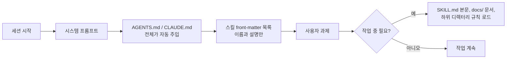
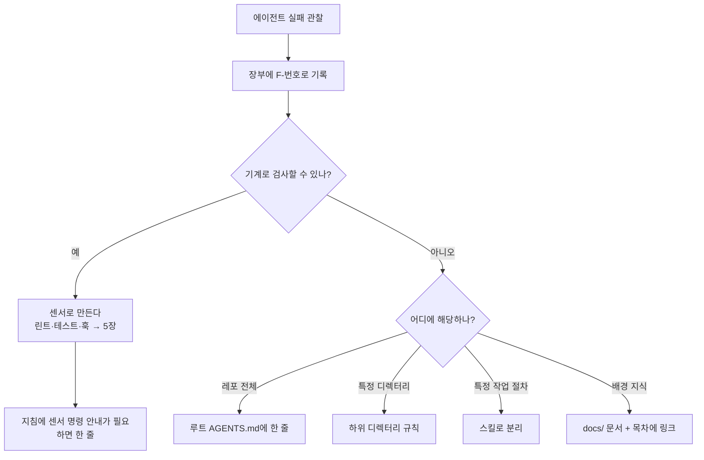
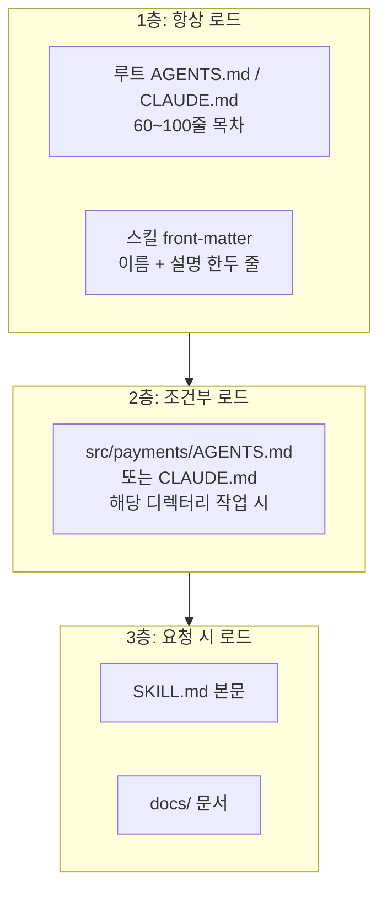

# 3장. 가이드 설계: AGENTS.md, 스킬, 점진적 공개

## 학습 목표

- 60~100줄 이내의 목차형 AGENTS.md를 작성하고, 각 줄이 어떤 실패나 제약에서 나왔는지 주석으로 추적할 수 있다.
- 레포 개요처럼 효과가 입증되지 않은 내용과 비표준 관행·자주 틀리는 명령처럼 꼭 필요한 내용을 구분해 지침을 줄일 수 있다.
- 스킬(front-matter + SKILL.md)과 디렉터리별 규칙으로 점진적 공개 구조를 설계할 수 있다.
- 'CRITICAL' 같은 강조 표현에 기대는 프롬프트의 한계를 설명하고, 센서로 바꿔야 할 지침을 골라낼 수 있다.
- ETH Zurich 연구 결과와 실무자의 체감 사이의 차이를 설명하고, 지침 파일을 넣기 전후를 비교 측정할 계획을 세울 수 있다.

## 왜 필요한가: 600줄짜리 지침 파일이 불러온 일

다음은 여러 팀에서 흔히 겪는 상황을 하나로 묶은 가상의 사례입니다.

결제 서비스를 맡은 한 팀이 코딩 에이전트를 도입했습니다. 첫 주에 에이전트는 `npm install`을 실행해 `pnpm-lock.yaml`과 충돌하는 lockfile을 만들었고, 금액을 `number`로 계산하다 소수점 오차를 냈으며, 8분이 걸리는 전체 테스트를 매번 돌렸습니다. 팀은 에이전트에게 "이 레포를 분석해 AGENTS.md를 만들어 줘"라고 시켰습니다. 그렇게 나온 600줄짜리 파일에는 디렉터리 트리, 기술 스택 소개, 모듈별 설명, 코딩 스타일 일반론이 빼곡했습니다. 팀원들은 중요한 규칙 앞에 "CRITICAL", "절대로" 같은 말을 덧붙였습니다.

한 달 뒤 결과는 기대와 달랐습니다. 토큰 비용은 눈에 띄게 늘었는데 `npm install` 사고는 가끔씩 계속 났습니다. 어떤 줄이 효과가 있었고 어떤 줄이 쓸모없었는지는 아무도 몰랐습니다. 파일이 길어져 사람도 읽지 않게 됐고, 서로 모순되는 규칙도 생겼습니다.

이 사례에는 이 장에서 다룰 질문이 모두 들어 있습니다.

- 지침 파일은 실제로 어떻게 에이전트에게 전달되고, 한 줄 한 줄에 어떤 비용이 붙는가?
- 무엇을 지침에 쓰고 무엇을 빼야 하는가?
- 세부 지식은 어디에 두었다가 언제 보여 줘야 하는가?
- 강조만으로는 지켜지지 않는 규칙을 어떻게 다뤄야 하는가?
- 지침 파일이 효과가 있었는지 어떻게 확인하는가?

2장에서 하네스를 가이드(피드포워드, 행동 전에 방향을 잡아 주는 장치)와 센서(피드백, 행동 뒤에 결과를 확인하는 장치)로 나눴습니다. 이 장은 그중 가이드를 다룹니다. 센서는 5장에서 자세히 다룹니다.

## 지침 파일의 동작 방식: 세션마다 자동으로 주입된다

AGENTS.md나 CLAUDE.md 같은 **에이전트 지침 파일**은 레포 수준의 지침 파일입니다. 세션이 시작될 때마다 컨텍스트(모델이 한 번에 보는 입력 전체)에 자동으로 들어갑니다. 에이전트가 이 파일을 "참고 문서로 찾아 읽는" 것이 아닙니다. 모든 대화의 앞부분에 **항상 붙어 있는 텍스트**에 가깝습니다.



이 동작 방식에서 설계 원칙 두 가지가 나옵니다.

1. **모든 줄은 모든 세션에서 비용을 냅니다.** 지침 파일의 한 줄은 그 줄과 상관없는 과제에서도 토큰을 쓰고, 모델의 주의를 나눠 가집니다.
2. **지시 여력(instruction budget)은 한정돼 있습니다.** 모델이 한 번에 신경 써서 따를 수 있는 지시의 양에는 한계가 있다고 보는 관점입니다. 이 여력을 레포 소개처럼 행동을 바꾸지 않는 문장에 쓰면, 정말 지켜야 할 규칙이 묻힙니다. 이것은 HumanLayer 같은 실무자들이 쓰는 관점입니다. 정량적으로 입증된 한계라기보다 설계 휴리스틱(경험에서 나온 판단 기준)으로 받아들이면 됩니다.

그래서 가이드 설계의 핵심 질문은 "무엇을 더 알려 줄까"가 아니라 "**이 지식을 언제, 어디서 보여 줄까**"입니다. 항상 보여 줄 것, 특정 디렉터리에서만 보여 줄 것, 필요할 때 꺼내 볼 것을 나누는 일이 이 장의 중심입니다.

## 지침은 많을수록 좋은가: ETH Zurich 연구와 실무자의 체감

### 연구가 보여 준 것

ETH Zurich와 LogicStar.ai 연구진(Gloaguen 외)은 "Evaluating AGENTS.md: Are Repository-Level Context Files Helpful for Coding Agents?"(arXiv:2602.11988)에서 레포 수준 컨텍스트 파일의 효과를 측정했습니다. SWE-bench 과제와, 개발자가 컨텍스트 파일을 직접 커밋한 레포의 이슈를 대상으로 삼았습니다. 연구가 보고한 내용은 다음과 같습니다.

| 관찰 | 내용 |
|---|---|
| 성공률 | 컨텍스트 파일을 넣어도 과제 성공률 개선은 제한적이었다 |
| 생성 방식별 비교 | LLM이 생성한 파일은 성공률을 오히려 약간 낮추는 경향을 보였고, 개발자가 직접 써서 커밋한 파일은 소폭 개선하는 경향을 보였다. 어느 쪽이든 변화 폭은 크지 않았다 |
| 비용 | 추론 비용이 평균 20% 넘게 늘었다 |
| 지시 준수 | 에이전트는 지침을 잘 따랐다 |
| 레포 개요 | 레포 개요(overview)는 도움이 되지 않았다 |
| 권고 | 비표준 관행처럼 꼭 필요한 요구사항만 적고, 배포 전에 엄밀하게 평가하라 |

'지시 준수' 줄이 특히 중요합니다. 에이전트가 지침을 무시해서 효과가 없었던 것이 아닙니다. **지침을 따랐는데도 성공률이 크게 오르지 않았습니다.** 그렇다면 문제는 지침의 내용에 있다고 볼 수 있습니다. 에이전트가 이미 코드를 읽어서 알아낼 수 있는 정보(디렉터리 구조, 사용 기술)를 다시 알려 주면 비용만 늘고 행동은 거의 바뀌지 않습니다.

### 실무자의 체감과 왜 다를까

반면 Mitchell Hashimoto, OpenAI Codex 팀, HumanLayer 같은 실무자들은 지침 파일이 하네스의 핵심 장치라고 말합니다. 어떤 내용이 실제로 도움이 되는지에는 아직 합의가 없습니다. 두 관점의 차이는 다음과 같은 가설로 설명해 볼 수 있습니다. 모두 검증된 결론이 아니라 측정으로 확인해야 할 가설입니다.

| 가설 | 설명 |
|---|---|
| 내용의 차이 | 실무자가 효과를 본 것은 파일 전체가 아니라 "이 명령을 써라" 같은 몇 줄일 수 있다 |
| 과제의 차이 | 벤치마크 이슈와 팀의 일상 업무는 성격이 다르다. 팀 고유 관행이 많은 레포일수록 효과가 클 수 있다 |
| 기억의 편향 | 지침 덕분에 성공한 사례는 기억에 남고, 늘어난 비용은 잘 보이지 않는다 |
| 작성 방식 | 실패에서 출발해 손으로 쓴 짧은 파일과 일반적인 장문 파일은 효과가 다를 수 있다 |

'작성 방식' 가설은 연구 결과와 바로 이어집니다. 연구에서 LLM 생성 파일과 개발자 작성 파일은 **효과의 방향이 달랐습니다**(전자는 약간 하락, 후자는 소폭 개선). 누가 어떻게 썼는지가 결과를 가를 수 있다는 신호입니다. 다만 개발자 작성 파일의 개선 폭도 작았고, 연구의 '개발자 작성 파일'이 곧 이 장에서 권하는 '실패에서 출발한 짧은 목차형 파일'은 아닙니다. 그래서 이 장의 실습에서는 (b) 자동 생성 장문과 (c) 손으로 쓴 목차형을 여러분의 레포에서 직접 비교해 이 가설을 확인합니다.

이 장의 결론은 "지침 파일을 쓰지 마라"가 아닙니다. **지침 파일도 하네스 구성 요소이므로 측정해서 검증하라**는 것입니다. 측정 계획은 이 장 뒤쪽에서 세우고 실습에서 실행합니다. 평가 하네스를 본격적으로 만드는 일은 9장에서 다룹니다.

### 넣을 것과 뺄 것

| 구분 | 예 | 판단 |
|---|---|---|
| 넣는다 | 표준과 다른 관행(금액은 정수 최소 단위) | 코드만 봐서는 알기 어렵고, 틀리면 결함이 된다 |
| 넣는다 | 자주 틀리는 명령(`npm` 대신 `pnpm`, 특정 테스트 실행법) | 에이전트가 실제로 반복해 틀렸다 |
| 넣는다 | 완료 조건(어떤 검사가 통과해야 끝인지) | 조기 완료 선언을 줄인다 |
| 넣는다 | 세부 문서의 위치(목차) | 필요할 때 찾아가게 한다 |
| 뺀다 | 레포 개요, 디렉터리 트리 | 연구에서 도움이 되지 않았고, 코드에서 알아낼 수 있다 |
| 뺀다 | "깨끗한 코드를 써라" 같은 일반론 | 모델이 이미 아는 내용이며 행동을 바꾸지 않는다 |
| 뺀다 | 특정 모듈에서만 필요한 상세 절차 | 디렉터리 규칙이나 스킬로 옮긴다 |
| 센서로 옮긴다 | "domain에서 infra를 import하지 마라" | 기계로 검사할 수 있으면 린트로 강제한다 |

## 목차형 AGENTS.md: 짧게, 손으로, 근거와 함께

### 두 가지 기준점: OpenAI의 100줄, HumanLayer의 60줄

OpenAI Codex 팀은 사람이 코드를 직접 쓰지 않고 약 5개월 동안 약 100만 줄 규모의 제품을 만들면서 AGENTS.md를 **약 100줄짜리 목차**로 유지했습니다. 실제 지식은 `docs/`에 두었습니다. 설계 문서, 실행 계획, 기술 부채 추적 같은 문서입니다. 이 팀은 **레포에 없는 지식은 존재하지 않는 것**으로 봤습니다. 슬랙 대화나 누군가의 머릿속에 있는 결정은 에이전트가 볼 수 없으므로, 에이전트에게 필요한 지식은 모두 레포 안의 문서로 남겨야 한다는 뜻입니다.

HumanLayer는 더 엄격합니다. AGENTS.md를 **60줄 미만으로, 직접 손으로** 쓰라고 권합니다. 에이전트가 자동 생성한 지침 파일은 길고 일반적이며, 왜 그 줄이 있는지 아무도 설명하지 못하기 때문입니다.

두 기준을 합치면 이 장의 목표치는 **60~100줄 이내의 목차형 파일**입니다. 목차형이란 파일이 지식을 직접 담기보다, 꼭 지켜야 할 몇 가지 규칙과 "더 알고 싶으면 어디를 보라"는 안내로 이루어진다는 뜻입니다.

### 근거 추적: 모든 규칙 줄에 출처를 단다

Addy Osmani는 AGENTS.md의 모든 줄이 **과거의 실패나 확실한 제약으로 거슬러 추적**할 수 있어야 한다고 말합니다. 실무에서는 짧은 태그와 별도의 근거 장부(ledger)를 함께 쓰는 방식이 관리하기 쉽습니다. 근거를 파일 안에 길게 쓰면 그 문장도 매 세션 토큰을 쓰기 때문입니다.

- `F-번호`: 실제로 관찰한 실패(Failure)
- `C-번호`: 실패 전에도 확실한 제약(Constraint). 예를 들어 규제 요건이나 완료 조건

**예외가 하나 있습니다.** '더 읽을 곳' 절의 목차(링크) 줄은 에이전트의 행동을 직접 지시하는 규칙이 아니라 문서 위치를 알려 주는 안내이므로 태그를 달지 않습니다. 태그는 규칙 줄, 즉 '더 읽을 곳' 앞의 `- `로 시작하는 줄에 모두 답니다.

아래는 앞의 결제 서비스 사례에 맞춰 다시 쓴 AGENTS.md입니다. 빈 줄을 포함해 30줄 남짓입니다.

```markdown
# AGENTS.md — billing-service

<!-- 규칙: 이 파일은 60줄 이하. 줄을 추가하려면 docs/harness/ledger.md에 근거를 먼저 남긴다. -->
<!-- '더 읽을 곳' 앞의 규칙 줄에는 모두 F/C 태그를 단다. 목차 링크 줄은 태그를 달지 않는다. -->

## 명령 (반드시 이 명령을 쓴다)
- 의존성 설치: `pnpm install` — npm, yarn은 쓰지 않는다 <!-- F-003 -->
- 단위 테스트: `pnpm test:unit -- <변경한 파일 경로>` — 전체 테스트(`pnpm test`)는 8분 걸리므로 마지막에 한 번만 <!-- F-007 -->
- 타입체크: `pnpm typecheck` — 완료 전에 반드시 통과시킨다 <!-- C-001 -->
- 마이그레이션 생성: `pnpm db:gen <이름>` — `prisma migrate dev`를 직접 부르지 않는다 <!-- F-011 -->

## 이 레포의 비표준 관행
- 금액은 `Money` 타입(정수, 최소 화폐 단위)으로만 다룬다. `number`로 계산하지 않는다 <!-- F-002 -->
- 현재 시각은 `src/shared/clock.ts`의 `now()`로만 얻는다 <!-- F-009 -->
- 외부 PG사 호출은 `src/payments/gateway/` 안에서만 한다 <!-- C-002 -->

## 작업 방식
- 기능 하나를 끝낸 뒤 다음으로 넘어간다. 여러 기능을 섞어 커밋하지 않는다 <!-- F-014 -->
- 확신이 없는 도메인 용어는 추측하지 말고 docs/domain/glossary.md를 연다 <!-- F-005 -->

## 완료 조건
- `pnpm typecheck`와 변경 범위의 `pnpm test:unit`이 통과해야 완료로 본다 <!-- C-001 -->
- 실패한 검사가 있으면 완료를 선언하지 말고 원인을 보고한다 <!-- F-012 -->

## 더 읽을 곳 (필요할 때만 연다)
- 레이어 구조와 의존 방향: docs/architecture.md
- 결제 도메인 용어: docs/domain/glossary.md
- 진행 중인 실행 계획: docs/plans/
- 알려진 기술 부채: docs/tech-debt.md
- DB 스키마 변경 절차: 스킬 `db-migration`
```

근거 장부는 사람이 읽는 문서입니다. 에이전트가 매 세션 읽을 필요는 없습니다. 아래는 장부의 **발췌**입니다. F-005, F-009, F-012, F-014, C-002 같은 나머지 항목은 지면상 생략했습니다.

```markdown
<!-- docs/harness/ledger.md (발췌) -->
| ID | 날짜 | 관찰한 일 | 대응 | 센서로 전환? |
|---|---|---|---|---|
| C-001 | 2026-09-01 | 팀 합의된 완료 조건 | 완료 조건·타입체크 명시 | 정지 훅(5장) |
| F-002 | 2026-09-02 | 0.1+0.2 오차로 정산 테스트 실패 | Money 타입 규칙 | 검토 중(린트 가능) |
| F-003 | 2026-09-03 | npm install로 package-lock.json 생성 | pnpm 명시 | 일부: preinstall 훅 + package-lock.json 검사 |
| F-007 | 2026-09-05 | 매 수정마다 전체 테스트로 세션 시간 초과 | 부분 테스트 명령 | 아니오 |
| F-011 | 2026-09-10 | migrate dev가 로컬 DB 초기화 | db:gen 명시 | 아니오 |
```

`센서로 전환?` 열이 중요합니다. F-003에는 이제 센서가 두 겹 생겼습니다. 하나는 npm 설치를 실패로 끝내 알려 주는 `preinstall` 훅이고, 다른 하나는 `package-lock.json`이 있는지 보는 검사입니다. 그러니 다음 정리 때 지침에서 이 줄을 빼도 되는지 실험해 볼 수 있습니다.

### docs/ 지식 베이스의 구조

목차가 가리키는 곳에는 실제 문서가 있어야 합니다. 링크만 있고 문서가 없으면 에이전트는 빈 곳을 찾아 헤매며 토큰을 씁니다. 다음은 OpenAI가 공개한 문서 종류(설계 문서, 실행 계획, 기술 부채 추적)를 참고해 구성한 예입니다.

```text
docs/
├── architecture.md        # 레이어와 의존 방향, 결정 이유
├── domain/
│   └── glossary.md        # 정산, 승인, 매입 같은 도메인 용어
├── plans/                 # 진행 중인 실행 계획 (7장의 진행 아티팩트와 연결)
│   └── 2026-11-refund-v2.md
├── tech-debt.md           # 알고 있지만 아직 고치지 않은 것
└── harness/
    └── ledger.md          # 지침 각 줄의 근거 장부
```

## Hashimoto 방식: 실수 하나에 지침 한 줄

Mitchell Hashimoto는 AI 도입 6단계 중 5단계를 "Engineer the Harness"라고 불렀습니다. 에이전트가 실수하면, 그 실수가 다시 나오지 않도록 해결책을 만든다는 뜻입니다. 해결책은 두 가지 형태입니다. AGENTS.md에 지침을 추가하는 것(그의 Ghostty 프로젝트 사례)과, 스크린샷이나 필터링된 테스트 실행 같은 검증 도구를 직접 만드는 것입니다.

이 방식은 HumanLayer가 경고한 안티패턴, 즉 **실패를 겪기 전에 이상적인 하네스부터 설계하는 것**의 반대편에 있습니다. 실패가 들어오면 다음 흐름으로 처리합니다.



이 흐름에서 지침 한 줄은 가장 먼저 고르는 수단이 아닙니다. 다른 수단이 맞지 않을 때 남는 **선택지(최후 수단)**에 가깝습니다. 기계로 검사할 수 있는 규칙이면 센서가 더 확실하고, 범위가 좁은 규칙이면 루트 파일보다 하위 규칙이 지시 여력을 덜 씁니다.

## 점진적 공개: 지시 여력을 아끼는 구조

**점진적 공개(progressive disclosure)**는 모든 지침과 도구 정의를 처음부터 넣지 않고, 필요할 때만 불러오는 설계입니다. 사람에게 새 프로젝트를 설명할 때 첫날 위키 전체를 읽히지 않고 "자주 쓰는 명령은 이거고, 결제 쪽 일을 하게 되면 이 문서를 보세요"라고 말하는 것과 같습니다.



### 스킬: front-matter와 SKILL.md

**스킬**은 특정 작업 절차를 묶어 둔 단위입니다. 처음에는 front-matter(파일 맨 위의 메타데이터 블록)만 컨텍스트에 올라가고, 에이전트가 그 스킬이 필요하다고 판단해 활성화하면 SKILL.md 본문을 읽습니다. 그래서 front-matter의 `description`은 "언제 이 스킬을 써야 하는지"를 에이전트가 판단할 수 있게 써야 합니다.

아래는 Claude Code의 스킬 형식(`.claude/skills/<이름>/SKILL.md`)을 따른 예입니다. 디렉터리 위치와 필드는 도구마다 다를 수 있으니 사용하는 도구의 문서를 확인하세요.

```markdown
---
name: db-migration
description: Prisma 스키마를 바꾸거나 DB 마이그레이션을 만들 때 사용한다. 컬럼 추가·삭제, 인덱스 변경, 데이터 백필이 해당된다.
---

# DB 마이그레이션 절차

1. `prisma/schema.prisma`를 수정한다.
2. `pnpm db:gen <변경_요약_snake_case>`로 마이그레이션을 만든다.
   - `prisma migrate dev`는 로컬 DB를 초기화하므로 쓰지 않는다.
3. 생성된 SQL을 열어 다음을 확인한다.
   - NOT NULL 컬럼 추가 시 DEFAULT가 있는가
   - 대용량 테이블(`payments`, `ledger_entries`) 인덱스는 `CONCURRENTLY`인가
4. 데이터 백필이 필요하면 마이그레이션에 넣지 말고 `scripts/backfill/`에 별도 스크립트로 만든다.
5. `pnpm test:unit -- src/db`를 실행한다.

참고: 스키마 설계 원칙은 docs/architecture.md의 "영속성" 절.
```

이 스킬이 없을 때는 5단계 절차가 모든 세션의 루트 지침에 들어가야 했습니다. 이제 루트 파일에는 "DB 스키마 변경 절차: 스킬 `db-migration`" 한 줄만 남습니다. 단, 출처를 모르는 외부 스킬은 신뢰된 프롬프트로 주입되므로 보안 위험이 됩니다. 이 문제는 4장에서 다룹니다.

### 디렉터리별 조건부 규칙

Stripe의 무인 코딩 에이전트 Minions는 규칙 파일을 **하위 디렉터리에 따라 조건부로 적용**합니다. 결제 모듈을 고칠 때만 결제 규칙이, 프런트엔드를 고칠 때만 프런트엔드 규칙이 들어가는 식입니다.

많은 에이전트 도구가 하위 디렉터리에 둔 지침 파일을 그 디렉터리 작업과 연결해 읽는 방식을 지원합니다. 정확한 로딩 시점은 도구마다 다르므로 확인이 필요합니다. 예시는 다음과 같습니다.

```markdown
<!-- src/payments/AGENTS.md : 결제 모듈 작업 시에만 적용 -->
# payments 모듈 규칙
- PG사 응답 코드는 `gateway/codes.ts`의 enum으로만 비교한다. 문자열 비교 금지 <!-- F-016 -->
- 재시도 로직은 `withIdempotency()`로 감싼다. 멱등 키 없이 재시도하면 이중 결제가 난다 <!-- F-019 -->
- 테스트용 카드 번호는 `test/fixtures/cards.ts`에서만 가져온다 <!-- C-004 -->
```

> **도구별 메모**: Claude Code는 AGENTS.md가 아니라 CLAUDE.md를 읽습니다. Claude Code를 쓴다면 같은 위치(`src/payments/`)에 CLAUDE.md를 두거나, CLAUDE.md에서 AGENTS.md를 참조하도록 하세요(참조 문법은 도구 문서에서 확인). 그렇지 않으면 하위 규칙이 로드되지 않을 수 있습니다.

판단 기준은 간단합니다. **그 규칙을 어기면 문제가 생기는 범위가 레포 전체인가, 한 디렉터리인가.** 한 디렉터리라면 루트 파일에 둘 이유가 없습니다.

## 강조 프롬프트의 한계: 센서로 옮겨야 할 지침 고르기

지침이 지켜지지 않으면 "IMPORTANT", "CRITICAL", "절대로" 같은 강조어를 붙이고 싶어집니다. 하지만 강조어에 기대는 방식에는 다음과 같은 한계가 있습니다. 특정 연구의 결론이라기보다 실무에서 흔히 관찰되는 문제입니다.

- **확인 장치가 없습니다.** 강조는 지킬 확률을 조금 높이려는 시도일 뿐, 지켰는지 확인하지 않습니다. Birgitta Böckeler(Thoughtworks)의 말처럼 가이드만 있고 센서가 없으면 규칙이 지켜졌는지 아무도 확인하지 않습니다.
- **강조는 인플레이션을 일으킵니다.** 모든 규칙이 CRITICAL이 되면 어느 것도 특별하지 않습니다.
- **원인을 가립니다.** 규칙이 계속 어겨진다면 문장이 약해서가 아니라 수단이 틀렸다는 신호일 때가 많습니다.

따라서 강조어를 붙이고 싶어질 때는 먼저 **이 규칙을 기계가 판정할 수 있는지** 물어야 합니다. 판정할 수 있다면 센서로 옮깁니다.

| 지침 | 기계 판정 가능? | 옮길 곳 |
|---|---|---|
| "CRITICAL: npm을 쓰지 마라" | 예 | 설치를 실패로 끝내 알리는 훅 + lockfile 검사 |
| "절대 domain에서 infra를 import하지 마라" | 예 | 린트 규칙 |
| "`new Date()`를 직접 쓰지 마라" | 예 | 린트 규칙 |
| "완료 전 타입체크를 반드시 돌려라" | 예 | 정지 훅(5장) |
| "도메인 용어가 애매하면 용어집을 봐라" | 아니오 | 지침으로 유지 |

npm 사용은 `package.json`에 한 줄을 넣어 잡아낼 수 있습니다.

```json
{
  "scripts": {
    "preinstall": "npx only-allow pnpm"
  }
}
```

이렇게 하면 npm으로 설치를 시도할 때 오류가 나서 **설치가 실패로 끝나고**, 에이전트도 무엇이 잘못됐는지 알게 됩니다. 다만 이 훅이 npm을 완전히 막아 준다고 보면 안 됩니다. npm 버전에 따라 루트 `preinstall` 스크립트가 의존성 설치 뒤에 실행되기도 하고, 그러면 오류가 나도 `package-lock.json`은 이미 만들어져 있을 수 있습니다. 그래서 실습의 `check.sh`처럼 `package-lock.json`이 없는지 검사하는 센서를 CI나 완료 검사에 함께 두어 **두 겹으로 막는 것**이 안전합니다.

레이어 규칙은 ESLint의 `no-restricted-imports`로 강제할 수 있습니다. OpenAI는 커스텀 린터로 단방향 레이어 의존을 강제하면서 **린트 메시지에 수정 방법을 담았습니다.** 에이전트가 이 메시지를 읽고 스스로 고칠 수 있게 하려는 것입니다.

아래 설정은 TypeScript 파일을 다루므로 `typescript-eslint`의 파서가 필요합니다(`pnpm add -D eslint typescript-eslint`). 기본 파서는 타입 표기가 있는 `.ts` 파일을 파싱하지 못합니다. 또 규칙마다 적용 범위가 다르므로 설정 블록을 나눴습니다. 레이어 규칙은 `src/domain/`에만 겁니다. 시각 규칙은 AGENTS.md의 레포 전체 규칙에 맞춰 `src/` 전체에 걸되, `now()`를 구현하는 `clock.ts`만 제외합니다.

```js
// eslint.config.js (flat config)
import tseslint from "typescript-eslint";

export default tseslint.config(
  // 1) 모든 TS 파일에 TypeScript 파서 적용
  {
    files: ["src/**/*.ts"],
    languageOptions: { parser: tseslint.parser },
  },
  // 2) 레이어 규칙: domain에서만
  {
    files: ["src/domain/**/*.ts"],
    rules: {
      "no-restricted-imports": ["error", {
        patterns: [{
          group: ["**/infra/**"],
          message:
            "domain 레이어는 infra를 import할 수 없습니다. " +
            "필요한 기능은 src/domain/ports/에 인터페이스로 정의하고, " +
            "구현은 src/infra/에 두세요. 자세한 내용: docs/architecture.md#레이어",
        }],
      }],
    },
  },
  // 3) 시각 규칙: 레포 전체, 단 clock.ts 자체는 제외
  {
    files: ["src/**/*.ts"],
    ignores: ["src/shared/clock.ts"],
    rules: {
      "no-restricted-syntax": ["error",
        {
          selector: "NewExpression[callee.name='Date'][arguments.length=0]",
          message: "현재 시각은 src/shared/clock.ts의 now()를 쓰세요. 테스트에서 시간을 고정하기 위해서입니다.",
        },
        {
          selector: "CallExpression[callee.object.name='Date'][callee.property.name='now']",
          message: "Date.now() 대신 src/shared/clock.ts의 now()를 쓰세요.",
        },
      ],
    },
  },
);
```

센서로 옮긴 뒤에는 지침의 해당 줄을 지우거나 "`pnpm lint`가 레이어 규칙을 검사한다" 정도로 줄일 수 있습니다. 실제로 지워도 되는지는 측정해서 확인합니다. 센서를 커밋 전 단계에 배치하는 전략과 에러 메시지를 쓰는 법은 5장에서 이어집니다.

## 안티패턴 정리: 자동 생성된 장문 지침

에이전트에게 지침 파일을 만들라고 하면 대개 레포 개요, 디렉터리 트리, 기술 스택 목록, 일반적인 코딩 원칙이 나옵니다. 이런 내용은 ETH Zurich 연구에서 도움이 되지 않은 '개요'에 가깝고, 에이전트가 코드를 읽어 알아낼 수 있는 정보를 반복합니다.

| 안티패턴 | 증상 | 대안 |
|---|---|---|
| 자동 생성 장문 지침 | 수백 줄, 근거를 설명할 수 없는 줄 | 손으로 쓴 60~100줄 목차 |
| 레포 개요·트리 나열 | 비용 증가, 행동 변화 없음 | 삭제, 필요한 경우 docs/로 |
| 강조어 남발 | CRITICAL이 여러 개 | 기계 판정 가능한 규칙은 센서로 |
| 미리 설계한 이상적 하네스 | 실패 기록 없이 규칙부터 존재 | 실패 하나에 해결책 하나 |
| 모든 절차를 루트에 | 특정 작업 절차가 매 세션 로드됨 | 스킬, 디렉터리 규칙 |
| 지우지 않는 파일 | 규칙이 쌓이며 서로 모순됨 | 정기적 삭제 실험(9장 ablation) |

규칙이 비대해지고 서로 모순되는 문제를 팀 차원에서 관리하는 방법은 10장에서 다룹니다.

## 지침 파일 측정 계획 세우기

"지침이 도움이 된다"는 느낌을 데이터로 바꾸려면 같은 과제를 조건만 바꿔 여러 번 돌려야 합니다. 에이전트의 결과는 실행할 때마다 달라질 수 있으므로 한 번 실행으로 결론을 내리지 않습니다.

가장 빠지기 쉬운 함정은 **지침을 쓸 때 참고한 과제로 그 지침을 평가하는 것**입니다. 시험 문제를 보고 요약 노트를 만든 뒤 같은 시험을 치르면 점수가 부풀려지는 것과 같습니다. 그래서 실패를 모으는 학습용 과제와 효과를 재는 평가용 과제를 나눕니다.

| 항목 | 계획 |
|---|---|
| 비교 조건 | (a) 지침 없음, (b) 자동 생성 장문, (c) 손으로 쓴 목차형 + 스킬 + 목차가 가리키는 docs/ |
| 과제 | 학습용 과제 2~3개(실패 수집·지침 작성에만 사용)와 평가용 과제 3개(측정에만 사용). 평가 과제는 숨겨진 검증 스크립트로 성공을 판정 |
| 반복 | 조건 × 평가 과제마다 최소 3회 |
| 지표 | 실행 상태(정상·오류·시간 초과), 성공 여부, 입력·출력 토큰, 비용, 소요 시간 |
| 통제 | 같은 모델, 같은 시작 커밋, 같은 프롬프트, 깨끗한 작업 디렉터리, 깨끗한 HOME(사용자 수준 지침·전역 스킬 배제), 레포 안 에이전트 설정(훅·권한·명령) 제거, 같은 시간 상한, **지침 작성에 쓴 과제와 평가 과제를 분리** |

이 계획을 그대로 실행하는 스크립트와 절차는 아래 실습에 있습니다. 이 측정은 9장에서 만들 평가 하네스의 축소판입니다. 여기서는 "지침 파일 하나의 효과"만 봅니다.

## 실습

### 준비물

- 실습용 레포 하나(팀 레포의 복사본 또는 공개 오픈소스 레포). 테스트를 실행할 수 있어야 합니다.
- 헤드리스 실행을 지원하는 코딩 에이전트 CLI(예: Claude Code의 `claude -p`)와, 환경 변수로 넘길 수 있는 인증 정보(예: `ANTHROPIC_API_KEY`)
- 컨테이너나 VM 같은 격리된 실행 환경(권한 확인을 건너뛰므로 필수). 이때 두 가지를 지킵니다.
  - **컨테이너는 비root 사용자로 실행합니다.** Claude Code는 root(또는 sudo) 권한에서 `--dangerously-skip-permissions`를 쓰면 실행을 거부할 수 있습니다(버전에 따라 다름). 기본 Docker 이미지는 대개 root로 실행되므로, Dockerfile에 `USER node`를 두거나 `docker run --user 1000:1000 ...`처럼 사용자를 지정하세요.
  - 사용하는 버전의 **도구 문서에서 root 실행 제약과 샌드박스 관련 환경 변수**를 확인합니다.
- `git`, `jq`, `bash`, `find`, `timeout`(GNU coreutils)
- 학습용 과제 2~3개와 평가용 과제 3개. 평가용 과제마다 `prompt.md`, 시작 커밋을 적은 `base-commit`, 숨겨진 테스트(`hidden-tests/`), 판정 스크립트(`check.sh`)

평가용 과제는 성격이 다르게 고릅니다. 예를 들어 (1) 작은 버그 수정, (2) 기존 패턴을 따르는 기능 추가, (3) 레포의 비표준 관행(특수한 명령이나 타입)을 지켜야 하는 변경으로 구성합니다. 학습용 과제도 비슷한 성격으로 고르되 **평가용 과제와 겹치지 않게** 합니다.

실습 레포에 다른 에이전트 도구의 설정 디렉터리(예: `.cursor/rules`)나 규칙 파일이 있다면 `repo/`에 넣기 전에 함께 지우세요. 스크립트는 AGENTS.md, CLAUDE.md와 `.claude/` 아래의 스킬·명령·설정만 지우므로, 다른 도구의 규칙이 남으면 조건 (a)에도 가이드나 센서가 섞일 수 있습니다.

작업 디렉터리는 다음 구조를 전제합니다. 스크립트가 이 경로를 그대로 읽으므로 먼저 이 트리를 만들어 두세요.

```text
harness-lab/
├── run-trial.sh
├── run-all.sh
├── repo/                        # 실습용 레포 (git 저장소, 여기서 매번 clone)
├── train-tasks/                 # 학습용: 실패 수집·지침 작성에만 사용
│   ├── s1/{prompt.md, base-commit, hidden-tests/, check.sh}
│   └── s2/ ...
├── tasks/                       # 평가용: 측정에만 사용
│   ├── t1/
│   │   ├── prompt.md            # 에이전트에게 줄 과제 문장
│   │   ├── base-commit          # 시작 커밋 해시 한 줄
│   │   ├── hidden-tests/        # 에이전트가 볼 수 없는 테스트
│   │   │   └── refund-rounding.test.ts
│   │   └── check.sh             # 성공 판정 (종료 코드 0 = 성공)
│   ├── t2/ ...
│   └── t3/ ...
├── variants/
│   ├── b-generated.md           # 조건 (b): 자동 생성 원본
│   ├── c-handwritten.md         # 조건 (c): 손으로 쓴 목차형
│   ├── c-docs/                  # (c)의 목차가 가리키는 문서 → docs/로 복사됨
│   │   ├── architecture.md
│   │   └── domain/glossary.md
│   └── skills/
│       └── db-migration/SKILL.md
├── ledger.md                    # 근거 장부
└── results/                     # 스크립트가 자동 생성
```

### 실습 스크립트

`run-trial.sh`는 Claude Code의 헤드리스 모드(`claude -p`)로 한 번의 시행을 실행하고 결과를 CSV로 남깁니다. 다음 장치가 들어 있습니다.

- **오염 방지**: 루트와 하위 디렉터리의 AGENTS.md/CLAUDE.md, `.claude/` 아래의 스킬·명령(`commands`)·설정(`settings*.json`, 훅과 권한 포함)을 모두 지웁니다. 또 **깨끗한 HOME**(`HOME=$(mktemp -d)`)으로 실행해 `~/.claude/CLAUDE.md`나 전역 스킬이 섞이지 않게 합니다. 그래서 인증 정보는 환경 변수로 넘깁니다.
- **기록**: 시행마다 작업 레포와 HOME 경로를 `env.txt`에, 에이전트 실행 직전에 레포에 남아 있던 지침·설정 파일 목록을 `guide-files.txt`에 남깁니다.
- **실패 처리**: 에이전트 실행에 시간 상한(기본 1800초)을 겁니다. 시간 초과는 `timeout`, 출력이 깨지거나 오류로 끝난 실행은 `agent_error`로 기록하고, 스크립트는 멈추지 않고 다음 시행으로 넘어갑니다. root로 실행하면 처음부터 멈춥니다.

다른 에이전트 CLI를 쓴다면 `claude` 호출 부분, 인증 환경 변수, 토큰을 뽑는 `jq` 경로만 바꾸면 됩니다. JSON 출력의 필드 이름은 버전에 따라 다를 수 있으니 처음 한 번은 `jq . agent.json`으로 구조를 확인하세요.

```bash
#!/usr/bin/env bash
# run-trial.sh <variant: a|b|c|c-*> <task-id> <trial-no>
# 실행 환경
#  - 반드시 격리된 컨테이너/VM 안에서 실행한다(4장). 권한 확인을 건너뛰기 때문이다.
#  - 컨테이너는 비root 사용자로 실행한다. Claude Code는 root(또는 sudo)에서
#    --dangerously-skip-permissions를 거부할 수 있다(버전에 따라 다름).
#    예: Dockerfile에 `USER node`, 또는 `docker run --user 1000:1000 ...`
#  - root 실행 제약과 샌드박스 관련 환경 변수는 사용 중인 버전의 도구 문서에서 확인한다.
#  - 인증 정보는 환경 변수로 넘긴다. 예:
#    docker run --user 1000:1000 -e ANTHROPIC_API_KEY ... ./run-trial.sh c t1 1
set -euo pipefail
VARIANT="$1"; TASK="$2"; TRIAL="$3"
ROOT="$(cd "$(dirname "$0")" && pwd)"
TASKSET="${TASKSET:-tasks}"              # 학습용 과제는 TASKSET=train-tasks
AGENT_TIMEOUT="${AGENT_TIMEOUT:-1800}"   # 에이전트 실행 시간 상한(초)
TDIR="$ROOT/$TASKSET/$TASK"
RES="$ROOT/results/$TASKSET"
OUT="$RES/$VARIANT-$TASK-$TRIAL"; mkdir -p "$OUT"
: "${ANTHROPIC_API_KEY:?인증 정보를 환경 변수로 넘기세요}"
if [ "$(id -u)" -eq 0 ] && [ "${ALLOW_ROOT:-0}" != 1 ]; then
  echo "root로 실행 중입니다. 비root 사용자로 실행하세요(도구 문서 확인 후 ALLOW_ROOT=1로 우회 가능)." >&2
  exit 3
fi

# 깨끗한 HOME: 사용자 수준 CLAUDE.md, 전역 스킬, 이전 세션 설정을 배제한다
export HOME="$(mktemp -d)"
WORK="$(mktemp -d)"
echo "WORK=$WORK HOME=$HOME" > "$OUT/env.txt"   # 시행 후 확인용
git clone -q "$ROOT/repo" "$WORK/repo"
cd "$WORK/repo"
git checkout -q "$(cat "$TDIR/base-commit")"

# 하위 디렉터리를 포함해 레포 안의 지침 파일, 스킬, 명령, 에이전트 설정을 지운다
find . -path ./.git -prune -o -type f \
  \( -name AGENTS.md -o -name CLAUDE.md -o -name CLAUDE.local.md \
     -o -path '*/.claude/settings*.json' \) -exec rm -f {} +
find . -path ./.git -prune -o -type d \
  \( -path '*/.claude/skills' -o -path '*/.claude/commands' \) -prune -exec rm -rf {} +

case "$VARIANT" in
  a) ;;  # 지침 없음
  b) cp "$ROOT/variants/b-generated.md" AGENTS.md ;;
  c|c-*)  # c: 기본, c-*: 덜어내기 변형(variants/c-no-F007.md 등)
     if [ "$VARIANT" = c ]; then SRC=c-handwritten; else SRC="$VARIANT"; fi
     cp "$ROOT/variants/$SRC.md" AGENTS.md
     mkdir -p .claude/skills docs
     cp -r "$ROOT/variants/skills/." .claude/skills/
     cp -r "$ROOT/variants/c-docs/." docs/ ;;   # 목차가 가리키는 문서
  *) echo "unknown variant: $VARIANT" >&2; exit 2 ;;
esac
# Claude Code는 CLAUDE.md를 읽으므로 AGENTS.md가 있는 모든 위치에 복사한다
find . -path ./.git -prune -o -type f -name AGENTS.md -print | while read -r f; do
  cp "$f" "$(dirname "$f")/CLAUDE.md"
done
git add -A
git -c user.name=harness -c user.email=harness@example.invalid \
  commit -q --allow-empty -m "trial setup"     # 작업 트리를 깨끗한 상태로

# 에이전트가 실제로 보게 될 지침·설정 파일 목록 (조건 a라면 비어 있어야 한다)
find . -path ./.git -prune -o \
  \( -name AGENTS.md -o -name CLAUDE.md -o -name CLAUDE.local.md -o -path '*/.claude/*' \) \
  -print > "$OUT/guide-files.txt"

START=$(date +%s)
set +e
timeout -k 30 "$AGENT_TIMEOUT" claude -p "$(cat "$TDIR/prompt.md")" \
  --output-format json --dangerously-skip-permissions \
  > "$OUT/agent.json" 2> "$OUT/agent.err"
RC=$?
set -e
END=$(date +%s)
echo "$RC" > "$OUT/exit-code.txt"

# 숨겨진 검증: 에이전트 실행이 끝난 뒤에 복사해 넣는다
cp -r "$TDIR/hidden-tests" ./__hidden__
if bash "$TDIR/check.sh" > "$OUT/check.log" 2>&1; then OK=1; else OK=0; fi

# 상태 판정: 시간 초과(124, -k로 강제 종료되면 137) → timeout
#            JSON이 깨졌거나 is_error가 true → agent_error
TIMED_OUT=0; IN=0; CACHE=0; OUTT=0; COST=0
if [ "$RC" -eq 124 ] || [ "$RC" -eq 137 ]; then
  STATUS=timeout; TIMED_OUT=1
elif jq -e '(.is_error // false) | not' "$OUT/agent.json" > /dev/null 2>&1; then
  STATUS=ok
  IN=$(jq '.usage.input_tokens // 0' "$OUT/agent.json" || echo 0)
  CACHE=$(jq '.usage.cache_read_input_tokens // 0' "$OUT/agent.json" || echo 0)
  OUTT=$(jq '.usage.output_tokens // 0' "$OUT/agent.json" || echo 0)
  COST=$(jq '.total_cost_usd // 0' "$OUT/agent.json" || echo 0)
else
  STATUS=agent_error
fi
[ -f "$RES/summary.csv" ] || \
  echo "variant,task,trial,status,timed_out,success,seconds,input,cache_read,output,cost_usd" > "$RES/summary.csv"
echo "$VARIANT,$TASK,$TRIAL,$STATUS,$TIMED_OUT,$OK,$((END-START)),$IN,$CACHE,$OUTT,$COST" >> "$RES/summary.csv"
```

평가용 과제 전체 실행은 반복문 하나면 됩니다. 결과는 `results/tasks/summary.csv`에 쌓입니다.

```bash
#!/usr/bin/env bash
# run-all.sh — 평가용 과제 3개 × 3조건 × 3회
set -euo pipefail
for v in a b c; do for t in t1 t2 t3; do for i in 1 2 3; do
  ./run-trial.sh "$v" "$t" "$i"
done; done; done
```

`check.sh`는 작업 레포 루트에서 실행됩니다. 숨겨진 테스트는 `__hidden__/`에 복사돼 있으니 그 경로만 골라 실행합니다. 아래는 vitest를 쓰는 레포의 예입니다. 마지막 줄은 앞에서 말한 lockfile 검사 센서이기도 합니다.

```bash
#!/usr/bin/env bash
# tasks/t1/check.sh — run-trial.sh가 작업 레포 루트에서 실행한다
set -euo pipefail
pnpm install --frozen-lockfile --silent
# __hidden__ 아래 테스트만 실행 (vitest 설정의 include가 좁다면 --dir __hidden__ 사용)
pnpm vitest run __hidden__ --reporter=dot
# 비표준 관행 위반도 실패로 본다: npm이 만든 lockfile이 있으면 실패
test ! -f package-lock.json
```

### 단계별 절차

1. **디렉터리 구성**: 위 트리대로 `harness-lab/`을 만들고 실습 레포를 `repo/`에 둡니다. 다른 에이전트 도구의 설정 디렉터리가 있으면 이때 지웁니다.
2. **과제 분리**: 학습용 과제 2~3개를 `train-tasks/`에, 평가용 과제 3개를 `tasks/`에 둡니다. 가능하면 평가용 과제는 동료가 고르고, (c)를 쓰는 사람은 평가 과제의 내용을 보지 않습니다.
3. **조건 (b) 준비**: 에이전트에게 "이 레포를 분석해 AGENTS.md를 작성해 줘"라고 시켜 나온 파일을 손대지 않고 `variants/b-generated.md`로 저장합니다. 줄 수를 기록합니다. 조건 (a)는 스크립트가 지침을 모두 지워 만들므로 따로 준비할 것이 없습니다.
4. **실패 수집(학습용 과제만)**: 조건 (a)로 학습용 과제를 한 번씩 돌립니다. 예: `TASKSET=train-tasks ./run-trial.sh a s1 1`. `results/train-tasks/` 아래의 `agent.json`, `check.log`를 보며 에이전트가 틀린 명령, 어긴 관행, 조기 완료 선언을 `ledger.md`에 F-번호로 기록합니다.
5. **조건 (c) 작성**: 장부만 보고 60줄 이하 목차형 AGENTS.md를 손으로 써서 `variants/c-handwritten.md`로 저장합니다. 규칙 줄에는 모두 `<!-- F-xxx -->` 또는 `<!-- C-xxx -->` 주석을 답니다. 특정 작업에만 필요한 절차 하나를 골라 스킬 1개(front-matter + SKILL.md)로 분리해 `variants/skills/`에 둡니다.
6. **docs/ 복사본 준비**: (c)의 '더 읽을 곳'이 가리키는 문서를 `variants/c-docs/`에 만듭니다. 실습 레포에 이미 있는 문서라면 복사해 두고, 없다면 짧게라도 작성합니다. 스크립트가 조건 (c)에서 이 폴더를 `docs/`로 복사하므로, 목차가 빈 링크가 되지 않습니다.
7. **센서 후보 표시**: 장부의 각 줄에 "기계로 판정 가능?" 여부를 적습니다. 이번 실습에서는 바꾸지 않고 표시만 합니다(5장에서 이어서 다룹니다).
8. **단가 측정과 예산 계산**: 본 측정 전에 과제 1개 × 1회로 단가를 잽니다. 토큰을 가장 많이 쓸 조건 (b)로 학습용 과제를 하나 돌리면 보수적인 추정치를 얻을 수 있습니다(`TASKSET=train-tasks ./run-trial.sh b s1 1`).
   - **먼저 그 행의 `status`가 `ok`인지 확인합니다.** `agent_error`나 `timeout`이면 `agent.err`와 `exit-code.txt`를 열어 원인(root 실행, 인증, 샌드박스 설정 등)을 고친 뒤 다시 잽니다. 이 확인 없이 본 측정을 시작하면 27회가 모두 같은 오류로 끝날 수 있습니다.
   - `ok`라면 그 행의 `cost_usd`와 `seconds`로 전체 예산을 계산합니다. 전체 실행 횟수 = 본 측정 27회 + 덜어내기(대상 줄 수 × 3회)
   - 예시 계산(가상의 수치): 1회에 0.6달러, 5분이 든다면 27회는 약 16달러, 순차 실행 약 2시간 15분입니다. 덜어내기를 5줄로 제한하면 15회(약 9달러, 75분)가 더해집니다. 시간 상한이 30분이므로 최악의 경우에도 1회당 30분을 넘지 않습니다.
   - 예산이 넘치면 반복 횟수보다 덜어내기 범위를 먼저 줄입니다.
9. **측정**: `./run-all.sh`로 3조건 × 3평가 과제 × 3회 = 27회를 실행합니다.
10. **표 작성**: `results/tasks/summary.csv`를 아래 형식으로 정리합니다. `agent_error`와 `timeout` 행은 성공률 계산과 따로 세어 둡니다.

| 조건 | 지침 줄 수 | 성공(9회 중) | agent_error | timeout | 평균 입력 토큰 | 평균 비용 | 평균 시간(초) |
|---|---|---|---|---|---|---|---|
| (a) 없음 | 0 | | | | | | |
| (b) 자동 생성 | | | | | | | |
| (c) 목차형 + 스킬 | | | | | | | |

11. **덜어내기(범위 제한)**: (c)의 모든 줄을 다 시험하지 말고, 의심 가는 **상위 3~5줄**만 고릅니다. 예를 들어 이미 센서가 생긴 줄(F-003)이나 관련 실패가 한 번도 재현되지 않은 줄입니다. 한 줄을 지운 변형을 `variants/c-no-F007.md`처럼 저장하고, 그 줄과 관련된 평가 과제만 3회 돌립니다(`./run-trial.sh c-no-F007 t2 1`). 성공 횟수가 같고 관련 실패가 다시 나타나지 않으면 그 줄을 지우고, 장부에 "삭제: 효과 관찰 안 됨"이라고 남깁니다.

### 기대 결과

- 조건 (b)는 지침 줄 수가 가장 많고, 입력 토큰과 비용이 (a)보다 늘어날 가능성이 큽니다. 성공률 개선은 크지 않을 수 있습니다. ETH Zurich 연구가 보고한 경향과 비슷한 모습입니다.
- 조건 (c)는 학습용 과제에서 모은 실패와 **같은 종류의 실수**(틀린 명령, 비표준 관행 위반)가 평가 과제에서도 일어날 수 있다면 차이를 보일 수 있습니다. 비표준 관행을 다루는 과제에서 특히 그렇습니다. 학습용과 평가용 과제를 나눴으므로 과제에 맞춘 편향은 줄어듭니다. 다만 조건당 9회(과제 3개 × 3회)는 표본이 작아서, 이 차이로는 **효과의 방향을 가늠하는 수준**까지만 말할 수 있습니다.
- 11단계에서 지워도 결과가 같은 줄이 한두 개 이상 나올 수 있습니다.
- **한계**: 과제 수가 부족해 학습용과 평가용으로 같은 과제를 썼다면, 이 비교는 (c)에 유리하게 편향됩니다. 이때 (c)의 좋은 결과는 "효과가 있다"는 증거가 아니라 상한선(최선의 경우)으로만 해석합니다. 덜어내기도 같은 평가 과제를 반복해 쓰므로 그 과제에 맞춰질 위험이 있다는 점을 기억해 두세요.
- 결과가 이 예상과 달라도 실습은 실패가 아닙니다. 여러분의 레포와 과제에서는 그렇다는 **측정된 사실**을 얻은 것입니다.

### 확인 방법

- `results/tasks/summary.csv`에 27행(헤더 제외)이 있는지 확인합니다. `status`가 `agent_error`나 `timeout`인 행이 있다면 해당 시행 폴더의 `agent.err`와 `exit-code.txt`를 열어 원인(root 실행, 인증, 무한 반복 등)을 보고, 원인을 고친 뒤 해당 시행만 다시 돌립니다.
- 실패한 시행은 `check.log`와 `agent.json`을 열어, 장부에 기록한 실패가 다시 나왔는지 확인합니다.
- 조건 (a)가 정말 지침 없이 실행됐는지 확인합니다. 예를 들어 `results/tasks/a-t1-1/guide-files.txt`가 **비어 있어야** 합니다. 같은 폴더의 `env.txt`에서 `HOME`이 `mktemp`가 만든 임시 경로(예: `/tmp/tmp.XXXX`)인지 확인합니다. 더 자세히 보고 싶다면 `env.txt`의 `WORK` 경로 아래 `repo/`로 들어가 `find . -name AGENTS.md -o -name CLAUDE.md`를 직접 실행해 볼 수 있습니다(작업 디렉터리는 시행 뒤에도 지워지지 않습니다).
- (c)의 AGENTS.md에서 근거 없는 규칙 줄이 없는지 확인합니다. 목차 링크 줄은 태그를 달지 않으므로 '더 읽을 곳' 절 앞의 규칙 줄만 검사합니다. 아래 명령이 **아무것도 출력하지 않으면** 정상입니다.

```bash
awk '/^## 더 읽을 곳/{exit} /^- /' variants/c-handwritten.md | grep -v '<!-- [FC]-[0-9]'
```

- 학습용 과제와 평가용 과제의 `prompt.md`가 겹치지 않는지 확인합니다. 같은 과제를 썼다면 결과 표 아래에 "이 비교는 (c)에 유리하게 편향됨"이라고 적어 둡니다.
- 3회 중 성공 횟수가 1회 차이 나는 정도는 우연일 수 있습니다. 결론을 내리기 전에 반복 횟수를 늘려 다시 확인합니다.

## 핵심 정리

1. AGENTS.md/CLAUDE.md는 세션마다 자동으로 주입되므로 모든 줄이 모든 세션에서 토큰과 지시 여력을 씁니다. 지시 여력은 실무자들이 쓰는 설계 휴리스틱입니다.
2. ETH Zurich 연구(arXiv:2602.11988)에 따르면 컨텍스트 파일의 성공률 개선은 제한적이었고 비용은 평균 20% 넘게 늘었습니다. 에이전트가 지침을 따랐는데도 레포 개요는 도움이 되지 않았습니다. LLM이 생성한 파일은 성공률을 약간 낮추는 경향을, 개발자가 작성한 파일은 소폭 개선하는 경향을 보였으므로 작성 방식은 직접 측정해 볼 변수입니다.
3. 지침 파일은 60~100줄의 손으로 쓴 목차로 유지하고, 비표준 관행·자주 틀리는 명령·완료 조건·문서 위치만 담습니다. 세부 지식은 docs/에 둡니다. 레포에 없는 지식은 에이전트에게 존재하지 않습니다.
4. 모든 규칙 줄은 실패(F)나 확실한 제약(C)으로 추적할 수 있어야 하며, 근거는 별도 장부에 남깁니다. 문서 위치만 알려 주는 목차 링크 줄은 예외입니다.
5. 실수 하나에 해결책 하나를 만들되, 지침 한 줄은 다른 수단이 맞지 않을 때 남는 선택지입니다. 범위가 좁으면 디렉터리 규칙이나 스킬로, 기계 판정이 가능하면 센서로 보냅니다.
6. 점진적 공개는 항상 로드(루트 목차, 스킬 front-matter), 조건부 로드(디렉터리 규칙), 요청 시 로드(SKILL.md 본문, docs/)의 세 층으로 설계합니다. 도구마다 읽는 파일 이름(AGENTS.md, CLAUDE.md)이 다르니 확인합니다.
7. 'CRITICAL' 같은 강조어는 준수 여부를 확인하지 못합니다. 강조하고 싶어지는 규칙은 센서로 옮길 후보이며, 센서 하나로 빈틈이 남으면(예: preinstall 훅) 결과물 검사로 한 겹 더 막습니다.
8. 지침 파일도 하네스 구성 요소이므로 넣기 전후를 반복 측정합니다. 지침을 쓸 때 참고한 과제와 평가 과제를 분리하고, 실행 환경(비root, 시간 상한, 깨끗한 HOME)을 통제하며, 지워도 결과가 같은 줄은 지웁니다.

## 확인 문제

**1.** ETH Zurich 연구에서 "에이전트가 지침을 잘 따랐다"는 관찰이 중요한 이유는 무엇입니까?

<details><summary>정답</summary>

지침을 따랐는데도 성공률이 크게 오르지 않았다는 것은, 효과가 제한적이었던 원인이 "무시"가 아니라 **지침 내용**에 있을 가능성을 보여 주기 때문입니다. 레포 개요처럼 코드에서 알아낼 수 있는 정보는 따라도 행동이 바뀌지 않고 비용만 늘립니다. 그래서 연구는 비표준 관행처럼 꼭 필요한 요구사항만 적으라고 권합니다.
</details>

**2.** 다음 중 루트 AGENTS.md에 남길 내용으로 가장 적절한 것을 고르세요.
① 디렉터리 트리와 각 폴더 설명 ② "가독성 좋은 코드를 작성하라" ③ "의존성 설치는 `pnpm install`만 쓴다(npm 사용 시 lockfile 충돌)" ④ 결제 모듈에서만 쓰는 재시도 규칙

<details><summary>정답</summary>

③입니다. 자주 틀리는 명령이고 레포 전체에 적용되며, 실제 실패에서 나온 규칙입니다. ①은 효과가 입증되지 않은 개요이고, ②는 모델이 이미 아는 일반론입니다. ④는 범위가 좁으므로 `src/payments/` 디렉터리 규칙으로 옮기는 편이 지시 여력을 아낍니다. 덧붙여 ③은 `preinstall` 스크립트(설치를 실패로 끝내 알림)와 `package-lock.json` 검사 같은 센서로 보완할 수 있으며, 그 뒤에는 지침에서 빼도 되는지 측정해 볼 수 있습니다.
</details>

**3.** 스킬의 front-matter에서 `description`을 신중하게 써야 하는 이유를 점진적 공개의 동작 방식과 연결해 설명하세요.

<details><summary>정답</summary>

세션 시작 시에는 스킬의 front-matter(이름과 설명)만 컨텍스트에 올라가고, 본문(SKILL.md)은 에이전트가 그 스킬을 활성화할 때 읽습니다. 에이전트는 설명만 보고 활성화 여부를 판단하므로, 설명이 "언제 써야 하는지"(예: 스키마 변경, 인덱스 추가, 백필)를 분명히 말하지 않으면 필요한 순간에 스킬이 로드되지 않습니다.
</details>

**4.** 팀원이 "에이전트가 자꾸 domain 레이어에서 infra를 import하니 AGENTS.md에 'CRITICAL: 절대 금지'를 추가하자"고 제안했습니다. 더 나은 대안과 그 이유를 쓰세요.

<details><summary>정답</summary>

이 규칙은 기계로 판정할 수 있으므로 `no-restricted-imports` 같은 린트 규칙(센서)으로 강제하는 것이 낫습니다. 강조어는 준수 확률을 조금 높이려는 시도일 뿐 지켰는지 확인하지 못하고, 남발하면 강조의 의미도 사라집니다. 린트 메시지에 고치는 방법(ports에 인터페이스 정의, 구현은 infra에)을 담으면 에이전트가 스스로 고칠 수 있습니다. 센서를 둔 뒤 지침의 해당 줄은 지우거나 짧게 줄일 수 있습니다.
</details>

**5.** 지침 파일을 넣기 전후를 비교할 때 각 조건을 한 번씩만 실행하면 안 되는 이유는 무엇이고, 무엇을 통제해야 합니까?

<details><summary>정답</summary>

에이전트의 결과는 같은 입력에서도 실행마다 달라질 수 있어, 한 번의 성공이나 실패는 우연일 수 있습니다. 그래서 조건과 과제마다 여러 번(최소 3회) 반복해야 합니다. 이때 모델, 시작 커밋, 과제 프롬프트, 작업 디렉터리 상태를 모두 같게 두고 지침 파일만 바꿔야 합니다. 하위 디렉터리의 지침 파일, 레포 안의 에이전트 설정(`.claude/settings*.json`, `.claude/commands`), 사용자 수준 설정(`~/.claude/CLAUDE.md`, 전역 스킬)이 섞이지 않도록 지우고 깨끗한 HOME에서 실행하는 것도 통제에 포함됩니다. 같은 시간 상한을 두고, 시간 초과나 오류로 끝난 시행은 따로 셉니다. 성공 판정은 에이전트가 볼 수 없는 숨겨진 테스트로 해야 공정합니다.
</details>

**6.** 한 팀이 과제 3개로 에이전트의 실패를 모아 AGENTS.md를 쓴 뒤, 같은 과제 3개로 "지침 없음"과 비교했더니 성공률이 크게 올랐습니다. 이 결과를 그대로 믿기 어려운 이유와 개선 방법을 쓰세요.

<details><summary>정답</summary>

지침이 평가 과제에서 나온 실패를 직접 겨냥해 쓰였으므로, 시험 문제를 보고 만든 요약 노트로 같은 시험을 치른 것과 같습니다. 성공률 향상은 다른 과제로 일반화되는 효과가 아니라 그 과제에 맞춰진 결과일 수 있어 (c)에 유리하게 편향됩니다. 실패를 모으는 학습용 과제(2~3개)와 효과를 재는 평가용 과제(3개)를 분리하고, 가능하면 지침 작성자가 평가 과제를 보지 않게 해야 합니다. 과제를 분리할 수 없다면 결과에 "이 비교는 편향되어 있다"는 한계를 명시하고 상한선으로만 해석합니다. 과제를 분리하더라도 표본이 작으면 효과의 방향을 가늠하는 정도로만 해석합니다.
</details>

## 참고 자료

- [Evaluating AGENTS.md: Are Repository-Level Context Files Helpful for Coding Agents? (arXiv:2602.11988)](https://arxiv.org/abs/2602.11988) — ETH Zurich / LogicStar.ai
- [Harness Engineering: Leveraging Codex in an Agent-First World (OpenAI 원문의 사본 페이지)](https://ericfode.github.io/agent-harness-wiki/raw/articles/openai-harness-engineering)
- [Skill Issue: Harness Engineering for Coding Agents](https://humanlayer.dev/blog/skill-issue-harness-engineering-for-coding-agents) — HumanLayer
- [My AI Adoption Journey](https://mitchellh.com/writing/my-ai-adoption-journey) — Mitchell Hashimoto
- [Minions: Stripe's one-shot, end-to-end coding agents](https://stripe.dev/blog/minions-stripes-one-shot-end-to-end-coding-agents) — Stripe
- [Agent Harness Engineering](https://addyosmani.com/blog/agent-harness-engineering/) — Addy Osmani
- [Harness engineering for coding agent users](https://martinfowler.com/articles/harness-engineering.html) — Birgitta Böckeler
- [The Anatomy of an Agent Harness](https://www.langchain.com/blog/the-anatomy-of-an-agent-harness) — LangChain
- [Demystifying evals for AI agents](https://www.anthropic.com/engineering/demystifying-evals-for-ai-agents) — Anthropic
