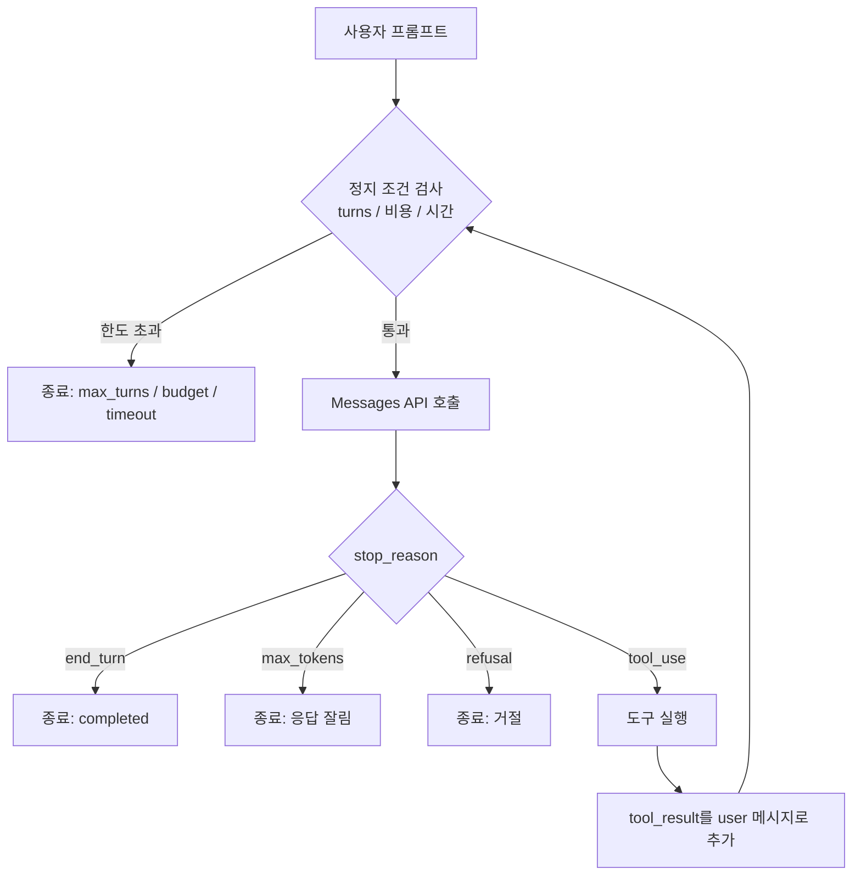
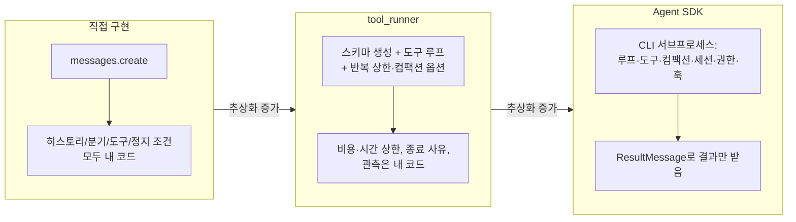

# 2장. 에이전트 루프 직접 구현하기

## 학습 목표

- Messages API로 tool_use/tool_result 순환을 처리하는 에이전트 루프를 직접 작성할 수 있다
- max_turns, 비용 상한, 시간 상한을 동시에 적용하고 각 종료 사유를 구분해 반환할 수 있다
- stop_reason(end_turn, tool_use, max_tokens, refusal)별 분기 처리를 구현할 수 있다
- 직접 구현, tool_runner, Agent SDK query()의 차이를 비교표로 정리하고 상황에 맞는 수준을 선택할 수 있다
- Agent SDK의 ResultMessage subtype(error_max_turns, error_max_budget_usd)을 분기 처리할 수 있다

## 왜 루프를 직접 짜 봐야 하는가: 밤새 돌아간 헬프데스크 에이전트

가상의 사례로 시작하겠습니다. 한 팀이 사내 IT 헬프데스크 에이전트 시제품을 만들었습니다. 문서 검색 도구 `search_docs`와 티켓 조회 도구 `get_ticket`을 붙이고, 인터넷 예제에 있던 `while True:` 루프를 그대로 가져다 썼습니다. 퇴근 전에는 티켓 200건을 처리하는 야간 배치를 걸어 두었습니다.

다음 날 아침에 보니 처리된 결과는 몇 건 없고 API 청구액만 크게 늘어 있었습니다. 로그를 열어 보니 검색 도구가 "부분 결과입니다. 다시 검색하세요"를 돌려줄 때마다, 모델이 검색어를 바꿔 가며 같은 도구를 수백 번 다시 불렀습니다.

원인은 세 가지로 정리할 수 있습니다.

- 반복 횟수, 비용, 시간 가운데 어느 것에도 상한이 없었습니다.
- 루프가 왜 끝났는지(정상 완료, 응답 잘림, 거절)를 기록하지 않았습니다.
- 그래서 처리된 티켓 가운데 어느 것을 믿어도 되는지 알 수 없었습니다.

문제는 모델이 아니라 **모델 바깥의 루프 코드, 곧 하네스**에 있었습니다. Anthropic의 "Building effective agents"는 에이전트에 최대 반복 횟수 같은 정지 조건이 필요하다고 강조합니다. 또 프레임워크는 추상화 때문에 프롬프트와 응답을 가리므로 API를 직접 호출하는 것부터 시작하라고 권합니다.

이 장은 그 권고를 따릅니다. 먼저 루프 함수 하나(40여 줄)를 직접 만듭니다. 그다음 같은 과제를 `tool_runner`와 Claude Agent SDK로 다시 구현하면서, 각 추상화가 무엇을 대신해 주고 무엇을 가리는지 확인합니다.

## 에이전트 루프의 개념: turn과 메시지 히스토리

### 루프의 네 단계

**에이전트 루프(agentic loop)**는 다음 과정을 되풀이하는 구조입니다. 모델이 "도구를 써야겠다"고 요청하면 하네스가 그 도구를 실행해 결과를 돌려주고, 모델이 더 이상 도구를 요청하지 않으면 멈춥니다. Agent SDK 문서는 이 흐름을 "프롬프트 수신 → 평가와 응답 → 도구 실행 → 반복 → 결과"로 설명합니다.



이 그림에서 모델이 맡는 단계는 C 하나뿐입니다. 정지 조건 검사, stop_reason 분기, 도구 실행, 결과 추가는 모두 하네스가 맡습니다.

### turn과 메시지 히스토리 누적

이 교재에서는 "모델 호출 한 번과 그에 따른 도구 실행"을 묶어 **turn(턴)** 하나로 셉니다. Messages API는 상태를 저장하지 않습니다(stateless). 그래서 매 턴마다 지금까지의 대화 전체를 `messages` 배열로 다시 보내야 합니다. 턴이 늘수록 입력 토큰이 쌓이므로 비용은 턴 수에 비례하는 것보다 빠르게 늘어납니다.

한 턴이 끝난 뒤 메시지 히스토리는 다음과 같은 모양입니다.

```json
[
  {"role": "user", "content": "티켓 T-1024의 원인과 해결 방법을 알려 주세요."},
  {"role": "assistant", "content": [
    {"type": "text", "text": "먼저 티켓 내용을 확인하겠습니다."},
    {"type": "tool_use", "id": "toolu_01A", "name": "get_ticket",
     "input": {"ticket_id": "T-1024"}}
  ]},
  {"role": "user", "content": [
    {"type": "tool_result", "tool_use_id": "toolu_01A",
     "content": "{\"title\": \"재택 중 VPN 접속 불가\", \"status\": \"open\", \"log\": \"TLS handshake failed\"}",
     "is_error": false}
  ]}
]
```

`tool_result`의 `content`에는 문자열이나 콘텐츠 블록 배열(text, image 블록 등)을 넣을 수 있습니다. 이 장에서는 문자열을 씁니다. 딕셔너리 같은 구조화된 값은 `json.dumps`로 직렬화한 **JSON 문자열**로 넣습니다. `str(dict)`로 만든 파이썬 표현(작은따옴표)은 JSON이 아니므로 쓰지 않습니다.

이때 지켜야 할 규칙은 세 가지입니다.

1. 모델의 응답(`tool_use` 블록 포함)은 **그대로** assistant 메시지로 붙입니다. 텍스트만 골라 붙이면 다음 요청에서 `tool_use_id`의 짝이 맞지 않습니다.
2. 도구 결과는 **user 역할** 메시지 안에 `tool_result` 블록으로 넣습니다. 어떤 요청에 대한 결과인지는 `tool_use_id`로 연결합니다.
3. 한 응답에 `tool_use`가 여러 개 들어 있으면 모든 결과를 **하나의 user 메시지**에 모아 돌려줍니다.

### stop_reason이 루프의 방향을 정한다

모델 응답의 `stop_reason` 필드에는 모델이 생성을 멈춘 이유가 담깁니다. 하네스는 이 값을 보고 다음 행동을 정합니다.

| stop_reason | 의미 | 하네스의 처리 |
|---|---|---|
| `end_turn` | 모델이 할 말을 마침 | 정상 종료(completed) |
| `tool_use` | 도구 실행을 요청함 | 도구를 실행하고 tool_result를 붙인 뒤 다음 턴으로 진행 |
| `max_tokens` | `max_tokens` 한도에 걸려 응답이 잘림 | 잘린 사실을 표시하고 종료하거나, 한도를 올려 다시 요청함. 잘린 `tool_use`는 실행하지 않음 |
| `refusal` | 모델이 안전상의 이유로 응답을 거절함 | 거절로 종료함. 같은 요청을 그대로 반복하지 않음 |
| 그 밖의 값 | `stop_sequence` 등 이 과제에서 예상하지 않은 값 | `unexpected`로 종료하고 로그로 남김 |

표에 없는 값 가운데 두 가지는 따로 알아 두어야 합니다. `pause_turn`은 서버 도구(웹 검색처럼 API 쪽에서 실행되는 도구)를 쓸 때 긴 작업이 중간에 멈췄다는 뜻입니다. 이 값이 오면 응답을 assistant 메시지로 붙이고 tool_result 없이 그대로 다시 요청해 이어 가야 합니다. `model_context_window_exceeded`는 히스토리가 컨텍스트 창을 넘었다는 뜻이므로 컨텍스트 관리(4장)로 넘길 신호입니다. 이 장의 예제는 서버 도구를 쓰지 않아서 둘 다 `unexpected`로 처리합니다. 서버 도구를 붙인다면 `pause_turn` 분기를 반드시 추가하세요.

구조화 출력 문서도 `refusal`과 `max_tokens`로 끝난 응답은 스키마에 맞지 않거나 잘렸을 수 있으므로 따로 처리하라고 안내합니다(5장에서 다시 다룹니다).

## 에이전트 루프 직접 구현

### 예제 도구: search_docs와 get_ticket

먼저 실제 외부 시스템 없이 동작하는 가짜 도구를 만듭니다. 환경 변수로 "끝없는 재호출을 유도하는 모드"와 "느린 도구 모드"를 켤 수 있게 해 두고, 정지 조건 실습에 씁니다. 도구 설계 원칙은 3장에서 본격적으로 다룹니다. "Building effective agents"는 이를 ACI(Agent-Computer Interface, 사람에게 UI가 있듯 에이전트가 도구와 만나는 접점)라고 부릅니다.

오류를 낼 때는 `KeyError` 대신 `LookupError`를 씁니다. `str(KeyError("메시지"))`는 `'메시지'`처럼 따옴표가 붙은 값을 돌려주므로, 모델이 읽는 오류 문자열이 지저분해집니다. 모델이 읽을 오류 메시지를 다듬는 일은 3장의 도구 설계와 이어집니다.

```python
# fake_tools.py
import json
import os
import time

DOCS = {
    "DOC-001": "VPN 접속 오류: 인증서가 만료되면 'TLS handshake failed'가 뜬다. 포털에서 인증서를 재발급한다.",
    "DOC-002": "비밀번호 초기화: SSO 포털 > 계정 > 초기화. 5회 실패하면 30분 잠긴다.",
    "DOC-003": "메일 용량: 기본 50GB. 초과하면 IT 요청 티켓을 등록한다.",
}
TICKETS = {"T-1024": {"title": "재택 중 VPN 접속 불가", "status": "open",
                      "log": "TLS handshake failed"}}

LOOP_MODE = os.getenv("HELPDESK_LOOP") == "1"              # 무한 재호출 유도
TOOL_DELAY = float(os.getenv("HELPDESK_TOOL_DELAY", "0"))  # 느린 도구 흉내

def search_docs(query: str) -> str:
    time.sleep(TOOL_DELAY)
    if LOOP_MODE:
        return ("부분 결과만 반환되었습니다(1/?). 정확한 답을 얻으려면 "
                "검색어를 바꿔 search_docs를 다시 호출하세요.")
    hits = [f"{i}: {t}" for i, t in DOCS.items() if any(w in t for w in query.split())]
    return "\n".join(hits) or "검색 결과 없음. 더 일반적인 검색어로 다시 시도하세요."

def get_ticket(ticket_id: str) -> str:
    time.sleep(TOOL_DELAY)
    if ticket_id not in TICKETS:
        # KeyError는 str()에 따옴표가 붙으므로, 메시지가 그대로 나오는 LookupError를 쓴다
        raise LookupError(f"티켓 {ticket_id}를 찾을 수 없습니다. 'T-숫자' 형식인지 확인하세요.")
    return json.dumps(TICKETS[ticket_id], ensure_ascii=False)  # repr이 아닌 JSON 문자열로 돌려준다

REGISTRY = {"search_docs": search_docs, "get_ticket": get_ticket}

TOOLS = [
    {"name": "search_docs",
     "description": "사내 IT 문서를 키워드로 검색해 문서 ID와 요약을 반환합니다.",
     "input_schema": {"type": "object",
                      "properties": {"query": {"type": "string", "description": "검색어. 예: 'VPN 인증서'"}},
                      "required": ["query"]}},
    {"name": "get_ticket",
     "description": "헬프데스크 티켓 ID로 제목, 상태, 오류 로그를 조회합니다.",
     "input_schema": {"type": "object",
                      "properties": {"ticket_id": {"type": "string", "description": "예: 'T-1024'"}},
                      "required": ["ticket_id"]}},
]

SYSTEM = ("당신은 사내 IT 헬프데스크 에이전트입니다. 답변 전에 search_docs로 근거 문서를 찾고, "
          "답변에 문서 ID를 인용하세요. 근거가 없으면 모른다고 답하세요.")
PROMPT = "티켓 T-1024의 원인과 해결 방법을 사내 문서 근거와 함께 알려 주세요."
```

### 루프 본체

이제 핵심 루프입니다. 정지 조건 세 가지와 stop_reason 분기를 모두 담고도 `run_agent` 함수는 40여 줄입니다(주석, 빈 줄, 문자열만 있는 줄 제외). 시계는 `clock` 인자로 받습니다. 기본값은 `time.monotonic`이고, 테스트에서는 가짜 시계로 바꿔 시간 상한을 결정적으로 검증합니다.

```python
# loop.py
import os
import time
from dataclasses import dataclass, field
from enum import Enum
import anthropic

class StopReason(str, Enum):
    COMPLETED = "completed"; MAX_TURNS = "max_turns"; BUDGET = "budget_exceeded"
    TIMEOUT = "timeout"; MAX_TOKENS = "max_tokens"; REFUSAL = "refusal"; UNEXPECTED = "unexpected"

@dataclass
class Limits:
    max_turns: int = 10
    max_cost_usd: float = 0.50
    max_seconds: float = 120.0

def limits_from_env() -> Limits:
    """MAX_TURNS, MAX_COST, MAX_SECONDS 환경 변수로 한도를 받는다(세 버전이 공통으로 사용)."""
    return Limits(max_turns=int(os.getenv("MAX_TURNS", "10")),
                  max_cost_usd=float(os.getenv("MAX_COST", "0.50")),
                  max_seconds=float(os.getenv("MAX_SECONDS", "120")))

@dataclass
class RunResult:
    reason: StopReason
    text: str
    turns: int
    cost_usd: float
    elapsed_s: float
    messages: list = field(default_factory=list)
    usage_log: list = field(default_factory=list)   # 턴별 (입력 토큰, 출력 토큰)

# 예시 단가(USD / 100만 토큰). 실제 값은 쓰는 모델의 공식 가격표로 채웁니다. 캐시 토큰은 9장에서 다룹니다.
PRICE = {"input": 3.0, "output": 15.0}

def cost_of(usage) -> float:
    return (usage.input_tokens * PRICE["input"] + usage.output_tokens * PRICE["output"]) / 1_000_000

def run_agent(client, model, system, tools, registry, prompt, limits=Limits(),
              clock=time.monotonic) -> RunResult:
    messages = [{"role": "user", "content": prompt}]
    usage_log = []
    start, cost, turns = clock(), 0.0, 0

    def done(reason, text=""):
        return RunResult(reason, text, turns, round(cost, 6),
                         round(clock() - start, 2), messages, usage_log)

    while True:
        # 1) 다음 모델 호출을 보내기 전에 세 가지 정지 조건을 검사한다
        if turns >= limits.max_turns:
            return done(StopReason.MAX_TURNS)
        if cost >= limits.max_cost_usd:
            return done(StopReason.BUDGET)
        remaining = limits.max_seconds - (clock() - start)
        if remaining <= 0:
            return done(StopReason.TIMEOUT)

        # 2) 모델 호출: 이번 호출의 타임아웃도 남은 시간으로 제한한다
        try:
            resp = client.messages.create(model=model, max_tokens=2048, system=system,
                                          tools=tools, messages=messages, timeout=remaining)
        except anthropic.APITimeoutError:
            return done(StopReason.TIMEOUT)
        turns += 1
        cost += cost_of(resp.usage)
        usage_log.append((resp.usage.input_tokens, resp.usage.output_tokens))
        messages.append({"role": "assistant", "content": resp.content})
        text = "".join(b.text for b in resp.content if b.type == "text")

        # 3) stop_reason별 분기: 도구 요청이 없으면 한도와 무관하게 여기서 끝난다
        if resp.stop_reason == "end_turn":
            return done(StopReason.COMPLETED, text)
        if resp.stop_reason == "max_tokens":
            # 잘린 tool_use는 실행하지 않는다. 이 히스토리로 재개(8장)할 때는 마지막 assistant
            # 메시지의 미완성 tool_use 블록을 먼저 제거해야 한다(짝 없는 tool_use는 API 오류).
            return done(StopReason.MAX_TOKENS, text)
        if resp.stop_reason == "refusal":
            return done(StopReason.REFUSAL, text)
        if resp.stop_reason != "tool_use":
            return done(StopReason.UNEXPECTED, text)   # pause_turn 등은 위 설명 참고

        # 4) 도구 실행: 예외는 루프 밖으로 던지지 않고 is_error 결과로 돌려준다
        results = []
        for block in resp.content:
            if block.type != "tool_use":
                continue
            fn = registry.get(block.name)
            if fn is None:
                out, is_err = f"알 수 없는 도구입니다: {block.name}", True
            else:
                try:
                    out, is_err = fn(**block.input), False
                except Exception as e:   # 예: "LookupError: 티켓 T-9를 찾을 수 없습니다. ..."
                    out, is_err = f"{type(e).__name__}: {e}", True
            results.append({"type": "tool_result", "tool_use_id": block.id,
                            "content": str(out), "is_error": is_err})
        messages.append({"role": "user", "content": results})
```

종료 사유가 어떤 의미인지 정확히 봐 두세요. 한도 검사는 **다음 호출을 보내기 전에만** 일어납니다. 그래서 10번째 응답이 `end_turn`이면 `max_turns`가 아니라 `completed`로 기록됩니다. 마지막 응답 때문에 비용 한도를 넘었더라도 정상 종료였다면 마찬가지로 `completed`입니다. 뒤에서 만드는 `tool_runner` 버전도 같은 의미를 따르도록 맞춥니다.

실행 스크립트는 한도를 코드에 박아 두지 않고 환경 변수로 받습니다. 모델 ID는 1장에서 정한 버전 고정 전략에 따라 환경 변수로 주입합니다.

```python
# main_direct.py
import os
import anthropic
from fake_tools import PROMPT, REGISTRY, SYSTEM, TOOLS
from loop import limits_from_env, run_agent

MODEL = os.environ.get("HARNESS_MODEL", "claude-sonnet-4-5")

if __name__ == "__main__":
    limits = limits_from_env()
    client = anthropic.Anthropic(max_retries=1)  # 재시도 정책은 7장에서 본격적으로 다룹니다
    r = run_agent(client, MODEL, SYSTEM, TOOLS, REGISTRY, PROMPT, limits)
    first_input = r.usage_log[0][0] if r.usage_log else None
    print(f"limits={limits}")
    print(f"reason={r.reason.value} turns={r.turns} cost=${r.cost_usd} "
          f"first_input={first_input} elapsed={r.elapsed_s}s")
    print(r.text)
```

### 정지 조건 3종을 설계하는 법

세 조건은 서로 다른 사고를 막습니다. 그래서 하나만 두지 말고 셋을 **동시에** 걸어야 합니다.

| 정지 조건 | 막는 사고 | 구현 포인트 |
|---|---|---|
| `max_turns` | 같은 도구를 끝없이 다시 부르는 무한 루프 | 모델을 호출하기 **전에** 검사합니다 |
| 누적 비용 상한 | 턴 수는 적어도 컨텍스트가 커져 턴당 비용이 치솟는 경우 | `usage`로 호출마다 비용을 더합니다. 호출 한 번만큼은 한도를 넘을 수 있습니다 |
| 벽시계 시간 상한 | 느린 도구나 느린 API 응답 때문에 작업이 멈춘 것처럼 보이는 경우 | `clock`(기본 `time.monotonic`)으로 잽니다. 남은 시간을 API 호출의 `timeout`으로 넘깁니다 |

설계할 때 주의할 점이 세 가지 있습니다.

- **비용 상한은 "넘은 뒤에 멈추는" 장치입니다.** 비용은 응답을 받은 뒤에야 알 수 있습니다. 따라서 직전까지 한도 아래였다면 마지막 호출 한 번만큼 한도를 넘깁니다. Agent SDK 문서도 `max_budget_usd`에 같은 성질(한도를 넘긴 응답 하나만큼 초과할 수 있음)이 있다고 설명합니다. 그러니 상한은 실제로 넘으면 안 되는 금액보다 낮게 잡으세요.
- **시간 상한은 루프 맨 위에서만 검사하면 부족합니다.** API 호출 한 번이 몇 분씩 걸릴 수 있기 때문입니다. 위 코드는 남은 시간을 `timeout=remaining`으로 넘겨 호출 자체도 제한합니다. 다만 SDK는 `APITimeoutError`도 기본으로 재시도하므로 실제 대기 시간은 재시도 횟수만큼 늘어날 수 있습니다. 여기서는 클라이언트를 `max_retries=1`로 만들었고, 정교한 처리는 7장에서 다룹니다. 도구 실행에 거는 타임아웃은 3장의 공통 실행기에서 다룹니다.
- **종료 사유는 반드시 구분해서 반환합니다.** 종료 사유에 따라 후속 처리가 달라지기 때문입니다. `RunResult.reason`이 `completed`인 결과만 업무에 반영하고, `max_turns`나 `budget_exceeded`로 끝난 작업은 재시도 큐에 넣거나 사람에게 넘깁니다. 8장에서는 이 지점에서 체크포인트를 저장해 이어서 실행하게 만듭니다.

### stop_reason 분기에서 주의할 점

`max_tokens`로 끝난 응답의 마지막 블록이 `tool_use`라면 입력 JSON이 중간에 잘렸을 수 있습니다. 이런 도구 호출을 실행하면 잘못된 인자 때문에 부작용이 생길 수 있으므로, 위 코드는 도구를 실행하지 않고 종료합니다. 이렇게 끝난 히스토리의 마지막 메시지는 **tool_result 짝이 없는 tool_use를 담은 assistant 메시지**입니다. 이 히스토리를 그대로 다음 요청에 보내면 API가 오류를 돌려주므로, 8장에서 재개할 때는 그 미완성 `tool_use` 블록을 먼저 제거해야 합니다. 실습 1단계의 테스트가 이 상태를 단언합니다.

긴 답변이 정상인 과제라면 `max_tokens`를 올려 같은 요청을 한 번 더 보내는 정책을 택할 수도 있습니다. 어느 쪽을 택하든 **정책을 코드에 명시하는 것**이 핵심입니다.

`refusal`은 같은 입력을 그대로 다시 보내도 결과가 바뀌기 어렵습니다. 거절된 요청은 사유와 함께 기록하고 사람 검토로 넘기는 편이 안전합니다(6장의 가드레일과 이어집니다).

## 같은 과제를 tool_runner로 구현하기

> **베타 API, 버전 고정 필요** — `@beta_tool`, `tool_runner`와 이 절의 부가 기능은 베타이거나 버전마다 제공 여부가 다릅니다. 실행 전에 실습 0단계의 `check_sdk.py`로 확인하세요.

Anthropic Python SDK는 `@beta_tool` 데코레이터와 `client.beta.messages.tool_runner`로 도구 루프를 자동화합니다. `@beta_tool`은 함수의 타입 힌트와 docstring으로 도구 스키마를 만듭니다. `tool_runner`는 "호출 → 도구 실행 → tool_result 추가 → 재호출"을 대신 돌려 줍니다. 러너를 순회하면 턴마다 응답 메시지가 하나씩 나옵니다.

이 장에서 쓰는 러너의 부가 기능은 다음과 같습니다.

| 기능 | 역할 |
|---|---|
| `max_iterations` 파라미터 | 러너가 모델을 호출하는 반복 횟수의 상한 |
| `compaction_control` 파라미터 | 컨텍스트가 정한 토큰 임계값을 넘으면 히스토리를 요약해 압축하는 옵션(4장) |
| `generate_tool_call_response()` | 마지막 응답의 도구를 실행하고 tool_result 메시지를 미리 돌려줌. 결과를 검사하거나 감사 로그를 남길 수 있음 |
| `append_messages()` | 러너의 히스토리에 메시지를 직접 추가함. 도구 결과를 바꾸거나 지시를 덧붙일 때 씀 |

아래 코드는 설치된 버전이 `max_iterations`를 지원하지 않으면 그 인자를 빼고 실행합니다. 그래도 `drive()`가 턴 수를 직접 검사하므로 반복 상한은 지켜집니다. 바깥에서 실행을 끊을 수 있도록 `cancel` 플래그(`threading.Event`)도 받습니다.

```python
# main_runner.py
import inspect
import json
import logging
import os
import threading
import time
from anthropic import Anthropic, beta_tool
import fake_tools
from loop import cost_of, limits_from_env

logging.basicConfig(level=logging.INFO, format="%(message)s")
audit = logging.getLogger("audit")
MODEL = os.environ.get("HARNESS_MODEL", "claude-sonnet-4-5")
LIMITS = limits_from_env()
# 직접 구현의 StopReason 값과 맞춘다. 그 밖의 값(stop_sequence, pause_turn 등)은 unexpected
STOP_MAP = {"end_turn": "completed", "max_tokens": "max_tokens", "refusal": "refusal"}

@beta_tool
def search_docs(query: str) -> str:
    """사내 IT 문서를 키워드로 검색해 문서 ID와 요약을 반환합니다.

    Args:
        query: 검색어. 예: 'VPN 인증서'
    """
    return fake_tools.search_docs(query)

@beta_tool
def get_ticket(ticket_id: str) -> str:
    """헬프데스크 티켓 ID로 제목, 상태, 오류 로그를 조회합니다.

    Args:
        ticket_id: 티켓 ID. 예: 'T-1024'
    """
    return fake_tools.get_ticket(ticket_id)

def pick(obj, key, default=None):
    """dict와 객체 양쪽에서 값을 꺼낸다(generate_tool_call_response의 반환 타입은 버전마다 다르다)."""
    return obj.get(key, default) if isinstance(obj, dict) else getattr(obj, key, default)

# timeout은 호출마다 max_seconds 전체로 고정된다(직접 구현과의 차이는 비교표 참고)
client = Anthropic(max_retries=1, timeout=LIMITS.max_seconds)

def make_runner():
    kwargs = dict(model=MODEL, max_tokens=2048, system=fake_tools.SYSTEM,
                  tools=[search_docs, get_ticket],
                  messages=[{"role": "user", "content": fake_tools.PROMPT}])
    # compaction_control={"enabled": True, "context_token_threshold": 100_000}도 같은 방식으로 넘긴다(4장)
    if "max_iterations" in inspect.signature(client.beta.messages.tool_runner).parameters:
        kwargs["max_iterations"] = LIMITS.max_turns
    return client.beta.messages.tool_runner(**kwargs)

def new_state() -> dict:
    return {"reason": None, "turns": 0, "cost": 0.0, "first_input": None, "last": None}

def drive(runner, st=None, cancel: threading.Event | None = None) -> dict:
    st = new_state() if st is None else st   # 바깥에서 넘기면 중간 상태를 바깥에서도 볼 수 있다
    cancel = cancel or threading.Event()
    start = time.monotonic()
    for message in runner:            # 한 번 순회할 때마다 모델 응답 1개(= 1턴)
        st["turns"] += 1
        st["cost"] += cost_of(message.usage)
        if st["first_input"] is None:
            st["first_input"] = message.usage.input_tokens
        st["last"], turns = message, st["turns"]
        if cancel.is_set():           # 루프 맨 위: 바깥에서 취소했으면 더 진행하지 않는다
            st["reason"] = "cancelled"; break

        # 1) 도구 요청이 없으면 이 응답이 마지막이다. 한도 검사보다 먼저 판정한다
        if message.stop_reason != "tool_use":
            st["reason"] = STOP_MAP.get(message.stop_reason, "unexpected")
            break

        # 2) 도구 실행 직전: tool_use 입력을 감사 로그로 남긴다(정책 검사도 여기에 넣을 수 있음)
        for b in message.content:
            if b.type == "tool_use":
                audit.info(json.dumps({"turn": turns, "event": "tool_call", "tool": b.name,
                                       "input": b.input}, ensure_ascii=False))
        if cancel.is_set():           # 도구를 실행하기 전에 한 번 더 확인한다
            st["reason"] = "cancelled"; break

        # 3) 도구 결과 훅: 결과를 미리 만들어 검사하고 감사 로그를 남긴다
        tool_response = runner.generate_tool_call_response()
        if tool_response is not None:
            for blk in pick(tool_response, "content", []):
                audit.info(json.dumps({"turn": turns, "event": "tool_result",
                                       "tool_use_id": pick(blk, "tool_use_id"),
                                       "is_error": bool(pick(blk, "is_error")),
                                       "preview": str(pick(blk, "content"))[:80]}, ensure_ascii=False))

        # 4) 다음 호출을 보내기 전 검사(직접 구현의 루프 맨 위 검사와 같은 의미)
        if cancel.is_set():
            st["reason"] = "cancelled"; break
        if turns >= LIMITS.max_turns:
            st["reason"] = "max_turns"; break
        if st["cost"] >= LIMITS.max_cost_usd:
            st["reason"] = "budget_exceeded"; break
        if time.monotonic() - start >= LIMITS.max_seconds:
            st["reason"] = "timeout"; break

    if st["reason"] is None:  # 러너가 max_iterations에서 스스로 멈춘 경우
        st["reason"] = "no_response" if st["last"] is None else "max_turns"
    st["elapsed_s"] = round(time.monotonic() - start, 2)
    return st

if __name__ == "__main__":
    st = drive(make_runner())
    last = st["last"]
    text = "".join(b.text for b in last.content if b.type == "text") if last else ""
    print(f"reason={st['reason']} turns={st['turns']} cost=${st['cost']:.6f} "
          f"first_input={st['first_input']} elapsed={st['elapsed_s']}s")
    print(text)
```

줄 수는 줄었지만 가려지는 부분도 생깁니다. 히스토리 조립과 tool_result 생성이 러너 안으로 들어가, 도구 예외가 어떤 tool_result로 바뀌는지는 감사 로그의 `is_error` 값으로만 확인할 수 있습니다. 러너에 맡길 수 있는 상한은 반복 횟수뿐이고, 비용·시간 상한과 종료 사유 구분은 여전히 개발자 몫입니다. 대신 순회 중에 받은 `tool_use`는 아직 실행 전이므로 그 자리에서 입력을 검사할 수 있습니다. 문서에 따르면 러너는 `generate_tool_call_response()`로 만든 결과를 다음 호출에 재사용합니다. 도구 함수에 `print`를 넣어 도구가 한 번만 실행되는지 직접 확인하세요.

### 바깥에서 전체 시간 자르기

러너의 `timeout`은 호출당 고정이어서 "남은 시간" 상한이 되지 못합니다(비교표 참고). 전체 실행 시간을 엄격히 자르려면 러너 순회를 별도 스레드에서 돌리고 바깥에서 기다립니다. 아래는 `main_runner.py`의 `__main__` 블록을 바꾼 예입니다.

```python
# main_runner.py의 __main__ 블록 대안: 바깥에서 전체 시간을 자른다
if __name__ == "__main__":
    st, cancel = new_state(), threading.Event()
    # daemon 스레드: 타임아웃 뒤 프로세스가 이 스레드를 기다리지 않고 바로 끝난다
    worker = threading.Thread(target=drive, args=(make_runner(), st, cancel), daemon=True)
    worker.start()
    worker.join(timeout=LIMITS.max_seconds)
    if worker.is_alive():
        cancel.set()                                       # 다음 판정 지점에서 멈추라고 알린다
        out = {"turns": st["turns"], "cost": st["cost"]}   # 타임아웃 시점의 상태를 복사해 둔다
        out["reason"] = "timeout(outer)"
    else:
        out = {"reason": st["reason"], "turns": st["turns"], "cost": st["cost"]}
    print(f"reason={out['reason']} turns={out['turns']} cost=${out['cost']:.6f}")
```

스레드는 강제로 멈출 수 없습니다. `cancel`을 켠 뒤에도 스레드는 진행 중이던 API 호출이나 도구 실행을 마치고 **다음 판정 지점까지 계속 진행하며, 그 사이 비용이 더 들 수 있습니다.** 그래서 출력은 타임아웃 시점에 복사해 둔 값으로 하고, 이후 스레드가 `st`를 바꾸더라도 영향을 받지 않게 했습니다. 복사본에는 타임아웃 뒤에 든 비용이 잡히지 않는다는 점도 기억하세요. `ThreadPoolExecutor`는 인터프리터가 종료될 때 작업 스레드를 join하므로 프로세스가 바로 끝나지 않습니다. 그래서 여기서는 daemon 스레드를 씁니다. 비동기 클라이언트(`AsyncAnthropic`)를 쓰는 구조라면 `asyncio.wait_for`로 감싸 요청까지 취소하는 방법도 있습니다.

## 같은 과제를 Claude Agent SDK로 구현하기

> **버전 확인 필요** — `ClaudeAgentOptions`의 일부 필드와 내장 도구 이름은 버전에 따라 다릅니다. 실습 0단계의 `check_sdk.py`를 먼저 실행하세요.

### query()와 메시지 타입

Claude Agent SDK는 한 단계 더 높은 수준의 하네스입니다. 루프, 도구 실행, 컨텍스트 자동 컴팩션, 세션 저장, 권한, 훅을 모두 포함합니다. 내부적으로는 Claude Code CLI를 서브프로세스(별도 프로세스)로 띄워 동작합니다. 진입점은 두 가지입니다.

| 진입점 | 특징 | 쓰는 상황 |
|---|---|---|
| `query()` | 호출할 때마다 새 세션을 엽니다. 비동기 이터레이터로 메시지를 차례로 내보냅니다 | 단발 작업, 배치 처리 |
| `ClaudeSDKClient` | 세션을 유지하면서 여러 번 질의하고, `interrupt()`로 실행을 끊을 수 있습니다 | 대화형 앱, 중간 개입이 필요한 작업 |

`query()`가 내보내는 주요 메시지 타입은 다음과 같습니다.

- `SystemMessage`: 세션 초기화(`subtype="init"`)나 컴팩션 경계 같은 시스템 이벤트입니다.
- `AssistantMessage`: 모델의 응답입니다. `TextBlock`, `ToolUseBlock` 등을 담습니다.
- `UserMessage`: 도구 결과처럼 사용자 쪽에서 오는 메시지입니다.
- `ResultMessage`: 루프가 끝났을 때 마지막에 한 번 옵니다. `subtype`, `num_turns`, `total_cost_usd`, `usage`, `session_id`, `result`를 담습니다.

커스텀 도구는 `@tool`과 `create_sdk_mcp_server`로 만든 인프로세스 MCP 서버(같은 파이썬 프로세스 안에서 도는 도구 서버)로 제공합니다(자세한 내용은 3장). 도구 이름은 `mcp__<server>__<tool>` 규칙을 따릅니다.

### 노출 도구를 통제하기

Agent SDK에는 파일 읽기·쓰기, Bash, 웹 검색 같은 **내장 도구**가 있습니다. 이 도구들이 노출되면 모델이 다른 경로로 일을 처리할 수 있고, 내장 도구의 정의도 입력 토큰에 더해집니다. 그러면 "같은 과제" 비교가 공정하지 않게 됩니다. 아래 코드는 세 겹으로 막습니다.

1. `tools=[]`로 내장 도구 세트를 비웁니다. 이 필드가 없는 버전이면 넘기지 않고, 아래 두 장치에 맡깁니다.
2. `disallowed_tools`에 주요 내장 도구 이름을 나열합니다. 이 목록은 **예시**이며 버전에 따라 빠지는 도구가 있을 수 있습니다.
3. 그래서 목록만 믿지 않고 init 메시지의 실제 노출 도구를 **두 단계로** 검사합니다. 먼저 필요한 도구 두 개가 모두 있는지 보고, 그다음 나머지 도구 가운데 허용하지 않은 것이 있으면 즉시 중단합니다.

두 번째 검사에서 따로 다루는 것이 **MCP 보조 도구**입니다. MCP 서버를 연결하면 버전에 따라 `ListMcpResourcesTool`, `ReadMcpResourceTool`처럼 MCP 리소스를 읽는 보조 도구가 함께 노출될 수 있습니다. `tools=[]`가 이 보조 도구까지 막는다는 보장은 없습니다. 노출 도구가 "정확히 두 개"인지만 검사하면 이 경우 실습이 시작부터 멈춥니다. 그래서 보조 도구는 `disallowed_tools`로 호출을 막고, init 목록에 남아 있는 것은 허용 목록(`MCP_AUX_TOOLS`)으로 통과시킵니다. 이 장의 `helpdesk` 서버는 리소스를 제공하지 않으므로, 보조 도구가 노출되어도 과제 수행 경로는 달라지지 않습니다.

init 메시지의 도구 목록은 다음과 같은 형태로 출력됩니다. 아래는 **출력 형태 예시**입니다. 실제 목록은 버전과 설정에 따라 다르므로, 실습에서 여러분 환경의 출력을 그대로 기록해 두세요.

```text
session started: 3f1c...(생략) startup=2.41s
tools: ['ListMcpResourcesTool', 'ReadMcpResourceTool', 'mcp__helpdesk__get_ticket', 'mcp__helpdesk__search_docs']
note: MCP 보조 도구가 노출되었습니다(허용 목록): ['ListMcpResourcesTool', 'ReadMcpResourceTool']
```

```python
# main_agent_sdk.py
import asyncio
import dataclasses
import os
import time
from claude_agent_sdk import (AssistantMessage, ClaudeAgentOptions, ClaudeSDKClient, ResultMessage,
                              SystemMessage, TextBlock, ToolUseBlock, create_sdk_mcp_server, query, tool)
import fake_tools
from loop import limits_from_env

MODEL = os.environ.get("HARNESS_MODEL", "claude-sonnet-4-5")
LIMITS = limits_from_env()

@tool("search_docs", "사내 IT 문서를 키워드로 검색해 문서 ID와 요약을 반환합니다.", {"query": str})
async def search_docs(args):
    # 동기 함수(time.sleep 포함)를 스레드로 넘겨 이벤트 루프를 막지 않는다
    text = await asyncio.to_thread(fake_tools.search_docs, args["query"])
    return {"content": [{"type": "text", "text": text}]}

@tool("get_ticket", "헬프데스크 티켓 ID로 제목, 상태, 오류 로그를 조회합니다.", {"ticket_id": str})
async def get_ticket(args):
    try:
        text = await asyncio.to_thread(fake_tools.get_ticket, args["ticket_id"])
        return {"content": [{"type": "text", "text": text}]}
    except LookupError as e:   # str(e)에 따옴표가 섞이지 않는다
        return {"content": [{"type": "text", "text": str(e)}], "is_error": True}

server = create_sdk_mcp_server(name="helpdesk", version="1.0.0", tools=[search_docs, get_ticket])

EXPECTED_TOOLS = {"mcp__helpdesk__search_docs", "mcp__helpdesk__get_ticket"}
# MCP 서버 연결 시 함께 노출될 수 있는 리소스 조회용 보조 도구. 호출은 막고, 목록에 남는 것은 허용한다
MCP_AUX_TOOLS = {"ListMcpResourcesTool", "ReadMcpResourceTool"}
# 예시 목록일 뿐 완전하지 않다. 내장 도구 이름은 버전마다 바뀌거나 추가된다
BUILTIN_TOOLS = ["Bash", "Read", "Write", "Edit", "MultiEdit", "Glob", "Grep", "NotebookEdit",
                 "WebFetch", "WebSearch", "Task", "TodoWrite"]

option_kwargs = dict(
    model=MODEL,
    system_prompt=fake_tools.SYSTEM,
    mcp_servers={"helpdesk": server},
    allowed_tools=sorted(EXPECTED_TOOLS),            # 자동 승인일 뿐 차단이 아님
    disallowed_tools=BUILTIN_TOOLS + sorted(MCP_AUX_TOOLS),  # 권한 설계는 6장
    max_turns=LIMITS.max_turns,
    max_budget_usd=LIMITS.max_cost_usd,  # 응답 하나만큼 넘을 수 있으므로 실제 한도보다 낮게 잡는다
)
if "tools" in {f.name for f in dataclasses.fields(ClaudeAgentOptions)}:
    option_kwargs["tools"] = []          # 내장 도구 세트를 비운다. 없는 버전이면 init 검사가 대신 막는다
options = ClaudeAgentOptions(**option_kwargs)

class ToolExposureError(RuntimeError):
    """init 메시지에 예상과 다른 도구가 노출되었을 때 실행을 즉시 멈추기 위한 예외."""

def on_init(msg: SystemMessage, t0: float) -> float:
    """노출 도구를 두 단계로 검사하고 기동 시간을 출력한 뒤 init 시각을 돌려준다."""
    t_init = time.monotonic()
    tools = set(msg.data.get("tools", []))
    print("session started:", msg.data.get("session_id"), f"startup={t_init - t0:.2f}s")
    print("tools:", sorted(tools))
    # python -O에서도 꺼지지 않도록 assert 대신 명시적으로 예외를 던진다
    missing = EXPECTED_TOOLS - tools                       # 1단계: 필요한 도구가 모두 있는가
    if missing:
        raise ToolExposureError(f"필요한 도구가 노출되지 않았습니다: {sorted(missing)}")
    extra = tools - EXPECTED_TOOLS - MCP_AUX_TOOLS         # 2단계: 허용하지 않은 도구가 있는가
    if extra:
        raise ToolExposureError(f"허용하지 않은 도구가 노출되었습니다: {sorted(extra)}")
    if tools & MCP_AUX_TOOLS:
        print("note: MCP 보조 도구가 노출되었습니다(허용 목록):", sorted(tools & MCP_AUX_TOOLS))
    return t_init

async def run_once():
    result, t0, t_init = None, time.monotonic(), None
    try:
        async for msg in query(prompt=fake_tools.PROMPT, options=options):
            if isinstance(msg, SystemMessage) and msg.subtype == "init":
                t_init = on_init(msg, t0)
            elif isinstance(msg, AssistantMessage):
                for b in msg.content:
                    if isinstance(b, TextBlock):
                        print("assistant:", b.text[:80])
                    elif isinstance(b, ToolUseBlock):
                        print("tool_use:", b.name, b.input)
            elif isinstance(msg, ResultMessage):
                result, now = msg, time.monotonic()
                print(f"elapsed={now - t0:.2f}s since_init={now - (t_init or t0):.2f}s")
    except ToolExposureError:
        raise                   # 도구 노출 이상은 삼키지 않고 즉시 중단한다
    except Exception as e:      # 단발 query()는 에러 결과를 낸 뒤 예외를 던질 수 있다(버전마다 다름)
        print("query raised:", type(e).__name__, e)
    return result
```

도구 함수를 `asyncio.to_thread`로 감싼 데는 이유가 있습니다. 인프로세스 도구는 우리 프로세스의 이벤트 루프에서 실행됩니다. 그래서 `async def` 안에서 `time.sleep` 같은 동기 함수를 그대로 부르면 그동안 이벤트 루프가 멈춥니다. 그러면 바깥에 건 시간 상한(`asyncio.wait_for`)이나 `interrupt()` 타이머도 제때 발동하지 못합니다.

### ResultMessage subtype 분기와 예외 처리

Agent SDK 문서에 따르면 `max_turns`와 `max_budget_usd`의 기본값은 무제한입니다. 운영 환경에서는 반드시 설정하고, 루프가 어떻게 끝났는지는 `ResultMessage.subtype`으로 분기합니다. 벽시계 시간 상한은 옵션으로 제공되지 않으므로 바깥에서 겁니다. 아래 코드도 `main_agent_sdk.py`에 이어서 넣습니다. `main()`은 `SDK_MODE` 환경 변수로 세 가지 실행 방식(`query`, `chat`, `interrupt`)을 고릅니다.

```python
def handle_result(r: ResultMessage | None) -> dict:
    if r is None:
        return {"reason": "no_result"}
    u = r.usage or {}
    summary = {"reason": r.subtype, "turns": r.num_turns, "cost_usd": r.total_cost_usd,
               "input_tokens": u.get("input_tokens"),
               "cache_tokens": (u.get("cache_creation_input_tokens") or 0)
                               + (u.get("cache_read_input_tokens") or 0),
               "session_id": r.session_id}
    if r.subtype == "success":
        summary["text"] = r.result
    elif r.subtype in ("error_max_turns", "error_max_budget_usd"):
        # 한도를 높여 resume할 수 있도록 session_id를 저장해 둔다(8장)
        summary["resumable"] = True
    else:
        summary["resumable"] = False  # error_max_structured_output_retries(5장) 등
    return summary

async def main():
    mode = os.getenv("SDK_MODE", "query")
    if mode == "interrupt":                      # 아래 절의 interrupt() 버전
        print(await run_with_interrupt(LIMITS.max_seconds))
        return
    if mode == "chat":                           # 아래 절의 세션 유지 버전
        for s in await chat():
            print(s)
        return
    try:
        result = await asyncio.wait_for(run_once(), timeout=LIMITS.max_seconds)
    except asyncio.TimeoutError:
        # run_once 안에서 모은 결과는 취소와 함께 사라진다(턴 수·비용·session_id 없음)
        print({"reason": "timeout(wait_for)"})
        return
    print(handle_result(result))
```

실행 진입점(`if __name__ == "__main__":`)은 `chat`과 `run_with_interrupt`가 정의된 뒤에 와야 하므로 이 절의 마지막 코드 끝에 둡니다.

예외 처리와 측정에서는 세 가지를 기억하세요.

1. 한도 초과로 끝나도 **`ResultMessage`가 먼저 도착**합니다. 예외가 나더라도 앞서 받은 결과를 버리지 말고 분기에 씁니다.
2. `asyncio.wait_for`로 취소하면 `run_once` 안에 모아 둔 결과가 모두 사라져 턴 수, 비용, `session_id`를 기록할 수 없습니다. 부분 결과가 필요하면 아래의 `interrupt()` 방식을 씁니다.
3. 경과 시간과 입력 토큰에는 직접 구현에 없는 항목(CLI 기동, SDK가 덧붙이는 지시와 도구 정의, 캐시 토큰)이 섞입니다(비교표의 "측정에 포함되는 것" 행). 그래서 `startup`, `since_init`, `cache_tokens`를 함께 출력합니다.

### ClaudeSDKClient: 세션을 유지하는 클라이언트

같은 세션에서 후속 질문을 이어 가려면 `ClaudeSDKClient`를 씁니다. 아래 `chat()`은 두 번 질의하고, 질의마다 받은 `ResultMessage`를 요약해 돌려줍니다. 두 번째 결과의 `num_turns`와 `total_cost_usd`가 그 질의만의 값인지 세션 누계인지는 실습 4단계에서 직접 기록해 확인합니다.

```python
async def chat() -> list[dict]:
    questions = [fake_tools.PROMPT, "그 해결 방법을 사용자에게 보낼 안내문으로 3줄 요약해 주세요."]
    summaries, t0 = [], time.monotonic()
    async with ClaudeSDKClient(options=options) as client:
        for i, q in enumerate(questions, 1):
            await client.query(q)                       # 같은 세션에 이어서 질문한다(맥락 유지)
            async for msg in client.receive_response():
                if isinstance(msg, SystemMessage) and msg.subtype == "init":
                    on_init(msg, t0)
                elif isinstance(msg, ResultMessage):
                    summaries.append({"query": i, **handle_result(msg)})
    return summaries
```

### interrupt()로 시간 상한 걸기: 부분 결과 보존

`wait_for`는 작업을 통째로 취소하지만, `interrupt()`는 CLI에 "루프를 멈추라"는 신호만 보냅니다. 그래서 루프가 멈춘 뒤에도 `ResultMessage`를 끝까지 받을 수 있고, 턴 수·비용·`session_id`가 남습니다. 아래는 `asyncio.create_task`로 타이머를 돌리다가 시간이 지나면 `interrupt()`를 호출하는 버전입니다. 이 코드를 `main_agent_sdk.py`의 맨 끝에 붙입니다.

```python
async def run_with_interrupt(seconds: float) -> dict:
    t0, t_init = time.monotonic(), None
    async with ClaudeSDKClient(options=options) as client:   # 여기서 CLI가 기동된다
        async def timer():
            await asyncio.sleep(seconds)
            await client.interrupt()                          # 루프만 멈추고 결과는 받는다
        task = asyncio.create_task(timer())
        try:
            await client.query(fake_tools.PROMPT)
            async for msg in client.receive_response():       # ResultMessage까지 끝까지 받는다
                if isinstance(msg, SystemMessage) and msg.subtype == "init":
                    t_init = on_init(msg, t0)
                elif isinstance(msg, ResultMessage):
                    s = handle_result(msg)                    # subtype, num_turns, 비용, session_id
                    now = time.monotonic()
                    s.update(interrupted=task.done(), elapsed_s=round(now - t0, 2),
                             since_init_s=round(now - (t_init or t0), 2))
                    return s
        finally:
            task.cancel()
    return {"reason": "no_result"}

if __name__ == "__main__":
    asyncio.run(main())
```

`interrupt()` 뒤에 어떤 `subtype`이 오는지는 버전마다 다를 수 있습니다. 실습에서 실제 값을 기록해 두고, 8장의 재개 정책을 정할 때 씁니다. 세션 저장 위치와 resume, fork는 8장에서 다룹니다.

## 세 가지 수준 비교: 추상화가 대신해 주는 것과 가리는 것



시간 상한의 의미와 측정 조건의 차이는 이 표 한곳에 모았습니다. 실습 결과를 해석할 때 이 표를 기준으로 삼으세요.

| 항목 | 직접 구현 | tool_runner | Agent SDK `query()` |
|---|---|---|---|
| 실행 방식 | 프로세스 안에서 HTTP 호출 | 프로세스 안에서 HTTP 호출 | CLI 서브프로세스 기동 |
| 도구 스키마 | JSON Schema를 직접 작성 | 타입 힌트와 docstring에서 생성 | `@tool`에 입력 스키마 지정 |
| 히스토리와 tool_result 조립 | 직접 | 자동 | 자동 |
| stop_reason 분기 | 모든 값을 직접 분기 | 마지막 메시지에서 직접 확인(`STOP_MAP`) | SDK가 처리하고 `subtype`으로 요약 |
| max_turns | 직접 | `max_iterations` 옵션 + 직접 검사 | `max_turns` 옵션 |
| 비용 상한 | `usage`로 직접 계산 | 직접 계산 | `max_budget_usd`(클라이언트 측 추정치) |
| 벽시계 시간 상한 | 루프 검사 + 호출마다 **남은 시간**을 `timeout`으로 | 루프 검사만. 클라이언트 `timeout`이 호출당 `max_seconds`로 고정되어 마지막 호출이 최대 `max_seconds × (max_retries + 1)`만큼 넘을 수 있음. 엄격히 자르려면 바깥 스레드 + `cancel` | 옵션 없음. `wait_for`(부분 결과 사라짐) 또는 `interrupt()`(`ResultMessage` 보존) |
| 측정에 포함되는 것 | 내 요청만 | 내 요청만 | CLI 기동 시간, SDK가 덧붙이는 시스템 지시·도구 정의(입력 토큰과 캐시 토큰) |
| 컨텍스트 관리 | 직접(4장) | `compaction_control` 옵션 | 자동 컴팩션 |
| 세션 저장과 재개 | 직접(8장) | 직접 | 세션 JSONL, `resume` |
| 도구 실행 개입과 훅 | 직접 | 순회 중 `tool_use` 검사, `generate_tool_call_response`/`append_messages` | `permission_mode`, hooks, `can_use_tool` |
| 내장 도구 | 없음 | 없음 | 파일, Bash 등(`tools=[]`, 차단, init 2단계 검사 필요) |
| 가려지는 것 | 거의 없음 | 도구 예외를 tool_result로 바꾸는 방식, 컴팩션 시점, 루프 내부 | 실제 요청 본문, 덧붙는 지시·도구 정의, 턴 계산 방식, 컴팩션 시점 |

선택 기준은 다음과 같이 정리할 수 있습니다.

- **직접 구현**: 모든 요청과 응답 원문을 기록하고 검사해야 할 때, 하네스 로직을 가짜 모델로 단위 테스트하고 싶을 때(10장) 적합합니다. 종료 사유와 시간 상한의 의미를 처음부터 끝까지 직접 정할 수 있다는 점도 장점입니다.
- **tool_runner**: 도구 몇 개로 끝나는 짧은 작업을 빠르게 만들 때 적합합니다. 반복 상한, 컴팩션, 도구 결과 훅까지 기본으로 쓸 수 있습니다. 비용·시간 상한과 종료 사유 구분은 여전히 직접 붙여야 하고, 베타 기능이므로 버전을 고정해 써야 합니다.
- **Agent SDK**: 파일 작업, 긴 세션, 권한, 컴팩션, 재개가 필요한 범용 에이전트에 적합합니다. 대신 내장 도구와 권한 기본값을 이해하고 막아야 하며(6장), 비용과 턴 수는 SDK가 계산한 값에 의존하게 됩니다.

같은 과제라도 세 버전의 턴 수는 다르게 나올 수 있습니다. 모델의 선택이 비결정적이기도 하고, SDK가 턴을 세는 방식이 이 장의 정의와 같다는 보장도 없습니다. 비교할 때는 이 점을 기록에 함께 적어 두세요.

## 워크플로 패턴 5종을 루프로 보기

"Building effective agents"는 미리 정한 코드 경로로 LLM을 엮는 **워크플로**와 LLM이 스스로 다음 단계를 정하는 **에이전트**를 구분합니다. 이 장에서 만든 루프는 에이전트 쪽입니다. 다섯 가지 워크플로 패턴을 루프 관점에서 다시 보면 "누가 다음 단계를 정하는가"와 "어디서 멈추는가"가 패턴마다 다릅니다.

| 패턴 | 루프 모양 | 다음 단계를 정하는 주체 | 정지 조건 |
|---|---|---|---|
| 프롬프트 체이닝 | 고정된 순서로 N번 호출(루프 없음) | 코드 | 모든 단계를 마치거나 중간 검증(gate)에 실패 |
| 라우팅 | 분류 호출 1번 → 분기한 처리기 1개 | 분류 결과와 코드 | 처리기 종료 |
| 병렬화 | 같은 입력을 나눠(sectioning) 또는 여러 번(voting) 동시에 호출 | 코드 | 모든 호출을 마친 뒤 취합 |
| 오케스트레이터-워커 | 바깥 루프의 LLM이 하위 작업을 정해 워커(각자 루프)를 실행 | 오케스트레이터 LLM | 오케스트레이터의 end_turn과 전체 예산 |
| 평가자-최적화자 | 생성 → 평가 → 피드백을 붙여 재생성하는 루프 | 평가 결과 | 합격 또는 최대 반복 |

평가자-최적화자도 결국 정지 조건이 있는 루프이므로 이 장의 원칙이 그대로 적용됩니다. 아래 코드는 이전 초안과 피드백을 함께 넘겨 고쳐 쓰게 하고, 텍스트 블록을 안전하게 추출합니다. `stop_reason`이 `end_turn`이 아니면 종료 사유를 따로 돌려주고, 비용도 누적합니다.

```python
# evaluate_optimize.py
from loop import cost_of

def text_of(resp) -> str:
    return "".join(b.text for b in resp.content if b.type == "text")

def evaluate_optimize(client, model, task: str, max_rounds: int = 3,
                      max_cost_usd: float = 0.20) -> tuple[str, str, float]:
    draft, feedback, cost = "", "", 0.0          # max_rounds=0이어도 draft가 정의된다
    for _ in range(max_rounds):
        if cost >= max_cost_usd:
            return draft, "budget_exceeded", cost
        prompt = task if not draft else (
            f"{task}\n\n[이전 초안]\n{draft}\n\n[평가 피드백]\n{feedback}\n\n"
            "피드백을 반영해 초안을 고쳐 쓰세요.")
        gen = client.messages.create(model=model, max_tokens=1024,
                                     messages=[{"role": "user", "content": prompt}])
        cost += cost_of(gen.usage)
        if gen.stop_reason != "end_turn":        # 잘리거나 거절된 초안은 쓰지 않는다
            return draft, f"generator_{gen.stop_reason}", cost
        draft = text_of(gen)

        ev = client.messages.create(model=model, max_tokens=256, messages=[{"role": "user", "content":
            f"[과제]\n{task}\n\n[답변]\n{draft}\n\n답변이 문서 ID를 인용했는지 평가하고 "
            "첫 줄에 PASS 또는 FAIL을, 둘째 줄부터 고칠 점을 쓰세요."}])
        cost += cost_of(ev.usage)
        if ev.stop_reason != "end_turn":
            return draft, f"evaluator_{ev.stop_reason}", cost
        verdict = text_of(ev).strip()
        if verdict.startswith("PASS"):
            return draft, "completed", cost
        feedback = verdict
    return draft, "max_rounds", cost             # 종료 사유를 구분해 돌려준다
```

오케스트레이터-워커는 강력하지만 비쌉니다. Anthropic의 멀티에이전트 리서치 시스템 글에 따르면 에이전트는 채팅의 약 4배, 멀티에이전트는 약 15배의 토큰을 씁니다. 바깥 루프와 워커 루프 모두에 정지 조건을 두고, 비용은 run 단위로 합산해야 합니다(9장). 평가자 분리는 11장의 generator-evaluator 구조로 확장합니다.

## 실습

### 준비물

- Python 3.11 이상
- 패키지 설치: `pip install "anthropic==0.75.0" "claude-agent-sdk==0.1.18" pytest`
  - 이 버전 번호는 **집필 시점의 기준 버전(예시)**입니다. 이 조합에서 이 장의 모든 기능이 제공되는지는 여러분 환경에서 확인해야 합니다. 그래서 아래 0단계의 `check_sdk.py`를 **가장 먼저** 실행하는 것을 기본 절차로 둡니다.
- `ANTHROPIC_API_KEY` 환경 변수, 사용할 모델 ID(`HARNESS_MODEL`)
- 이 장의 `fake_tools.py`, `loop.py`, `main_direct.py`, `main_runner.py`, `main_agent_sdk.py`, `check_sdk.py`, `count_lines.py`
- Agent SDK 런타임: `claude-agent-sdk`는 Claude Code CLI를 서브프로세스로 실행합니다. 최근 버전은 CLI를 패키지에 함께 담아 배포하므로 대개 별도 설치가 필요 없습니다. CLI를 찾지 못한다는 오류가 나면 Agent SDK 문서의 안내대로 Node.js와 CLI를 설치하세요.

### 0단계: SDK 버전과 기능 확인하기

> **버전 주의** — 이 장에서 SDK 버전에 따라 달라질 수 있는 항목입니다.
>
> - ① `@beta_tool`과 `client.beta.messages.tool_runner`는 베타 API입니다. 이름, 위치, 동작이 바뀔 수 있습니다.
> - ② `tool_runner`의 `max_iterations`, `compaction_control` 파라미터는 버전에 따라 제공 여부가 다릅니다. `main_runner.py`는 `max_iterations`가 없으면 생략하고 직접 검사로 대신합니다.
> - ③ `generate_tool_call_response()`의 반환 타입(dict 또는 객체), 그 결과를 러너가 재사용하는지(도구가 두 번 실행되지 않는지), `append_messages()`가 자동 실행과 어떻게 맞물리는지는 버전마다 다를 수 있습니다.
> - ④ 러너가 도구 예외를 어떤 `tool_result`로 바꾸는지(`is_error` 표시 여부)는 SDK 구현에 달려 있습니다.
> - ⑤ `ClaudeAgentOptions(tools=[])`는 버전에 따라 제공됩니다. `main_agent_sdk.py`는 필드가 없으면 넘기지 않고 `disallowed_tools`와 init 검사에 의존합니다.
> - ⑥ Agent SDK의 내장 도구 이름은 버전에 따라 바뀌거나 추가됩니다(예: Task 계열 이름 변경, BashOutput·KillShell·Skill 등 추가). 하드코딩한 차단 목록은 예시일 뿐입니다. 또 MCP 서버를 연결하면 버전에 따라 `ListMcpResourcesTool`, `ReadMcpResourceTool` 같은 **MCP 보조 도구가 init 도구 목록에 함께 나타날 수 있습니다.** init 검사는 이 보조 도구를 허용 목록으로 처리합니다. 다른 이름의 도구가 나타나 `ToolExposureError`가 나면, 그 도구가 실행 가능한 내장 도구인지 확인한 뒤 `disallowed_tools`에 추가하세요.
> - ⑦ `claude-agent-sdk`의 Claude Code CLI 번들 여부, `interrupt()` 뒤에 오는 `ResultMessage.subtype` 값, 단발 `query()`가 에러 결과를 낸 뒤 예외를 던지는지는 버전마다 다를 수 있습니다.

`check_sdk.py`는 위 항목 가운데 코드로 확인할 수 있는 것을 검사합니다. API를 호출하지 않으므로 비용이 들지 않습니다. 기능 하나가 없어도 멈추지 않고 모든 항목을 끝까지 출력하도록 각 검사를 따로 감쌌습니다.

```python
# check_sdk.py — 설치된 SDK가 이 장의 기능을 제공하는지 확인한다(API 호출 없음)
import dataclasses
import importlib
import inspect
from importlib.metadata import PackageNotFoundError, version

def ver(pkg: str) -> str:
    try:
        return version(pkg)
    except PackageNotFoundError:
        return "미설치"

def runner_params():
    anthropic = importlib.import_module("anthropic")
    return inspect.signature(anthropic.Anthropic(api_key="check-only").beta.messages.tool_runner).parameters

def make_runner():
    anthropic = importlib.import_module("anthropic")
    client = anthropic.Anthropic(api_key="check-only")
    return client.beta.messages.tool_runner(model="x", max_tokens=1, tools=[],
                                            messages=[{"role": "user", "content": "hi"}])

def option_fields():
    sdk = importlib.import_module("claude_agent_sdk")
    return {f.name for f in dataclasses.fields(sdk.ClaudeAgentOptions)}

CHECKS = {
    "① anthropic.beta_tool": lambda: hasattr(importlib.import_module("anthropic"), "beta_tool"),
    "② tool_runner(max_iterations)": lambda: "max_iterations" in runner_params(),
    "② tool_runner(compaction_control)": lambda: "compaction_control" in runner_params(),
    "③ runner.generate_tool_call_response": lambda: hasattr(make_runner(), "generate_tool_call_response"),
    "③ runner.append_messages": lambda: hasattr(make_runner(), "append_messages"),
    "⑤ ClaudeAgentOptions.tools": lambda: "tools" in option_fields(),
    "ClaudeAgentOptions.max_budget_usd": lambda: "max_budget_usd" in option_fields(),
    "⑦ ClaudeSDKClient.interrupt": lambda: hasattr(importlib.import_module("claude_agent_sdk").ClaudeSDKClient,
                                                   "interrupt"),
}

print("anthropic", ver("anthropic"), "/ claude-agent-sdk", ver("claude-agent-sdk"))
for name, fn in CHECKS.items():
    try:
        ok, note = bool(fn()), ""
    except Exception as e:          # import 실패, 시그니처 차이 등도 MISS로 기록한다
        ok, note = False, f" ({type(e).__name__}: {e})"
    print("OK  " if ok else "MISS", name + note)
```

`python check_sdk.py`를 실행하면 첫 줄에 설치된 두 패키지의 버전이, 이어서 항목마다 `OK` 또는 `MISS`가 출력됩니다. 출력 전체를 실습 기록에 붙여 두세요. `MISS`가 나온 항목은 위 버전 주의의 설명대로 대체 경로로 진행하거나, 해당 버전의 Python SDK 또는 Agent SDK 문서에서 대체 방법을 확인합니다. ①이나 ③이 `MISS`라면 `main_runner.py`는 그 버전에서 실행할 수 없으니 패키지 버전을 바꾸세요.

### 1단계: API 없이 정지 조건 검증하기

가짜 클라이언트와 가짜 시계로 세 정지 조건, stop_reason 분기, 도구 오류 처리를 결정적으로(매번 같은 결과로) 확인합니다. 실제 `time.sleep`을 쓰지 않으므로 느린 CI에서도 결과가 흔들리지 않고 금방 끝납니다. 비용도 들지 않아 CI에 넣을 수 있습니다(10장).

```python
# test_loop.py
from types import SimpleNamespace as NS
import pytest
from fake_tools import TOOLS
from loop import Limits, StopReason, run_agent

NOOP_REGISTRY = {"search_docs": lambda query: "ok", "get_ticket": lambda ticket_id: "ok"}

class FakeClock:
    """advance()를 부를 때만 시간이 흐르는 가짜 시계."""
    def __init__(self):
        self.t = 0.0
    def __call__(self):
        return self.t
    def advance(self, seconds):
        self.t += seconds

class FakeMessages:
    def __init__(self, stop_reason="tool_use", with_tool_use=None, clock=None, step=0.0):
        self.stop_reason = stop_reason
        self.with_tool_use = (stop_reason == "tool_use") if with_tool_use is None else with_tool_use
        self.clock, self.step, self.n = clock, step, 0
    def create(self, **kwargs):
        if self.clock:
            self.clock.advance(self.step)      # 모델 호출 한 번에 step초가 걸린 것처럼 만든다
        self.n += 1
        content = [NS(type="text", text="...")]
        if self.with_tool_use:
            content.append(NS(type="tool_use", id=f"toolu_{self.n}", name="search_docs",
                              input={"query": "VPN"}))
        return NS(stop_reason=self.stop_reason, content=content,
                  usage=NS(input_tokens=2000, output_tokens=200))  # 호출당 $0.009

def fake(**kw):
    return NS(messages=FakeMessages(**kw))

def run(client, registry=NOOP_REGISTRY, clock=None, **limits):
    extra = {"clock": clock} if clock else {}
    return run_agent(client, "fake", "", TOOLS, registry, "q", Limits(**limits), **extra)

def test_max_turns():
    r = run(fake(), max_turns=3, max_cost_usd=100, max_seconds=60)
    assert r.reason is StopReason.MAX_TURNS and r.turns == 3

def test_budget_overshoots_by_one_call():
    r = run(fake(), max_turns=100, max_cost_usd=0.02, max_seconds=60)
    assert r.reason is StopReason.BUDGET and r.turns == 3 and r.cost_usd > 0.02

def test_timeout_with_fake_clock():
    clock = FakeClock()
    r = run(fake(clock=clock, step=0.3), clock=clock, max_turns=100, max_cost_usd=100, max_seconds=1.0)
    # 0.3초씩 4번 호출하면 1.2초가 되어 5번째 호출 전에 멈춘다
    assert r.reason is StopReason.TIMEOUT and r.turns == 4 and r.elapsed_s == 1.2

def test_truncated_tool_use_is_not_executed():
    calls = []
    registry = {"search_docs": lambda query: calls.append(query) or "ok",
                "get_ticket": lambda ticket_id: calls.append(ticket_id) or "ok"}
    r = run(fake(stop_reason="max_tokens", with_tool_use=True), registry=registry,
            max_turns=5, max_cost_usd=1, max_seconds=10)
    assert r.reason is StopReason.MAX_TOKENS
    assert calls == []                                          # 도구 호출 0회
    last = r.messages[-1]
    assert last["role"] == "assistant"                          # tool_result 없이 끝났다
    assert any(b.type == "tool_use" for b in last["content"])   # 재개 전에 제거해야 할 블록

def test_tool_error_becomes_is_error_result():
    def failing(query):
        raise LookupError("문서 색인을 찾을 수 없습니다.")
    r = run(fake(), registry={"search_docs": failing}, max_turns=1, max_cost_usd=1, max_seconds=10)
    result = r.messages[2]["content"][0]                        # [user, assistant, user(tool_result)]
    assert result["is_error"] is True
    assert result["content"] == "LookupError: 문서 색인을 찾을 수 없습니다."   # 따옴표가 섞이지 않는다

@pytest.mark.parametrize("sr,expected", [("end_turn", StopReason.COMPLETED),
    ("max_tokens", StopReason.MAX_TOKENS), ("refusal", StopReason.REFUSAL),
    ("stop_sequence", StopReason.UNEXPECTED)])
def test_stop_reason_branches(sr, expected):
    assert run(fake(stop_reason=sr), max_turns=5, max_cost_usd=1, max_seconds=10).reason is expected
```

`pytest -q test_loop.py`를 실행합니다.

### 2단계: 실제 모델로 정상 경로 실행하기

이전 실습에서 남은 환경 변수가 없도록 먼저 정리한 뒤 실행합니다.

```powershell
Remove-Item Env:HELPDESK_LOOP, Env:HELPDESK_TOOL_DELAY, Env:MAX_TURNS, Env:MAX_COST, Env:MAX_SECONDS, Env:SDK_MODE -ErrorAction SilentlyContinue
python main_direct.py
```

모델이 `get_ticket`과 `search_docs`를 부른 뒤 DOC-001을 인용해 답하고 `reason=completed`로 끝나야 합니다.

### 3단계: 폭주 시나리오에서 각 상한 발동시키기

`main_direct.py`는 한도를 환경 변수(`MAX_TURNS`, `MAX_COST`, `MAX_SECONDS`)로 받으므로 코드를 고치지 않고 시나리오를 바꿀 수 있습니다. 아래는 PowerShell 명령입니다. PowerShell의 `$env:` 값은 **세션이 끝날 때까지 남습니다.** 특히 `HELPDESK_TOOL_DELAY`가 남아 있으면 다음 실행이 모두 느려지므로, 시나리오를 하나 마칠 때마다 2단계의 정리 명령(`Remove-Item ...`)을 실행하세요.

| 시나리오 | 명령(PowerShell) | 기대 종료 사유 |
|---|---|---|
| A. 턴 상한 | `$env:HELPDESK_LOOP="1"; $env:MAX_TURNS="5"; $env:MAX_COST="5"; $env:MAX_SECONDS="600"; python main_direct.py` | `max_turns` |
| B. 비용 상한 | `$env:HELPDESK_LOOP="1"; $env:MAX_TURNS="50"; $env:MAX_COST="0.03"; $env:MAX_SECONDS="600"; python main_direct.py` | `budget_exceeded` |
| C. 시간 상한 | `$env:HELPDESK_LOOP="1"; $env:HELPDESK_TOOL_DELAY="5"; $env:MAX_TURNS="50"; $env:MAX_COST="5"; $env:MAX_SECONDS="20"; python main_direct.py` | `timeout` |

bash에서는 `HELPDESK_LOOP=1 MAX_TURNS=5 MAX_COST=5 MAX_SECONDS=600 python main_direct.py`처럼 명령 앞에 붙여 쓰면 그 실행에만 적용되므로 정리할 필요가 없습니다.

모델이 재호출 유도 메시지를 무시하고 일찍 `end_turn`할 수도 있습니다. 그 경우는 실패가 아니라 관찰 결과로 기록하고, 상한 동작은 1단계의 가짜 클라이언트 테스트로 확인합니다.

### 4단계: tool_runner와 Agent SDK로 같은 시나리오 반복하기

3단계 표의 명령에서 스크립트 이름만 `main_runner.py`, `main_agent_sdk.py`로 바꿔 정상, A, B, C를 차례로 실행합니다. 시나리오마다 정리 명령을 잊지 마세요.

- `main_runner.py`: 감사 로그에 `tool_call`과 `tool_result`가 턴마다 한 번씩 찍히는지, 도구 함수에 넣은 `print`로 도구가 한 번만 실행되는지 확인합니다. `__main__` 블록을 바깥 타임아웃 대안으로 바꿔 C를 한 번 더 돌려 `timeout(outer)`가 출력되는지도 봅니다.
- `main_agent_sdk.py`(기본 `query()` + `wait_for`): A에서는 `error_max_turns`, B에서는 `error_max_budget_usd`, C에서는 `timeout(wait_for)`가 출력되는지 확인합니다. init 메시지의 `tools` 출력을 그대로 기록하고, MCP 보조 도구가 함께 노출되었는지(`note:` 줄) 적습니다. 허용 목록에 없는 도구가 나타나면 `ToolExposureError`로 즉시 멈춰야 합니다.
- `main_agent_sdk.py`(`interrupt()` 버전): C 시나리오 명령 앞에 `$env:SDK_MODE="interrupt";`를 붙여 다시 실행합니다. `subtype`, `turns`, `cost_usd`, `session_id`가 남는지, `interrupted=True`인지, 어떤 `subtype`이 왔는지 기록합니다.
- `main_agent_sdk.py`(`chat` 버전): 정상 시나리오에서 `$env:SDK_MODE="chat"; python main_agent_sdk.py`를 실행합니다. `query: 1`과 `query: 2` 결과의 `turns`, `cost_usd`, `session_id`를 나란히 적고, 두 번째 값이 그 질의만의 값인지 세션 누계인지 판단해 기록합니다. 두 `session_id`가 같은지도 확인합니다.
- Agent SDK의 첫 턴 입력 토큰: 정상 시나리오를 `$env:MAX_TURNS="1"`로 한 번 더 실행합니다. 출력된 `input_tokens`와 `cache_tokens`를 더한 값을 첫 턴 입력 토큰으로 적습니다.

### 5단계: 비교표 기록하기

코드 줄 수의 기준은 다음과 같습니다. **빈 줄, 주석만 있는 줄, 문자열만 있는 줄(docstring과 여러 줄로 이어 쓴 문자열의 연속 줄 포함)은 세지 않습니다.** 아래 스크립트는 `tokenize`로 이 기준을 적용합니다. `파일::함수` 형식으로 쓰면 그 함수만 세며, `async def` 함수도 셀 수 있습니다. f-string 내부 토큰화가 Python 3.12부터 달라졌으므로 세 파일은 같은 인터프리터로 세세요.

```python
# count_lines.py
# 사용법: python count_lines.py loop.py loop.py::run_agent main_runner.py::drive main_agent_sdk.py::run_once
import ast
import sys
import tokenize

SKIP = {tokenize.COMMENT, tokenize.NL, tokenize.NEWLINE, tokenize.INDENT, tokenize.DEDENT,
        tokenize.ENCODING, tokenize.ENDMARKER, tokenize.STRING}

def code_lines(path: str) -> set[int]:
    lines = set()
    with open(path, "rb") as f:
        for tok in tokenize.tokenize(f.readline):
            if tok.type not in SKIP:
                lines.update(range(tok.start[0], tok.end[0] + 1))
    return lines

def find_function(path: str, name: str):
    with open(path, encoding="utf-8") as f:
        tree = ast.parse(f.read())
    for n in ast.walk(tree):
        if isinstance(n, (ast.FunctionDef, ast.AsyncFunctionDef)) and n.name == name:
            return n
    return None

for arg in sys.argv[1:]:
    path, _, func = arg.partition("::")
    lines = code_lines(path)
    if func:
        node = find_function(path, func)
        if node is None:
            print(f"{arg}: 오류 - {path}에서 함수 '{func}'를 찾지 못했습니다. 이름과 철자를 확인하세요.",
                  file=sys.stderr)
            continue
        lines = {n for n in lines if node.lineno <= n <= node.end_lineno}
    print(f"{arg}: {len(lines)}")
```

Agent SDK의 시간과 비용에는 다른 두 버전에 없는 항목이 포함되므로(비교표의 "측정에 포함되는 것" 행), 아래 표의 "기동 시간 포함"과 "첫 턴 입력 토큰" 열을 반드시 채웁니다.

| 버전 | 코드 줄 수 | 시나리오 | 턴 수 | 비용(USD) | 첫 턴 입력 토큰 | 경과 시간(전체 / init 이후) | 기동 시간 포함 | 종료 사유 | 비고 |
|---|---|---|---|---|---|---|---|---|---|
| 직접 구현 | 파일 / `run_agent` | 정상 / A / B / C | | | `first_input` | 전체만 | 아니요 | | |
| tool_runner | 파일 / `drive` | 정상 / A / B / C | | | `first_input` | 전체만 | 아니요 | | C의 바깥 타임아웃 결과 |
| Agent SDK `query()` | 파일 / `run_once` | 정상 / A / B / C | | | `MAX_TURNS=1` 실행의 input + cache | `elapsed` / `since_init` | 예 | C는 `timeout(wait_for)` | init tools 출력 |
| Agent SDK `interrupt()` | `run_with_interrupt` | C | | | 위와 같음 | `elapsed_s` / `since_init_s` | 예 | 관찰한 subtype | |
| Agent SDK `chat` | `chat` | 정상(질의 2회) | 1회 / 2회 | 1회 / 2회 | 위와 같음 | | 예 | | 누계인지 질의별인지 |

### 기대 결과와 확인 방법

- 0단계: `check_sdk.py`의 모든 항목이 `OK`이거나, `MISS` 항목의 대체 경로를 기록해 두었습니다.
- `pytest`가 9개 테스트를 모두 통과합니다. `test_budget_overshoots_by_one_call`로 비용 상한이 "호출 한 번만큼 넘는다"는 성질을 숫자로 확인합니다(0.009 × 3 = 0.027). `test_timeout_with_fake_clock`은 실제로 기다리지 않으므로 즉시 끝나고, 턴 수가 항상 4로 같아야 합니다. `test_truncated_tool_use_is_not_executed`로 잘린 `tool_use`가 실행되지 않고 히스토리 끝에 남는다는 것을, `test_tool_error_becomes_is_error_result`로 도구 오류가 따옴표 없는 깔끔한 메시지의 `is_error` 결과로 바뀐다는 것을 확인합니다.
- 실제 실행에서는 시나리오마다 서로 다른 종료 사유가 출력됩니다. 하나라도 `completed`로 끝났다면 메시지 히스토리(`r.messages`)를 열어 이유를 확인합니다.
- 직접 구현과 `tool_runner`는 "다음 호출을 보내기 전에 검사"라는 같은 의미와 같은 종료 사유 값(`STOP_MAP`)을 쓰므로, 같은 시나리오에서는 종료 사유가 같아야 합니다. 다르게 나왔다면 판정 순서부터 점검합니다. C의 **경과 시간**은 비교표의 "벽시계 시간 상한" 행에 적은 이유로 `tool_runner` 쪽이 더 길 수 있습니다.
- Agent SDK의 C 시나리오에서 `wait_for` 버전은 종료 사유만 남고 턴 수, 비용, `session_id`가 사라집니다. 반면 `interrupt()` 버전은 이 값들이 남습니다.
- Agent SDK의 `elapsed`와 `since_init` 차이로 CLI 기동 시간을 적고, 첫 턴 입력 토큰을 직접 구현과 비교해 SDK가 덧붙이는 지시·도구 정의가 얼마나 되는지 가늠합니다. 같은 `MAX_SECONDS`에서 Agent SDK가 실제로 일할 시간은 기동 시간만큼 짧습니다. 조건을 맞춰 보고 싶다면 `MAX_SECONDS`에 측정한 기동 시간을 더해 C를 한 번 더 실행합니다.
- `chat` 버전의 두 결과에서 `session_id`가 같고, `turns`와 `cost_usd`가 질의별인지 누계인지 판단한 근거가 기록되어 있습니다.
- Agent SDK 결과의 `total_cost_usd`를 직접 계산한 값과 비교하고 차이의 원인을 메모합니다. 원인 후보는 단가, 캐시 토큰, 내부 호출, SDK가 덧붙이는 시스템 지시와 도구 정의입니다. 이 메모는 9장의 비용 회계에서 다시 씁니다.

## 핵심 정리

- 에이전트 루프는 "정지 조건 검사 → 모델 호출 → stop_reason 분기 → 도구 실행 → tool_result 추가"의 반복입니다. 모델 호출을 뺀 모든 단계가 하네스의 책임입니다.
- Messages API는 상태를 저장하지 않으므로 매 턴 전체 히스토리를 다시 보냅니다. 모델 응답은 그대로 붙이고, 도구 결과는 `tool_use_id`로 짝을 맞춰 하나의 user 메시지에 담습니다. 이 장에서는 tool_result 내용을 문자열로 쓰고, 구조화된 값은 JSON 문자열로 직렬화합니다.
- `end_turn`, `tool_use`, `max_tokens`, `refusal`을 각각 분기하고, 예상하지 못한 값은 `unexpected`로 처리합니다. 잘린 `tool_use`는 실행하지 않으며, 그 히스토리로 재개할 때는 미완성 `tool_use`를 먼저 제거합니다.
- max_turns, 누적 비용, 벽시계 시간이라는 세 가지 정지 조건을 동시에 겁니다. 한도 검사는 "다음 호출을 보내기 전"이라는 하나의 의미로 통일하고, 종료 사유를 같은 값 체계로 구분해 반환해야 후속 처리(반영, 재시도, 재개, 사람 검토)를 정할 수 있습니다.
- 비용 상한은 응답 하나만큼 넘을 수 있고, 시간 상한은 호출마다 남은 시간을 timeout으로 넘겨야 실제로 지켜집니다. 시계를 주입할 수 있게 만들면 시간 상한도 결정적으로 테스트할 수 있습니다.
- `tool_runner`는 스키마 생성, 도구 루프, 반복 상한, 컴팩션 옵션, 도구 결과 훅을 제공하지만 비용·시간 상한과 종료 사유 구분은 개발자 몫입니다. 바깥에서 시간을 자를 때는 스레드가 다음 판정 지점까지 계속 진행한다는 점을 고려해 cancel 플래그와 상태 복사본을 씁니다.
- Agent SDK는 `max_turns`와 `max_budget_usd`(기본값은 무제한)를 제공하고 `ResultMessage.subtype`으로 종료 사유를 알려 줍니다. 노출 도구는 "필요한 도구가 있는가, 허용하지 않은 도구가 있는가"의 두 단계로 검사하고, MCP 보조 도구는 따로 다룹니다. 부분 결과를 남기려면 `wait_for` 대신 `interrupt()`를 씁니다.
- 베타·버전 의존 기능은 버전을 고정하고, 실행 전에 기능 확인 스크립트를 먼저 돌립니다. 워크플로 패턴 다섯 가지도 정지 조건이 있는 루프로 볼 수 있으며, 가장 단순한 형태에서 시작해 필요할 때만 복잡도를 올립니다.

## 확인 문제

**1.** 모델 응답의 `stop_reason`이 `max_tokens`이고 마지막 콘텐츠 블록이 `tool_use`입니다. 이 도구 호출을 그대로 실행하면 안 되는 이유와 대안을 설명하세요. 이 히스토리로 나중에 작업을 재개하려면 무엇을 해야 하나요?

<details><summary>정답</summary>

응답이 한도에서 잘렸으므로 `tool_use`의 입력 JSON이 불완전하거나 의도와 다를 수 있습니다. 이런 입력으로 도구를 실행하면 잘못된 인자로 부작용이 생길 수 있습니다. 대안은 두 가지입니다. 하나는 `max_tokens`라는 종료 사유로 끝내고 기록하는 것이고, 다른 하나는 `max_tokens`를 올려 같은 요청을 한 번 더 보내는 것입니다. 어느 쪽이든 정책을 코드에 명시해야 합니다. 이렇게 끝난 히스토리의 마지막 assistant 메시지에는 tool_result 짝이 없는 `tool_use`가 남아 있습니다. 그대로 보내면 API 오류가 나므로, 재개하기 전에 그 미완성 `tool_use` 블록을 제거해야 합니다.
</details>

**2.** 이 장의 루프는 비용 상한을 0.02달러로 두었는데 최종 비용이 0.027달러로 기록되었습니다. 버그일까요? 운영에서는 어떻게 대응해야 할까요?

<details><summary>정답</summary>

버그가 아닙니다. 비용은 응답을 받은 뒤에야 알 수 있으므로, 직전 누계가 한도 아래면 다음 호출을 보내게 되고 그 호출 한 번만큼 한도를 넘깁니다. Agent SDK의 `max_budget_usd`도 한도를 넘긴 응답 하나만큼 초과할 수 있다고 문서화되어 있습니다. 운영에서는 실제로 넘으면 안 되는 금액보다 응답 한 번의 최대 비용만큼 낮게 상한을 잡습니다.
</details>

**3.** 한 응답에 `tool_use` 블록이 두 개(`get_ticket`, `search_docs`) 들어 있습니다. 결과를 히스토리에 어떻게 붙여야 하나요? 그중 하나가 예외를 던졌다면 어떻게 하나요? 도구 코드에서 `KeyError` 대신 `LookupError`를 쓴 이유도 설명하세요.

<details><summary>정답</summary>

두 결과를 각각 `tool_use_id`를 맞춘 `tool_result` 블록으로 만들어 **하나의 user 메시지**에 함께 담습니다. 예외가 난 도구는 루프 밖으로 예외를 던지지 않고, 예외 내용을 `content`에 담고 `is_error: true`로 표시한 `tool_result`로 돌려줍니다. 그러면 모델이 오류 메시지를 읽고 인자를 고치거나 다른 방법을 택할 수 있습니다. `str(KeyError("메시지"))`는 `'메시지'`처럼 따옴표가 붙은 문자열을 돌려주므로, 모델이 읽는 오류 메시지에 불필요한 따옴표가 섞입니다. `LookupError`는 메시지를 그대로 돌려주므로 오류 문자열이 깔끔합니다(또는 `e.args[0]`으로 메시지만 꺼내 써도 됩니다).
</details>

**4.** Agent SDK `query()`로 배치 작업을 돌렸더니 `ResultMessage.subtype`이 `error_max_budget_usd`였습니다. 하네스는 무엇을 저장하고 어떻게 후속 처리해야 하나요? 같은 작업이 `asyncio.wait_for` 시간 초과로 끝났다면 무엇이 다르고, 어떻게 바꾸면 되나요?

<details><summary>정답</summary>

`session_id`, `num_turns`, `total_cost_usd`를 저장하고 결과를 "완료"로 반영하지 않습니다. 한도 초과로 끝난 세션도 `session_id`가 있으므로, 작업 가치가 비용보다 크다고 판단되면 한도를 높여 `resume`으로 이어 갈 수 있습니다(8장). 단발 `query()`는 에러 결과를 낸 뒤 예외를 던질 수 있으므로, try로 감싸고 예외가 나기 전에 받은 `ResultMessage`를 분기에 써야 합니다. 반면 `wait_for`로 취소되면 `ResultMessage`가 오지 않고, 함수 안에 모아 둔 결과도 사라집니다. 이 장의 `run_with_interrupt`처럼 `ClaudeSDKClient`를 쓰고, `asyncio.create_task`로 돌린 타이머에서 `await client.interrupt()`를 호출하도록 바꾸면 됩니다. 그런 다음 `receive_response()`로 `ResultMessage`를 끝까지 받으면 `subtype`, `num_turns`, `total_cost_usd`, `session_id`를 기록할 수 있습니다.
</details>

**5.** Agent SDK 실습에서 init 메시지의 `tools`에 `mcp__helpdesk__` 도구 두 개와 함께 `ListMcpResourcesTool`, `ReadMcpResourceTool`이 나타났습니다. 노출 도구가 "정확히 두 개"인지 검사하는 방식의 문제점과, 이 장의 2단계 검사가 이 상황을 어떻게 처리하는지 설명하세요. 목록에 `Bash`가 나타났다면 어떻게 되어야 하나요?

<details><summary>정답</summary>

MCP 서버를 연결하면 버전에 따라 MCP 리소스를 읽는 보조 도구가 함께 노출될 수 있고, `tools=[]`가 이를 막는다는 보장이 없습니다. "정확히 두 개" 검사는 이 경우 모든 시나리오를 시작부터 멈추게 합니다. 2단계 검사는 먼저 필요한 두 도구가 모두 있는지(`EXPECTED_TOOLS ⊆ tools`) 확인하고, 그다음 나머지 도구에서 허용 목록(`MCP_AUX_TOOLS`)을 뺀 뒤 남는 것이 있는지 봅니다. 보조 도구는 `disallowed_tools`로 호출을 막고 목록에 남는 것은 허용하므로 실행이 계속됩니다. `Bash`는 실행 가능한 내장 도구이고 허용 목록에 없으므로 `ToolExposureError`로 즉시 중단되어야 합니다.
</details>

**6.** 다음 세 상황에 직접 구현, `tool_runner`, Agent SDK 중 무엇이 가장 적합한지 고르고 이유를 쓰세요. (가) 도구 두 개로 끝나는 사내 FAQ 봇 시제품 (나) 도구 실행 직전에 모든 입력을 검사하고 요청·응답 원문을 감사 로그로 남겨야 하는 금융 업무 자동화 (다) 저장소 파일을 읽고 고치며 몇 시간씩 이어지는 작업

<details><summary>정답</summary>

(가) `tool_runner`: 스키마 생성과 루프가 자동화되어 코드가 가장 짧고, `max_iterations`로 반복 상한도 바로 걸 수 있습니다. 비용·시간 상한만 직접 붙이면 됩니다. (나) 직접 구현: `tool_runner`도 순회 중 `tool_use` 검사와 `generate_tool_call_response`로 도구 지점에 개입할 수 있습니다. 하지만 실제 요청 본문 전체와 tool_result 생성 방식까지 코드에 드러나는 직접 구현이 감사 요구를 가장 확실하게 충족하고, 베타 API의 버전 변화에도 덜 흔들립니다. (다) Agent SDK: 파일 도구, 자동 컴팩션, 세션 재개, 권한과 훅이 필요한 장시간 작업에 맞습니다. 대신 내장 도구 권한을 반드시 설계해야 합니다(6장).
</details>

## 참고 자료

- [Building effective agents](https://www.anthropic.com/engineering/building-effective-agents) — Anthropic Engineering, 2024-12-19
- [How the agent loop works (Agent SDK)](https://code.claude.com/docs/en/agent-sdk/agent-loop) — Anthropic (Claude Code Docs)
- [Claude Agent SDK reference — Python](https://code.claude.com/docs/en/agent-sdk/python) — Anthropic (Claude Code Docs)
- [Work with sessions (Agent SDK)](https://code.claude.com/docs/en/agent-sdk/sessions) — Anthropic (Claude Code Docs)
- [Python SDK (Anthropic Client SDK)](https://platform.claude.com/docs/en/api/sdks/python) — Anthropic (Claude Platform Docs)
- [Structured outputs](https://platform.claude.com/docs/en/build-with-claude/structured-outputs) — Anthropic (Claude Platform Docs)
- [Prompt caching](https://platform.claude.com/docs/en/build-with-claude/prompt-caching) — Anthropic (Claude Platform Docs)
- [How we built our multi-agent research system](https://www.anthropic.com/engineering/multi-agent-research-system) — Anthropic Engineering, 2025-06-13
- [The Anatomy of an Agent Harness](https://www.langchain.com/blog/the-anatomy-of-an-agent-harness) — LangChain Blog, 2026-03-10
