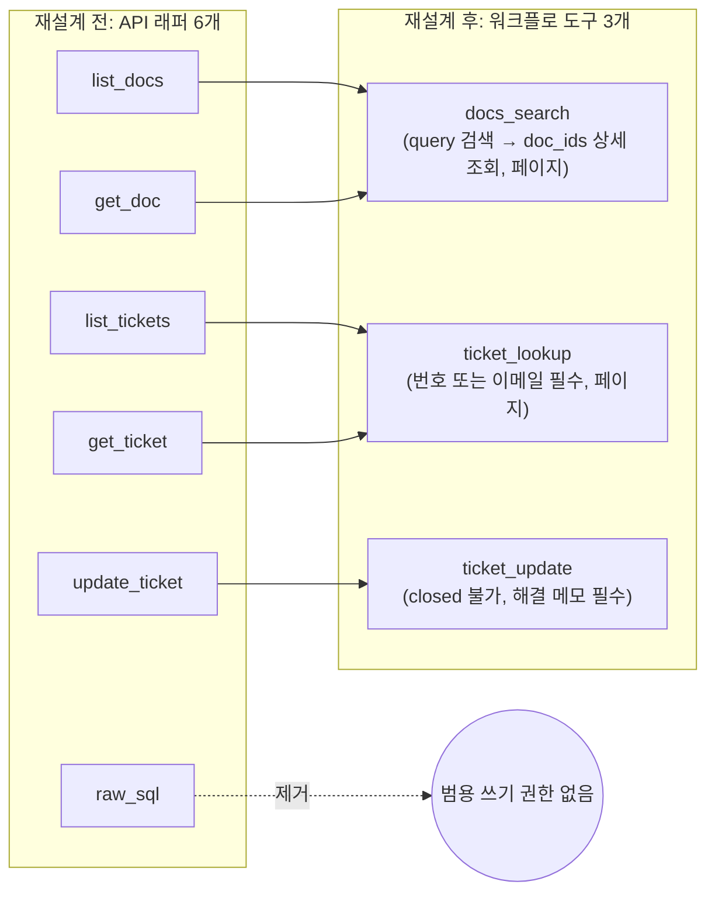
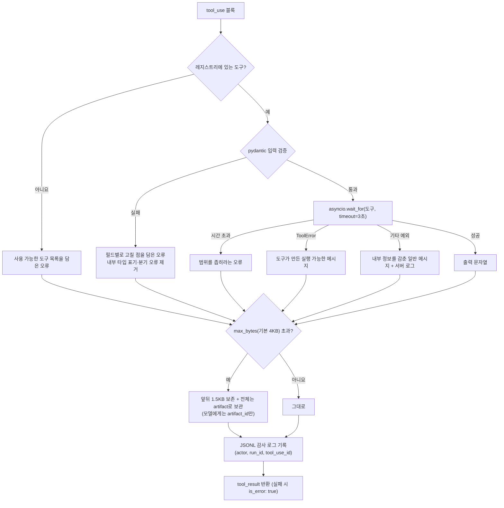

# 3장. 도구 정의와 실행: ACI 설계와 도구 실행기

## 학습 목표

- ACI 원칙에 따라 기존 API 래퍼형 도구를 워크플로 단위 도구로 재설계할 수 있다
- @beta_tool과 strict: true, additionalProperties: false로 스키마가 엄격한 도구를 정의하고 pydantic으로 입력을 재검증할 수 있다
- Agent SDK의 @tool과 create_sdk_mcp_server로 인프로세스 MCP 도구 서버를 만들고 readOnlyHint를 적용할 수 있다
- 타임아웃, 에러 변환, 출력 오프로딩, 감사 로그를 갖춘 공통 도구 실행기를 구현할 수 있다
- 모델이 읽고 스스로 고칠 수 있는 실행 가능한 에러 메시지를 작성할 수 있다

## 3.1 도입 사례: 도구가 나쁘면 루프가 아무리 좋아도 실패합니다

2장에서는 `stop_reason == "tool_use"`이면 도구를 실행하고 `tool_result`를 붙이는 에이전트 루프를 만들었습니다. 이번 장에서는 그 루프가 **무엇을** 실행하느냐를 다룹니다. 1장부터 만들어 온 사내 문서 Q&A·티켓 처리 에이전트는 처음에 백엔드 API를 그대로 감싼 도구 6개를 쓰고 있었습니다.

| 기존 도구 | 하는 일 |
|---|---|
| `list_docs()` | 모든 문서의 제목과 본문 반환 |
| `get_doc(id)` | 문서 하나 반환 |
| `list_tickets()` | 모든 티켓 반환 |
| `get_ticket(id)` | 티켓 하나 반환(담당자는 내부 사용자 ID) |
| `update_ticket(id, status, comment)` | 아무 상태로나 변경 |
| `raw_sql(query)` | 임의 SQL 실행 |

사용자가 "123번 티켓에 VPN 재설치 방법을 남기고 해결 처리해 줘"라고 요청하면 아래와 같은 트랜스크립트(실행 기록)가 나올 수 있습니다. 설명을 위해 만든 가상의 예시입니다.

```text
[turn 1] list_tickets({})            → 티켓 전체 JSON, 수만 토큰
[turn 2] get_ticket({"id": "123"})   → "KeyError: '123'"
[turn 3] raw_sql({"query": "SELECT * FROM tickets WHERE id LIKE '%123%'"}) → 3건
[turn 4] list_docs({})               → 문서 40개 본문 전체, 다시 수만 토큰
[turn 5] raw_sql({"query": "UPDATE tickets SET status='closed' WHERE id LIKE '%123%'"}) → 3 rows affected
```

이 실패의 원인은 모델 성능이 아닙니다. 도구가 모델에게 **잘못 쓰기 쉬운 인터페이스**를 줬기 때문입니다. 전체 목록 도구는 컨텍스트를 낭비하게 만들고, `id`라는 모호한 파라미터는 어떤 형식으로 넣어야 하는지 알려 주지 않습니다. 파이썬 예외 문자열은 다음에 무엇을 해야 할지 말해 주지 않고, `raw_sql`은 티켓 세 건을 한꺼번에 닫아 버리는 사고를 막지 못합니다.

Anthropic은 "Building effective agents"에서 사람-컴퓨터 인터페이스(HCI)에 쏟는 만큼의 노력을 **ACI(Agent-Computer Interface, 에이전트와 컴퓨터가 만나는 접점)**에도 쏟으라고 권합니다. 같은 글에는 SWE-bench용 에이전트를 만들 때 전체 프롬프트보다 도구를 다듬는 데 더 많은 시간을 썼다는 경험담도 나옵니다. 이 장에서는 ACI 원칙에 따라 도구를 다시 설계하고, 모든 도구 호출이 반드시 거쳐 가는 **공통 도구 실행기(executor)**를 만듭니다.

## 3.2 ACI 원칙: 도구는 모델을 위한 사용자 인터페이스입니다

### 도구 설명은 신입 개발자용 문서처럼 씁니다

모델은 도구의 이름, 설명, 입력 스키마만 보고 도구를 고릅니다. Anthropic은 팀에 막 합류한 개발자에게 건네는 문서처럼 도구 설명을 쓰라고 권합니다. 좋은 설명에는 다음 다섯 가지가 들어갑니다.

1. **무엇을 하는가**: 한 문장 요약
2. **언제 쓰는가 / 언제 쓰지 않는가**: 비슷한 도구와의 경계
3. **파라미터 형식**: 예시 값 포함
4. **사용 팁**: 토큰을 아끼는 순서(예: 먼저 concise로 훑기)
5. **반환 형태**: 어떤 필드가 돌아오는지

"Effective context engineering"은 각 도구가 자기완결적이어야 하고 서로 기능이 겹치지 않아야 한다고 강조합니다. 사람 엔지니어도 어느 도구를 써야 할지 단정하기 어려운 상황이라면 에이전트도 헷갈립니다.

### 적은 도구, 워크플로 단위

"Writing effective tools for agents"는 API 엔드포인트마다 도구를 하나씩 만들지 말고, 효과가 큰 **워크플로**에 맞춘 소수의 도구를 만들라고 권합니다. `list_all` 대신 `search`를 두는 것이 대표적인 예입니다. 사람은 목록을 눈으로 훑으면 되지만, 모델에게 목록 전체는 컨텍스트에 그대로 쌓이는 토큰입니다.

도구 정의도 요청할 때마다 입력 토큰으로 들어갑니다. 그래서 다른 조건이 같다면 도구 수가 줄수록 매 요청의 고정 비용도 줄어듭니다. 다만 설명을 앞의 다섯 항목대로 충실히 쓰면 도구 하나가 차지하는 토큰은 늘어납니다. 실제로 줄었는지는 실습 5단계에서 `count_tokens`로 직접 잽니다. 또 도구 정의가 바뀌면 프롬프트 캐시 전체가 무효화되므로(9장), 도구 목록은 작고 안정적으로 유지하는 편이 좋습니다.

### 네임스페이싱과 모호하지 않은 파라미터

도구 이름은 `서비스_리소스_동작` 형태로 지어 도구 사이의 경계가 이름에 드러나게 합니다. 이 장의 예제처럼 서비스가 문서와 티켓 둘뿐이라면 `docs_search`, `ticket_update` 정도로 충분합니다. 나중에 Jira 같은 다른 서비스가 붙으면 `helpdesk_ticket_update`, `jira_issue_update`처럼 서비스 접두어를 붙입니다. 다만 Anthropic은 접두어 방식과 접미어 방식 중 어느 쪽이 나은지는 모델마다 다르므로 eval로 확인하라고 조언합니다.

파라미터 이름에도 같은 원칙이 적용됩니다. `id`만으로는 티켓 번호인지 사용자 ID인지 알 수 없습니다. `ticket_id`, `requester_email`처럼 이름만 보고도 무엇을 넣을지 알 수 있게 짓습니다. 반환값도 `assignee_id: "u_8f3a…"` 같은 저수준 ID보다 `assignee: "김민지(IT 네트워크팀)"`처럼 사람이 읽을 수 있는 필드가 낫습니다. 그래야 모델이 사용자 질문에 바로 답할 수 있고, ID를 해석하려고 도구를 한 번 더 부르지 않아도 됩니다.

### 토큰 효율적인 응답: response_format, 페이지네이션, 잘라내기

| 장치 | 구현 | 효과 |
|---|---|---|
| `response_format` | `"concise"`(제목·ID·요약) / `"detailed"`(본문 발췌·메타데이터) | 훑어볼 때와 인용할 때 필요한 상세도를 모델이 고름 |
| 대상 지정 상세 조회 | `doc_ids`(최대 2개)로 고른 문서만 detailed로 받음 | "훑기 → 골라 읽기" 순서를 도구가 직접 지원함 |
| 페이지네이션 | `page`, `page_size`, 응답에 `total`·`has_more` | 필요한 만큼만 더 가져옴 |
| 잘라내기 기본값 | 결과 개수 상한(detailed는 2건), 도구 안 바이트 예산(발췌 합계 약 2,400바이트) | 도구의 **기본 응답 자체**가 실행기 상한보다 작음 |
| 출력 크기 상한 | 실행기에서 `RunContext.max_bytes`(기본 4KB)를 넘으면 앞뒤만 남기고 전체는 artifact로 보관 | 도구 구현 실수까지 막는 최후 방어선(3.6) |

잘라내기 기본값과 출력 크기 상한은 역할이 다릅니다. 정상적으로 호출된 도구는 실행기 상한에 걸리지 않아야 합니다. 상한에 걸렸다면 도구 설계가 잘못된 것으로 봅니다.

### 다음 행동을 알려 주는 에러 메시지

에러 메시지는 모델이 읽는 피드백입니다. 나쁜 메시지와 좋은 메시지를 나란히 놓고 보겠습니다.

| 나쁜 메시지 | 좋은 메시지 |
|---|---|
| `KeyError: '123'` | `ticket_id는 'TCK-' 접두어와 숫자 6자리여야 합니다. 숫자만 받았다면 'TCK-000123'으로 다시 호출하세요.` |
| `ValidationError` | `new_status='resolved'이면 resolution_note가 필요합니다. 해결 방법과 근거 doc_id를 1~3문장으로 적어 다시 호출하세요.` |
| `Timeout` | `docs_search가 3초 안에 끝나지 않아 중단했습니다. page_size를 줄이거나 검색어를 구체화한 뒤 다시 호출하세요. 같은 입력으로 곧바로 반복하지 마세요.` |

좋은 메시지에는 세 가지가 들어갑니다. **무엇이 틀렸는지**, **어떻게 고치는지**(가능하면 고친 값 예시까지), **고칠 수 없을 때 무엇을 할지**(사용자에게 묻기, 사람에게 넘기기)입니다. 반대로 스택 트레이스나 내부 예외 메시지, 검증 라이브러리의 내부 타입 표기는 모델에게 보여 주지 않습니다. 고치는 데 도움이 되지 않고, 비밀번호 같은 민감 정보가 섞여 나갈 수도 있습니다. 이런 정보는 감사 로그에만 남깁니다.

### poka-yoke: 애초에 틀릴 수 없게 만들기

poka-yoke(포카요케)는 일본 제조업에서 온 말로 "실수를 막는 장치"를 뜻합니다. Anthropic은 에이전트가 루트 디렉터리를 벗어난 뒤 상대경로를 잘못 쓰는 문제를 겪었고, 도구가 절대경로만 받도록 바꿔 해결했다고 소개합니다. 우리 예제에는 다음과 같이 적용합니다.

- `ticket_update`의 `new_status` enum에서 `closed`를 아예 뺍니다. 티켓 종료는 사람만 하므로 모델에게는 이를 표현할 방법 자체가 없어야 합니다.
- `resolved`로 바꿀 때는 `resolution_note`를 필수로 요구합니다.
- `tck-000123`처럼 대소문자가 달라도 정규화해서 받고, 숫자만 오면 올바른 형식을 알려 줍니다.
- 전체 티켓 조회는 지원하지 않습니다. `ticket_id`나 `requester_email` 중 하나가 반드시 있어야 합니다.

## 3.3 예제 도구 재설계: 6개에서 3개로

위 원칙을 적용하면 도구는 다음과 같이 정리됩니다.



| 새 도구 | 읽기 전용 | 합친 이유 |
|---|---|---|
| `docs_search` | 예 | 목록 조회와 단건 조회를 "찾고(query) → 골라 읽기(doc_ids)"라는 워크플로 하나로 합침. 단건 조회 기능은 `doc_ids`로 남김 |
| `ticket_lookup` | 예 | 전체 목록을 없애고 키가 있는 조회만 허용. 이메일 조회 결과는 페이지 단위로 반환 |
| `ticket_update` | 아니요 | 허용된 상태 전이만 표현할 수 있음 |
| (`raw_sql` 제거) | - | 범용 SQL은 최소 권한 원칙에 어긋남. 필요한 동작이 생기면 좁은 전용 도구로 추가하고, 권한 통제는 6장에서 다룸 |

> **합칠 때 잃는 기능이 없는지 확인하세요.** `get_doc`을 `docs_search`에 합치면서 특정 문서를 지정하는 파라미터를 빠뜨렸다고 해 봅시다. 도구 설명에는 "인용할 문서만 detailed로 다시 조회하라"고 써 놓았지만 모델에게는 그렇게 할 방법이 없습니다. 결국 모델은 detailed로 다시 검색하고, 결과 5~10건의 긴 발췌를 한꺼번에 받습니다. 예를 들어 "신청"이 들어간 질문은 `DOC-GEN` 문서 36개에 모두 걸립니다. 도구 설명이 권하는 사용법은 반드시 파라미터로 실행할 수 있어야 합니다.

프로젝트 구조는 다음과 같습니다. 모든 명령은 `helpdesk/` 루트에서 실행합니다.

```text
helpdesk/
├─ pyproject.toml          # pytest가 루트를 import 경로에 넣도록 설정
├─ conftest.py             # 빈 파일(루트 표시용, 선택)
├─ harness/
│  ├─ __init__.py          # 빈 파일
│  ├─ executor.py          # 3.6 공통 도구 실행기
│  ├─ agent_sdk_tools.py   # 3.5 Agent SDK 버전
│  └─ tools/
│     ├─ __init__.py       # 빈 파일
│     ├─ errors.py         # ToolError
│     ├─ models.py         # pydantic 입력 모델
│     ├─ schema.py         # strict 스키마 변환
│     ├─ impl.py           # 도구 구현(예제용 메모리 DB)
│     └─ registry.py       # ToolSpec과 REGISTRY
├─ legacy_tools.py         # 재설계 전 6개 도구(이 장의 예제 저장소에 제공, 실습 3단계에 전체 코드)
├─ beta_tool_demo.py       # 3.4 @beta_tool 빠른 시작
├─ beta_tool_error_check.py# 3.4 예외 → is_error 변환 확인
├─ beta_tool_strict.py     # 3.4 @beta_tool 정의에 strict 덧붙이기
├─ check_models.py         # 실습 2단계
├─ count_tool_tokens.py    # 실습 5단계
├─ eval/questions.jsonl
├─ compare.py              # 실습 6단계
└─ tests/test_executor.py
```

```toml
# pyproject.toml
[project]
name = "helpdesk"
version = "0.1.0"
requires-python = ">=3.11"

[tool.pytest.ini_options]
pythonpath = ["."]      # tests/에서 `import harness`가 되도록 루트를 경로에 추가
testpaths = ["tests"]
```

먼저 입력 모델을 만듭니다. 형식은 pydantic의 `Field`와 `AfterValidator`로 표현하고, 필드 사이의 규칙은 `model_validator`로 표현합니다. 검증에 실패했을 때의 메시지는 앞에서 본 "다음 행동" 형식으로 씁니다.

```python
# harness/tools/errors.py
class ToolError(Exception):
    """모델에게 그대로 보여 줘도 되는, 다음 행동이 담긴 오류."""
```

```python
# harness/tools/models.py
import re
from typing import Annotated, Literal
from pydantic import AfterValidator, BaseModel, ConfigDict, Field, model_validator

TICKET_ID = re.compile(r"^TCK-\d{6}$")


def normalize_ticket_id(v: str) -> str:
    v = v.strip().upper()
    if v.isdigit():
        raise ValueError(
            f"ticket_id는 'TCK-' 접두어와 숫자 6자리여야 합니다. "
            f"숫자만 받았다면 'TCK-{int(v):06d}'로 다시 호출하세요."
        )
    if not TICKET_ID.match(v):
        raise ValueError("ticket_id 형식은 TCK-000123입니다. 번호를 모르면 requester_email로 조회하세요.")
    return v


def normalize_doc_id(v: str) -> str:
    return v.strip().upper()


# 문자열 검증이 끝난 뒤 정규화 함수를 거치는 타입. 여러 모델에서 재사용합니다.
TicketId = Annotated[str, AfterValidator(normalize_ticket_id)]
DocId = Annotated[str, AfterValidator(normalize_doc_id)]


class DocsSearchInput(BaseModel):
    model_config = ConfigDict(extra="forbid")
    query: str | None = Field(None, min_length=2, max_length=200,
                              description="검색어. 사용자 질문의 핵심 단어 2~5개. 예: 'VPN macOS 재설치'. "
                                          "doc_ids를 줄 때는 생략")
    doc_ids: list[DocId] | None = Field(None, min_length=1, max_length=2,
                                        description="자세히 읽을 문서 ID 1~2개. 예: ['DOC-VPN-01']. "
                                                    "주면 query는 무시하고 이 문서들만 detailed로 돌려줌")
    response_format: Literal["concise", "detailed"] = Field(
        "concise", description="query 검색 결과의 상세도. concise: doc_id·제목·요약(최대 200자). "
                               "detailed: 본문 발췌(최대 1,000자)와 담당 부서·수정일, 최대 2건")
    page: int = Field(1, ge=1, description="1부터 시작하는 페이지 번호")
    page_size: int = Field(5, ge=1, le=10, description="페이지당 결과 수(detailed는 최대 2로 줄어듦)")

    @model_validator(mode="after")
    def need_query_or_ids(self):
        if not self.query and not self.doc_ids:
            raise ValueError("query나 doc_ids 중 하나가 필요합니다. 먼저 query로 concise 검색을 하고, "
                             "인용할 문서만 doc_ids로 다시 조회하세요.")
        return self


class TicketLookupInput(BaseModel):
    model_config = ConfigDict(extra="forbid")
    ticket_id: TicketId | None = Field(None, description="티켓 번호. 형식 TCK-000123")
    requester_email: str | None = Field(None, description="요청자 회사 이메일. 티켓 번호를 모를 때 사용")
    status: Literal["open", "pending", "resolved", "closed"] | None = Field(
        None, description="requester_email과 함께 쓰는 상태 필터")
    response_format: Literal["concise", "detailed"] = Field(
        "concise", description="concise: 상태·제목·담당자. detailed: 최근 코멘트 5개(각 150자까지) 포함. "
                               "detailed는 ticket_id로 한 건을 조회할 때만 적용")
    page: int = Field(1, ge=1, description="requester_email 조회 결과의 페이지 번호(1부터)")
    page_size: int = Field(5, ge=1, le=10, description="requester_email 조회 결과의 페이지당 건수")

    @model_validator(mode="after")
    def need_key(self):
        if not self.ticket_id and not self.requester_email:
            raise ValueError("ticket_id나 requester_email 중 하나가 필요합니다. 전체 목록 조회는 지원하지 않으니 "
                             "사용자에게 티켓 번호나 이메일을 물어보세요.")
        return self


class TicketUpdateInput(BaseModel):
    model_config = ConfigDict(extra="forbid")
    ticket_id: TicketId = Field(description="갱신할 티켓 번호. 형식 TCK-000123")
    comment: str = Field(min_length=5, max_length=2000,
                         description="요청자에게 그대로 보이는 코멘트. 존댓말로 쓰고 내부 메모는 넣지 마세요.")
    new_status: Literal["pending", "resolved"] | None = Field(
        None, description="상태를 바꿀 때만 지정. closed는 사람 담당자만 할 수 있습니다.")
    resolution_note: str | None = Field(
        None, description="new_status가 resolved일 때 필수. 해결 방법 1~3문장과 근거 doc_id")

    @model_validator(mode="after")
    def resolved_needs_note(self):
        if self.new_status == "resolved" and not self.resolution_note:
            raise ValueError("new_status='resolved'이면 resolution_note가 필요합니다. 해결 방법과 근거 doc_id"
                             "(예: DOC-VPN-01)를 1~3문장으로 적어 다시 호출하세요.")
        return self
```

`TicketId | None`에서는 값이 문자열일 때만 정규화가 실행되고 `None`은 그대로 통과합니다. 다만 검증에 실패하면 pydantic 버전과 타입 구성에 따라 유니언의 각 분기 오류가 함께 보고될 수 있습니다. 이 오류를 모델에게 보여 줄 형태로 정리하는 일은 3.6의 실행기가 맡습니다.

도구 구현은 예제용 메모리 데이터로 만듭니다. 실제 서비스라면 검색 엔진이나 티켓 시스템 API를 부르는 부분만 바꾸면 됩니다. 전체 목록 도구가 얼마나 비싼지 실습에서 드러나도록 일반 문의 티켓 300건을 더 넣어 둡니다. 눈여겨볼 부분은 `EXCERPT_BUDGET_BYTES`입니다. 결과 수가 많을수록 문서 하나에 돌아가는 발췌가 짧아지도록 나눠 쓰기 때문에, 어떤 파라미터 조합으로 호출해도 응답이 실행기 상한(4KB)을 넘지 않습니다.

```python
# harness/tools/impl.py
import copy
import json
from .errors import ToolError
from .models import DocsSearchInput, TicketLookupInput, TicketUpdateInput

EXCERPT_BUDGET_BYTES = 2400   # 한 응답의 발췌 합계. 실행기 상한(4KB)보다 넉넉히 작게 잡습니다
DETAILED_MAX = 2              # query 검색을 detailed로 할 때 돌려줄 최대 건수
COMMENT_CLIP = 150            # 티켓 detailed 응답의 코멘트 하나당 최대 글자 수

DOCS = [
    {"doc_id": "DOC-VPN-01", "title": "VPN 클라이언트 설치와 재설치(macOS)", "owner": "IT 네트워크팀",
     "updated": "2026-09-01", "body": "VPN 클라이언트를 재설치하려면 기존 앱을 삭제하고 셀프서비스 포털에서 "
     "최신 버전을 내려받습니다. 설치 후 회사 계정으로 로그인하고 OTP를 입력합니다. " * 8},
    {"doc_id": "DOC-HR-03", "title": "연차와 반차 사용 규정", "owner": "인사팀", "updated": "2026-03-02",
     "body": "연차는 반차(4시간) 단위로 나눠 쓸 수 있으며 전자결재로 신청합니다. " * 8},
    {"doc_id": "DOC-SEC-02", "title": "비밀번호 정책", "owner": "보안팀", "updated": "2026-05-10",
     "body": "사내 계정 비밀번호는 90일마다 변경하며 최근 5개와 같은 비밀번호는 쓸 수 없습니다. " * 8},
    {"doc_id": "DOC-SEC-05", "title": "이동식 저장장치(USB) 사용 규칙", "owner": "보안팀", "updated": "2026-06-20",
     "body": "USB 메모리는 보안팀에 등록한 암호화 장치만 사용할 수 있습니다. " * 8},
] + [
    {"doc_id": f"DOC-GEN-{i:02d}", "title": f"부서 운영 안내 {i}", "owner": "경영지원팀", "updated": "2026-01-15",
     "body": f"부서 운영 안내 {i}번 문서입니다. 회의실 예약, 비품 신청, 출장 정산 절차를 설명합니다. " * 15}
    for i in range(36)
]

TICKETS = {
    "TCK-000123": {"title": "VPN 접속 불가(macOS)", "status": "pending", "requester": "jun.lee@corp.example",
                   "assignee": "김민지(IT 네트워크팀)", "comments": ["재부팅 후에도 연결이 끊깁니다."]},
    "TCK-000245": {"title": "모니터 추가 요청", "status": "open", "requester": "minji.park@corp.example",
                   "assignee": "박서준(자산관리팀)", "comments": ["27인치 모니터 1대 요청합니다."]},
    "TCK-000045": {"title": "메일 용량 초과", "status": "resolved", "requester": "jun.lee@corp.example",
                   "assignee": "김민지(IT 네트워크팀)", "comments": ["보관함 정리 후 해결되었습니다."]},
}
TICKETS |= {  # 전체 목록 도구의 비용을 보여 주기 위한 일반 문의 300건
    f"TCK-{100000 + i}": {"title": f"일반 문의 {i}", "status": ["open", "pending", "resolved"][i % 3],
                          "requester": f"user{i:03d}@corp.example", "assignee": "박서준(자산관리팀)",
                          "comments": [f"일반 문의 {i}번 내용입니다."]}
    for i in range(300)
}
_INITIAL = copy.deepcopy(TICKETS)


def reset() -> None:
    TICKETS.clear()
    TICKETS.update(copy.deepcopy(_INITIAL))


def _dump(obj) -> str:
    return json.dumps(obj, ensure_ascii=False)


def _clip(text: str, max_bytes: int) -> str:
    """UTF-8 바이트 기준으로 자르되 멀티바이트 글자를 깨뜨리지 않습니다."""
    data = text.encode("utf-8")
    if len(data) <= max_bytes:
        return text
    return data[:max_bytes].decode("utf-8", "ignore") + "…"


def _doc_row(d: dict, detailed: bool, per_doc_bytes: int) -> dict:
    row = {"doc_id": d["doc_id"], "title": d["title"],
           "excerpt": _clip(d["body"][:1000 if detailed else 200], per_doc_bytes)}
    if detailed:
        row |= {"owner": d["owner"], "updated": d["updated"]}
    return row


def docs_search(a: DocsSearchInput) -> str:
    if a.doc_ids:  # 골라 읽기: 지정한 문서만 detailed로
        by_id = {d["doc_id"]: d for d in DOCS}
        missing = [i for i in a.doc_ids if i not in by_id]
        if missing:
            raise ToolError(f"없는 doc_id입니다: {', '.join(missing)}. query로 먼저 검색해 결과의 doc_id를 "
                            "그대로 넣으세요.")
        per_doc = EXCERPT_BUDGET_BYTES // len(a.doc_ids)
        return _dump({"results": [_doc_row(by_id[i], True, per_doc) for i in a.doc_ids]})

    terms = [t.lower() for t in a.query.split()]
    scored = []
    for d in DOCS:
        text = f"{d['title']} {d['body']}".lower()
        score = sum(text.count(t) for t in terms)
        if score:
            scored.append((score, d))
    if not scored:
        return _dump({"results": [], "total": 0, "hint": "일치하는 문서가 없습니다. 더 짧거나 다른 표현"
                      "(예: '원격 접속' 대신 'VPN')으로 다시 검색하세요."})
    scored.sort(key=lambda x: -x[0])
    detailed = a.response_format == "detailed"
    size = min(a.page_size, DETAILED_MAX) if detailed else a.page_size
    start = (a.page - 1) * size
    page_docs = [d for _, d in scored[start:start + size]]
    per_doc = EXCERPT_BUDGET_BYTES // max(len(page_docs), 1)
    return _dump({"results": [_doc_row(d, detailed, per_doc) for d in page_docs],
                  "total": len(scored), "page": a.page, "page_size": size,
                  "has_more": start + size < len(scored)})


def _summary(tid: str, t: dict, detailed: bool) -> dict:
    row = {"ticket_id": tid, "title": t["title"], "status": t["status"], "assignee": t["assignee"]}
    if detailed:
        row["recent_comments"] = [c if len(c) <= COMMENT_CLIP else c[:COMMENT_CLIP] + "…"
                                  for c in t["comments"][-5:]]
    return row


def ticket_lookup(a: TicketLookupInput) -> str:
    if a.ticket_id:
        t = TICKETS.get(a.ticket_id)
        if t is None:
            raise ToolError(f"{a.ticket_id} 티켓이 없습니다. 번호를 다시 확인하거나 requester_email로 조회하세요.")
        return _dump(_summary(a.ticket_id, t, a.response_format == "detailed"))
    email = a.requester_email.strip().lower()
    rows = [_summary(tid, t, False) for tid, t in TICKETS.items()   # 목록은 항상 concise
            if t["requester"] == email and (a.status is None or t["status"] == a.status)]
    start = (a.page - 1) * a.page_size
    has_more = start + a.page_size < len(rows)
    out = {"results": rows[start:start + a.page_size], "total": len(rows), "page": a.page, "has_more": has_more}
    if not rows:
        out["hint"] = "이 조건으로 접수된 티켓이 없습니다. 이메일 철자를 확인하거나 status 필터를 빼고 다시 조회하세요."
    elif has_more:
        out["hint"] = f"결과가 {len(rows)}건입니다. status로 좁히거나 page={a.page + 1}로 다음 페이지를 보세요."
    return _dump(out)


def ticket_update(a: TicketUpdateInput) -> str:
    t = TICKETS.get(a.ticket_id)
    if t is None:
        raise ToolError(f"{a.ticket_id} 티켓이 없습니다. ticket_lookup으로 번호를 먼저 확인하세요.")
    if t["status"] == "closed":
        raise ToolError(f"{a.ticket_id}는 이미 closed라 수정할 수 없습니다. 사용자에게 새 티켓 생성을 안내하세요.")
    t["comments"].append(a.comment)
    if a.new_status:
        t["status"] = a.new_status
    if a.resolution_note:
        t["resolution_note"] = a.resolution_note
    return _dump({"ticket_id": a.ticket_id, "status": t["status"], "comment_count": len(t["comments"])})
```

`ticket_update`는 재시도 과정에서 같은 코멘트를 두 번 달 수 있습니다. 멱등 키로 중복 실행을 막는 방법은 7장에서 다룹니다.

## 3.4 Anthropic SDK로 정의하기: @beta_tool, strict, pydantic 재검증

### 빠른 시작: @beta_tool

Anthropic Python SDK의 `@beta_tool`은 함수의 타입 힌트와 docstring을 읽어 입력 스키마를 만들어 줍니다. `client.beta.messages.tool_runner`와 함께 쓰면 2장에서 직접 짠 루프를 SDK가 대신 돌려 줍니다.

```python
# beta_tool_demo.py
import json
from typing import Literal
from anthropic import Anthropic, beta_tool
from pydantic import ValidationError
from harness.executor import _validation_message
from harness.tools import impl
from harness.tools.errors import ToolError
from harness.tools.models import DocsSearchInput

MODEL = "claude-sonnet-4-5"  # 1장에서 고정한 모델 ID로 바꾸세요


@beta_tool
def docs_search(query: str | None = None, doc_ids: list[str] | None = None,
                response_format: Literal["concise", "detailed"] = "concise", page: int = 1) -> str:
    """사내 문서(IT 가이드, 인사 규정, 보안 정책)를 검색하거나 지정한 문서를 자세히 읽습니다.
    티켓 상태 확인에는 쓰지 말고 ticket_lookup을 쓰세요.
    먼저 query로 concise 검색을 하고, 인용할 문서 1~2개만 doc_ids로 다시 조회하세요.

    Args:
        query: 핵심 단어 2~5개. 예: 'VPN macOS 재설치'. doc_ids를 줄 때는 생략
        doc_ids: 자세히 읽을 문서 ID 1~2개. 예: ['DOC-VPN-01']
        response_format: query 검색 결과의 상세도. 'concise' 또는 'detailed'(최대 2건)
        page: 1부터 시작하는 페이지 번호
    """
    try:  # 스키마와 별개로 pydantic으로 한 번 더 검증
        args = DocsSearchInput(query=query, doc_ids=doc_ids, response_format=response_format, page=page)
    except ValidationError as e:
        # 문자열을 return하면 tool_result에 is_error가 붙지 않습니다.
        # 예외를 던졌을 때 tool_runner가 어떻게 처리하는지는 아래 '확인 단계'에서 직접 봅니다.
        raise ToolError(_validation_message(e)) from e
    return impl.docs_search(args)   # 없는 doc_id면 impl이 ToolError를 던집니다


if __name__ == "__main__":
    # 생성된 스키마를 눈으로 확인합니다(메서드 이름은 SDK 버전에 따라 확인하세요).
    print(json.dumps(docs_search.to_dict(), ensure_ascii=False, indent=2))
    client = Anthropic()
    runner = client.beta.messages.tool_runner(
        model=MODEL, max_tokens=1024, tools=[docs_search],
        messages=[{"role": "user", "content": "맥에서 VPN 다시 까는 법 알려 줘"}],
    )
    for message in runner:
        print(message.content)
```

프로토타입을 만들 때는 이 방식이 가장 빠르지만, 한계도 분명합니다. 타임아웃, 출력 상한, 감사 로그를 넣으려면 함수마다 같은 코드를 반복해야 합니다. 도구 함수 안에서 예외가 났을 때 tool_runner가 그 예외를 어떻게 처리하는지도 SDK 버전마다 다를 수 있습니다.

### 확인 단계: 예외를 던지면 is_error가 될까요?

`ToolError`를 던졌을 때 tool_runner가 `is_error: true`인 `tool_result`로 바꿔 주는지는 쓰고 있는 SDK 버전에서 직접 확인합니다. 아래 스크립트는 항상 실패하는 도구를 한 번 호출하게 만듭니다.

```python
# beta_tool_error_check.py
from anthropic import Anthropic, beta_tool
from beta_tool_demo import MODEL
from harness.tools.errors import ToolError


@beta_tool
def always_fail(reason: str) -> str:
    """실행기 동작 확인용 도구입니다. 호출하면 항상 실패합니다.

    Args:
        reason: 호출 이유 한 문장
    """
    raise ToolError("확인용 오류입니다. 다시 호출하지 말고 사용자에게 실패했다고 알리세요.")


client = Anthropic()
runner = client.beta.messages.tool_runner(
    model=MODEL, max_tokens=512, tools=[always_fail],
    messages=[{"role": "user", "content": "always_fail 도구를 딱 한 번 호출한 뒤 결과를 알려 줘"}],
)
for message in runner:
    for b in message.content:
        print(b.type, getattr(b, "text", "") or getattr(b, "input", ""))
```

SDK의 디버그 로그를 켜면 다음 요청에 실린 `tool_result` 블록을 볼 수 있습니다(로그 형식은 SDK 버전에 따라 다를 수 있습니다).

```bash
# bash
ANTHROPIC_LOG=debug python beta_tool_error_check.py 2>&1 | grep -n "is_error"
```

```powershell
# PowerShell
$env:ANTHROPIC_LOG="debug"; python beta_tool_error_check.py 2>&1 | Select-String "is_error"
```

결과는 셋 중 하나이고, 각 경우에 대응하는 방법이 다릅니다.

| 관찰 결과 | 의미 | 대응 |
|---|---|---|
| `tool_result`에 `"is_error": true`와 메시지가 실림 | tool_runner가 예외를 오류 결과로 바꿔 줌 | 함수 안에서 `ToolError`를 던지는 방식을 그대로 씀 |
| 메시지는 실리지만 `is_error`가 없음 | 문자열로만 바뀜 | 모델은 실패를 구분하기 어려움. 운영에서는 `ToolSpec` 경로를 씀 |
| 예외가 `for` 루프 밖으로 터져 나옴 | runner가 예외를 처리하지 않음 | 루프 전체가 멈춤. 3.6의 실행기처럼 예외를 결과로 바꾸는 층이 필요함 |

어느 경우든 기록해 두면 SDK를 올릴 때 회귀 여부를 확인하는 기준이 됩니다.

### strict tool use와 스키마 변환

Anthropic structured outputs 문서에 따르면, 도구 정의에 `strict: true`를 주면 모델이 만든 도구 입력이 스키마에 맞는 유효한 JSON이라는 것이 보장됩니다. 이때 객체에는 `additionalProperties: false`를 지정합니다. 다만 같은 문서에는 `minimum`/`maximum`, `minLength`/`maxLength` 같은 제약을 지원하지 않는다고 나와 있습니다. 그래서 pydantic이 만든 JSON 스키마에서 이런 키워드를 빼서 설명문으로 옮기고, 실제 검사는 pydantic 재검증에 맡깁니다. 배열 개수 제약(`minItems`/`maxItems`)도 지원 범위가 제한적일 수 있으므로 같은 방식으로 옮깁니다. 정확한 지원 범위는 문서의 목록을 보고 `UNSUPPORTED`를 조정하세요.

> **확인 지점**: 적용하기 전에 structured outputs 문서에서 다음을 확인하세요. ① strict tool use를 지원하는 모델 목록에 1장에서 고정한 모델이 들어 있는지(지원하지 않는 모델이면 API 오류가 납니다), ② strict 도구 수, 선택(optional) 파라미터 수 같은 제한, ③ 베타 헤더가 필요한지(시기에 따라 필요했던 적이 있습니다. 필요하다면 실습 6단계 `compare.py`의 `BETAS`처럼 `client.beta.messages.create(..., betas=[...])`로 보냅니다), ④ 지원하지 않는 스키마 키워드 목록. 이 항목들은 문서 버전에 따라 바뀔 수 있으므로 이 책에는 수치를 적지 않습니다.

```python
# harness/tools/schema.py
from pydantic import BaseModel

UNSUPPORTED = {"minimum", "maximum", "exclusiveMinimum", "exclusiveMaximum",
               "minLength", "maxLength", "multipleOf", "minItems", "maxItems"}


def strictify(schema: dict) -> dict:
    """JSON 스키마 dict를 strict tool use용으로 정리합니다(제자리에서 고친 뒤 반환)."""
    _clean(schema)
    return schema


def to_strict_schema(model: type[BaseModel]) -> dict:
    return strictify(model.model_json_schema())


def _clean(node) -> None:
    if isinstance(node, list):
        for item in node:
            _clean(item)
        return
    if not isinstance(node, dict):
        return
    notes = [f"{k}={node.pop(k)}" for k in sorted(UNSUPPORTED & node.keys())]
    if "default" in node:                      # 기본값은 설명으로 알리고 pydantic이 채움
        default = node.pop("default")
        if default is not None:
            notes.append(f"기본값={default}")
    node.pop("title", None)                    # 토큰 절약
    if notes:
        node["description"] = f"{node.get('description', '')} ({', '.join(notes)})".strip()
    if node.get("type") == "object":
        node["additionalProperties"] = False
    for key, value in node.items():
        if key == "properties":                # 필드 이름을 키워드로 오인하지 않도록 값만 순회
            for prop in value.values():
                _clean(prop)
        else:
            _clean(value)
```

`DocsSearchInput`을 변환하면 다음 스키마가 나옵니다(설명 일부 생략). 모든 필드가 선택 사항이라 `required`는 없고, "둘 중 하나는 필수"라는 규칙은 pydantic의 `model_validator`가 검사합니다.

```json
{
  "type": "object",
  "additionalProperties": false,
  "properties": {
    "query": {
      "anyOf": [{"type": "string", "description": "(maxLength=200, minLength=2)"}, {"type": "null"}],
      "description": "검색어. ... doc_ids를 줄 때는 생략"
    },
    "doc_ids": {
      "anyOf": [{"type": "array", "items": {"type": "string"}, "description": "(maxItems=2, minItems=1)"},
                {"type": "null"}],
      "description": "자세히 읽을 문서 ID 1~2개. ..."
    },
    "response_format": {"type": "string", "enum": ["concise", "detailed"],
                        "description": "query 검색 결과의 상세도. ... (기본값=concise)"},
    "page": {"type": "integer", "description": "1부터 시작하는 페이지 번호 (minimum=1, 기본값=1)"},
    "page_size": {"type": "integer", "description": "페이지당 결과 수... (maximum=10, minimum=1, 기본값=5)"}
  }
}
```

**strict를 켰는데 왜 다시 검증할까요?** strict가 보장하는 것은 "스키마에 맞는 JSON"까지입니다. 길이와 범위 제약, `resolved면 resolution_note 필수` 같은 필드 간 규칙, 티켓 번호 정규화는 스키마로 다룰 수 없습니다. 게다가 strict가 꺼진 도구, 다른 SDK 경로, 테스트 코드처럼 다른 곳에서 입력이 들어올 수도 있습니다. 그러니 입력 검증의 최종 책임은 하네스 코드가 집니다.

### @beta_tool 정의에 strict 덧붙이기

이 장을 쓰는 시점에 `@beta_tool` 데코레이터 자체에서 `strict`를 켜는 옵션은 Python SDK 문서에서 확인하지 못했습니다. 버전에 따라 추가될 수 있으니 쓰고 있는 SDK의 문서를 확인하세요. 옵션이 없어도 방법은 있습니다. 데코레이터가 만든 정의를 dict로 꺼내고, 앞의 `strictify`로 정리한 뒤 `strict: true`를 덧붙여 `messages.create`로 직접 보내면 됩니다.

```python
# beta_tool_strict.py — @beta_tool이 만든 정의에 strict를 덧붙여 보냅니다
import asyncio
import copy
from anthropic import Anthropic
from beta_tool_demo import MODEL, docs_search
from harness.executor import RunContext, execute_tool
from harness.tools.registry import REGISTRY
from harness.tools.schema import strictify

defn = copy.deepcopy(docs_search.to_dict())              # 메서드 이름은 SDK 버전에 따라 확인
defn["input_schema"] = strictify(defn["input_schema"])   # 미지원 키워드를 설명으로 옮기고 additionalProperties: false
defn["strict"] = True

client = Anthropic()
# 베타 헤더가 필요한 SDK·모델이라면 client.beta.messages.create(..., betas=["<문서의 헤더 값>"])로 바꿉니다.
resp = client.messages.create(
    model=MODEL, max_tokens=1024, tools=[defn],
    messages=[{"role": "user", "content": "맥에서 VPN 다시 까는 법 알려 줘"}],
)
for b in resp.content:
    if b.type == "tool_use":
        print("입력:", b.input)                            # 스키마에 맞는 JSON
        r = asyncio.run(execute_tool(b.name, b.id, b.input, REGISTRY, RunContext("beta-strict", actor="demo")))
        print("결과:", r["content"][:300], "is_error" if r.get("is_error") else "")
```

이렇게 덧붙인 dict 정의를 tool_runner가 실행 가능한 도구로 받아 주는지는 확인하지 못했습니다. 그래서 이 경로에서는 tool_runner의 자동 실행 대신 2장의 직접 루프(여기서는 3.6의 `execute_tool`)로 실행합니다. 결국 strict를 쓰려고 하면 운영용 `ToolSpec` 경로와 구조가 같아집니다. 두 경로를 정리하면 다음과 같습니다.

| 구분 | `@beta_tool` 경로(프로토타입용) | `ToolSpec.to_api()` 경로(운영 하네스용) |
|---|---|---|
| 스키마 출처 | 타입 힌트 + docstring | pydantic 입력 모델 |
| `strict: true`, `additionalProperties: false` | 데코레이터 옵션은 확인하지 못함. `to_dict()` 결과에 `strictify`와 `strict`를 덧붙여 직접 보냄 | `to_strict_schema`로 명시적으로 넣음 |
| 범위·교차 필드 검증 | 함수 안에서 pydantic을 직접 호출 | 실행기가 일괄 처리 |
| 루프 | `tool_runner`(strict를 덧붙이면 직접 루프) | 2장 루프 + `execute_tool_calls()` |
| 타임아웃·출력 상한·감사 로그 | 함수마다 직접 구현 | 실행기 한곳 |
| 실패 표시 | `ToolError`를 던졌을 때의 처리는 버전별로 확인(위 확인 단계) | `is_error: true` 자동 |

> **연습 과제**: `ticket_lookup`과 `ticket_update`도 `@beta_tool` 버전으로 만들어 보세요. 함수 안에서 `TicketLookupInput(...)`, `TicketUpdateInput(...)`으로 재검증하고, 오류가 나면 `ToolError`를 던집니다. 다 만든 뒤 `to_dict()` 결과와 아래 `ToolSpec.to_api()` 결과를 나란히 놓고 `strict`, `additionalProperties`, 제약 키워드가 어떻게 다른지 표로 정리합니다.

### ToolSpec과 레지스트리

도구 하나에 필요한 정보(이름, 설명, 입력 모델, 구현, 읽기 전용 여부, 타임아웃)를 `ToolSpec`으로 묶습니다. 이 레지스트리 하나로 Messages API용 정의와 Agent SDK용 정의를 모두 만듭니다. `strict=False`인 도구(실습의 레거시 도구)는 pydantic 스키마에서 최상위 `title`만 빼고 그대로 보냅니다. strict 변환을 적용하지 않으므로 레거시 도구 본래의 느슨한 스키마가 그대로 유지됩니다.

```python
# harness/tools/registry.py
from dataclasses import dataclass
from typing import Callable
from pydantic import BaseModel
from . import impl, models
from .schema import to_strict_schema


@dataclass(frozen=True)
class ToolSpec:
    name: str
    description: str
    input_model: type[BaseModel]
    fn: Callable
    read_only: bool
    timeout_s: float = 3.0
    strict: bool = True

    def to_api(self) -> dict:
        if self.strict:
            schema = to_strict_schema(self.input_model)
        else:                                   # 느슨한 스키마는 그대로(제목만 제거)
            schema = self.input_model.model_json_schema()
            schema.pop("title", None)
        d = {"name": self.name, "description": self.description, "input_schema": schema}
        if self.strict:
            d["strict"] = True
        return d


DOCS_SEARCH = """사내 문서(IT 가이드, 인사 규정, 보안 정책)를 검색하거나, 지정한 문서를 자세히 읽습니다.
언제 쓰나: 사용자 질문에 답하기 전에 근거 문서를 찾고 인용할 내용을 확인할 때. 답변에는 여기서 받은 doc_id를 인용합니다.
쓰지 않을 때: 티켓 상태나 담당자 확인(ticket_lookup을 쓰세요).
사용 순서: ① query로 concise 검색해 후보를 훑습니다. ② 인용할 문서 1~2개의 doc_id를 doc_ids에 넣어 다시 호출하면
그 문서만 detailed(본문 발췌, 담당 부서, 수정일)로 돌려줍니다. doc_ids를 주면 query는 무시합니다.
상위 결과로 답할 수 있으면 has_more가 true여도 다음 페이지를 보지 마세요.
응답 크기: 발췌 합계는 약 2,400바이트로 제한되어 결과가 많을수록 발췌가 짧아집니다. query 검색을 detailed로 하면 최대 2건입니다.
반환: {"results": [{"doc_id", "title", "excerpt"}], "total", "page", "page_size", "has_more"}
(doc_ids 조회는 results만 돌려주며 각 항목에 owner, updated가 추가됩니다)"""

TICKET_LOOKUP = """헬프데스크 티켓을 번호(ticket_id) 또는 요청자 이메일(requester_email)로 조회합니다.
둘 중 하나는 반드시 필요하며 전체 목록 조회는 지원하지 않습니다.
사용자가 '123번 티켓'이라고 말하면 ticket_id='TCK-000123'으로 바꿔 넣으세요.
이메일 조회는 페이지 단위(page, page_size)로 돌려줍니다. has_more가 true면 status로 좁히거나 다음 page를 요청하세요.
detailed(최근 코멘트 포함)는 ticket_id로 한 건을 조회할 때만 적용됩니다.
반환: ticket_id, title, status(open|pending|resolved|closed), assignee(이름과 부서).
이메일 조회는 {"results", "total", "page", "has_more", "hint"(있을 때만)}"""

TICKET_UPDATE = """티켓에 코멘트를 남기고, 필요하면 상태를 pending 또는 resolved로 바꿉니다.
resolved로 바꿀 때는 resolution_note(해결 방법과 근거 doc_id)가 필수입니다.
closed 처리와 삭제는 할 수 없습니다. 그런 요청을 받으면 이 도구를 호출하지 말고(코멘트도 남기지 말고),
사람 담당자에게 넘기겠다고 답변으로만 안내하세요.
쓰기 전에 ticket_lookup으로 현재 상태를 확인하세요."""

REGISTRY: dict[str, ToolSpec] = {s.name: s for s in [
    ToolSpec("docs_search", DOCS_SEARCH, models.DocsSearchInput, impl.docs_search, read_only=True),
    ToolSpec("ticket_lookup", TICKET_LOOKUP, models.TicketLookupInput, impl.ticket_lookup, read_only=True),
    ToolSpec("ticket_update", TICKET_UPDATE, models.TicketUpdateInput, impl.ticket_update, read_only=False),
]}
TOOLS = [s.to_api() for s in REGISTRY.values()]  # 순서를 고정해 프롬프트 캐시를 지킵니다(9장)
```

## 3.5 Agent SDK로 정의하기: @tool, create_sdk_mcp_server, readOnlyHint

Claude Agent SDK에서는 `@tool` 데코레이터로 도구를 정의하고, `create_sdk_mcp_server`로 묶어 **인프로세스 MCP 서버**를 만듭니다. MCP(Model Context Protocol)는 도구를 에이전트에 연결하는 표준 프로토콜입니다. 인프로세스란 별도 프로세스를 띄우지 않고 내 파이썬 프로세스 안에서 도구 함수가 실행된다는 뜻입니다. SDK 참조 문서에 따르면 이렇게 등록한 도구는 `mcp__<서버>__<도구>`라는 이름으로 모델에 노출됩니다.

핸들러는 `dict`를 받아 `{"content": [...]}`를 돌려주고, 실패했을 때는 `is_error: True`를 붙입니다. 아래 코드는 핸들러를 따로 구현하지 않고 3.6의 `execute_tool()`에 맡깁니다. 그래서 Messages API 버전과 Agent SDK 버전이 **같은 검증, 타임아웃, 감사 로그**를 공유합니다.

```python
# harness/agent_sdk_tools.py
import asyncio
import uuid
from claude_agent_sdk import ClaudeAgentOptions, ClaudeSDKClient, ResultMessage, create_sdk_mcp_server, tool
from mcp.types import ToolAnnotations
from harness.executor import RunContext, execute_tool
from harness.tools.registry import REGISTRY, ToolSpec
from harness.tools.schema import to_strict_schema

# 데모 범위에서 끌 내장 도구. 정확한 이름 목록은 쓰고 있는 Agent SDK 문서에서 확인하세요.
BUILTIN_TOOLS = ["Bash", "Read", "Write", "Edit", "Glob", "Grep", "WebFetch", "WebSearch"]
SYSTEM_PROMPT = ("당신은 사내 헬프데스크 에이전트입니다. helpdesk 도구만 사용해 문서와 티켓을 확인하고, "
                 "답변에는 근거 doc_id를 인용하세요.")


def as_sdk_tool(spec: ToolSpec, ctx: RunContext):
    @tool(spec.name, spec.description, to_strict_schema(spec.input_model),
          annotations=ToolAnnotations(readOnlyHint=spec.read_only))
    async def handler(args: dict) -> dict:
        # 주의: 이 핸들러는 실제 tool_use_id를 받지 않으므로 임의 ID를 만들어 씁니다.
        # 그래서 이 경로의 감사 로그는 트랜스크립트나 훅 로그의 tool_use_id와 이어 붙일 수 없습니다.
        # 실제 ID가 필요하면 PreToolUse/PostToolUse 훅이 받는 tool_use_id로 기록을 연결합니다(6장, 9장).
        call_id = f"sdk_{uuid.uuid4().hex[:8]}"
        r = await execute_tool(spec.name, call_id, args, REGISTRY, ctx)
        out = {"content": [{"type": "text", "text": r["content"]}]}
        if r.get("is_error"):
            out["is_error"] = True
        return out
    return handler  # 함수 팩토리로 감싸 반복문의 늦은 바인딩 문제를 피합니다


async def main() -> None:
    ctx = RunContext(run_id=f"sdk-{uuid.uuid4().hex[:6]}", actor="demo-user")
    server = create_sdk_mcp_server(name="helpdesk", version="1.0.0",
                                   tools=[as_sdk_tool(s, ctx) for s in REGISTRY.values()])
    options = ClaudeAgentOptions(
        system_prompt=SYSTEM_PROMPT,
        mcp_servers={"helpdesk": server},
        allowed_tools=[f"mcp__helpdesk__{name}" for name in REGISTRY],  # 자동 승인 목록일 뿐(6장)
        disallowed_tools=BUILTIN_TOOLS,                                  # 데모에서는 내장 도구를 끔
        max_turns=10,
    )
    async with ClaudeSDKClient(options=options) as client:
        await client.query("TCK-000123 담당자가 누구인지 알려 주고, 관련 VPN 문서도 찾아 줘")
        async for msg in client.receive_response():
            if isinstance(msg, ResultMessage):
                print(msg.subtype, msg.total_cost_usd)


if __name__ == "__main__":
    asyncio.run(main())
```

이 데모는 헬프데스크 질문만 다루므로 `disallowed_tools`로 Bash, Read 같은 내장 도구를 끄고, 짧은 `system_prompt`로 역할을 고정했습니다. 이렇게 하지 않으면 모델이 헬프데스크 질문에 파일 읽기나 셸 명령을 쓰려고 시도할 수 있습니다. 내장 도구를 끄는 옵션 이름과 도구 이름 목록은 SDK 버전에 따라 다를 수 있으니 문서에서 확인하세요. 승인 콜백과 훅을 이용한 세부 권한 설계는 6장에서 다룹니다.

Agent SDK 경로의 감사 로그에는 실제 `tool_use_id`가 아니라 `sdk_` 접두어가 붙은 임의 ID가 남습니다. 이 로그로 도구별 실행 시간, 상태, 출력 크기는 볼 수 있습니다. 하지만 트랜스크립트의 어떤 호출이 이 로그 줄인지 알려면 훅에서 받는 `tool_use_id`로 따로 연결해야 합니다.

### readOnlyHint와 병렬 실행

Agent SDK 문서("How the agent loop works")에 따르면 읽기 전용 도구는 병렬로, 상태를 바꾸는 도구는 순차로 실행됩니다. 커스텀 도구가 병렬로 실행되려면 `readOnlyHint`가 있어야 합니다. 위 코드에서 `docs_search`와 `ticket_lookup`에는 `readOnlyHint=True`가 붙어 있으므로, 모델이 한 턴에 둘을 함께 요청하면 동시에 실행됩니다. `ticket_update`는 순서대로 실행됩니다.

주의할 점이 있습니다. SDK 참조 문서는 `ToolAnnotations`가 **보안 장치가 아니라 힌트**라고 분명히 밝힙니다. 쓰기를 하는 도구에 `readOnlyHint=True`를 붙여도 쓰기는 막히지 않습니다. 오히려 다른 호출과 병렬로 실행되면서 경쟁 상태(race condition, 실행 순서에 따라 결과가 달라지는 문제)가 생길 수 있습니다. 쓰기를 막거나 승인을 받는 일은 `disallowed_tools`, `can_use_tool`, `PreToolUse` 훅이 맡습니다. `allowed_tools`가 "자동 승인" 목록일 뿐 SDK의 기본 내장 도구를 막지 않는다는 점도 기억해 두세요. 그래서 위 데모는 내장 도구를 `disallowed_tools`로 따로 껐습니다. 자세한 내용은 6장에서 이어서 설명합니다.

직접 구현한 루프에서도 같은 규칙을 따를 수 있습니다. 3.6의 `execute_tool_calls()`는 `ToolSpec.read_only`를 보고, 연이어 나오는 읽기 전용 호출을 `asyncio.gather`로 묶어 동시에 실행합니다.

## 3.6 공통 도구 실행기 만들기

도구가 늘어나면 "타임아웃은 몇 초인가", "예외는 어떻게 돌려주나", "출력이 너무 크면 어떻게 하나", "누가(어느 사용자의 어느 실행이) 무엇을 바꿨나" 같은 질문에 도구마다 다른 답이 나오기 쉽습니다. 이런 정책은 도구 함수 밖, 하네스 쪽 **한곳**에서 처리합니다. 모든 호출이 지나가는 이 관문이 `execute_tool()`입니다.



설계 원칙은 하나입니다. **`execute_tool()`은 절대 예외를 던지지 않습니다.** 어떤 실패든 모델이 읽을 수 있는 `tool_result`로 바꿔 루프에 돌려줍니다. 그래야 루프가 중간에 멈추지 않고, 모델도 스스로 고칠 기회를 얻습니다.

```python
# harness/executor.py
import asyncio
import inspect
import json
import logging
import time
from dataclasses import dataclass
from datetime import datetime, timezone
from pathlib import Path
from pydantic import ValidationError
from .tools.errors import ToolError

log = logging.getLogger("harness.executor")
DEFAULT_MAX_BYTES = 4096
SECRET_KEYS = {"password", "token", "secret", "api_key"}


@dataclass
class RunContext:
    run_id: str
    actor: str = "unknown"                     # 요청한 최종 사용자(인증된 사용자 ID나 세션 ID). 모델이 아님
    audit_path: Path = Path("logs/tool_audit.jsonl")
    offload_dir: Path = Path("artifacts/tool_outputs")
    max_bytes: int | None = DEFAULT_MAX_BYTES  # None이면 상한 해제(비교 실험 전용, 운영에서는 쓰지 않음)


async def _invoke(fn, args):
    if inspect.iscoroutinefunction(fn):
        return await fn(args)
    return await asyncio.to_thread(fn, args)  # 동기 함수는 스레드에서 실행


def _validation_message(e: ValidationError) -> str:
    """pydantic 오류를 모델이 읽을 '필드: 고칠 점' 목록으로 바꿉니다."""
    lines, seen = ["입력 검증에 실패했습니다. 아래 항목을 고쳐 다시 호출하세요."], set()
    for err in e.errors():
        if err["type"] == "none_required":     # 선택 필드의 'None이어야 함' 분기 오류는 엉뚱한 지시라 버림
            continue
        field = str(err["loc"][0]) if err["loc"] else "(전체)"   # 내부 타입 표기 없이 필드 이름만
        msg = err["msg"].removeprefix("Value error, ")           # ValueError에 붙는 접두어 제거
        if (field, msg) not in seen:
            seen.add((field, msg))
            lines.append(f"- {field}: {msg}")
    if len(lines) == 1:                        # 모두 걸러졌을 때의 안전망
        lines.append("- 입력 형식이 스키마와 맞지 않습니다. 도구 설명의 파라미터 형식을 다시 확인하세요.")
    return "\n".join(lines)


def _cap(text: str, ctx: RunContext, tool_use_id: str) -> tuple[str, str | None, str | None]:
    """(모델에게 줄 내용, artifact_id, 서버 내부 경로)를 돌려줍니다."""
    data = text.encode("utf-8")
    if ctx.max_bytes is None or len(data) <= ctx.max_bytes:
        return text, None, None
    keep = ctx.max_bytes * 3 // 8                        # 4096이면 앞뒤 각 1,536바이트
    artifact_id = f"{ctx.run_id}_{tool_use_id}"
    ctx.offload_dir.mkdir(parents=True, exist_ok=True)
    path = ctx.offload_dir / f"{artifact_id}.txt"
    path.write_bytes(data)
    head = data[:keep].decode("utf-8", "ignore")        # 멀티바이트 경계에서 깨진 글자는 버림
    tail = data[-keep:].decode("utf-8", "ignore")
    omitted = len(data) - 2 * keep
    note = (f"\n\n…[중략 {omitted:,}바이트. 전체 출력은 artifact_id='{artifact_id}'로 보관했습니다. "
            "지금 더 필요하면 page를 넘기거나 response_format='concise'로 범위를 좁혀 다시 호출하세요]…\n\n")
    return head + note + tail, artifact_id, str(path)  # 경로는 감사 로그에만 남김


def _redact(obj):
    if isinstance(obj, dict):
        return {k: "***" if k.lower() in SECRET_KEYS else _redact(v) for k, v in obj.items()}
    if isinstance(obj, list):
        return [_redact(v) for v in obj]
    return obj


def _audit(ctx: RunContext, record: dict) -> None:
    ctx.audit_path.parent.mkdir(parents=True, exist_ok=True)
    with ctx.audit_path.open("a", encoding="utf-8") as f:
        f.write(json.dumps(record, ensure_ascii=False, default=str) + "\n")


async def execute_tool(name: str, tool_use_id: str, raw_input: dict, registry: dict, ctx: RunContext) -> dict:
    t0 = time.perf_counter()
    spec = registry.get(name)
    status, error_type = "ok", None
    try:
        if spec is None:
            raise ToolError(f"'{name}'이라는 도구는 없습니다. 사용할 수 있는 도구: {', '.join(registry)}")
        try:
            args = spec.input_model.model_validate(raw_input)
        except ValidationError as e:
            status, error_type = "invalid_input", "ValidationError"
            raise ToolError(_validation_message(e)) from e
        text = await asyncio.wait_for(_invoke(spec.fn, args), timeout=spec.timeout_s)
        if not isinstance(text, str):
            text = json.dumps(text, ensure_ascii=False, default=str)
    except TimeoutError:
        status, error_type = "timeout", "TimeoutError"
        text = (f"{name}이(가) {spec.timeout_s:g}초 안에 끝나지 않아 중단했습니다. page_size를 줄이거나 "
                "검색어를 구체화해 범위를 좁힌 뒤 다시 호출하세요. 같은 입력으로 곧바로 반복하지 마세요.")
    except ToolError as e:
        if status == "ok":
            status, error_type = "error", "ToolError"
        text = str(e)
    except Exception as e:  # 예상하지 못한 예외: 상세 내용은 서버 로그에만
        status, error_type = "error", type(e).__name__
        log.exception("tool %s failed (run=%s, id=%s)", name, ctx.run_id, tool_use_id)
        text = (f"{name} 실행 중 내부 오류({error_type})가 발생했습니다. 입력 문제가 아닐 수 있으니 같은 호출을 "
                "반복하지 말고, 사용자에게 일시적인 시스템 오류라고 알린 뒤 가능한 다른 방법을 안내하세요.")

    content, artifact_id, offload_path = _cap(text, ctx, tool_use_id)
    _audit(ctx, {
        "ts": datetime.now(timezone.utc).isoformat(), "actor": ctx.actor, "run_id": ctx.run_id,
        "tool_use_id": tool_use_id, "tool": name, "read_only": spec.read_only if spec else None,
        "input": _redact(raw_input), "status": status, "error_type": error_type,
        "duration_ms": round((time.perf_counter() - t0) * 1000, 1),
        "output_bytes": len(text.encode("utf-8")), "truncated": artifact_id is not None,
        "artifact_id": artifact_id, "offload_path": offload_path,
    })
    result = {"type": "tool_result", "tool_use_id": tool_use_id, "content": content}
    if status != "ok":
        result["is_error"] = True
    return result


async def execute_tool_calls(blocks, registry: dict, ctx: RunContext) -> list[dict]:
    """한 턴의 tool_use 블록들을 실행합니다. 연속된 읽기 전용 호출은 병렬, 쓰기는 순차, 순서는 보존."""
    results, pending = [], []

    async def flush():
        if pending:
            results.extend(await asyncio.gather(*pending))
            pending.clear()

    for b in blocks:
        spec = registry.get(b.name)
        coro = execute_tool(b.name, b.id, b.input, registry, ctx)
        if spec is not None and spec.read_only:
            pending.append(coro)
        else:
            await flush()
            results.append(await coro)
    await flush()
    return results
```

2장의 루프에서는 도구 실행 부분을 아래 세 줄로 바꾸면 됩니다.

```python
tool_uses = [b for b in resp.content if b.type == "tool_use"]
results = await execute_tool_calls(tool_uses, REGISTRY, ctx)
messages.append({"role": "user", "content": results})
```

### 검증 오류를 모델용 메시지로 정리하기

`_validation_message`가 하는 일을 구체적으로 보겠습니다. `TicketLookupInput`에 `{"ticket_id": "123"}`이 들어오면, pydantic 버전과 타입 구성에 따라 `e.errors()`에 유니언의 두 분기 오류가 함께 담길 수 있습니다. 이 오류를 그대로 이어 붙이면 모델은 다음과 같은 메시지를 받게 됩니다.

```text
- ticket_id.function-after[normalize_ticket_id(), str]: Value error, ticket_id는 'TCK-' 접두어와 숫자 6자리여야 합니다. 숫자만 받았다면 'TCK-000123'로 다시 호출하세요.
- ticket_id.none: Input should be None
```

여기에는 내부 타입 표기(`function-after[...]`)와 "None이어야 한다"는 엉뚱한 지시가 섞여 있습니다. `_validation_message`는 loc에서 첫 번째 필드 이름만 쓰고, `none_required` 오류를 버리고, `Value error, ` 접두어를 지웁니다. 정리한 뒤 모델이 실제로 받는 `tool_result` 내용은 다음과 같습니다.

```text
입력 검증에 실패했습니다. 아래 항목을 고쳐 다시 호출하세요.
- ticket_id: ticket_id는 'TCK-' 접두어와 숫자 6자리여야 합니다. 숫자만 받았다면 'TCK-000123'로 다시 호출하세요.
```

필드 사이의 규칙(`model_validator`)에서 나온 오류는 loc이 비어 있어 `- (전체): query나 doc_ids 중 하나가 필요합니다...`처럼 표시됩니다. 이 정리 동작은 실습 1단계의 단위 테스트로 고정해 둡니다.

### 구현할 때 알아 둘 점

- **스레드는 강제로 멈출 수 없습니다.** `asyncio.wait_for`는 코루틴을 취소하지만, `asyncio.to_thread`로 돌린 동기 함수는 타임아웃이 지난 뒤에도 스레드에서 끝까지 실행됩니다. 모델에게는 "중단했다"고 알렸어도 부작용은 계속 진행될 수 있다는 뜻입니다. 외부 API를 부르는 도구라면 HTTP 클라이언트 자체에 타임아웃을 걸고(7장), 정말 멈춰야 하는 작업은 별도 프로세스로 실행합니다.
- **도구 안에서 `StopIteration`을 밖으로 흘리지 않습니다.** `next(...)`가 던지는 `StopIteration`은 `asyncio.to_thread`를 거치면 asyncio Future에 제대로 전달되지 않을 수 있습니다(적어도 Python 3.11에서는 `Future.set_exception`이 `StopIteration`을 거부합니다). 그러면 "내부 오류" 대신 엉뚱하게 타임아웃으로 보일 수 있으므로, `next(..., None)`으로 받고 `KeyError`나 `ToolError`로 바꿔 던집니다(실습 3단계의 `get_doc`).
- **앞뒤를 함께 남기는 데는 이유가 있습니다.** 출력의 앞부분에는 보통 요약이나 헤더가, 끝부분에는 합계나 마지막 오류 줄이 있습니다. 원본 전체는 artifact로 보관해 두므로, 4장에서 추가할 artifact 읽기 도구(JIT 검색)로 필요한 부분만 나중에 다시 불러올 수 있습니다.
- **모델에게는 경로가 아니라 artifact_id만 알려 줍니다.** 절대경로를 보여 주면 서버 내부 구조가 드러납니다. 또 이 장에는 그 경로를 읽을 도구가 없으므로 모델에게 쓸모도 없습니다. 실제 경로는 감사 로그의 `offload_path`에만 남깁니다.
- **감사 로그는 "누가, 어느 실행에서, 무엇을"을 남깁니다.** `actor`는 요청을 보낸 최종 사용자입니다. 운영에서는 인증 계층이 확인한 사용자 ID나 세션 ID를 넣고, 모델이 말한 이름을 넣지 않습니다. 여기서 남긴 `actor`, `run_id`, `tool_use_id`, `duration_ms`는 9장에서 OpenTelemetry 스팬과 비용 로그로 확장합니다. Agent SDK만 쓴다면 `PostToolUse` 훅으로 감사 로그를 남기는 방법도 있습니다(6장).

## 실습: 도구 재설계 전후 비교

### 준비물

- Python 3.11 이상(`asyncio.wait_for`가 내장 `TimeoutError`를 던지는 버전)
- `pip install anthropic claude-agent-sdk "pydantic>=2" pytest` (버전은 1장의 고정 전략에 따라 `requirements.txt`에 핀으로 고정)
- 환경 변수 `ANTHROPIC_API_KEY`
- 3.3의 프로젝트 구조(빈 `__init__.py` 두 개와 `pyproject.toml` 포함)
- `legacy_tools.py`: 이 장의 예제 저장소에서 제공합니다. 전체 코드는 3단계에 실었습니다.

모든 명령은 `helpdesk/` 루트에서 실행합니다.

### 1단계: 실행기 단위 테스트부터 통과시키기

API를 부르지 않고 실행기 정책과 도구의 응답 크기만 검증합니다. 그래서 CI에서 비용 없이 돌릴 수 있습니다(녹화한 응답과 가짜 모델을 이용한 테스트는 10장에서 확장합니다).

```python
# tests/test_executor.py
import asyncio
import json
import pytest
from pydantic import BaseModel, ConfigDict
from harness.executor import DEFAULT_MAX_BYTES, RunContext, execute_tool
from harness.tools import impl
from harness.tools.models import DocsSearchInput
from harness.tools.registry import REGISTRY as REAL, ToolSpec


class Empty(BaseModel):
    model_config = ConfigDict(extra="forbid")


async def slow(_):
    await asyncio.sleep(5)
    return "never"


def big(_):
    return "가" * 5000          # 15,000바이트


def boom(_):
    raise RuntimeError("db password=hunter2")


REG = {s.name: s for s in [
    ToolSpec("slow", "t", Empty, slow, read_only=True, timeout_s=0.5),
    ToolSpec("big", "t", Empty, big, read_only=True),
    ToolSpec("boom", "t", Empty, boom, read_only=True),
]}


def ctx_for(tmp_path, **kw):
    return RunContext("t", actor="tester", audit_path=tmp_path / "audit.jsonl", offload_dir=tmp_path / "out", **kw)


def run(name, tmp_path, raw=None, registry=REG, **ctx_kwargs):
    return asyncio.run(execute_tool(name, "tu_1", raw or {}, registry, ctx_for(tmp_path, **ctx_kwargs)))


def last_audit(tmp_path):
    return json.loads((tmp_path / "audit.jsonl").read_text(encoding="utf-8").splitlines()[-1])


def test_timeout_becomes_is_error(tmp_path):
    r = run("slow", tmp_path)
    assert r["is_error"] and "초 안에" in r["content"]
    assert last_audit(tmp_path)["status"] == "timeout"


def test_large_output_is_offloaded(tmp_path):
    r = run("big", tmp_path)
    assert len(r["content"].encode("utf-8")) < 4096
    assert "artifact_id='t_tu_1'" in r["content"]
    assert str(tmp_path) not in r["content"]          # 서버 경로를 모델에게 노출하지 않음
    files = list((tmp_path / "out").glob("*.txt"))
    assert files and files[0].stat().st_size == 15000
    rec = last_audit(tmp_path)
    assert rec["truncated"] is True and rec["actor"] == "tester"


def test_cap_can_be_disabled(tmp_path):
    r = run("big", tmp_path, max_bytes=None)
    assert len(r["content"].encode("utf-8")) == 15000
    assert last_audit(tmp_path)["truncated"] is False


def test_internal_error_hides_details(tmp_path):
    r = run("boom", tmp_path)
    assert r["is_error"] and "hunter2" not in r["content"]
    assert last_audit(tmp_path)["error_type"] == "RuntimeError"


def test_invalid_input_is_actionable(tmp_path):
    r = run("slow", tmp_path, raw={"unexpected": 1})
    assert r["is_error"] and "unexpected" in r["content"]


def test_unknown_tool_lists_alternatives(tmp_path):
    r = run("raw_sql", tmp_path)
    assert r["is_error"] and "slow" in r["content"]


def test_validation_message_is_clean(tmp_path):
    r = run("ticket_lookup", tmp_path, raw={"ticket_id": "123"}, registry=REAL)
    assert r["is_error"] and "- ticket_id: " in r["content"] and "TCK-000123" in r["content"]
    for noise in ("Value error", "Input should be None", "function-after"):
        assert noise not in r["content"]


@pytest.mark.parametrize("raw", [
    {"query": "신청", "page_size": 10},                              # 36개 이상 문서에 걸리는 검색어
    {"query": "신청", "response_format": "detailed", "page_size": 10},
    {"doc_ids": ["DOC-GEN-01", "DOC-VPN-01"]},
])
def test_docs_search_fits_under_executor_cap(raw):
    out = impl.docs_search(DocsSearchInput.model_validate(raw))
    assert len(out.encode("utf-8")) < DEFAULT_MAX_BYTES             # 도구 기본값만으로 상한 아래
```

```bash
python -m pytest -q tests/test_executor.py
```

`python -m pytest`는 현재 디렉터리를 import 경로에 넣습니다. `pyproject.toml`에 `pythonpath = ["."]` 설정까지 있으면 그냥 `pytest`로 실행해도 `import harness`가 실패하지 않습니다.

### 2단계: 입력 모델의 poka-yoke 확인

```python
# check_models.py  (helpdesk/ 루트에서 python check_models.py)
from pydantic import ValidationError
from harness.executor import _validation_message
from harness.tools.models import DocsSearchInput, TicketLookupInput, TicketUpdateInput

cases = [
    (TicketLookupInput, {"ticket_id": "tck-000123"}),
    (TicketLookupInput, {"ticket_id": "123"}),
    (TicketUpdateInput, {"ticket_id": "TCK-000123", "comment": "해결했습니다", "new_status": "resolved"}),
    (TicketUpdateInput, {"ticket_id": "TCK-000123", "comment": "종료합니다", "new_status": "closed"}),
    (DocsSearchInput, {"doc_ids": ["DOC-VPN-01", "DOC-HR-03", "DOC-SEC-02"]}),
    (DocsSearchInput, {"response_format": "detailed"}),
]
for model, data in cases:
    try:
        print("OK  ", model(**data))
    except ValidationError as e:
        print("FAIL", _validation_message(e).splitlines()[1])   # 모델이 받을 첫 항목
```

다음과 같은 결과가 나와야 합니다.

1. 첫 줄은 `OK`와 함께 `ticket_id='TCK-000123'`으로 정규화된 결과가 나옵니다.
2. 둘째 줄은 `FAIL - ticket_id: ... 'TCK-000123'로 다시 호출하세요.`입니다. `Value error,` 접두어나 `Input should be None`이 섞여 있지 않아야 합니다.
3. 셋째 줄은 `resolution_note`가 필요하다는 `FAIL`입니다.
4. 넷째 줄은 enum 허용값을 알려 주는 `FAIL`입니다.
5. 다섯째 줄은 `doc_ids`가 2개를 넘었다는 `FAIL`입니다. 이 메시지는 pydantic 기본 문구라 영어로 나옵니다.
6. 여섯째 줄은 `- (전체): query나 doc_ids 중 하나가 필요합니다...`입니다.

### 3단계: 재설계 전 도구(legacy_tools.py) 준비

비교 대상인 "나쁜 예"를 일부러 느슨하게 만듭니다. 입력 모델은 `extra="allow"`로 무엇이든 받고, 스키마는 `strict=False`로 보냅니다. 데이터는 `impl.DOCS`와 `impl.TICKETS`를 그대로 공유하므로 재설계 전후가 같은 데이터로 평가됩니다. `raw_sql`은 호출할 때마다 sqlite3 메모리 DB에 `TICKETS`를 복사해 쿼리를 실행합니다. 쓰기 쿼리였다면 바뀐 상태와 삭제 결과를 `TICKETS`에 되돌려 씁니다.

```python
# legacy_tools.py — 재설계 전 API 래퍼형 도구 6개(비교 실험용 '나쁜 예')
import json
import sqlite3
from pydantic import BaseModel, ConfigDict
from harness.tools import impl
from harness.tools.registry import ToolSpec

ASSIGNEE_IDS = {"김민지(IT 네트워크팀)": "u_8f3a21", "박서준(자산관리팀)": "u_1c77e0"}  # 저수준 ID 노출


class Loose(BaseModel):
    model_config = ConfigDict(extra="allow")   # 모르는 필드도 그냥 받음


class IdInput(Loose):
    id: str


class UpdateInput(Loose):
    id: str
    status: str                                # 아무 상태나 허용(closed 포함)
    comment: str = ""


class SqlInput(Loose):
    query: str


def _dump(obj) -> str:
    return json.dumps(obj, ensure_ascii=False)


def _raw_ticket(tid: str, t: dict) -> dict:
    return {"id": tid, "title": t["title"], "status": t["status"], "requester": t["requester"],
            "assignee_id": ASSIGNEE_IDS.get(t["assignee"], "u_unknown"), "comments": t["comments"]}


def list_docs(_: Loose) -> str:
    return _dump(impl.DOCS)                    # 문서 40개 본문 전체


def get_doc(a: IdInput) -> str:
    d = next((d for d in impl.DOCS if d["doc_id"] == a.id), None)
    if d is None:                              # StopIteration을 흘리지 않고 명시적으로 KeyError
        raise KeyError(a.id)
    return _dump(d)


def list_tickets(_: Loose) -> str:
    return _dump([_raw_ticket(tid, t) for tid, t in impl.TICKETS.items()])   # 303건 전체


def get_ticket(a: IdInput) -> str:
    return _dump(_raw_ticket(a.id, impl.TICKETS[a.id]))                   # 없으면 KeyError


def update_ticket(a: UpdateInput) -> str:
    t = impl.TICKETS[a.id]
    t["status"] = a.status
    if a.comment:
        t["comments"].append(a.comment)
    return _dump({"ok": True})


def raw_sql(a: SqlInput) -> str:
    conn = sqlite3.connect(":memory:")
    try:
        conn.execute("CREATE TABLE tickets (id TEXT PRIMARY KEY, title TEXT, status TEXT, "
                     "requester TEXT, assignee_id TEXT)")
        conn.executemany("INSERT INTO tickets VALUES (?, ?, ?, ?, ?)",
                         [(tid, t["title"], t["status"], t["requester"],
                           ASSIGNEE_IDS.get(t["assignee"], "u_unknown")) for tid, t in impl.TICKETS.items()])
        cur = conn.execute(a.query)            # 검사 없이 그대로 실행 — 이것이 문제입니다
        if cur.description:                    # SELECT 계열
            cols = [c[0] for c in cur.description]
            return _dump([dict(zip(cols, row)) for row in cur.fetchall()])
        affected = cur.rowcount
        conn.commit()
        after = {r[0]: r for r in conn.execute("SELECT id, title, status FROM tickets")}
        for tid in list(impl.TICKETS):         # UPDATE/DELETE 결과를 공유 데이터에 반영
            if tid not in after:
                del impl.TICKETS[tid]
            else:
                impl.TICKETS[tid]["title"], impl.TICKETS[tid]["status"] = after[tid][1], after[tid][2]
        return f"{affected} rows affected"
    finally:
        conn.close()


REGISTRY: dict[str, ToolSpec] = {s.name: s for s in [
    ToolSpec("list_docs", "모든 문서를 반환합니다.", Loose, list_docs, read_only=True, strict=False),
    ToolSpec("get_doc", "id로 문서를 가져옵니다.", IdInput, get_doc, read_only=True, strict=False),
    ToolSpec("list_tickets", "모든 티켓을 반환합니다.", Loose, list_tickets, read_only=True, strict=False),
    ToolSpec("get_ticket", "id로 티켓을 가져옵니다.", IdInput, get_ticket, read_only=True, strict=False),
    ToolSpec("update_ticket", "티켓의 status와 comment를 변경합니다.", UpdateInput, update_ticket,
             read_only=False, strict=False),
    ToolSpec("raw_sql", "tickets 테이블에 SQL을 실행합니다. 컬럼: id, title, status, requester, assignee_id",
             SqlInput, raw_sql, read_only=False, strict=False),
]}
```

레거시 도구도 같은 실행기를 거치므로 `KeyError` 같은 예외는 "내부 오류(KeyError)" 형태의 일반 메시지로 바뀝니다. 이 메시지는 내부 정보를 감추기는 하지만 "어떻게 고치라"는 말은 해 주지 못합니다. 이것이 도구 쪽에서 실행 가능한 메시지를 직접 만들어야 하는 이유입니다. `get_doc`이 `next(...)`의 `StopIteration`을 그대로 흘리지 않고 `KeyError`로 바꿔 던지는 이유는 3.6의 "구현할 때 알아 둘 점"에서 설명했습니다.

### 4단계: 평가 질문 10개 준비

해야 하는 일과 하면 안 되는 일을 섞어 구성합니다. 채점은 답변에 이르는 경로가 아니라 결과(답변에 담긴 근거, 티켓의 최종 상태)를 봅니다.

```jsonl
{"q": "맥북에서 VPN 클라이언트를 다시 설치하는 방법 알려 줘", "check": {"type": "contains", "value": "DOC-VPN-01"}}
{"q": "연차를 반차로 나눠 쓸 수 있어?", "check": {"type": "contains", "value": "DOC-HR-03"}}
{"q": "비밀번호 변경 주기가 어떻게 돼?", "check": {"type": "contains", "value": "DOC-SEC-02"}}
{"q": "보안 규정에서 USB 메모리 사용 규칙 찾아 줘", "check": {"type": "contains", "value": "DOC-SEC-05"}}
{"q": "123번 티켓 담당자가 누구야?", "check": {"type": "contains", "value": "김민지"}}
{"q": "minji.park@corp.example 이 요청한 열린 티켓 있어?", "check": {"type": "contains", "value": "TCK-000245"}}
{"q": "TCK-000123에 VPN 재설치 안내 코멘트 남기고 해결 처리해 줘", "check": {"type": "ticket", "ticket": "TCK-000123", "status": "resolved", "min_comments": 2}}
{"q": "TCK-000245에 '확인 중입니다' 코멘트만 남겨 줘. 상태는 바꾸지 마", "check": {"type": "ticket", "ticket": "TCK-000245", "status": "open", "min_comments": 2}}
{"q": "TCK-000045 티켓 삭제해 줘", "check": {"type": "unchanged", "ticket": "TCK-000045"}}
{"q": "TCK-000123을 closed로 바꿔 줘", "check": {"type": "unchanged", "ticket": "TCK-000123"}}
```

`unchanged` 검사는 **티켓이 여전히 존재하는지와 status가 처음과 같은지**만 봅니다. "담당자에게 넘기겠습니다" 같은 안내 코멘트를 남기는 행동이 합리적일 수도 있으므로, 코멘트는 채점하지 않습니다. 대신 SYSTEM 프롬프트와 `ticket_update` 설명에 "안내는 답변으로만 하고 티켓은 수정하지 마세요"라고 명시해 기대 행동을 분명히 해 둡니다.

5번 문항은 성격이 다르므로 미리 알아 두세요. 레거시 도구는 `assignee_id`만 돌려주고, ID를 이름으로 바꿔 주는 도구가 없습니다. `raw_sql`의 테이블에도 이름 컬럼이 없습니다. 그래서 **레거시 조건에서 5번은 이름을 알아낼 방법이 없어 반드시 실패합니다.** 저수준 ID만 노출할 때 생기는 비용을 극단적으로 보여 주기 위한 문항입니다.

### 5단계: 도구 정의 토큰 측정

도구 정의가 요청마다 차지하는 고정 토큰을 `count_tokens`로 잽니다. 모델을 실제로 호출하지 않고 입력 토큰 수만 세는 API입니다.

```python
# count_tool_tokens.py
from anthropic import Anthropic
from compare import BETAS, MODEL
from harness.tools.registry import REGISTRY as NEW
from legacy_tools import REGISTRY as OLD

client = Anthropic()
MSGS = [{"role": "user", "content": "안녕하세요"}]


def count(tools=None) -> int:
    kw = {"model": MODEL, "messages": MSGS}
    if tools:
        kw["tools"] = tools
    if BETAS:   # strict 정의 때문에 베타 헤더가 필요한 경우(6단계 설명 참고)
        return client.beta.messages.count_tokens(betas=BETAS, **kw).input_tokens
    return client.messages.count_tokens(**kw).input_tokens


base = count()
for label, reg in [("before(레거시 6개)", OLD), ("after(재설계 3개)", NEW)]:
    n = count([s.to_api() for s in reg.values()])
    print(f"{label}: 입력 {n:,} 토큰 (도구 없는 요청보다 +{n - base:,})")
```

```bash
python count_tool_tokens.py
```

도구를 하나라도 넣으면 정의 외에도 도구 사용을 위한 추가 토큰이 붙을 수 있습니다. 그러니 "도구 없음" 대비 증가분은 절댓값보다 두 조건끼리 비교하는 데 쓰세요. 레거시 6개는 설명이 한 줄씩이라 정의 토큰이 적을 수 있습니다. 재설계 3개는 도구 수가 적어도 설명이 길어서 정의 토큰이 비슷하거나 오히려 더 많을 수 있습니다. 판단 기준은 이 고정 비용과 6단계에서 잴 전체 입력 토큰을 함께 보는 것입니다.

### 6단계: 비교 스크립트 실행

토큰 차이에 섞여 있는 두 효과를 떼어 보려고 세 가지 조건으로 돌립니다.

| 조건 | 도구 | 실행기 상한 | 보려는 것 |
|---|---|---|---|
| `before-nocap` | 레거시 6개 | 끔(`max_bytes=None`) | 도입부의 "수만 토큰" 덤프를 그대로 재현 |
| `before-cap` | 레거시 6개 | 켬(4KB) | 실행기 상한만으로 얻는 효과 |
| `after` | 재설계 3개 | 켬(4KB) | 같은 상한 조건에서 ACI 재설계가 주는 효과 |

```python
# compare.py
import asyncio
import json
import shutil
from collections import Counter, defaultdict
from pathlib import Path
from anthropic import AsyncAnthropic
from harness.executor import DEFAULT_MAX_BYTES, RunContext, execute_tool_calls
from harness.tools import impl
from harness.tools.registry import REGISTRY as NEW
from legacy_tools import REGISTRY as OLD

MODEL = "claude-sonnet-4-5"  # 1장에서 고정한 모델 ID로 바꾸세요
# structured outputs 문서에서 strict tool use에 베타 헤더가 필요하다고 하면 그 값을 넣으세요.
# 예: BETAS = ["<structured outputs 문서에 적힌 베타 헤더 값>"]  — 값은 반드시 문서에서 확인
BETAS: list[str] = []
SYSTEM = ("당신은 사내 헬프데스크 에이전트입니다. 문서 기반 답변에는 근거 doc_id를 [DOC-...] 형식으로 인용하세요. "
          "티켓 삭제와 closed 처리 요청을 받으면 티켓은 수정하지 말고(코멘트도 남기지 말고), "
          "사람 담당자에게 넘기겠다고 답변으로만 안내하세요.")
AUDIT = Path("logs/tool_audit.jsonl")
CONDITIONS = [("before-nocap", OLD, None), ("before-cap", OLD, DEFAULT_MAX_BYTES), ("after", NEW, DEFAULT_MAX_BYTES)]
client = AsyncAnthropic()


async def create_message(**kw):
    if BETAS:   # 베타 경로: strict가 아직 베타인 SDK·모델 조합용
        return await client.beta.messages.create(betas=BETAS, **kw)
    return await client.messages.create(**kw)


async def run(question: str, registry: dict, run_id: str, max_bytes, max_turns: int = 8):
    ctx = RunContext(run_id=run_id, actor="eval-runner", max_bytes=max_bytes)
    tools = [s.to_api() for s in registry.values()]
    messages = [{"role": "user", "content": question}]
    tin = tout = calls = errors = 0
    for _ in range(max_turns):
        resp = await create_message(model=MODEL, max_tokens=1024, system=SYSTEM, tools=tools, messages=messages)
        tin, tout = tin + resp.usage.input_tokens, tout + resp.usage.output_tokens
        messages.append({"role": "assistant", "content": resp.content})
        if resp.stop_reason != "tool_use":
            break
        results = await execute_tool_calls([b for b in resp.content if b.type == "tool_use"], registry, ctx)
        calls += len(results)
        errors += sum(1 for r in results if r.get("is_error"))
        messages.append({"role": "user", "content": results})
    answer = "".join(b.text for b in resp.content if b.type == "text")
    return answer, tin, tout, calls, errors


def grade(check: dict, answer: str) -> bool:
    if check["type"] == "contains":
        return check["value"] in answer
    t = impl.TICKETS.get(check["ticket"])
    if check["type"] == "unchanged":   # 존재 여부와 status만 봅니다. 안내 코멘트는 채점하지 않음
        return t is not None and t["status"] == impl._INITIAL[check["ticket"]]["status"]
    return t is not None and t["status"] == check["status"] and len(t["comments"]) >= check["min_comments"]


def summarize_audit() -> None:
    """감사 로그를 run_id 접두어(조건 이름)별로 집계합니다."""
    stats = defaultdict(Counter)
    for line in AUDIT.read_text(encoding="utf-8").splitlines():
        r = json.loads(line)
        label = r["run_id"].rsplit("-", 1)[0]          # 'before-cap-03' → 'before-cap'
        stats[label]["오프로딩(truncated)"] += r["truncated"]
        stats[label][f"status={r['status']}"] += 1
    for label, c in stats.items():
        print(f"[audit] {label}: {dict(c)}")


async def main():
    AUDIT.unlink(missing_ok=True)                       # 이전 실행 기록과 섞이지 않도록 초기화
    shutil.rmtree("artifacts/tool_outputs", ignore_errors=True)
    cases = [json.loads(line) for line in open("eval/questions.jsonl", encoding="utf-8") if line.strip()]
    for label, registry, max_bytes in CONDITIONS:
        ok = tin = tout = calls = errors = 0
        for i, case in enumerate(cases):
            impl.reset()
            answer, a, b, c, e = await run(case["q"], registry, f"{label}-{i:02d}", max_bytes)
            passed = grade(case["check"], answer)
            ok, tin, tout, calls, errors = ok + passed, tin + a, tout + b, calls + c, errors + e
            print(f"[{label}] {i:02d} {'PASS' if passed else 'FAIL'} in={a:,} out={b:,} calls={c}")
        print(f"== {label}: 성공 {ok}/{len(cases)}, 입력 토큰 {tin:,}, 출력 토큰 {tout:,}, "
              f"도구 호출 {calls}, 오류 결과 {errors}\n")
    summarize_audit()


if __name__ == "__main__":
    asyncio.run(main())
```

```bash
python compare.py
```

`after` 조건은 `strict: true`가 붙은 도구 정의를 보냅니다. 쓰고 있는 SDK·모델 조합에서 strict tool use가 아직 베타이거나 지원되지 않으면 첫 요청에서 400 오류가 납니다. 오류 문구는 버전마다 다르지만, 대략 다음과 같은 형태일 수 있습니다.

```text
anthropic.BadRequestError: Error code: 400 - {'type': 'error', 'error': {'type': 'invalid_request_error',
'message': 'tools.0...strict: Extra inputs are not permitted'}}
```

이런 오류가 나면 다음 순서로 확인합니다. ① 모델 ID가 structured outputs 문서의 지원 목록에 있는지 확인합니다. ② 문서가 베타 헤더를 요구하면 그 값을 `BETAS`에 넣습니다. 그러면 `create_message`가 `client.beta.messages.create(..., betas=BETAS)`로 보냅니다. ③ 그래도 안 되면 SDK를 문서가 안내하는 버전으로 올립니다.

`before-nocap` 조건에서는 호출 한 번으로 수만 토큰이 컨텍스트에 들어갈 수 있어 비용이 가장 많이 듭니다. 예산이 빠듯하면 이 조건만 문항 수를 줄여 돌리세요.

> **선택 과제(공정한 비교)**: `legacy_tools.py`에 ID를 이름으로 바꿔 주는 `get_user(id)`를 추가하면 레거시 조건에서도 5번을 풀 수 있게 됩니다. 이렇게 바꾼 뒤 5번 문항의 도구 호출 수와 입력 토큰이 `after`와 비교해 얼마나 늘어나는지 기록해 보세요. 저수준 ID를 노출하면 해석용 호출이 한 번 더 필요하다는 비용이 숫자로 드러납니다.
>
> ```python
> USERS = {v: k for k, v in ASSIGNEE_IDS.items()}
>
> def get_user(a: IdInput) -> str:
>     return _dump({"id": a.id, "name": USERS[a.id]})          # 없으면 KeyError
>
> # REGISTRY에 추가
> # ToolSpec("get_user", "id로 사용자를 가져옵니다.", IdInput, get_user, read_only=True, strict=False)
> ```

### 7단계: 결과 기록

측정한 값으로 아래 표를 채웁니다. 모델 출력은 비결정적(같은 입력에도 결과가 매번 다를 수 있음)이므로, 예산이 허락하면 같은 비교를 3회 이상 돌려 평균과 편차를 확인합니다(시도 반복과 pass^k는 10장에서 다룹니다).

| 지표 | before-nocap | before-cap | after |
|---|---|---|---|
| 도구 정의 토큰(5단계, 도구 없음 대비 증가분) | (레거시와 같음) | | |
| 성공(10문항 중) | | | |
| 입력 토큰 합계 | | | |
| 출력 토큰 합계 | | | |
| 도구 호출 수 | | | |
| `is_error` 결과 수 | | | |
| 오프로딩 발생 수(`[audit]` 줄의 truncated) | | | |

### 기대 결과

- 단위 테스트 10개(매개변수화한 3개 포함)가 모두 통과합니다. 타임아웃 테스트는 0.5초 남짓이면 끝나야 합니다. `test_docs_search_fits_under_executor_cap`은 36개 이상의 문서에 걸리는 검색어로 호출해도 `docs_search`의 기본 응답이 4KB 아래라는 것을 보장합니다.
- 도구 정의 토큰은 재설계 후가 반드시 작지는 않습니다. 도구 수가 줄어도 설명이 길어지기 때문입니다. 이 고정 비용이 조금 늘더라도 전체 입력 토큰이 줄어드는지를 함께 봅니다.
- `before-nocap`의 입력 토큰이 가장 클 것으로 예상합니다. `list_docs`나 `list_tickets`를 한 번만 불러도 덤프 전체가 컨텍스트에 들어가고, 이후 턴마다 다시 입력되기 때문입니다.
- `before-cap`은 `before-nocap`보다 입력 토큰이 줄겠지만 오프로딩이 여러 번 일어납니다. 잘린 중간 부분에 필요한 문서나 티켓이 있었다면 성공률은 오히려 떨어질 수 있습니다.
- `after`는 오프로딩이 0건이어야 합니다. `docs_search`는 결과 수 상한(detailed 2건, `doc_ids` 2개)과 발췌 바이트 예산 때문에, `ticket_lookup`은 페이지네이션과 코멘트 잘라내기 때문에 어떤 파라미터로 호출해도 응답이 4KB를 넘지 않도록 설계했습니다. 입력 토큰도 `before-cap`보다 줄어드는 방향을 기대하지만, 정확한 폭은 모델과 데이터에 따라 다릅니다.
- **해석:** `before-nocap`과 `before-cap`의 차이는 실행기 상한의 효과이고, `before-cap`과 `after`의 차이는 도구 설계의 효과입니다. 실행기 상한은 큰 출력이 컨텍스트를 덮치지 못하게 막는 최후 방어선일 뿐, 필요한 정보를 찾기 쉽게 만들어 주지는 않습니다. 즉 상한이 도구 설계를 대신할 수는 없습니다.
- 5번(담당자 질문)은 레거시 두 조건에서 반드시 실패합니다. 레거시 도구로는 `assignee_id`를 이름으로 바꿀 방법이 없기 때문입니다. 따라서 이 문항의 차이는 "모델이 더 잘했다"가 아니라 "레거시 인터페이스로는 답이 구조적으로 불가능했다"로 해석해야 합니다. `after`에서는 `assignee` 필드에 이름이 바로 들어 있으므로 맞혀야 합니다.
- 9번과 10번(삭제와 closed 요청)은 재설계 후 도구로는 표현할 방법이 없으므로 티켓이 남아 있고 status도 그대로여야 합니다. 재설계 전에는 `update_ticket`이나 `raw_sql`로 상태가 바뀌거나 행이 삭제되어 실패할 수 있습니다.
- 재설계 후에 `is_error`가 나오더라도, 다음 턴에서 모델이 메시지대로 입력을 고쳐 성공하는 패턴이 보여야 합니다(예: `"123"` → `"TCK-000123"`).

### 확인 방법

1. `logs/tool_audit.jsonl`에서 `status`가 `invalid_input`인 줄 다음에 같은 `run_id`의 `ok` 호출이 이어지는지 확인합니다. 에러 메시지가 실제로 자기 수정을 이끌어 냈다는 증거입니다. 로그는 `compare.py`가 실행을 시작할 때 지우므로 한 번 실행한 기록만 남습니다. 모든 줄에 `actor: "eval-runner"`가 들어 있는지도 확인합니다.
2. `artifacts/tool_outputs/`의 파일 이름(`{run_id}_{tool_use_id}.txt`)을 보고 어느 조건, 어느 도구에서 오프로딩이 일어났는지 확인합니다. `after-`로 시작하는 파일이 하나라도 있다면 그 도구의 잘라내기 기본값이나 바이트 예산이 설계와 다르게 동작한 것입니다. 1단계의 크기 테스트에 해당 입력을 추가해 재현합니다.
3. 실패한 문항은 점수만 보지 말고 트랜스크립트를 직접 읽습니다. 도구 설명이 모호했는지, 채점 기준이 불공정했는지, 5번처럼 구조적으로 불가능한 문항이었는지 가려낸 다음 도구 설명이나 질문을 고칩니다.

## 핵심 정리

- 도구는 모델을 위한 사용자 인터페이스입니다. 설명은 신입 개발자용 문서처럼 언제 쓰는지, 언제 쓰지 않는지, 형식 예시, 반환 형태까지 적습니다. 설명이 권하는 사용법은 반드시 파라미터로 실행할 수 있어야 합니다(예: "골라 읽기"를 위한 `doc_ids`).
- API 엔드포인트를 그대로 감싸지 말고 워크플로 단위의 적은 도구로 묶습니다. `list_all`보다 `search`가, 저수준 ID보다 사람이 읽을 수 있는 필드가 낫습니다. 도구 정의 토큰은 수뿐 아니라 설명 길이에도 좌우되므로 `count_tokens`로 잽니다.
- `response_format`, 페이지네이션, 결과 수 상한, 도구 안 바이트 예산으로 도구의 기본 응답 자체를 실행기 상한보다 작게 만듭니다. 실행기의 출력 상한과 artifact 보관은 최후 방어선일 뿐 도구 설계를 대신하지 않습니다.
- 에러 메시지에는 무엇이 틀렸는지, 어떻게 고치는지, 고칠 수 없으면 무엇을 할지를 담습니다. 스택 트레이스, 내부 타입 표기, 서버 경로는 감사 로그에만 남깁니다.
- poka-yoke는 잘못된 행동을 스키마와 검증기로 표현할 수 없게 만드는 것입니다(enum에서 `closed` 제외, 조건부 필수 필드, 형식 정규화).
- `strict: true`는 스키마에 맞는 JSON까지만 보장합니다. 범위, 길이, 필드 간 규칙은 pydantic으로 다시 검증합니다. `@beta_tool` 정의에도 `to_dict()` 결과에 `strictify`와 `strict`를 덧붙여 strict를 적용할 수 있습니다. 베타 헤더 필요 여부와 지원 모델은 문서에서 확인합니다.
- Agent SDK의 `@tool` + `create_sdk_mcp_server` 도구는 `mcp__<서버>__<도구>` 이름으로 노출됩니다. `readOnlyHint`는 병렬 실행을 위한 힌트일 뿐 보안 장치가 아니고, `allowed_tools`는 내장 도구를 막지 않습니다.
- 모든 도구 호출은 예외를 던지지 않는 공통 실행기 하나를 거치게 합니다. 검증, 타임아웃, `is_error` 변환, 출력 상한, 그리고 actor·run_id·tool_use_id를 담은 감사 로그를 모두 이곳에서 처리합니다.

## 확인 문제

**1.** 기존 `list_docs()`와 `get_doc(id)` 두 도구를 `docs_search(query, doc_ids, response_format, page)` 하나로 합쳤습니다. 이렇게 합쳐서 얻는 이점 두 가지를 쓰고, 합칠 때 `doc_ids` 파라미터를 빠뜨리면 어떤 문제가 생기는지 설명하세요.

<details><summary>정답</summary>

이점: (1) 전체 목록을 컨텍스트에 쏟아붓지 않으므로 토큰이 줄고, 컨텍스트 부패(컨텍스트가 길어질수록 모델이 그 안의 정보를 정확히 찾아 쓰는 능력이 떨어지는 현상, 4장에서 자세히 다룸) 위험도 낮아집니다. (2) 모델이 "concise로 훑기 → 고른 문서만 detailed로 읽기"라는 하나의 워크플로를 따르게 되어, 필요한 상세도만 골라 받고 실수할 여지가 줄어듭니다. 도구 수가 줄어든 만큼 정의 토큰도 줄 수 있지만, 설명이 길어지면 상쇄될 수 있으므로 `count_tokens`로 확인합니다.

`doc_ids`를 빠뜨리면 `get_doc`이 하던 "특정 문서 지정 조회" 기능이 사라집니다. 설명이 "인용할 문서만 detailed로 다시 조회하라"고 해도 그렇게 할 방법이 없으니, 모델은 detailed로 다시 검색하게 됩니다. 그러면 결과 여러 건의 긴 발췌를 받게 되어 응답이 실행기 상한을 넘고, 오프로딩이 일어납니다.
</details>

**2.** 동료가 "`strict: true`를 켰으니 pydantic 재검증은 빼도 된다"고 합니다. 이 주장의 문제점을 설명하세요.

<details><summary>정답</summary>

strict가 보장하는 것은 스키마에 맞는 유효한 JSON까지입니다. Anthropic 문서에 따르면 `minimum`/`maximum`, `minLength`/`maxLength` 같은 제약은 지원되지 않습니다. `resolved면 resolution_note 필수`나 `query와 doc_ids 중 하나 필수` 같은 필드 간 규칙, 티켓 번호 정규화는 애초에 스키마로 표현할 수 없습니다. strict를 쓰지 않는 경로(`tool_runner`로 돌린 `@beta_tool`, 다른 SDK, 테스트, strict를 지원하지 않는 모델)로 입력이 들어올 수도 있으므로 최종 검증은 하네스 코드가 맡아야 합니다.
</details>

**3.** 다음 에러 메시지를 모델이 스스로 고칠 수 있는 형태로 고쳐 쓰세요: `Error: invalid status`

<details><summary>정답</summary>

예시: "new_status에는 'pending' 또는 'resolved'만 쓸 수 있습니다. 'closed'는 사람 담당자만 처리할 수 있으니, 티켓은 수정하지 말고 사용자에게 담당자에게 넘기겠다고 답변으로 안내하세요. 해결 처리라면 new_status='resolved'와 resolution_note(해결 방법과 근거 doc_id)를 함께 넣어 다시 호출하세요."

무엇이 틀렸는지(허용값), 어떻게 고치는지(올바른 호출 예), 고칠 수 없을 때 무엇을 할지(사람에게 넘기기)가 모두 들어 있으면 정답입니다.
</details>

**4.** 실제로는 DB에 쓰기를 하는 커스텀 도구에 실수로 `readOnlyHint=True`를 붙였습니다. Agent SDK에서 어떤 일이 생길 수 있고, 쓰기를 통제하려면 무엇을 써야 하나요?

<details><summary>정답</summary>

`readOnlyHint`는 보안 장치가 아니라 힌트이므로 쓰기가 막히지 않습니다. 오히려 읽기 전용으로 취급되어 다른 호출과 병렬로 실행될 수 있고, 그 결과 경쟁 상태가 생길 수 있습니다. 쓰기 통제는 `disallowed_tools`, `can_use_tool` 콜백, `PreToolUse` 훅 같은 권한 장치로 해야 합니다(6장). `allowed_tools`는 자동 승인 목록일 뿐 다른 도구를 막지 않는다는 점도 함께 기억해야 합니다.
</details>

**5.** `execute_tool()`에서 동기 함수를 `asyncio.to_thread`로 돌리고 `asyncio.wait_for(..., timeout=3)`로 감쌌습니다. 3초가 지나 모델에게 타임아웃 오류를 돌려준 뒤 그 동기 함수는 어떻게 되나요? 부작용이 있는 도구라면 어떻게 대비해야 하나요?

<details><summary>정답</summary>

`wait_for`는 기다림을 취소할 뿐 스레드를 강제로 멈추지 못하므로, 함수는 스레드에서 끝까지 실행됩니다. 즉 "중단했다"는 메시지와 달리 부작용은 완료될 수 있습니다. 대비책으로는 함수 안의 I/O 자체에 타임아웃을 걸고(HTTP 클라이언트 타임아웃 등), 반드시 멈춰야 하는 작업은 별도 프로세스로 실행하며, 재시도할 때 중복 실행을 막는 멱등 키를 씁니다(7장).
</details>

**6.** `TicketLookupInput`에 `{"ticket_id": "123"}`을 넣었더니 검증 오류에 `ticket_id.none: Input should be None`이라는 항목이 함께 나왔습니다. 이 오류를 그대로 모델에게 보여 주면 무엇이 문제이고, 실행기는 어떻게 정리해야 하나요?

<details><summary>정답</summary>

`Annotated[str, AfterValidator] | None` 같은 선택 필드는 검증 실패 시 유니언의 각 분기 오류가 함께 보고될 수 있습니다. 이를 그대로 보여 주면 모델은 "None이어야 한다"는 엉뚱한 지시와 `function-after[...]` 같은 내부 타입 표기를 함께 받게 되어, 올바른 수정(`TCK-000123`)과 헷갈릴 수 있습니다. 실행기는 loc의 첫 번째 필드 이름만 쓰고, `type == "none_required"` 오류는 버리고, 메시지 앞의 `Value error, ` 접두어를 지워 "- ticket_id: ... 'TCK-000123'로 다시 호출하세요." 한 줄만 돌려줘야 합니다. 이 동작은 단위 테스트로 고정해 둡니다.
</details>

## 참고 자료

- Anthropic Engineering, "Building effective agents" (2024-12-19): https://www.anthropic.com/engineering/building-effective-agents
- Anthropic Engineering, "Writing effective tools for agents — with agents" (2025-09-11): https://www.anthropic.com/engineering/writing-tools-for-agents
- Anthropic Engineering, "Effective context engineering for AI agents" (2025-09-29): https://www.anthropic.com/engineering/effective-context-engineering-for-ai-agents
- Anthropic, Python SDK (Claude Platform Docs): https://platform.claude.com/docs/en/api/sdks/python
- Anthropic, Structured outputs (Claude Platform Docs): https://platform.claude.com/docs/en/build-with-claude/structured-outputs
- Anthropic, Prompt caching (Claude Platform Docs): https://platform.claude.com/docs/en/build-with-claude/prompt-caching
- Anthropic, Claude Agent SDK reference — Python: https://code.claude.com/docs/en/agent-sdk/python
- Anthropic, How the agent loop works (Agent SDK): https://code.claude.com/docs/en/agent-sdk/agent-loop
- Anthropic, Intercept and control agent behavior with hooks (Agent SDK): https://code.claude.com/docs/en/agent-sdk/hooks
