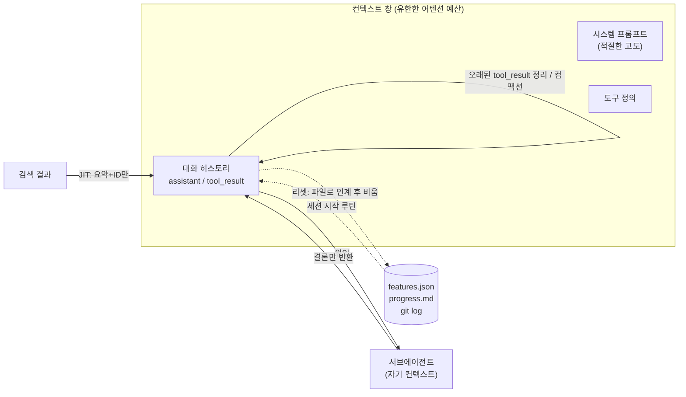
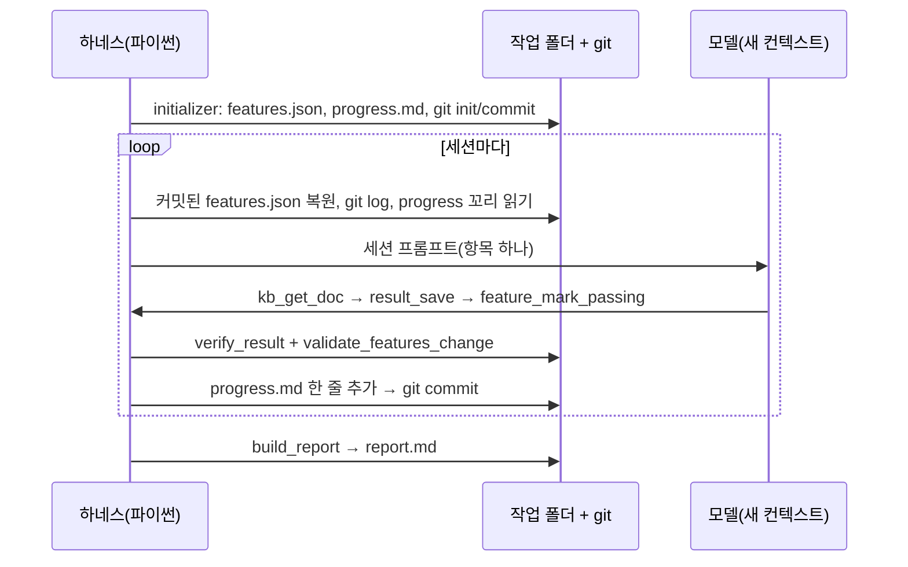
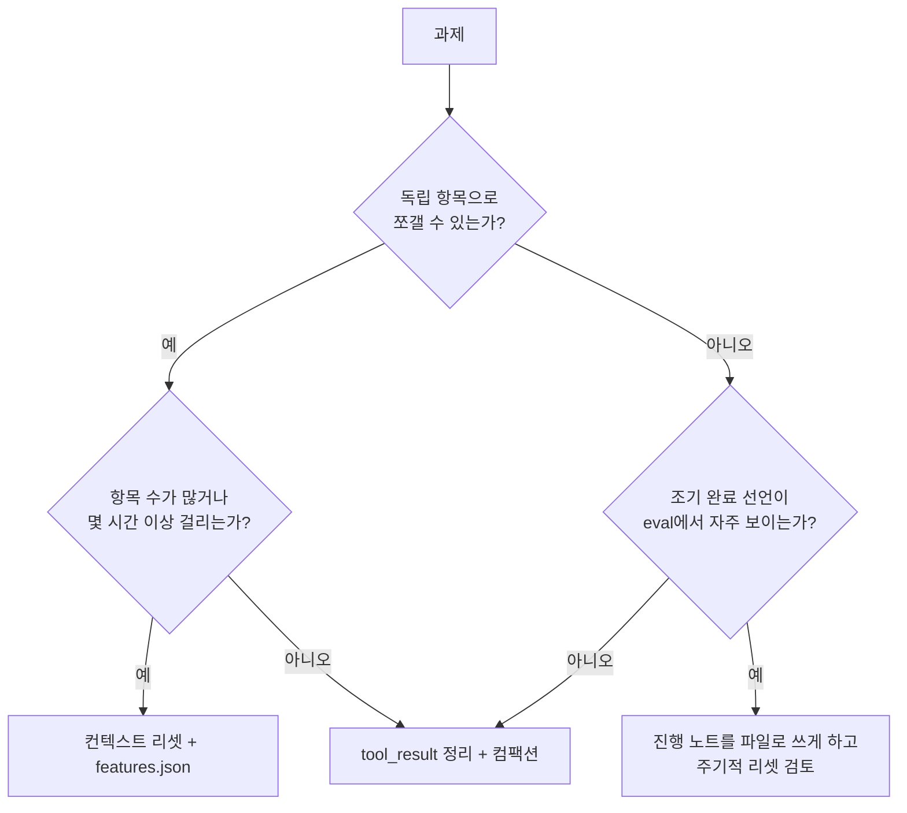

# 4장. 컨텍스트와 메모리 관리

## 학습 목표

- count_tokens와 usage로 턴별 컨텍스트 사용량을 측정하고 예산 경고를 구현할 수 있다
- 대용량 검색 결과를 참조(ID, 경로)로 대체하고 필요할 때 불러오는 JIT 검색 도구를 구현할 수 있다
- 오래된 tool_result 정리와 요약 기반 컴팩션을 히스토리 관리 함수로 구현할 수 있다
- features.json과 progress 파일을 이용한 구조화 인계로 컨텍스트 리셋 하네스를 구현하고, 에이전트가 수정 가능한 필드를 코드로 제한할 수 있다
- 컴팩션과 컨텍스트 리셋의 장단점을 과제 특성에 따라 비교해 선택할 수 있다

## 왜 필요한가: 대화가 길어질수록 나빠지는 에이전트

2~3장에서 만든 사내 문서 Q&A 에이전트를 실제 업무에 붙였다고 가정해 보겠습니다. 다음은 설명을 위해 꾸민 사례입니다.

- 검색 도구가 상위 5개 문서의 본문을 통째로 돌려주므로 10턴쯤 지나면 히스토리가 수만 토큰으로 불어납니다.
- 12턴째부터 시스템 프롬프트에 적은 "문장마다 doc_id 인용" 규칙을 가끔 빠뜨립니다.
- "문서 50개 분류" 과제를 맡기면 18개쯤 처리하고 "모두 완료했습니다"라고 끝냅니다.
- 요청은 매번 히스토리 전체를 다시 보내므로 턴당 비용이 계속 오릅니다.

마지막 문제는 계산해 볼 수 있습니다. 시스템 프롬프트와 도구 정의, 첫 지시를 합쳐 2,200토큰이고 턴마다 모델 출력이 150토큰 붙는다고 가정합니다. 이때 검색 결과를 통째로 돌려주는 방식(턴당 6,000토큰)과 요약과 ID만 주고 본문은 하나만 읽는 JIT 방식(턴당 1,500토큰)을 비교하면 다음과 같습니다.

| 방식 | 턴당 추가 토큰 | 10턴째 요청의 컨텍스트 | 10턴 누적 입력 토큰 |
|---|---|---|---|
| 전문 반환 | 6,150 | 57,550 | 298,750 |
| JIT | 1,650 | 17,050 | 96,250 |

표의 값은 아래 코드로 계산했습니다. 측정값이 아니라 가정에 따른 값이며, JIT 방식은 검색 한 번과 본문 읽기 한 번을 한 턴으로 묶어 단순화했습니다.

```python
# simulate_growth.py — 표의 값을 계산한다(가정값, 측정값 아님)
def simulate(added_per_turn: int, turns: int = 10, base: int = 2_200):
    total, context = 0, base
    for t in range(1, turns + 1):
        context = base + (t - 1) * added_per_turn  # t번째 요청에 실리는 토큰
        total += context                            # 매 요청마다 히스토리 전체를 다시 보낸다
    return added_per_turn, context, total

results = {name: simulate(150 + r) for name, r in [("전문 반환", 6_000), ("JIT", 1_500)]}
for name, (added, last, total) in results.items():
    print(f"{name}: 턴당 +{added:,}, 10턴째 {last:,}, 누적 {total:,}")
print(f"누적 입력 절감률: {1 - results['JIT'][2] / results['전문 반환'][2]:.1%}")  # 67.8%
```

턴마다 히스토리를 다시 보내므로 누적 입력은 턴 수의 제곱에 가깝게 늘어납니다. 따라서 턴당 추가 토큰을 줄이면 비용과 정확도가 함께 좋아집니다. 이 장의 주제가 바로 이것입니다.

## 컨텍스트 엔지니어링과 하네스 엔지니어링의 관계

**컨텍스트 엔지니어링**은 추론 시점에 모델이 보는 토큰 전체(시스템 프롬프트, 도구 정의, 예시, 대화 히스토리, 검색 결과)를 골라 관리하는 일입니다. Anthropic은 이를 프롬프트 엔지니어링의 상위 개념으로 봅니다. 하네스 엔지니어링과의 관계는 출처에 따라 다르게 설명됩니다.

| 관점 | 핵심 질문 | 출처 | 이 장의 예 |
|---|---|---|---|
| 컨텍스트 엔지니어링 | 모델이 이번 호출에서 무엇을 보는가 | Anthropic(2025-09) | 시스템 프롬프트 고도, JIT 검색, 요약 |
| 하네스 엔지니어링 | 시스템이 무엇을 막고, 측정하고, 교정하는가 | OpenAI Codex 팀(InfoQ 등 2차 요약 기준) | 예산 측정과 경고, passes 외 필드 변경 거부, 검증 후 커밋 |
| 하네스의 하위 영역으로 보는 견해 | 컴팩션과 도구 출력 오프로딩도 하네스 부품 | LangChain, martinfowler.com | 히스토리 관리 함수 |
| 좁은 하네스 정의 | 모델이 무엇을 저장·검색·보게 될지 통제하는 코드 | Meta-Harness 논문 | 이 장 전체 |

이 교재에서는 두 관점을 함께 씁니다. 모델에게 무엇을 보여 줄지는 컨텍스트 엔지니어링으로 결정합니다. 그 결정이 지켜지는지 측정하고 강제하는 일은 하네스 코드가 맡습니다.



## 컨텍스트 부패와 어텐션 예산

**컨텍스트 부패(context rot)**는 컨텍스트가 길어질수록 모델이 그 안의 정보를 정확히 떠올리는 능력이 떨어지는 현상입니다. Anthropic은 그래서 컨텍스트를 **어텐션 예산**, 곧 토큰이 늘수록 한 토큰의 가치가 줄어드는(수확 체감) 유한한 자원으로 보라고 합니다. 목표는 원하는 결과를 내는 가장 작은 고신호 토큰 집합을 찾는 것입니다. 창 크기 한도에 걸리지 않더라도 불필요한 토큰은 정확도와 비용 모두에 손해입니다.

이 장에서 다룰 전략을 문제별로 정리하면 다음과 같습니다.

| 문제 | 전략 | 성격 |
|---|---|---|
| 얼마나 찼는지 모름 | count_tokens, usage로 측정하고 80%에서 경고 | 센서 |
| 지시가 장황하거나 모호함 | 적절한 고도의 시스템 프롬프트, 정형 few-shot | 가이드 |
| 검색 결과가 통째로 들어옴 | JIT 검색, 출력 오프로딩(3장) | 선택 |
| 오래된 도구 결과가 쌓임 | tool_result 정리 | 압축 |
| 대화 전체가 한도에 가까움 | 요약 기반 컴팩션 | 압축 |
| 몇 시간짜리 작업 | 컨텍스트 리셋과 구조화 인계 | 외부 기억 |
| 탐색 과정이 본 맥락을 오염시킴 | 서브에이전트 격리 | 격리 |

## 예산 측정: count_tokens와 usage

측정 수단은 두 가지입니다.

- **`client.messages.count_tokens(...)`**: 요청을 보내기 **전에** 입력 토큰 수를 셉니다. 컴팩션 전후 비교에 씁니다.
- **응답의 `usage`**: 요청을 보낸 **뒤에** 실제 사용량을 알려 줍니다. `input_tokens`, `output_tokens`, `cache_creation_input_tokens`, `cache_read_input_tokens`가 들어 있습니다.

다음 턴의 컨텍스트 크기는 "이번 입력 + 이번 출력"입니다. 이번 출력이 히스토리에 붙어 다음 요청에 실리기 때문입니다. 프롬프트 캐싱(9장)을 쓰면 캐시에 쓰거나 캐시에서 읽은 토큰은 `input_tokens`에 들어가지 않습니다. 그래서 세 입력 필드를 모두 더해야 실제 크기가 나옵니다.

먼저 공통 설정입니다. 컨텍스트 창 크기는 모델마다 다르므로 코드에 박지 말고 모델 문서에서 확인한 값을 환경 변수로 넣습니다.

```python
# harness_ch04/config.py
import os

MODEL = os.environ.get("HARNESS_MODEL", "claude-sonnet-4-5")  # 사용 가능 모델: client.models.list()로 확인
SUMMARY_MODEL = os.environ.get("HARNESS_SUMMARY_MODEL", MODEL)
CONTEXT_LIMIT = int(os.environ.get("HARNESS_CONTEXT_LIMIT", "200000"))  # 예시값. 모델 문서의 창 크기로 바꾼다
WARN_RATIO = float(os.environ.get("HARNESS_WARN_RATIO", "0.8"))
CHARS_PER_TOKEN = float(os.environ.get("HARNESS_CHARS_PER_TOKEN", "2.0"))  # 근사치용. 말뭉치로 보정한다
```

`count_tokens`는 SDK 버전에 따라 위치나 존재 여부가 다를 수 있습니다. `python -c "import anthropic; print(anthropic.__version__, hasattr(anthropic.Anthropic(api_key='x').messages, 'count_tokens'))"`로 확인하고, Python SDK 문서의 토큰 계수 항목을 참고합니다. 메서드가 없으면 `AttributeError`가 나고, 네트워크 문제가 있으면 `APIError` 계열 예외가 납니다. 아래 코드는 두 경우 모두 문자 수 기반 근사치로 대체하고, 그 값이 근사치라는 표시(`"estimate"`)를 함께 돌려줍니다.

```python
# harness_ch04/budget.py
import json, logging
from dataclasses import dataclass, field
import anthropic
from .config import MODEL, CONTEXT_LIMIT, WARN_RATIO, CHARS_PER_TOKEN

log = logging.getLogger("harness.budget")

def estimate_tokens(payload) -> int:
    """count_tokens를 못 쓸 때의 근사치. 한 번은 실제 값과 비교해 CHARS_PER_TOKEN을 보정한다."""
    return int(len(json.dumps(payload, ensure_ascii=False, default=str)) / CHARS_PER_TOKEN)

def count_context_tokens(client, *, messages, system=None, tools=None) -> tuple[int, str]:
    """다음 요청의 입력 토큰 수와 측정 방식('count_tokens' | 'estimate')을 돌려준다."""
    kwargs = {"model": MODEL, "messages": messages}
    if system:
        kwargs["system"] = system
    if tools:
        kwargs["tools"] = tools
    try:
        return client.messages.count_tokens(**kwargs).input_tokens, "count_tokens"
    except AttributeError:
        log.warning("이 SDK에는 messages.count_tokens가 없습니다. 근사치를 씁니다.")
    except anthropic.APIError as e:
        log.warning("count_tokens 실패(%s). 근사치를 씁니다.", type(e).__name__)
    return estimate_tokens(kwargs), "estimate"

@dataclass
class ContextBudget:
    limit: int = CONTEXT_LIMIT
    warn_ratio: float = WARN_RATIO
    rows: list = field(default_factory=list)
    warned: bool = False
    total_input: int = 0   # 누적 입력 토큰(비용의 대리 지표, 금액 환산은 9장)
    managed: int = 0       # 히스토리 정리·컴팩션 횟수

    def record(self, turn: int, usage) -> dict:
        cache_w = getattr(usage, "cache_creation_input_tokens", None) or 0
        cache_r = getattr(usage, "cache_read_input_tokens", None) or 0
        input_side = (usage.input_tokens or 0) + cache_w + cache_r
        used = input_side + (usage.output_tokens or 0)  # 출력은 다음 턴 히스토리에 붙는다
        self.total_input += input_side
        row = {"event": "context_usage", "turn": turn, "input": usage.input_tokens,
               "output": usage.output_tokens, "cache_write": cache_w, "cache_read": cache_r,
               "context_used": used, "ratio": round(used / self.limit, 3)}
        self.rows.append(row)
        log.info(json.dumps(row))
        if row["ratio"] >= self.warn_ratio and not self.warned:
            self.warned = True
            log.warning(json.dumps({"event": "context_budget_warning", "turn": turn,
                                    "ratio": row["ratio"], "threshold": self.warn_ratio}))
        return row

    @property
    def needs_management(self) -> bool:
        return bool(self.rows) and self.rows[-1]["ratio"] >= self.warn_ratio

    @property
    def peak(self) -> int:
        return max((r["context_used"] for r in self.rows), default=0)
```

다음은 이 예산을 붙인 에이전트 루프입니다. 2장의 루프를 이 장에 맞게 줄여 다시 썼습니다. 2장에서 정한 대로 정지 조건 세 가지를 모두 둡니다. 턴 수와 벽시계 시간 상한은 그대로이고, 비용 상한 자리에는 누적 입력 토큰을 대리 지표로 씁니다(달러 환산은 9장). 도구 실행부는 일부러 단순하게 만들었습니다. 3장의 공통 실행기는 긴 출력을 파일로 오프로딩하지만 여기서는 앞뒤만 남기고 자르므로, 잘린 가운데 부분은 다시 볼 수 없습니다. 실전에서는 3장 실행기로 바꿔 끼웁니다.

```python
# harness_ch04/loop.py
import json, logging, time
from typing import Callable
import anthropic
from .config import MODEL
from .budget import ContextBudget, count_context_tokens

log = logging.getLogger("harness.loop")
MAX_TOOL_CHARS = 8_000

def make_client() -> anthropic.Anthropic:
    try:
        return anthropic.Anthropic()  # ANTHROPIC_API_KEY를 환경 변수에서 읽는다. 키를 코드·로그에 남기지 않는다
    except anthropic.AnthropicError as e:
        raise SystemExit("ANTHROPIC_API_KEY 환경 변수를 설정한 뒤 다시 실행하세요.") from e

def to_param(block) -> dict:
    if block.type == "text":
        return {"type": "text", "text": block.text}
    if block.type == "tool_use":
        return {"type": "tool_use", "id": block.id, "name": block.name, "input": block.input}
    return block.model_dump(exclude_none=True)

def clip(text: str, limit: int = MAX_TOOL_CHARS) -> str:
    if len(text) <= limit:
        return text
    half = limit // 2
    return f"{text[:half]}\n...[중략 {len(text) - limit}자]...\n{text[-half:]}"

def run_tool(name: str, args: dict, impls: dict) -> tuple[str, bool]:
    fn = impls.get(name)
    if fn is None:
        return f"알 수 없는 도구 '{name}'. 사용 가능: {sorted(impls)}", True
    try:
        return clip(str(fn(**args))), False
    except (TypeError, ValueError, KeyError) as e:   # 우리 도구가 만든 '다음 행동' 메시지를 그대로 전달
        return f"{name} 실패: {e}", True
    except OSError as e:                              # 내부 경로가 담길 수 있으므로 메시지를 넘기지 않는다
        return f"{name} 실패: 파일 입출력 오류({type(e).__name__}). 잠시 후 다시 시도하세요.", True

def run_agent(client, task: str, *, system: str, tools: list[dict], impls: dict,
              budget: ContextBudget | None = None,
              manage_history: Callable[[list], list] | None = None,
              on_end_turn: Callable[[str], str | None] | None = None,
              max_turns: int = 20, max_seconds: float = 600,
              max_input_tokens: int = 2_000_000) -> dict:
    budget = budget or ContextBudget()
    messages = [{"role": "user", "content": task}]
    started, final_text, stop, turn = time.monotonic(), "", "max_turns", 0
    for turn in range(1, max_turns + 1):
        if time.monotonic() - started > max_seconds:
            stop = "timeout"; break
        if budget.total_input > max_input_tokens:
            stop = "token_budget"; break
        if manage_history and budget.needs_management:
            before, _ = count_context_tokens(client, system=system, messages=messages, tools=tools)
            messages = manage_history(messages)
            after, src = count_context_tokens(client, system=system, messages=messages, tools=tools)
            budget.managed += 1
            log.info(json.dumps({"event": "history_managed", "turn": turn,
                                 "before": before, "after": after, "source": src}))
        try:
            resp = client.messages.create(model=MODEL, max_tokens=2048, system=system,
                                          tools=tools, messages=messages, timeout=120)
        except anthropic.APIError as e:  # 재시도 정책은 7장
            log.error(json.dumps({"event": "api_error", "turn": turn, "type": type(e).__name__}))
            stop = "api_error"; break
        budget.record(turn, resp.usage)
        messages.append({"role": "assistant", "content": [to_param(b) for b in resp.content]})
        if resp.stop_reason == "tool_use":
            results = []
            for b in resp.content:
                if b.type == "tool_use":
                    out, is_err = run_tool(b.name, b.input, impls)
                    results.append({"type": "tool_result", "tool_use_id": b.id,
                                    "content": out, "is_error": is_err})
            messages.append({"role": "user", "content": results})
            continue
        final_text = "".join(b.text for b in resp.content if b.type == "text")
        if resp.stop_reason == "end_turn" and on_end_turn:
            nudge = on_end_turn(final_text)
            if nudge:
                messages.append({"role": "user", "content": nudge}); continue
        stop = resp.stop_reason; break
    return {"messages": messages, "turns": turn, "stop": stop,
            "final_text": final_text, "budget": budget}
```

`manage_history`는 사용량이 80%를 넘으면 호출됩니다. 호출 전후의 토큰 수는 count_tokens로 다시 재서 로그에 남기므로 정리 효과를 숫자로 확인할 수 있습니다.

## 시스템 프롬프트의 적절한 고도와 정형 few-shot

Anthropic은 시스템 프롬프트를 **적절한 고도(right altitude)**에서 쓰라고 합니다. 고도가 너무 낮으면 if-else 규칙을 하드코딩한 것과 같아서 깨지기 쉽습니다. 너무 높으면 막연해서 행동을 이끌지 못합니다.

```text
[너무 낮음] 질문에 '연차'가 있으면 D001을 읽어라. '휴가'가 있으면 D001과 D014를 읽어라. 답이 3줄을 넘으면 ...
[너무 높음] 친절하고 정확하게 답하세요.
```

적절한 고도의 프롬프트에는 목표, 판단 기준, 도구 사용 방침, 출력 형식을 담습니다. 예시는 경우를 빠짐없이 나열하지 말고, 서로 다른 전형적 사례(canonical few-shot) 몇 개만 넣습니다. 시스템 프롬프트는 요청마다 `system` 파라미터로 따로 들어가고 히스토리에 섞이지 않습니다. 그래서 컴팩션 때 지워지지 않으며, **영구 규칙을 두기에 가장 안전한 자리**입니다.

```python
# harness_ch04/prompts.py
QA_SYSTEM = """너는 사내 문서 Q&A 도우미다.
목표: 직원 질문에 사내 문서를 근거로 답한다. 근거가 없으면 없다고 말한다.
도구: kb_search_docs로 후보를 찾고, 답에 필요한 문서만 kb_get_doc으로 읽는다. 이미 읽은 문서는 다시 읽지 않는다.
답변: 한국어로 핵심부터 쓰고, 문장마다 근거 doc_id를 [D001]처럼 붙인다.
<examples>
<example>질문: VPN이 안 붙어요. / 답변: VPN 접속 절차는 담당 부서 승인 후 진행합니다 [D012].</example>
<example>질문: 사내 식당 메뉴는 어디서 보나요? / 답변: 검색한 문서에서 근거를 찾지 못했습니다. 총무 담당자에게 문의해 주세요.</example>
</examples>"""

WORKER_SYSTEM = """너는 사내 문서 분류 담당자다.
목표: 지정된 항목의 문서를 읽고 분류·요약해 저장한 뒤 검증을 통과시킨다.
분류 기준: 문서가 다루는 업무의 주무 부서(인사, 보안, IT지원, 재무, 총무). 여러 부서가 얽히면 신청자가 먼저 연락할 부서를 고른다.
요약: 3문장 이하, 20~300자, 문서에 없는 내용은 쓰지 않는다.
절차: kb_get_doc → result_save → feature_mark_passing. 검증 오류가 나면 메시지대로 고친다.
<examples>
<example>'VPN 접속 안내' → category: IT지원</example>
<example>'출장비 한도 안내' → category: 재무</example>
</examples>"""
```

## JIT 검색과 가벼운 참조

**JIT(Just-In-Time) 검색**은 데이터를 미리 다 싣지 않는 방식입니다. 컨텍스트에는 경로나 ID 같은 **가벼운 참조**만 두고, 본문은 모델이 필요하다고 판단할 때 도구로 불러옵니다. 3장의 ACI 원칙대로 이름은 서비스_리소스_동작 형식(`kb_search_docs`, `kb_get_doc`)으로 짓고, 페이지네이션(offset/limit)을 넣고, 에러 메시지에는 다음 행동을 적습니다.

먼저 실습용 문서 말뭉치입니다. 정답 라벨은 도구가 접근할 수 없는 별도 파일에 둡니다.

```python
# harness_ch04/docstore.py
import json, logging, random
from dataclasses import dataclass
from pathlib import Path

log = logging.getLogger("harness.docstore")
CATEGORIES = ["인사", "보안", "IT지원", "재무", "총무"]
_TOPICS = {"인사": ["연차 신청", "채용 절차", "평가 일정"], "보안": ["비밀번호 정책", "피싱 신고", "출입 카드"],
           "IT지원": ["VPN 접속", "노트북 교체", "프린터 오류"], "재무": ["법인카드 정산", "출장비 한도", "예산 이월"],
           "총무": ["회의실 예약", "택배 수령", "비품 신청"]}

@dataclass
class Doc:
    doc_id: str
    title: str
    body: str
    @property
    def summary(self) -> str:
        return self.body.split("\n", 1)[0][:120]

def make_sample_corpus(docs_dir: Path, labels_path: Path, n: int = 50, seed: int = 7) -> None:
    rng = random.Random(seed)
    docs_dir.mkdir(parents=True, exist_ok=True)
    labels = {}
    for i in range(1, n + 1):
        cat = CATEGORIES[(i - 1) % len(CATEGORIES)]
        topic, doc_id = rng.choice(_TOPICS[cat]), f"D{i:03d}"
        lines = [f"{topic} 안내입니다. {topic} 절차와 문의처를 설명합니다."]
        lines += [f"{k}. {topic} 확인 사항 {k}: 담당 부서 승인, 기한 {rng.randint(1, 30)}일, 증빙 보관."
                  for k in range(1, 13)]
        (docs_dir / f"{doc_id}.md").write_text(f"# {topic} ({doc_id})\n" + "\n".join(lines), encoding="utf-8")
        labels[doc_id] = cat
    labels_path.write_text(json.dumps(labels, ensure_ascii=False, indent=2), encoding="utf-8")

def ensure_corpus(base: Path, n: int) -> tuple[Path, Path]:
    docs, labels = base / f"corpus_{n}", base / f"labels_{n}.json"
    if not docs.is_dir():
        make_sample_corpus(docs, labels, n)
    return docs, labels

def load_corpus(docs_dir: Path) -> dict[str, Doc]:
    if not docs_dir.is_dir():
        raise FileNotFoundError(f"문서 폴더 '{docs_dir.name}'가 없습니다. ensure_corpus로 먼저 만드세요.")
    store = {}
    for p in sorted(docs_dir.glob("*.md")):
        try:
            text = p.read_text(encoding="utf-8")
        except (OSError, UnicodeDecodeError) as e:
            log.warning("문서 건너뜀 %s: %s", p.name, type(e).__name__); continue
        title, _, body = text.partition("\n")
        store[p.stem] = Doc(p.stem, title.lstrip("# ").strip(), body.strip())
    if not store:
        raise FileNotFoundError("읽을 수 있는 문서가 0개입니다.")
    return store
```

다음은 검색 도구입니다. 비교를 위해 본문 전체를 돌려주는 즉시 적재(eager) 버전도 함께 둡니다.

```python
# harness_ch04/tools_jit.py
import json
from .docstore import Doc

def _rank(store: dict[str, Doc], query: str, top_k: int) -> list[Doc]:
    terms = query.split()
    if not terms:
        raise ValueError("query가 비어 있습니다. 찾을 낱말을 1개 이상 넣으세요.")
    score = lambda d: sum((d.title + " " + d.body).count(t) for t in terms)
    ranked = sorted(store.values(), key=score, reverse=True)[: max(1, min(int(top_k), 10))]
    return [d for d in ranked if score(d) > 0]

def search_docs_eager(store, query: str, top_k: int = 5) -> str:
    """비교용: 본문 전체를 돌려주는 즉시 적재 방식."""
    return json.dumps([{"doc_id": d.doc_id, "title": d.title, "body": d.body}
                       for d in _rank(store, query, top_k)], ensure_ascii=False)

def kb_search_docs(store, query: str, top_k: int = 5) -> str:
    hits = _rank(store, query, top_k)
    if not hits:
        return "검색 결과가 없습니다. 더 짧거나 다른 낱말로 다시 검색하세요."
    return json.dumps({"results": [{"doc_id": d.doc_id, "title": d.title, "summary": d.summary,
                                    "chars": len(d.body)} for d in hits],
                       "next": "본문이 필요하면 kb_get_doc(doc_id)를 호출하세요."}, ensure_ascii=False)

def kb_get_doc(store, doc_id: str, offset: int = 0, limit: int = 2000) -> str:
    doc = store.get(doc_id.strip().upper())
    if doc is None:
        raise ValueError(f"doc_id '{doc_id}'가 없습니다. kb_search_docs 결과의 doc_id를 그대로 쓰세요.")
    offset, limit = max(0, int(offset)), max(200, min(int(limit), 4000))
    end = offset + limit
    return json.dumps({"doc_id": doc.doc_id, "title": doc.title, "offset": offset,
                       "text": doc.body[offset:end],
                       "next_offset": end if end < len(doc.body) else None}, ensure_ascii=False)

JIT_TOOLS = [
    {"name": "kb_search_docs",
     "description": "사내 문서를 낱말로 검색한다. 본문 대신 doc_id, 제목, 한 줄 요약, 본문 길이만 돌려준다. "
                    "답에 본문이 필요하면 kb_get_doc을 호출한다.",
     "input_schema": {"type": "object", "properties": {
         "query": {"type": "string", "description": "공백으로 구분한 검색어. 예: '연차 신청'"},
         "top_k": {"type": "integer", "description": "결과 수(1~10, 기본 5)"}}, "required": ["query"]}},
    {"name": "kb_get_doc",
     "description": "doc_id로 문서 본문을 가져온다. 길면 next_offset을 offset으로 넘겨 이어 읽는다.",
     "input_schema": {"type": "object", "properties": {
         "doc_id": {"type": "string", "description": "kb_search_docs가 준 doc_id. 예: 'D007'"},
         "offset": {"type": "integer", "description": "시작 위치(문자), 기본 0"},
         "limit": {"type": "integer", "description": "읽을 길이(200~4000자), 기본 2000"}}, "required": ["doc_id"]}},
]

def bind(store) -> dict:
    return {"kb_search_docs": lambda **kw: kb_search_docs(store, **kw),
            "kb_get_doc": lambda **kw: kb_get_doc(store, **kw)}
```

절감률은 공정하게 재야 합니다. JIT 쪽에는 검색 결과뿐 아니라 실제로 본문 하나를 읽는 비용까지 더해서 비교합니다.

```python
# harness_ch04/measure_jit.py — 실행: python -m harness_ch04.measure_jit
import json, logging
from pathlib import Path
from .budget import count_context_tokens
from .docstore import ensure_corpus, load_corpus
from .loop import make_client
from .tools_jit import kb_get_doc, kb_search_docs, search_docs_eager

QUERIES = ["연차 신청", "VPN 접속", "법인카드 정산", "피싱 신고", "회의실 예약"]

def main():
    logging.basicConfig(level=logging.WARNING)
    docs_dir, _ = ensure_corpus(Path("runs_ch04"), 50)
    store, client = load_corpus(docs_dir), make_client()
    tot_e = tot_j = 0
    print("| 질의 | 전문 반환 | JIT(검색+본문 1개) | 절감률 | 측정 방식 |\n|---|---|---|---|---|")
    for q in QUERIES:
        try:
            top = json.loads(kb_search_docs(store, q))["results"][0]["doc_id"]
        except json.JSONDecodeError:
            print(f"| {q} | - | - | 결과 없음 | - |"); continue
        jit = kb_search_docs(store, q) + kb_get_doc(store, top)
        e, src = count_context_tokens(client, messages=[{"role": "user", "content": search_docs_eager(store, q)}])
        j, _ = count_context_tokens(client, messages=[{"role": "user", "content": jit}])
        tot_e, tot_j = tot_e + e, tot_j + j
        print(f"| {q} | {e:,} | {j:,} | {1 - j / e:.1%} | {src} |")
    if tot_e:
        print(f"\n전체 절감률: {1 - tot_j / tot_e:.1%}")

if __name__ == "__main__":
    main()
```

JIT에도 대가가 있습니다. 본문을 읽으려면 턴이 하나 더 필요하므로 지연 시간이 늘고, 모델이 필요한 문서를 읽지 않고 요약만 보고 답할 위험도 생깁니다. 이 위험은 QA_SYSTEM의 도구 방침과 5장의 인용 검증으로 줄입니다.

## 오래된 tool_result 정리와 컴팩션

### tool_result 정리

가장 싸고 안전한 압축은 오래된 도구 결과를 지우는 것입니다. 이때 블록 자체를 삭제하면 안 됩니다. API는 assistant 메시지의 모든 `tool_use`에 대해 다음 user 메시지에 같은 `tool_use_id`의 `tool_result`가 있어야 요청을 받아 줍니다. 그래서 블록은 남기고 **내용만** "무엇을 호출했고, 다시 필요하면 어떻게 하라"는 한 줄로 바꿉니다.

### 컴팩션과 초기 지시 소실

**컴팩션(compaction)**은 한도에 가까워진 대화의 중간 부분을 요약으로 바꾸고 이어 가는 방식입니다. 이때 요약 모델이 원래 지시의 제약("doc_id를 인용하라")을 빠뜨리는 **초기 지시 소실**이 흔히 일어납니다. 아래 구현은 세 가지로 이를 막습니다. 첫째, 영구 규칙은 시스템 프롬프트에 둡니다. 둘째, 첫 user 메시지(원래 과제)는 요약하지 않고 그대로 **고정(pin)**합니다. 셋째, 다시 컴팩션할 때는 이전 요약을 새 요약의 입력으로 넣어 요약이 중복으로 쌓이지 않게 합니다. 남길 꼬리 부분은 반드시 assistant 메시지부터 시작하게 잘라 tool_use와 tool_result 짝이 깨지지 않게 합니다.

```python
# harness_ch04/history.py
import copy, json, logging
import anthropic
from .config import SUMMARY_MODEL
from .budget import ContextBudget, count_context_tokens

log = logging.getLogger("harness.history")
CLEARED = "[정리됨]"
SUMMARY_OPEN, SUMMARY_CLOSE = "<compacted_summary>", "</compacted_summary>"
SUMMARY_SYSTEM = """너는 에이전트 작업 기록을 인계 노트로 압축한다. 다음만 쓴다.
1) 완료한 항목과 결과(ID 포함) 2) 내린 결정과 이유 3) 실패·오류와 원인 4) 남은 일과 다음 행동.
기록에 없는 내용은 만들지 않는다. 원래 과제 지시는 따로 보존되므로 반복하지 않는다."""

def clear_old_tool_results(messages: list, keep_last: int = 3) -> list:
    new = copy.deepcopy(messages)
    calls = {b["id"]: f'{b["name"]}({json.dumps(b["input"], ensure_ascii=False)[:80]})'
             for m in new if m["role"] == "assistant" and isinstance(m["content"], list)
             for b in m["content"] if b.get("type") == "tool_use"}
    seen = cleared = 0
    for m in reversed(new):
        if m["role"] != "user" or not isinstance(m["content"], list):
            continue
        for b in reversed(m["content"]):
            if b.get("type") != "tool_result":
                continue
            seen += 1
            c = b.get("content")
            if seen <= keep_last or (isinstance(c, str) and c.startswith(CLEARED)):
                continue
            b["content"] = (f"{CLEARED} {calls.get(b['tool_use_id'], '이전 호출')}의 결과는 공간 절약을 위해 "
                            "지웠습니다. 다시 필요하면 같은 도구를 호출하세요.")
            cleared += 1
    log.info(json.dumps({"event": "tool_results_cleared", "count": cleared}))
    return new

def _render(messages: list, per_block: int = 500) -> str:
    lines = []
    for m in messages:
        blocks = m["content"] if isinstance(m["content"], list) else [{"type": "text", "text": m["content"]}]
        for b in blocks:
            if b.get("type") == "text":
                lines.append(f'{m["role"]}: {b["text"][:per_block]}')
            elif b.get("type") == "tool_use":
                lines.append(f'도구 호출: {b["name"]} {json.dumps(b["input"], ensure_ascii=False)[:200]}')
            elif b.get("type") == "tool_result":
                c = b.get("content"); c = c if isinstance(c, str) else json.dumps(c, ensure_ascii=False)
                lines.append(f'도구 결과{"(오류)" if b.get("is_error") else ""}: {c[:per_block]}')
    return "\n".join(lines)

def compact_history(client, messages: list, keep_last_msgs: int = 6) -> list:
    first = messages[0]["content"]
    if not isinstance(first, str):
        log.warning("첫 메시지가 문자열이 아니어서 컴팩션을 건너뜁니다."); return messages
    task, _, old = first.partition(SUMMARY_OPEN)          # 원래 과제는 고정(pin)한다
    old_summary = old.split(SUMMARY_CLOSE)[0].strip()
    start = max(1, len(messages) - keep_last_msgs)
    i = next((k for k in range(start, len(messages)) if messages[k]["role"] == "assistant"), None)
    if i is None or i <= 1:
        return messages
    transcript = (f"이전 요약:\n{old_summary}\n\n" if old_summary else "") + _render(messages[1:i])
    try:
        resp = client.messages.create(model=SUMMARY_MODEL, max_tokens=1500, system=SUMMARY_SYSTEM, timeout=60,
                                      messages=[{"role": "user", "content": f"<transcript>\n{transcript}\n</transcript>"}])
    except anthropic.APIError as e:
        log.warning(json.dumps({"event": "compaction_failed", "type": type(e).__name__, "fallback": "clear"}))
        return clear_old_tool_results(messages, keep_last=1)
    summary = "".join(b.text for b in resp.content if b.type == "text").strip()
    if resp.stop_reason == "max_tokens":
        summary += "\n(요약이 길이 한도에서 잘렸습니다)"
    head = {"role": "user", "content": f"{task.rstrip()}\n\n{SUMMARY_OPEN}\n{summary}\n{SUMMARY_CLOSE}\n"
                                       "위는 지금까지의 작업 요약입니다. 원래 지시를 지키며 이어서 진행하세요."}
    log.info(json.dumps({"event": "compacted", "removed": i - 1, "kept": len(messages) - i}))
    return [head] + messages[i:]

def make_manager(client, budget: ContextBudget, system: str, tools: list[dict], keep_results: int = 3):
    """1단계: tool_result 정리. 정리 후에도 경고선 이상이면 2단계: 컴팩션."""
    def manage(messages: list) -> list:
        cleared = clear_old_tool_results(messages, keep_last=keep_results)
        n, _ = count_context_tokens(client, system=system, messages=cleared, tools=tools)
        return cleared if n / budget.limit < budget.warn_ratio else compact_history(client, cleared)
    return manage
```

요약 호출이 실패해도 예외를 루프 밖으로 던지지 않고 tool_result 정리로 물러섭니다. 요약은 추론적 통제라서 틀릴 수 있다는 점도 기억해 둡니다. 무엇을 버릴지를 모델이 정하기 때문입니다.

이제 예산 측정, JIT 도구, 히스토리 관리를 한데 묶은 데모입니다.

```python
# harness_ch04/demo.py — 실행: python -m harness_ch04.demo
import json, logging
from pathlib import Path
from .budget import ContextBudget
from .docstore import ensure_corpus, load_corpus
from .history import make_manager
from .loop import make_client, run_agent
from .prompts import QA_SYSTEM
from .tools_jit import JIT_TOOLS, bind

def main():
    logging.basicConfig(level=logging.INFO, format="%(message)s")
    docs_dir, _ = ensure_corpus(Path("runs_ch04"), 50)
    store, client, budget = load_corpus(docs_dir), make_client(), ContextBudget()
    res = run_agent(client, "연차 신청, VPN 접속, 법인카드 정산 절차를 문서를 읽고 비교해 표로 정리해 줘.",
                    system=QA_SYSTEM, tools=JIT_TOOLS, impls=bind(store), budget=budget,
                    manage_history=make_manager(client, budget, QA_SYSTEM, JIT_TOOLS), max_turns=15)
    print(res["final_text"])
    print(json.dumps({"turns": res["turns"], "stop": res["stop"], "peak": budget.peak,
                      "managed": budget.managed}))

if __name__ == "__main__":
    main()
```

## 서브에이전트를 통한 컨텍스트 격리

여러 문서를 훑는 탐색은 본 에이전트의 컨텍스트를 금방 채웁니다. 이 탐색을 **서브에이전트**에게 맡기면, 서브에이전트가 자기 컨텍스트에서 읽은 본문은 버려지고 본 에이전트에는 짧은 결론만 돌아옵니다. 다만 격리는 본 컨텍스트를 아낄 뿐 전체 비용을 줄여 주지는 않습니다. Anthropic 멀티에이전트 리서치 시스템은 채팅 대비 약 15배의 토큰을 썼다고 보고했습니다.

```python
# harness_ch04/subagent.py
import json
from .loop import run_agent
from .tools_jit import JIT_TOOLS, bind

SUB_SYSTEM = ("너는 사내 문서 조사 담당이다. kb_search_docs로 찾고 필요한 문서만 kb_get_doc으로 읽은 뒤, "
              "질문에 대한 결론을 doc_id 인용과 함께 10줄 이내로 쓴다.")
RESEARCH_TOOL = {"name": "kb_research_delegate",
                 "description": "여러 문서를 읽어야 하는 조사 질문을 하위 에이전트에게 맡긴다. "
                                "읽은 본문은 돌아오지 않고 doc_id를 인용한 10줄 이내 결론만 돌아온다.",
                 "input_schema": {"type": "object", "properties": {
                     "question": {"type": "string", "description": "하나의 구체적 조사 질문"}},
                     "required": ["question"]}}

def make_research_delegate(client, store, max_chars: int = 1500):
    def kb_research_delegate(question: str) -> str:
        sub = run_agent(client, question, system=SUB_SYSTEM, tools=JIT_TOOLS, impls=bind(store),
                        max_turns=8, max_seconds=180)          # 서브에이전트는 자기 예산(새 ContextBudget)을 쓴다
        answer = sub["final_text"].strip() or f"결론을 내지 못했습니다(정지 사유: {sub['stop']}). 질문을 좁혀 다시 맡기세요."
        return json.dumps({"answer": answer[:max_chars], "sub_turns": sub["turns"],
                           "sub_peak_tokens": sub["budget"].peak}, ensure_ascii=False)
    return kb_research_delegate

# 사용: run_agent(client, task, system=QA_SYSTEM, tools=[RESEARCH_TOOL],
#                impls={"kb_research_delegate": make_research_delegate(client, store)})
```

Claude Agent SDK에도 서브에이전트 정의 기능이 있고, 서브에이전트 비용은 `ResultMessage.model_usage`로 집계됩니다(9장). `python -c "from claude_agent_sdk import AgentDefinition"`이 `ImportError`로 실패하는 버전이라면, 위 함수를 3장의 `@tool`과 `create_sdk_mcp_server`로 감싸 같은 효과를 냅니다.

## 컨텍스트 리셋과 구조화 인계

### 컴팩션만으로 부족한 이유

Anthropic의 장시간 하네스 글은 컴팩션만으로는 세션 사이의 기억 단절을 메우지 못했다고 보고합니다. 대표적인 실패는 두 가지였습니다. 한 번에 너무 많이 하려다 중간 상태가 기록되지 않는 것, 그리고 일이 남았는데 **너무 이르게 완료를 선언**하는 것입니다. 후속 글은 일부 모델에서 **context anxiety**도 관찰했다고 합니다. 한도가 가까워졌다고 여긴 모델이 서둘러 일을 마무리하는 현상입니다. 컴팩션을 해도 같은 대화가 계속 이어지므로 이 문제가 남을 수 있습니다. 그래서 이 글들은 **컨텍스트 리셋**을 제안합니다. 구조화된 인계 산출물을 파일로 남기고 완전히 새로운 컨텍스트로 갈아타는 방식입니다.

Anthropic 패턴을 이 장의 과제("문서 50개 분류와 요약 보고서")에 대응시키면 다음과 같습니다.

| Anthropic 패턴 | 이 장의 구현 |
|---|---|
| initializer 에이전트 | `initializer()` 함수: features.json(모두 `passes: false`), progress.md, git init과 첫 커밋 |
| feature list JSON | `features.json`. 에이전트는 `passes`만 바꿀 수 있음. 마크다운보다 JSON이 덜 함부로 덮어써진다고 보고됨 |
| init.sh와 기본 E2E 테스트 | 세션 시작 루틴(커밋된 상태 복원, git log, progress 읽기)과 `verify_result()` |
| 세션당 기능 하나 | 하네스가 미완 항목 하나를 골라 그 문서만 쓸 수 있게 도구를 제한 |
| git 커밋, progress 갱신 | 검증 → progress 한 줄 추가 → 커밋 |

hands_on 문장은 "커밋 → progress 갱신" 순서입니다. 아래 코드는 progress를 먼저 갱신하고 그다음에 커밋합니다. 그래야 한 커밋에 결과, 상태, 기록이 함께 담기고, git으로 되돌릴 때 셋이 한꺼번에 돌아가기 때문입니다.



에이전트가 고칠 수 있는 범위는 두 겹으로 막습니다. 안쪽 겹은 좁은 도구입니다. `feature_mark_passing`은 검증을 통과해야만 `passes`를 바꿉니다. 바깥쪽 겹은 세션이 끝난 뒤 하네스가 마지막 커밋과 비교하는 `validate_features_change`입니다. 이 검사는 Agent SDK 버전처럼 에이전트가 Write나 Edit 도구로 파일을 직접 고칠 수 있는 환경에서도 그대로 작동합니다.

```python
# harness_ch04/longrun.py
import json, logging, os, subprocess
from collections import Counter
from pathlib import Path
from .budget import ContextBudget
from .docstore import CATEGORIES
from .history import make_manager
from .loop import run_agent
from .prompts import WORKER_SYSTEM
from .tools_jit import JIT_TOOLS, kb_get_doc

log = logging.getLogger("harness.longrun")
TASK = "사내 문서를 인사·보안·IT지원·재무·총무 중 하나로 분류하고 3문장 이하로 요약한 뒤 보고서를 만든다."

class FeatureChangeError(ValueError):
    pass

def write_json_atomic(path: Path, data) -> None:
    tmp = path.with_suffix(path.suffix + ".tmp")
    tmp.write_text(json.dumps(data, ensure_ascii=False, indent=2), encoding="utf-8")
    os.replace(tmp, path)  # 쓰는 도중 죽어도 반쯤 쓴 파일이 남지 않는다

def write_features(workdir: Path, features: list) -> None:
    write_json_atomic(workdir / "features.json", {"task": TASK, "features": features})

def load_features(workdir: Path) -> list[dict]:
    try:
        return json.loads((workdir / "features.json").read_text(encoding="utf-8"))["features"]
    except FileNotFoundError:
        raise FileNotFoundError("features.json이 없습니다. initializer()를 먼저 실행하세요.") from None
    except (json.JSONDecodeError, KeyError):
        raise FeatureChangeError("features.json 형식이 깨졌습니다. 직전 커밋으로 복원하세요.") from None

def git(workdir: Path, *args, timeout: int = 30) -> str | None:
    cmd = ["git", "-c", "user.name=harness", "-c", "user.email=harness@localhost", *args]
    try:
        return subprocess.run(cmd, cwd=workdir, capture_output=True, text=True, encoding="utf-8",
                              timeout=timeout, check=True).stdout
    except FileNotFoundError:
        log.warning("git을 찾지 못했습니다. 커밋 없이 progress.md로만 인계합니다.")
    except subprocess.TimeoutExpired:
        log.warning("git %s 시간 초과", args[0])
    except subprocess.CalledProcessError as e:
        log.warning("git %s 실패: %s", args[0], ((e.stderr or e.stdout) or "").strip()[:200])
    return None

def committed_features(workdir: Path) -> list[dict] | None:
    out = git(workdir, "show", "HEAD:features.json")
    try:
        return json.loads(out)["features"] if out else None
    except (json.JSONDecodeError, KeyError):
        return None

def validate_features_change(before: list[dict], after: list[dict], max_flips: int = 1) -> list[str]:
    """passes 외 필드 변경, 항목 추가·삭제·순서 변경, 한 번에 여러 항목 변경을 거부한다."""
    if [f["id"] for f in before] != [f["id"] for f in after]:
        raise FeatureChangeError("항목을 추가·삭제하거나 순서를 바꿀 수 없습니다.")
    flips = []
    for b, a in zip(before, after):
        if set(a) != set(b):
            raise FeatureChangeError(f"{b['id']}: 필드를 추가하거나 지울 수 없습니다.")
        changed = [k for k in b if k != "passes" and a[k] != b[k]]
        if changed:
            raise FeatureChangeError(f"{b['id']}: passes 외 필드({', '.join(changed)})는 수정할 수 없습니다.")
        if not isinstance(a["passes"], bool):
            raise FeatureChangeError(f"{b['id']}: passes는 true/false만 허용합니다.")
        if a["passes"] != b["passes"]:
            flips.append(b["id"])
    if len(flips) > max_flips:
        raise FeatureChangeError(f"한 번에 {max_flips}개 항목만 바꿀 수 있습니다(시도: {len(flips)}개).")
    return flips

def verify_result(workdir: Path, doc_id: str) -> list[str]:
    try:
        r = json.loads((workdir / "results" / f"{doc_id}.json").read_text(encoding="utf-8"))
    except FileNotFoundError:
        return [f"results/{doc_id}.json이 없습니다. result_save를 먼저 호출하세요."]
    except (OSError, json.JSONDecodeError):
        return [f"results/{doc_id}.json을 읽을 수 없습니다. result_save로 다시 저장하세요."]
    errs = []
    if r.get("doc_id") != doc_id:
        errs.append("doc_id가 파일 이름과 다릅니다.")
    if r.get("category") not in CATEGORIES:
        errs.append(f"category는 {CATEGORIES} 중 하나여야 합니다.")
    s = str(r.get("summary", "")).strip()
    if not 20 <= len(s) <= 300:
        errs.append(f"summary는 20~300자여야 합니다(현재 {len(s)}자).")
    return errs

def initializer(workdir: Path, store: dict) -> None:
    workdir.mkdir(parents=True, exist_ok=True)
    if (workdir / "features.json").exists():
        log.info("이미 초기화되어 있어 initializer를 건너뜁니다."); return
    (workdir / "results").mkdir(exist_ok=True)
    write_features(workdir, [{"id": f"F{n:03d}", "doc_id": d, "passes": False,
                              "description": f"{d}를 분류·요약해 results/{d}.json에 저장"}
                             for n, d in enumerate(sorted(store), start=1)])
    (workdir / "progress.md").write_text(
        f"# 진행 기록\n\n과제: {TASK}\n규칙: 세션마다 항목 하나. passes 외 필드는 수정 금지.\n\n", encoding="utf-8")
    git(workdir, "init", "-q")
    git(workdir, "add", "-A")
    git(workdir, "commit", "-q", "-m", f"initializer: {len(store)}개 항목 생성")

SESSION_TOOLS = [t for t in JIT_TOOLS if t["name"] == "kb_get_doc"] + [
    {"name": "result_save", "description": "분류·요약 결과를 저장한다. 저장 후 feature_mark_passing으로 검증한다.",
     "input_schema": {"type": "object", "properties": {
         "doc_id": {"type": "string"}, "category": {"type": "string", "enum": CATEGORIES},
         "summary": {"type": "string", "description": "3문장 이하, 20~300자"}},
         "required": ["doc_id", "category", "summary"]}},
    {"name": "feature_mark_passing", "description": "저장된 결과를 검증하고 통과하면 항목을 완료로 기록한다.",
     "input_schema": {"type": "object", "properties": {"feature_id": {"type": "string", "description": "예: F007"}},
                      "required": ["feature_id"]}}]

def make_session_tools(workdir: Path, store: dict, allowed: set[str]) -> dict:
    def result_save(doc_id: str, category: str, summary: str) -> str:
        doc_id = doc_id.strip().upper()
        if doc_id not in allowed:
            raise ValueError(f"이번 작업 대상이 아닙니다. 대상 예: {sorted(allowed)[:3]}")
        if category not in CATEGORIES:
            raise ValueError(f"category는 {CATEGORIES} 중 하나로 쓰세요.")
        write_json_atomic(workdir / "results" / f"{doc_id}.json",
                          {"doc_id": doc_id, "category": category, "summary": summary.strip()})
        return f"저장했습니다. feature_mark_passing으로 {doc_id} 항목을 검증하세요."

    def feature_mark_passing(feature_id: str) -> str:
        before = load_features(workdir)
        target = next((f for f in before if f["id"] == feature_id.strip().upper()), None)
        if target is None or target["doc_id"] not in allowed:
            raise ValueError("feature_id가 이번 작업 대상이 아닙니다.")
        errs = verify_result(workdir, target["doc_id"])
        if errs:
            raise ValueError("검증 실패: " + " / ".join(errs))
        after = [dict(f, passes=True) if f["id"] == target["id"] else f for f in before]
        validate_features_change(before, after)   # 도구 안에서도 같은 규칙을 지킨다
        write_features(workdir, after)
        return f"{target['id']} 통과로 기록했습니다."

    return {"kb_get_doc": lambda **kw: kb_get_doc(store, **kw),
            "result_save": result_save, "feature_mark_passing": feature_mark_passing}

SESSION_PROMPT = """[세션 {n} 시작 루틴 결과]
최근 git 기록:
{git_log}
progress.md 마지막 부분:
{progress}
이번 세션 항목: {fid} — {desc} (doc_id={doc_id})
이 항목 하나만 처리하세요. feature_mark_passing이 성공하면 결과를 한 줄로 보고하고 끝내세요."""

def _tail(path: Path, n: int = 20) -> str:
    try:
        return "\n".join(path.read_text(encoding="utf-8").splitlines()[-n:])
    except FileNotFoundError:
        return "(progress.md 없음)"

def run_reset_session(client, workdir: Path, store: dict, n: int, skip=frozenset()) -> dict:
    disk = load_features(workdir)
    before = committed_features(workdir) or disk          # 마지막 커밋이 기준 상태
    if disk != before:
        log.warning(json.dumps({"event": "uncommitted_features_reverted", "session": n}))
        write_features(workdir, before)
    todo = next((f for f in before if not f["passes"] and f["id"] not in skip), None)
    if todo is None:
        return {"done": True}
    prompt = SESSION_PROMPT.format(n=n, git_log=git(workdir, "log", "--oneline", "-5") or "(없음)",
                                   progress=_tail(workdir / "progress.md"), fid=todo["id"],
                                   desc=todo["description"], doc_id=todo["doc_id"])
    res = run_agent(client, prompt, system=WORKER_SYSTEM, tools=SESSION_TOOLS,
                    impls=make_session_tools(workdir, store, {todo["doc_id"]}), max_turns=8, max_seconds=180)
    passed = False
    try:
        flips = validate_features_change(before, load_features(workdir))
        passed = todo["id"] in flips
        status = "통과" if passed else f"미완료(정지 사유 {res['stop']})"
    except (FeatureChangeError, FileNotFoundError) as e:
        write_features(workdir, before)
        status = f"거부: {e}"
    with open(workdir / "progress.md", "a", encoding="utf-8") as fp:
        fp.write(f"- 세션 {n}: {todo['id']}({todo['doc_id']}) {status}, 턴 {res['turns']}\n")
    git(workdir, "add", "-A")
    git(workdir, "commit", "-q", "-m", f"세션 {n}: {todo['id']} {status[:40]}")
    return {"done": False, "fid": todo["id"], "passed": passed, "turns": res["turns"]}

def run_reset(client, workdir: Path, store: dict, max_total_turns: int) -> dict:
    turns = early = 0
    fails: dict[str, int] = {}
    for n in range(1, len(load_features(workdir)) * 3 + 1):
        if turns >= max_total_turns:
            break
        r = run_reset_session(client, workdir, store, n, frozenset(k for k, v in fails.items() if v >= 3))
        if r["done"]:
            break
        turns += r["turns"]
        if not r["passed"]:
            early += 1
            fails[r["fid"]] = fails.get(r["fid"], 0) + 1
    return {"turns": turns, "early_stops": early, "managed": 0}

def run_compaction(client, workdir: Path, store: dict, max_total_turns: int, max_nudges: int = 3) -> dict:
    budget, stats = ContextBudget(), {"claims": 0}
    items = "\n".join(f"{f['id']} {f['doc_id']}" for f in load_features(workdir) if not f["passes"])
    task = f"{TASK}\n아래 항목을 순서대로 처리하세요. 항목마다 kb_get_doc → result_save → feature_mark_passing.\n{items}"

    def on_end_turn(_text: str) -> str | None:
        remaining = [f for f in load_features(workdir) if not f["passes"]]
        if not remaining:
            return None
        stats["claims"] += 1                                  # 일이 남았는데 끝내려 함 = 조기 완료 선언
        if stats["claims"] > max_nudges:
            return None
        return f"아직 {len(remaining)}개 남았습니다. 다음은 {remaining[0]['id']}({remaining[0]['doc_id']})입니다. 계속하세요."

    res = run_agent(client, task, system=WORKER_SYSTEM, tools=SESSION_TOOLS,
                    impls=make_session_tools(workdir, store, set(store)), budget=budget,
                    manage_history=make_manager(client, budget, WORKER_SYSTEM, SESSION_TOOLS),
                    on_end_turn=on_end_turn, max_turns=max_total_turns, max_seconds=3600)
    return {"turns": res["turns"], "early_stops": stats["claims"], "managed": budget.managed}

def build_report(workdir: Path) -> Path:
    rows, missing = [], []
    for f in load_features(workdir):
        try:
            if not f["passes"]:
                raise FileNotFoundError
            rows.append(json.loads((workdir / "results" / f"{f['doc_id']}.json").read_text(encoding="utf-8")))
        except (OSError, json.JSONDecodeError):
            missing.append(f["doc_id"])
    cnt = Counter(r["category"] for r in rows)
    lines = ["# 문서 분류 보고서", "", "| 부서 | 문서 수 |", "|---|---|"]
    lines += [f"| {c} | {cnt.get(c, 0)} |" for c in CATEGORIES]
    lines += ["", f"미완료: {', '.join(missing) or '없음'}", "", "## 문서별 요약"]
    lines += [f"- [{r['doc_id']}] ({r['category']}) {r['summary']}" for r in rows]
    out = workdir / "report.md"
    out.write_text("\n".join(lines), encoding="utf-8")
    return out
```

보고서는 모델에게 맡기지 않고 검증을 통과한 결과 파일로 코드가 만듭니다. 결정적으로 만들 수 있는 부분은 계산적 통제로 처리한다는 1장의 원칙을 그대로 따른 것입니다.

## 컴팩션과 컨텍스트 리셋, 무엇을 고를까

| 기준 | 컴팩션 | 컨텍스트 리셋 + 구조화 인계 |
|---|---|---|
| 연속성 | 대화 흐름이 이어져 미묘한 맥락이 일부 남음 | 파일에 적힌 것만 이어짐 |
| 정보 손실 | 요약 모델이 무엇을 버릴지 정함(추론적) | 인계 형식을 코드가 정함(계산적) |
| 조기 완료, context anxiety | 같은 대화가 계속 길어져 남을 수 있음 | 매 세션이 깨끗하고, 다음 항목을 하네스가 지정 |
| 구현 비용 | 함수 하나 | initializer, 상태 파일, 검증, git |
| 재개 | 별도 체크포인트 필요(8장) | 파일과 git이 곧 체크포인트 |
| 추가 비용 | 요약 호출 | 세션마다 시스템 프롬프트와 상태를 다시 적재 |
| 잘 맞는 과제 | 탐색, 디버깅처럼 앞뒤 추론이 얽힌 수십 턴 작업 | 독립 항목으로 쪼개지는 대량·장시간 작업 |



어느 쪽이 기본값으로 나은지는 아직 정해지지 않았습니다. 모델마다 context anxiety의 정도가 다르기 때문입니다. 그래서 다음 비교 스크립트로 직접 측정합니다. 두 버전 모두 같은 모델, 같은 도구, 같은 검증기, 같은 총 턴 상한을 씁니다. 리셋 버전은 구조상 하네스가 다음 세션을 띄워 주는데, 이 차이 자체가 비교하려는 대상입니다. 공정성을 위해 컴팩션 버전에도 "남은 항목" 알림을 `max_nudges`번까지 줍니다. 이 값을 크게 키우면 11장의 Ralph 루프에 가까워집니다.

```python
# harness_ch04/compare.py — 실행: python -m harness_ch04.compare --n 10
import argparse, json, logging
from pathlib import Path
from .docstore import ensure_corpus, load_corpus
from .longrun import build_report, initializer, load_features, run_compaction, run_reset
from .loop import make_client

def score(workdir: Path, labels_path: Path) -> dict:
    feats = load_features(workdir)
    labels = json.loads(labels_path.read_text(encoding="utf-8"))
    passed, correct = [f for f in feats if f["passes"]], 0
    for f in passed:
        try:
            r = json.loads((workdir / "results" / f"{f['doc_id']}.json").read_text(encoding="utf-8"))
        except (OSError, json.JSONDecodeError):
            continue
        correct += r.get("category") == labels.get(f["doc_id"])
    return {"completion": len(passed) / len(feats), "accuracy": correct / len(passed) if passed else 0.0}

def main():
    ap = argparse.ArgumentParser(description="컴팩션 vs 리셋 완료율 비교")
    ap.add_argument("--n", type=int, default=10)
    ap.add_argument("--mode", choices=["reset", "compaction", "both"], default="both")
    ap.add_argument("--max-total-turns", type=int, default=0, help="0이면 n*8")
    a = ap.parse_args()
    logging.basicConfig(level=logging.INFO, format="%(message)s")
    base = Path("runs_ch04")
    docs_dir, labels = ensure_corpus(base, a.n)
    store, client, cap = load_corpus(docs_dir), make_client(), a.max_total_turns or a.n * 8
    rows = []
    for mode in (["reset", "compaction"] if a.mode == "both" else [a.mode]):
        wd = base / f"{mode}_{a.n}"
        initializer(wd, store)
        st = (run_reset if mode == "reset" else run_compaction)(client, wd, store, max_total_turns=cap)
        build_report(wd)
        sc = score(wd, labels)
        rows.append(f"| {mode} | {sc['completion']:.0%} | {sc['accuracy']:.0%} | {st['turns']} | "
                    f"{st['early_stops']} | {st['managed']} |")
    print("| 버전 | 완료율 | 정확도 | 총 턴 | 조기 종료 | 히스토리 정리 |\n|---|---|---|---|---|---|")
    print("\n".join(rows))

if __name__ == "__main__":
    main()
```

## Agent SDK의 자동 컴팩션, PreCompact 훅, compact_boundary

Claude Agent SDK는 컨텍스트가 한도에 가까워지면 **자동으로 컴팩션**하고, 그 지점을 `compact_boundary` 시스템 메시지로 알립니다. 공식 문서는 영구 규칙은 CLAUDE.md에 두고, **PreCompact 훅**으로 요약 전 원본 트랜스크립트를 보관하라고 권합니다. 직접 구현 루프에서 시스템 프롬프트와 고정 지시가 하던 역할을 SDK에서는 이 둘이 맡는 셈입니다. Python SDK에서는 SessionStart 훅 콜백을 쓸 수 없으므로, 리셋 버전의 세션 시작 루틴은 위의 `SESSION_PROMPT`처럼 프롬프트를 조립하는 파이썬 코드로 구현합니다.

```python
# harness_ch04/sdk_compact.py — 실행: python -m harness_ch04.sdk_compact
import asyncio, json, logging, shutil, time
from pathlib import Path
from claude_agent_sdk import ClaudeAgentOptions, HookMatcher, ResultMessage, SystemMessage, query
from .docstore import ensure_corpus

log = logging.getLogger("harness.sdk")
ARCHIVE = Path("runs_ch04/transcripts")

async def archive_before_compact(input_data, tool_use_id, context):
    src = input_data.get("transcript_path")
    if not src:
        log.warning(json.dumps({"event": "precompact", "archived": False, "reason": "no_transcript_path"}))
        return {}
    dst = ARCHIVE / f"{input_data.get('session_id', 'unknown')}-{int(time.time())}.jsonl"
    try:
        ARCHIVE.mkdir(parents=True, exist_ok=True)
        await asyncio.to_thread(shutil.copyfile, src, dst)
        # 원본 경로는 서버 내부 경로이므로 로그에는 보관 파일 이름만 남긴다
        log.info(json.dumps({"event": "precompact", "trigger": input_data.get("trigger"), "archived": dst.name}))
    except OSError as e:
        log.warning(json.dumps({"event": "precompact", "archived": False, "reason": type(e).__name__}))
    return {}

async def main():
    logging.basicConfig(level=logging.INFO, format="%(message)s")
    docs_dir, _ = ensure_corpus(Path("runs_ch04"), 50)
    options = ClaudeAgentOptions(
        cwd=str(docs_dir.resolve()),
        allowed_tools=["Read", "Glob", "Grep"],          # 자동 승인일 뿐이다(6장)
        disallowed_tools=["Write", "Edit", "Bash"],      # 차단은 따로 명시한다
        max_turns=60, max_budget_usd=3.0,
        hooks={"PreCompact": [HookMatcher(hooks=[archive_before_compact])]},
    )
    prompt = "이 폴더의 문서를 모두 읽고 부서별로 분류한 표를 만들어 주세요. 문서마다 doc_id를 적으세요."
    try:
        async for msg in query(prompt=prompt, options=options):
            if isinstance(msg, SystemMessage) and msg.subtype == "compact_boundary":
                meta = (getattr(msg, "data", None) or {}).get("compact_metadata") or {}
                log.info(json.dumps({"event": "compact_boundary", "trigger": meta.get("trigger"),
                                     "pre_tokens": meta.get("pre_tokens")}))
            elif isinstance(msg, ResultMessage):
                log.info(json.dumps({"event": "result", "subtype": msg.subtype, "turns": msg.num_turns,
                                     "cost_usd": msg.total_cost_usd, "session_id": msg.session_id}))
    except Exception as e:  # 단발 query()는 에러 결과를 낸 뒤 예외를 던진다(에이전트 루프 문서)
        log.error(json.dumps({"event": "sdk_error", "type": type(e).__name__}))

if __name__ == "__main__":
    asyncio.run(main())
```

버전마다 다를 수 있는 부분은 다음과 같이 확인합니다.

- **설치 버전**: `pip show claude-agent-sdk`로 확인하고, 1장에서 고정한 버전과 비교합니다.
- **compact_boundary 필드 이름**: `compact_metadata`, `pre_tokens`는 버전에 따라 다를 수 있습니다. 확인하려면 해당 분기에 `log.debug(sorted(msg.data))`를 잠시 넣어 실제 키를 봅니다. 증상은 `trigger`와 `pre_tokens`가 `null`로 찍히는 것입니다. 이때는 "경계 발생" 사실만 남기고, 크기는 `ResultMessage.usage`로 대신 기록합니다.
- **PreCompact 입력**: `transcript_path`가 없으면 보관을 건너뛰고 경고만 남깁니다. 이에 대비해 스트림의 메시지를 직접 JSONL로 저장해 두는 방식(8장)도 함께 쓸 수 있습니다.
- **컴팩션이 일어나지 않을 때**: 문서 50개 정도로는 자동 컴팩션이 일어나지 않을 수 있으며, 로그에 `compact_boundary`가 없어도 정상입니다. 관찰하려면 `ensure_corpus(Path("runs_ch04"), 400)`처럼 문서 수를 늘립니다. 이때 `max_budget_usd`도 함께 조정합니다.

## 실습

### 준비물

- Python 3.11 이상, git, `ANTHROPIC_API_KEY` 환경 변수
- 1장에서 고정한 `requirements.txt`(anthropic, claude-agent-sdk, pytest)를 `pip install -r requirements.txt`로 설치
- 위 코드를 `harness_ch04/` 패키지(`__init__.py`는 빈 파일)로 저장: config, budget, loop, prompts, docstore, tools_jit, measure_jit, history, demo, subagent, longrun, compare, sdk_compact
- 비용 주의: `compare`는 항목마다 모델을 여러 번 호출합니다. 먼저 `--n 10`으로 돌리고, 결과를 본 뒤에 50으로 늘립니다.

### 단계 1. 오프라인 테스트로 하네스 로직 확인

API를 부르지 않고 가짜 클라이언트로 정리, 컴팩션, 필드 제한 로직을 검사합니다(녹화 응답과 가짜 모델을 쓰는 방식은 10장에서 확장합니다).

```python
# tests/test_ch04.py
from types import SimpleNamespace
import pytest
from harness_ch04.budget import ContextBudget
from harness_ch04.history import SUMMARY_OPEN, clear_old_tool_results, compact_history
from harness_ch04.longrun import FeatureChangeError, validate_features_change

def _conv(n):
    msgs = [{"role": "user", "content": "원래 지시: 한국어로 답하고 doc_id를 인용하라"}]
    for k in range(n):
        msgs.append({"role": "assistant", "content": [{"type": "tool_use", "id": f"t{k}",
                     "name": "kb_get_doc", "input": {"doc_id": f"D{k:03d}"}}]})
        msgs.append({"role": "user", "content": [{"type": "tool_result", "tool_use_id": f"t{k}", "content": "본문" * 500}]})
    return msgs

class FakeClient:
    class messages:
        @staticmethod
        def create(**kw):
            return SimpleNamespace(content=[SimpleNamespace(type="text", text="D000~D002 완료")], stop_reason="end_turn")

def test_budget_warns_at_80_percent():
    b = ContextBudget(limit=1000, warn_ratio=0.8)
    u = lambda n: SimpleNamespace(input_tokens=n, output_tokens=0, cache_read_input_tokens=0, cache_creation_input_tokens=0)
    b.record(1, u(500)); assert not b.warned
    b.record(2, u(820)); assert b.warned and b.needs_management

def test_clear_keeps_last_results():
    out = clear_old_tool_results(_conv(5), keep_last=2)
    contents = [m["content"][0]["content"] for m in out if m["role"] == "user" and isinstance(m["content"], list)]
    assert [c.startswith("[정리됨]") for c in contents] == [True, True, True, False, False]
    assert "kb_get_doc" in contents[0]

def test_compaction_pins_instruction_and_keeps_pairs():
    out = compact_history(FakeClient(), _conv(5), keep_last_msgs=4)
    out = compact_history(FakeClient(), out, keep_last_msgs=2)        # 두 번 컴팩션
    assert out[0]["content"].startswith("원래 지시") and out[0]["content"].count(SUMMARY_OPEN) == 1
    assert out[1]["role"] == "assistant"
    uses = {b["id"] for m in out if m["role"] == "assistant" for b in m["content"]}
    results = {b["tool_use_id"] for m in out[1:] if m["role"] == "user" for b in m["content"]}
    assert uses == results

BEFORE = [{"id": "F001", "doc_id": "D001", "description": "x", "passes": False},
          {"id": "F002", "doc_id": "D002", "description": "y", "passes": False}]

def test_only_passes_may_change():
    assert validate_features_change(BEFORE, [dict(BEFORE[0], passes=True), BEFORE[1]]) == ["F001"]

@pytest.mark.parametrize("after", [
    [dict(BEFORE[0], description="쉬운 일"), BEFORE[1]],
    [BEFORE[0]],
    [dict(BEFORE[0], passes=True), dict(BEFORE[1], passes=True)],
    [dict(BEFORE[0], passes="yes"), BEFORE[1]],
    [dict(BEFORE[0], note="추가"), BEFORE[1]],
])
def test_rejects_other_changes(after):
    with pytest.raises(FeatureChangeError):
        validate_features_change(BEFORE, after)
```

`pytest tests/test_ch04.py -q`를 실행합니다. 기대 결과는 `9 passed`입니다.

### 단계 2. 턴별 사용량과 80% 경고 확인

경고를 빨리 보기 위해 한도를 일부러 낮춥니다. bash에서는 `HARNESS_CONTEXT_LIMIT=8000 python -m harness_ch04.demo`, PowerShell에서는 `$env:HARNESS_CONTEXT_LIMIT="8000"; python -m harness_ch04.demo`를 실행합니다.

- 기대 결과: 매 턴 `{"event": "context_usage", ... "ratio": ...}` 한 줄이 찍힙니다. 비율이 0.8을 넘는 턴에 `context_budget_warning`이 한 번 나오고, 다음 턴에 `history_managed`의 `before`보다 `after`가 작게 나옵니다.
- 확인 방법: `source`가 `estimate`이면 count_tokens를 쓰지 못한 것입니다. 위 예산 절의 버전 확인 명령으로 원인을 찾습니다.

### 단계 3. JIT 절감률 측정

`python -m harness_ch04.measure_jit`를 실행합니다. 질의별 표와 전체 절감률이 출력됩니다. 전문 반환은 본문 최대 5개, JIT는 요약 5개와 본문 1개이므로 차이는 대략 본문 4개 분량이어야 합니다. 절감률이 음수로 나오면 검색 결과가 1개뿐인 질의일 가능성이 큽니다. 이 경우 표의 결과 수를 확인합니다.

### 단계 4. 장시간 과제: 리셋 버전

`python -m harness_ch04.compare --n 10 --mode reset`을 실행한 뒤 다음을 확인합니다.

- `git -C runs_ch04/reset_10 log --oneline`에 initializer 커밋과 세션별 커밋이 있어야 합니다.
- `runs_ch04/reset_10/progress.md`에 세션마다 한 줄씩 기록이 있어야 합니다.
- `features.json`에서는 `passes`만 바뀌어 있어야 합니다.
- 중단 후 재개를 확인합니다. 실행 중에 Ctrl+C로 멈추고 같은 명령을 다시 실행하면 initializer를 건너뛰고 남은 항목부터 이어 갑니다.
- 변조 감지를 확인합니다. `features.json`에서 미완 항목 하나의 `description`을 손으로 고친 뒤 다시 실행하면 `uncommitted_features_reverted` 경고가 찍히고 마지막 커밋 상태로 복원됩니다.

### 단계 5. 컴팩션 버전과 비교

두 버전이 같은 조건에서 컴팩션을 겪게 하려고 한도를 낮춥니다. `HARNESS_CONTEXT_LIMIT=30000`으로 설정하고 `python -m harness_ch04.compare --n 10 --mode compaction`을 실행합니다. 실제 창 크기에서 나타나는 context anxiety는 인위적으로 낮춘 한도에서와 다를 수 있다는 한계가 있습니다. 두 결과를 다음 표에 옮겨 적습니다.

| 버전 | 완료율 | 정확도 | 총 턴 | 조기 종료 | 히스토리 정리 |
|---|---|---|---|---|---|
| reset | (측정값) | | | | 0 |
| compaction | (측정값) | | | | |

어느 쪽이 이길지는 미리 정해져 있지 않습니다. 결과는 모델과 한도에 따라 달라집니다. 숫자를 확인한 뒤에는 컴팩션 버전에서 조기 종료가 일어난 지점의 로그와 `compacted` 이벤트 직후의 assistant 메시지를 직접 읽고, 요약에서 무엇이 빠졌는지 확인합니다.

### 단계 6(선택). Agent SDK 컴팩션 관측

`python -m harness_ch04.sdk_compact`를 실행합니다. `result` 이벤트가 나오면 성공입니다. `compact_boundary`가 나왔다면 `runs_ch04/transcripts/`에 보관 파일이 생겼는지 확인합니다.

## 핵심 정리

- 컨텍스트는 수확 체감이 있는 유한한 어텐션 예산입니다. 길어질수록 정확도가 떨어지는 컨텍스트 부패가 있고, 히스토리를 매번 다시 보내므로 누적 비용은 턴 수의 제곱에 가깝게 늘어납니다.
- 사용량은 보내기 전에는 count_tokens로, 보낸 뒤에는 usage로 잽니다. 다음 턴의 크기는 입력(캐시 쓰기·읽기 포함)과 출력을 합한 값이며, 80% 경고를 히스토리 관리의 방아쇠로 씁니다.
- 영구 규칙은 컴팩션되지 않는 시스템 프롬프트에 적절한 고도로 쓰고, 예시는 소수의 정형 few-shot으로 충분합니다.
- JIT 검색은 요약과 doc_id만 돌려주고 본문은 `kb_get_doc`으로 불러옵니다. 절감률은 실제 본문 읽기 비용까지 포함해 공정하게 잽니다.
- 오래된 tool_result는 블록을 지우지 말고 내용만 바꿔 tool_use와의 짝을 지킵니다. 컴팩션은 원래 과제를 고정하고, 꼬리를 assistant 메시지부터 잘라 짝을 보존합니다.
- 장시간 작업은 features.json, progress.md, git으로 구조화 인계를 하는 컨텍스트 리셋이 더 견고할 수 있습니다. 에이전트가 고칠 수 있는 필드는 좁은 도구와 커밋 기준 검증으로 코드에서 제한합니다.
- 서브에이전트는 본 컨텍스트를 격리하지만 전체 토큰은 늘립니다. Agent SDK에서는 자동 컴팩션을 PreCompact 훅과 compact_boundary 로그로 관측합니다.
- 컴팩션과 리셋 중 무엇이 나은지는 과제 구조와 모델에 달려 있으므로, 같은 조건에서 완료율과 조기 종료 횟수를 재서 고릅니다.

## 확인 문제

1. `ContextBudget.record`는 `context_used`를 계산할 때 `output_tokens`와 캐시 관련 두 필드까지 더합니다. 각각 왜 더해야 하는지 설명하세요.

<details><summary>정답</summary>
이번 응답의 출력은 히스토리에 붙어 다음 요청의 입력이 되므로, 다음 턴의 컨텍스트 크기를 미리 보려면 출력을 더해야 합니다. 프롬프트 캐싱을 쓰면 캐시에 쓴 토큰(cache_creation_input_tokens)과 캐시에서 읽은 토큰(cache_read_input_tokens)은 input_tokens에 들어가지 않습니다. 둘을 빼면 실제로 컨텍스트 창을 차지하는 크기를 작게 잡게 됩니다.
</details>

2. 동료가 "오래된 tool_result 블록을 메시지에서 아예 삭제하면 토큰을 더 아낄 수 있다"고 제안했습니다. 이 제안의 문제와 이 장의 대안을 설명하세요.

<details><summary>정답</summary>
API는 assistant 메시지의 각 tool_use에 대응하는 tool_result가 다음 user 메시지에 있어야 요청을 받아 줍니다. 블록을 지우면 짝이 깨져 요청이 거부됩니다. `clear_old_tool_results`는 블록을 남겨 둔 채 내용만 "[정리됨] 어떤 호출이었는지, 다시 필요하면 같은 도구를 호출하라"는 한 줄로 바꿉니다. 그래서 짝도 유지되고 모델이 다음 행동도 알 수 있습니다.
</details>

3. JIT 절감률을 잴 때 `kb_search_docs` 결과만 `search_docs_eager` 결과와 비교하면 어떤 문제가 생기나요?

<details><summary>정답</summary>
JIT 방식에서도 답을 쓰려면 보통 본문을 하나 이상 읽어야 합니다. 검색 결과만 비교하면 JIT 쪽 비용을 빼고 재는 셈이라 절감률이 부풀려집니다. 그래서 measure_jit는 검색 결과에 본문 1개(kb_get_doc)를 더해 비교합니다. 추가 턴 때문에 늘어나는 지연 시간도 별도로 고려해야 합니다.
</details>

4. 다음 두 과제에 컴팩션과 컨텍스트 리셋 중 무엇을 기본으로 고를지 근거와 함께 답하세요. (가) 한 장애를 로그와 코드를 오가며 40턴 동안 추적하는 디버깅 (나) 송장 300건을 하나씩 검증하고 결과를 기록하는 작업

<details><summary>정답</summary>
(가)는 컴팩션(먼저 tool_result 정리)이 적합합니다. 앞뒤 추론이 얽혀 있어 독립 항목으로 쪼개기 어렵고, 대화 흐름이 이어지는 것이 중요합니다. (나)는 컨텍스트 리셋과 구조화 인계가 적합합니다. 항목이 독립적이고 양이 많아 오래 걸리며, features.json의 passes와 git 커밋이 진행 상태이자 재개 지점이 되고, 매 세션 깨끗한 컨텍스트에서 시작하므로 조기 완료 선언(context anxiety)의 영향도 줄어듭니다. 다만 최종 선택은 같은 조건에서 완료율을 재서 확인합니다.
</details>

5. 리셋 하네스에서 에이전트가 features.json의 미완 항목 `description`을 "쉬운 일"로 바꾸고 `passes`를 true로 만들었습니다. 이 장의 코드는 어디서 이를 막고, 그 뒤 상태는 어떻게 되나요?

<details><summary>정답</summary>
세션이 끝나면 `run_reset_session`이 마지막 커밋 상태(before)와 현재 파일을 `validate_features_change`로 비교합니다. passes 외 필드(description)가 바뀌었으므로 FeatureChangeError가 나고, 하네스가 before 상태를 다시 써서 복원합니다. progress.md에는 "거부: ..."가 기록되고 커밋됩니다. 세션 사이에 손으로 고친 경우에도 다음 세션 시작 때 커밋본과 다른 점이 감지되어 복원됩니다. 정상 경로에서는 처음부터 `feature_mark_passing`만 passes를 바꿀 수 있고, 그것도 `verify_result`를 통과해야만 가능합니다.
</details>

6. Agent SDK 예제의 PreCompact 훅은 무엇을 위해 존재하며, 로그에 `transcript_path` 원본 경로 대신 보관 파일 이름만 남기는 이유는 무엇인가요?

<details><summary>정답</summary>
자동 컴팩션은 대화를 요약으로 바꾸므로 요약 과정에서 사라진 정보는 되찾을 수 없습니다. PreCompact 훅은 컴팩션 직전에 원본 트랜스크립트를 복사해 두어, 나중에 무엇이 빠졌는지 확인하거나 eval용 트랜스크립트로 쓸 수 있게 합니다. 원본 경로는 서버의 내부 디렉터리 구조와 사용자 홈 경로를 드러낼 수 있습니다. 로그에는 내부 경로를 남기지 않는다는 원칙에 따라 식별에 필요한 보관 파일 이름만 기록합니다.
</details>

## 참고 자료

- [Effective context engineering for AI agents](https://www.anthropic.com/engineering/effective-context-engineering-for-ai-agents) — Anthropic Engineering, 2025-09-29
- [Effective harnesses for long-running agents](https://www.anthropic.com/engineering/effective-harnesses-for-long-running-agents) — Anthropic Engineering, 2025-11-26
- [Harness design for long-running application development](https://www.anthropic.com/engineering/harness-design-long-running-apps) — Anthropic Engineering, 2026-03-24
- [How we built our multi-agent research system](https://www.anthropic.com/engineering/multi-agent-research-system) — Anthropic Engineering, 2025-06-13
- [Writing effective tools for agents — with agents](https://www.anthropic.com/engineering/writing-tools-for-agents) — Anthropic Engineering, 2025-09-11
- [How the agent loop works (Agent SDK)](https://code.claude.com/docs/en/agent-sdk/agent-loop) — Anthropic (Claude Code Docs)
- [Intercept and control agent behavior with hooks](https://code.claude.com/docs/en/agent-sdk/hooks) — Anthropic (Claude Code Docs)
- [Claude Agent SDK reference — Python](https://code.claude.com/docs/en/agent-sdk/python) — Anthropic (Claude Code Docs)
- [Work with sessions (Agent SDK)](https://code.claude.com/docs/en/agent-sdk/sessions) — Anthropic (Claude Code Docs)
- [Python SDK (Anthropic Client SDK)](https://platform.claude.com/docs/en/api/sdks/python) — Anthropic (Claude Platform Docs)
- [Prompt caching](https://platform.claude.com/docs/en/build-with-claude/prompt-caching) — Anthropic (Claude Platform Docs)
- [The Anatomy of an Agent Harness](https://www.langchain.com/blog/the-anatomy-of-an-agent-harness) — LangChain Blog, 2026-03-10
- [Harness engineering for coding agent users](https://martinfowler.com/articles/harness-engineering.html) — martinfowler.com, 2026-04-02
- [OpenAI Introduces Harness Engineering: Codex Agents Power Large-Scale Software Development](https://www.infoq.com/news/2026/02/openai-harness-engineering-codex) — InfoQ, 2026-02-21
- [Meta-Harness: End-to-End Optimization of Model Harnesses](https://arxiv.org/abs/2603.28052) — arXiv, 2026-03-30
