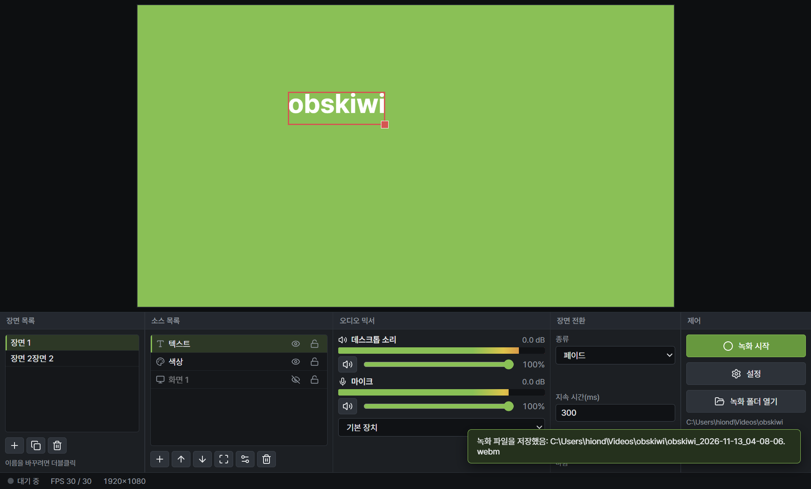

# obskiwi

OBS Studio의 핵심 개념(장면, 소스, 미리보기 합성, 오디오 믹서, 장면 전환, 녹화)을 따라 만든 Windows 데스크톱 교육용 예제임.  
Electron + React + TypeScript로 구현했으며, OBS의 이름, 로고, 아이콘은 쓰지 않은 독자 예제임.  
설계 근거는 [docs/obs-analysis.md](docs/obs-analysis.md)(OBS 설치 파일 정적 분석 결과)에 있음.



## 실행 방법

필요한 것: Windows 11, Node.js 22 이상, npm 10 이상

```bash
npm install      # 의존성 설치(electron 바이너리 내려받기 포함)
npm run build    # 타입 검사 + 렌더러(vite) 빌드 + main/preload(tsc) 컴파일
npm start        # 앱 실행 (electron .)
npm run dev      # build 후 start
npm run typecheck
```

- `npm start`에서 electron 실행 파일이 없다는 오류가 나면 `node node_modules/electron/install.js`를 한 번 실행함  
- 개발자 도구가 필요하면 `OBSKIWI_DEVTOOLS=1 npm start`로 실행함  
- 장면 모음 저장 위치: `%APPDATA%\obskiwi\scenes\default.json`  
- 녹화 기본 폴더: `내 동영상\obskiwi` (설정 대화상자에서 변경 가능)

## 폴더 구조

```text
obskiwi/
  docs/obs-analysis.md        OBS 분석 문서(설계 근거)
  src/
    shared/types.ts           장면 모음 데이터 모델과 IPC 함수 목록(타입만)
    main/main.ts              Electron main: 창, IPC 핸들러, 화면 캡처 허용, 파일 저장
    main/preload.ts           contextBridge로 window.obskiwi 노출
    renderer/
      index.html              CSP 메타 태그 포함
      main.tsx, App.tsx       진입점과 전체 배치(상태는 useReducer 하나)
      state/reducer.ts        장면, 소스, 항목, 오디오, 설정 상태 전이
      engine/compositor.ts    캔버스 합성기(fps 타이머, 전환 효과, 항목 크기 계산)
      engine/capture.ts       화면, 창, 영상 장치 스트림 관리(요청 순서대로 처리)
      engine/audio.ts         AudioContext 믹서(GainNode, AnalyserNode, 녹화용 출력)
      engine/recorder.ts      MediaRecorder 녹화와 1초 조각 전송
      engine/hub.ts           엔진 객체를 한곳에 모은 싱글톤
      components/             도크별 컴포넌트와 대화상자, 미리보기, 상태 표시줄
  dist/                       빌드 결과(git 제외)
```

## 화면 구성

| 영역 | 내용 |
|------|------|
| 위쪽 | 미리보기 캔버스(기준 해상도 1920x1080, 비율 유지) |
| 아래쪽 도크 5개 | 장면 목록, 소스 목록, 오디오 믹서, 장면 전환, 제어 |
| 맨 아래 | 상태 표시줄(녹화 상태와 경과 시간, 실제 렌더 FPS) |

## 기능 표

| 기능 | OBS 대응 개념 | obskiwi 구현 |
|------|--------------|-------------|
| 장면 목록 | 장면(scene) | 추가, 더블클릭 이름 바꾸기, 삭제(마지막 1개 불가), 복제, 선택 시 전환 |
| 소스 목록 | 소스, 장면 항목 | 디스플레이, 창, 영상 장치, 이미지, 텍스트, 색상 추가. 보임, 잠금, 순서, 삭제, 속성 |
| 미리보기 합성 | 렌더 그래프 | Canvas 2D, `setInterval`(fps 기준)로 그려 창이 가려져도 유지 |
| 항목 편집 | 장면 항목 변환 | 클릭 선택, 끌어서 이동, 손잡이로 크기 조절(Shift는 자유 비율), 잠금 시 이동 불가 |
| 오디오 믹서 | fader, volmeter | GainNode 음량(0 ~ 100%, dB 표시), 음소거, AnalyserNode 막대, 녹화용 합산 출력 |
| 장면 전환 | transition | 자르기, 페이드(지속 시간 ms) |
| 녹화 | output, encoder | MediaRecorder(vp9, 안 되면 vp8)로 WebM 저장 |
| 설정 | 설정 창 | 출력 폴더, FPS(24, 30, 60), 기준 해상도(1280x720, 1920x1080) |

## 구현 메모

- 화면과 창 캡처: 렌더러가 `capture:select`로 원본을 알린 뒤 `getDisplayMedia`를 부르면,  
  main의 `setDisplayMediaRequestHandler`가 그 원본으로 허용함. 요청은 한 줄로 세워 순서를 지킴  
- 데스크톱 소리: 화면 캡처 스트림에 소리가 있으면 쓰고, 없으면 「데스크톱 소리 켜기」 버튼으로 loopback을 받음  
- 선택 테두리와 손잡이는 캔버스 위에 얹은 DOM이라 녹화 영상에 찍히지 않음  
- 보안: contextIsolation, sandbox, nodeIntegration 끔. IPC 인자 검사, 요청 위치 검사(file://), CSP 적용  
- 해상도를 바꾸면 항목의 위치와 크기를 같은 비율로 조정함

## 실행 검증 결과(2026-11-13, Playwright로 앱을 띄워 확인)

| 확인 항목 | 결과 |
|----------|------|
| 앱 실행, 화면 배치, 콘솔 오류 | 정상, 콘솔 오류 0건 |
| 디스플레이 캡처 | 2560x1600 화면이 미리보기에 그려짐. 고른 뒤 약 1초 안에 열림 |
| 색상, 텍스트 소스와 보임 토글 | 정상 |
| 미리보기에서 끌어서 이동 | 텍스트 항목이 끈 만큼 이동함 |
| 장면 추가와 페이드 전환 | 정상 |
| 녹화 5초 | WebM(vp9 1920x1080 + opus) 저장, ffmpeg로 열어 프레임 추출 성공 |
| 데스크톱 소리, 마이크 음량 막대 | 막대가 움직임(소리 내용은 귀로 확인하지 않음) |

확인하지 않은 것: 창 캡처, 영상 장치(웹캠), 이미지 소스, 설정 대화상자 변경, 녹화 파일의 소리 품질

## 알려진 제한

- MediaRecorder가 만든 WebM은 재생 시간 정보가 없어 일부 플레이어에서 탐색 막대가 제한될 수 있음.  
  ffmpeg로 디코딩하면 opus 패킷 머리글 오류가 1건 나오지만 영상 추출은 정상임  
- 이미지는 data URL로 장면 모음 JSON에 저장되어 큰 이미지를 많이 넣으면 파일이 커짐(최대 20MB 제한)  
- 창 캡처 ID는 창을 닫았다 열면 바뀌므로, 저장된 장면을 다시 열면 경고 아이콘이 뜰 수 있음(속성에서 다시 고름)  
- 범위 밖: 방송 송출, 가상 카메라, 필터, 플러그인, 단축키
