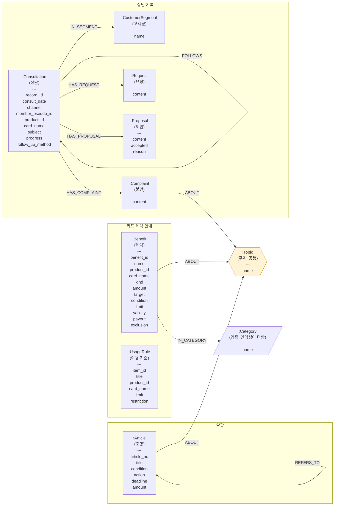

# 5단계 검토: 스키마 초안과 공통 개념 층 초안 `[단계 ③]`

- 승인하는 것: 공통 개념(Class) 9개와 그 규칙(동일, 분류, 개념, 역관, 검사 규칙), 문서 종류별 스키마 초안 3개,  
  상담 기록의 머리줄 규칙, 후보에서 뺀 이름과 그 까닭  
- 승인하면 다음에 일어나는 일: 7단계로 넘어가 시험용 표본(약관 30, 카드 혜택 안내 45, 상담 기록 24)의 기대 답 초안을 쓰고  
  합격 기준을 여쭘. 스키마와 공통 개념 층은 8단계 시험을 통과한 뒤 9단계에서 함께 저장함  
- 온톨로지 적용(요소: Class 정의, 동일, 분류, 개념, 역관, 검사 규칙): 4단계의 후보를 문서 종류별로 고르기 전에  
  공통 개념을 먼저 정하고, 같은 개체로 보는 키와 분류 값과 검사 조건을 스키마 초안과 함께 정함  
- 기존 방식과 다른 점: 기존 ③은 문서 종류마다 후보를 병합, 제거, 추가해 스키마만 확정함.  
  이번에는 1 ~ 4절(공통 개념 층 초안)을 먼저 만들고, 5절의 문서 종류별 추천이 그 결과를 따름  
- 6단계 기계 검증은 이미 돌렸고 69개 검사가 모두 통과함(7절)  

## 0. 4단계 후보에서 본 것

### 개념 설명
4단계는 온톨로지를 적용하지 않고 LLM이 문서만 보고 스키마 후보를 넓게 뽑은 단계임.  
아래는 그 결과에서 5단계 판단에 쓰인 사실만 추린 것임(근거: `{문서 종류}/output/candidates_summary.md`).  

| 문서 종류 | 호출(실패) | 노드 이름 수 | 관계 이름 수 | 눈에 띈 점 |
|---|---|---|---|---|
| 약관 | 25(0) | 43 | 79 | 조항(Clause)은 7번뿐이고 회원, 카드사, 거래처럼 조항 속 낱말이 노드로 많이 나옴 |
| 카드 혜택 안내 | 67(0) | 29 | 59 | 혜택과 카드가 67번씩 나옴. 시행일(effective_date)이 42번 나왔지만 어느 역량 질문에도 안 쓰임 |
| 상담 기록 | 22(1) | 23 | 50 | 불만(Complaint)과 제안(Proposal)은 1번씩만 나옴. 전화번호, 생년월일, 이메일 같은 개인정보 속성이 나옴 |

열 뜻  
- 호출(실패): LLM을 부른 수와 그 가운데 응답이 스키마 검증에 실패한 수. 실패 1건은 같은 속성에 제약을 겹쳐 넣은 응답임  
- 노드 이름 수, 관계 이름 수: 대소문자와 밑줄 차이를 없애고 센 서로 다른 이름의 수  

- 세 문서 종류 어디에서도 **문서끼리 이어 줄 공통 개념(주제)은 후보에 나오지 않았음**.  
  LLM은 단위 하나만 보므로 다른 문서와 이어질 자리를 모름. 그래서 아래 1절에서 공통 개념을 사람이 정함  

## 1. 공통 개념(Class)

### 개념 설명
Class는 같은 뜻의 개체를 묶은 업무 개념임. 여러 원천(문서 3종, 정형 DB)의 노드 타입이나 테이블이 같은 Class에 대응할 수 있음.  
Class마다 뜻 한 줄을 여기에만 적고, 스키마의 description 첫머리는 스크립트가 이 뜻을 가져와 만듦(뜻이 두 곳에서 어긋나지 않게).  
같은 개체로 보는 규칙(동일)과 정해진 값(분류)도 Class마다 적음.  

| Class | 뜻 | 원천별 라벨 | 식별 키 | 동일 규칙 | 허용 값과 상하위 | 채우는 방법 |
|---|---|---|---|---|---|---|
| 카드상품 | 카드사가 파는 카드 상품 하나. 회원이 발급받은 카드 한 장이 아님 | 카드 혜택 안내 Benefit과 UsageRule(키만), 상담 기록 Consultation(키만), 정형 DB Product | product_id | 혜택 안내와 정형 DB는 값 같음. 상담 기록은 바꾸는 규칙(카드 이름 → 상품 ID, 표 64쌍) | 없음 | 머리줄 값 |
| 회원 | 카드를 가진 개인 회원 한 명. 문서에는 가명 ID로만 나타남 | 상담 기록 Consultation(키만), 정형 DB Member | member_pseudo_id, member_id | 바꾸는 규칙(member_id의 SHA-256 앞 16자리에 m_을 붙임) | 없음 | 머리줄 값 |
| 고객군 | 회원을 성향에 따라 나눈 무리 하나. 값은 값 목록의 6개뿐임 | 상담 기록 CustomerSegment, 정형 DB Member.segment_id | name | 바꾸는 규칙(번호 ↔ 이름, 파일 이름 「신규가입」 → 「신규 가입」) | 6개(신규 가입, 장기 보유, VIP, 휴면 직전, 다중 카드, 연회비 부담). 상하위 없음 | 머리줄 값 |
| 업종 | 가맹점을 나눈 정해진 갈래 하나. 값은 값 목록의 8개뿐임 | 카드 혜택 안내 Category(인덱싱이 더함), 정형 DB Merchant.category | name | 정형 DB와는 값 같음. 혜택 쪽은 맞추기 표 | 8개(식비, 쇼핑, 교통, 주유, 여행, 해외, 생활, 교육). 상하위 없음 | 맞추기 표 |
| 주제(공통 노드) | 단위가 다루는 업무 대상 하나를 짧은 명사로 쓴 것(예: 연회비, 본인 확인, 광고 수신) | 문서 3종 모두 Topic | name | 이름 맞추기(띄어쓰기를 없앤 이름이 같으면 같은 주제. 동의어 표는 8단계 시험 결과로 만듦) | 없음 | LLM 추출 |
| 조항 | 개인회원 이용약관의 조(제N조) 하나 | 약관 Article | article_no | 값 같음 | 없음 | LLM 추출(키는 머리줄 값) |
| 혜택 | 카드상품이 회원에게 주는 혜택 항목 하나(할인, 적립, 캐시백, 바우처, 보너스, 무이자 할부, 제휴 서비스) | 카드 혜택 안내 Benefit | benefit_id | 값 같음 | 없음 | LLM 추출(키는 머리줄 값) |
| 상담 | 상담 기록 한 건 | 상담 기록 Consultation | record_id | 값 같음 | 없음 | LLM 추출(키는 머리줄 값) |
| 불만 | 고객이 상담에서 분명히 말한 불만이나 불편 하나 | 상담 기록 Complaint | 없음 | 같은 상담 안에서 내용이 같으면 같은 불만 | 없음 | LLM 추출 |

열 뜻  
- 원천별 라벨: 이 Class가 각 원천에서 어떤 라벨로 나타나는지. 「키만」은 그 원천에 이 Class의 노드를 만들지 않고  
  다른 노드에 키 속성만 둔다는 뜻임(정형 DB가 이미 가진 대상을 그래프에 다시 싣지 않기 위함)  
- 식별 키: 개체 하나를 가려내는 값  
- 동일 규칙: 두 원천의 값이 같은 개체를 가리킨다고 보는 규칙. 값 같음, 바꾸는 규칙(값의 꼴을 바꿔 맞춤),  
  맞추기 표(사람이 확정한 대응표), 이름 맞추기 중 하나  
- 허용 값과 상하위: 분류 Class가 가질 수 있는 값. 값 목록 파일(`inputs/value_lists.json`)에서만 읽음.  
  상하위는 하위 값을 상위 값으로도 찾게 하는 정보인데, 두 값 목록에는 없어 「없음」으로 둠  
- 채우는 방법: LLM 추출(LLM이 본문에서 뽑음), 머리줄 값(단위 앞에 붙인 줄의 값을 그대로 씀), 맞추기 표(인덱싱이 표를 보고 이음)  
- 공통 노드: 여러 문서 종류에 같은 라벨과 description으로 들어가 문서끼리 잇는 노드  

판단 근거  
- 카드상품, 회원: 4단계 후보의 Card(혜택 안내 67번, 상담 18번), Customer, Member를 노드로 두지 않고 키로만 둠.  
  정형 DB가 이미 가진 대상이라 노드를 만들면 같은 데이터가 두 벌이 됨. 대신 키로 이어 문서끼리, 문서와 DB가 이어짐  
- 회원의 바꾸는 규칙: 평가 질문의 M-1042, M-3001을 규칙대로 바꾼 값이 상담 기록의 가명 ID 12종에 있음을 확인함  
- 고객군, 업종을 노드로 둔 까닭: 역량 질문 A1, X1이 이 값으로 무리를 나누고 값이 여러 단위에 되풀이됨  
  (속성 글로만 두면 같은 값의 단위끼리 이어지지 않음)  
- 주제: 2단계 건너가는 지점 P1, P2는 키도 값 목록도 없는 「같은 주제」 연결임. 주제 노드가 없으면 M1, M2에 답할 길이 없음  

## 2. 관계: 개념과 역관

### 개념 설명
개념 규칙은 관계마다 출발 Class와 도착 Class를 적는 것임. 그래프를 읽는 쪽(검색기)이 이 관계가 무엇과 무엇을 잇는지 알게 됨.  
역관은 한 방향 관계에 반대 이름을 붙이는 것임. 그래프에는 한 방향만 저장하고, 반대 방향으로 묻는 질문은 반대 이름으로 해석함.  
주의: 출발과 도착 Class는 연결을 해석하는 규칙이라 잘못된 연결을 막지 않음. 막는 일은 스키마의 패턴(추출 허용 목록)과 3절의 검사 규칙이 함.  

| 관계 | 출발 Class | 도착 Class | 반대 이름 | 반대 이름이 필요한 까닭 |
|---|---|---|---|---|
| ABOUT | 불만, 조항, 혜택 | 주제 | TOPIC_OF | M1, M2는 주제에서 출발해 조항과 혜택을 물음 |
| HAS_COMPLAINT | 상담 | 불만 | 없음 | 반대 방향 질문이 없음 |
| IN_SEGMENT | 상담 | 고객군 | SEGMENT_OF | A1은 고객군에서 출발해 상담을 물음 |
| FOLLOWS | 상담 | 상담 | FOLLOWED_BY | C5, Q14는 첫 상담에서 뒤의 상담으로도 따라감 |
| REFERS_TO | 조항 | 조항 | 없음 | 반대 방향 질문이 없음 |
| IN_CATEGORY | 혜택 | 업종 | CATEGORY_OF | X1은 업종에서 출발해 혜택을 물음. 이 관계는 LLM이 뽑지 않고 인덱싱이 맞추기 표로 더함 |

열 뜻  
- 출발 Class, 도착 Class: 화살표가 나가는 쪽과 들어가는 쪽의 Class  
- 반대 이름: 같은 사실을 거꾸로 읽을 때 쓰는 이름. 그래프에 따로 저장하지 않음  

## 3. 검사 규칙

### 개념 설명
검사 규칙은 그래프 데이터가 지켜야 할 조건임. 허용 값(값이 목록 안에 있음), 허용 수(관계나 값의 개수 범위),  
참조 무결성(가리키는 대상이 실제로 있음) 세 가지가 있음. Neo4j Community 판은 제약으로 「값이 겹치지 않음」만 걸 수 있어,  
나머지는 공통 개념 층에 검사 규칙으로 적고 8단계 채우기 시험에서 위반 수를 셈.  

| 번호 | 종류 | 대상 | 조건 | 적는 곳 |
|---|---|---|---|---|
| K01 | 허용 값 | 고객군 이름 | 값 목록의 6개 안에 있음 | 검사 규칙 |
| K02 | 허용 값 | 업종 이름 | 값 목록의 8개 안에 있음 | 검사 규칙 |
| K03 | 허용 수 | 상담 | 고객군 연결이 정확히 1개 | 검사 규칙 |
| K04 | 허용 수 | 상담 | 회원 가명 키와 상품 키가 1개씩 | 검사 규칙 |
| K05 | 허용 수 | 혜택, 이용 기준 | 상품 키가 정확히 1개 | 검사 규칙 |
| K06 | 허용 수 | 불만, 조항, 혜택 | 주제 연결이 1 ~ 3개(주제 없이 떠 있거나 너무 넓게 잇지 않음) | 검사 규칙 |
| K07 | 참조 무결성 | 혜택, 이용 기준, 상담의 상품 키 | 정형 DB의 상품 ID 64개 안에 있음 | 검사 규칙 |
| K08 | 참조 무결성 | 상담이 이어받은 앞선 상담 | 그 상담 ID가 상담 기록 48건 안에 있음 | 검사 규칙 |
| K09 | 참조 무결성 | 조항이 가리키는 다른 조항 | 그 조 번호가 약관 52개 조 안에 있음 | 검사 규칙 |
| U01 | 허용 수 | 조 번호, 혜택 ID, 이용 기준 ID, 상담 ID, 주제 이름, 고객군 이름 | 값이 겹치지 않음(같은 값이면 노드 하나) | 스키마 제약(UNIQUENESS) |

열 뜻  
- 적는 곳: 스키마 제약은 그래프DB가 직접 막는 것, 검사 규칙은 시험과 인덱싱 뒤 검사로 위반을 세는 것  
- 상품 키: product_id. 회원 가명 키: member_pseudo_id  

## 4. 건너가는 지점마다의 경로

### 개념 설명
2단계에서 적은 건너가는 지점(원천이 바뀌는 자리)마다, 위 Class와 관계로 실제로 건너가는 길을 적은 것임.  
6단계 검사가 지점마다 길이 하나 이상 있는지 확인했고, 8단계에서 시험 결과로 그 길이 실제로 이어지는지 셈.  

| 지점 | 질문 | 경로 | 쓰인 규칙 |
|---|---|---|---|
| P1 | M1 | 상담 → HAS_COMPLAINT → 불만 → ABOUT → 주제 ← ABOUT ← 조항 | 개념, 역관, 동일(주제 이름 맞추기) |
| P2 | M2 | 불만 → ABOUT → 주제 ← ABOUT ← 혜택 | 개념, 역관, 동일(주제 이름 맞추기) |
| P3 | M3 | 상담의 product_id = 혜택의 product_id | 동일(카드상품) |
| P4 | X1 | 정형 DB 가맹점 업종 = 업종 노드 ← IN_CATEGORY ← 혜택 | 분류(허용 값 8개), 동일(맞추기 표), 역관 |
| P5 | X2 | 정형 DB 회원 번호 → 바꾸는 규칙 → 상담의 member_pseudo_id | 동일(회원) |
| P6 | X3 | 정형 DB 상품 ID = 혜택의 product_id | 동일(카드상품) |

열 뜻  
- 경로: 화살표는 그래프의 관계 방향. 「=」는 노드 없이 키 값이 같아 이어지는 곳  

## 5. 문서 종류별 스키마 초안 추천

### 개념 설명
4단계 후보를 역량 질문 기준으로 다듬은 결과임(나온 횟수가 아니라 질문에 쓰이는지로 판단).  
공통(1절의 공통 노드를 넣음), 병합(같은 뜻의 이름을 하나로), 제거(질문에 안 쓰이거나 개인정보), 참조(다른 원천이 가진 대상은 키만 둠),  
추가(질문에 필요한데 후보에 없거나 드물던 것) 다섯 가지로 나눔.  

### 5.1 약관

| 구분 | 추천 | 근거 질문 |
|---|---|---|
| 공통 | Topic(주제)과 ABOUT(조항 → 주제) | M1 |
| 병합 | Clause(7), number, clause_number → Article(조항), article_no | R1 ~ R4 |
| 병합 | due_date, deadline_days, review_due_days, reply_due_date → Article.deadline | R2, R3 |
| 병합 | Payment.amount, FeeComponent.amount → Article.amount | R2 |
| 병합 | Procedure, NOTIFIES_RESULT, INFORMS → Article.action | R1, R3 |
| 병합 | BASED_ON, SUBJECT_TO, ConversionStandard.reference_clause → REFERS_TO(조항 → 조항) | R4 |
| 제거 | Member, CardCompany, CardIssuer, Merchant, Transaction, Statement, Account 등 38개 이름 | 없음(조항 안의 일반 낱말이고 어느 질문도 이 개체를 묻지 않음) |
| 추가 | Article.condition(적용되는 경우) | R1 |

### 5.2 카드 혜택 안내

| 구분 | 추천 | 근거 질문 |
|---|---|---|
| 공통 | Topic(주제)과 ABOUT(혜택 → 주제) | M2 |
| 참조 | Card(67) → 노드를 만들지 않고 Benefit과 UsageRule에 product_id(머리줄 값), card_name만 둠 | M3, X3 |
| 병합 | discount_rate, accrual_rate, cashback_rate, percentage, amount, Voucher, Bonus → Benefit.amount, kind | B1 |
| 병합 | Condition(20), performance_condition → Benefit.condition | B2 |
| 병합 | Channel(15), Merchant, Store, target_channel → Benefit.target | B2, X1 |
| 병합 | Limit(18), monthly_limit 등 → Benefit.limit | B3 |
| 병합 | Payout, PaymentTiming, payment_timing, payout_day → Benefit.payout | B3 |
| 병합 | Exclusion(11), ExcludedTransaction, TransactionType, exclusions → Benefit.exclusion | B4 |
| 분류 | MerchantCategory, TransactionCategory, Industry, Category, DiscountCategory → 업종(Category). LLM이 뽑지 않고 인덱싱이 맞추기 표로 더함 | X1 |
| 제거 | effective_date(42번 나옴) | 없음(모든 항목에 같은 가상 시행일이 적혀 있고 어느 질문도 묻지 않음) |
| 제거 | Account, Guardian, Charity, Service, Notification, FinancialInstitution, BusinessProfile, Settlement | 없음 |
| 추가 | UsageRule(이용 기준): 혜택을 주지 않는 이용 규칙 항목(통합 한도, 결제 한도) | B5 |
| 추가 | Benefit.validity(사용 기한) | B3 |

- 조건, 한도, 제외 거래를 노드로 두지 않은 까닭: B2 ~ B4는 혜택 하나에서 읽기만 하고 그 값으로 혜택을 묶거나 비교하지 않음.  
  읽기만 하는 값은 속성으로 둠  

### 5.3 상담 기록

| 구분 | 추천 | 근거 질문 |
|---|---|---|
| 공통 | Topic(주제)과 ABOUT(불만 → 주제) | M1, M2 |
| 참조 | Customer(12), Member(9) → 노드를 만들지 않고 Consultation.member_pseudo_id(머리줄 값)만 둠 | X2 |
| 참조 | Card(18) → 노드를 만들지 않고 Consultation.product_id(머리줄 값), card_name만 둠 | M3 |
| 병합 | id, consultation_id → record_id. date → consult_date. topic → subject | C2 ~ C6 |
| 병합 | follow_up_method, followup_method, ContactMethod → Consultation.follow_up_method | C6 |
| 병합 | Complaint, Issue, IssueTopic → Complaint(불만) | C1 |
| 병합 | Proposal, Guideline → Proposal(제안) | C3 |
| 병합 | FOLLOWS(12), PRECEDES, PREVIOUS_CONSULTATION → FOLLOWS | C5 |
| 분류 | customer_group, group → CustomerSegment(고객군) 노드. 머리줄 값으로 채움 | A1 |
| 제거 | Agent(9), Channel(7) | 없음(상담사는 질문에 안 쓰임. 채널은 읽기만 해서 Consultation.channel 속성으로 둠) |
| 제거 | TransactionSummary(8), Transaction, TransactionRecord | 없음(정형 DB가 가진 거래 집계. 2단계에서 범위 밖으로 승인) |
| 제거 | phone, contact_phone, birthdate, email, name, last_four, masked_number | 없음(개인정보 처리 대상 속성) |
| 추가 | Consultation.progress(일이 어디까지 진행되었나). 후보에 없었음 | C4 |
| 추가 | Proposal.accepted, reason(받아들였나, 그 까닭). 후보에 없었음 | C3, A2 |
| 추가 | HAS_COMPLAINT, HAS_PROPOSAL(후보에 1번씩) | C1, C3 |

열 뜻(5.1 ~ 5.3 공통)  
- 구분: 공통, 병합, 제거, 참조, 추가, 분류(분류 Class의 노드로 바꿈)  
- 추천: 괄호 숫자는 4단계에서 나온 건수  
- 근거 질문: 2단계 역량 질문 번호. 「없음」은 어느 질문에도 쓰이지 않아 뺀 것  

## 6. 스키마 초안

### 개념 설명
위 추천을 반영한 문서 종류별 스키마 초안임. 노드 타입은 그래프의 점 종류, 관계는 점을 잇는 선 종류, 속성은 점에 딸린 값임.  
description은 LLM이 추출할 때 읽는 설명이라 추출 품질을 좌우함. 그래서 「해당」과 「비해당」을 함께 적음.  
노란 육각형이 공통 노드, 점선은 인덱싱이 맞추기 표로 더하는 것임.  

| 문서 종류 | 노드 타입(한글) | 관계 | 제약(값이 겹치지 않음) |
|---|---|---|---|
| 약관 | Article(조항), Topic(주제) | REFERS_TO, ABOUT | Article.article_no, Topic.name |
| 카드 혜택 안내 | Benefit(혜택), UsageRule(이용 기준), Topic(주제) | ABOUT | Benefit.benefit_id, UsageRule.item_id, Topic.name |
| 상담 기록 | Consultation(상담), CustomerSegment(고객군), Complaint(불만), Request(요청), Proposal(제안), Topic(주제) | FOLLOWS, IN_SEGMENT, HAS_COMPLAINT, HAS_REQUEST, HAS_PROPOSAL, ABOUT | Consultation.record_id, CustomerSegment.name, Topic.name |

열 뜻  
- 제약: Neo4j가 직접 지키게 하는 조건. Community 판이라 UNIQUENESS(값이 겹치지 않음)만 씀  

description 예(공통 노드 Topic, 세 문서 종류에 똑같이 들어감)  

```text
단위가 다루는 업무 대상 하나를 짧은 명사로 쓴 것(예: 연회비, 본인 확인, 광고 수신).   ← 공통 개념 층의 뜻(스크립트가 넣음)
해당: 그 단위가 다루는 업무 대상을 2 ~ 8글자의 명사로 씀(예: 연회비, 본인 확인, 광고 수신, 혜택 신청, 이의신청,
결제일, 해외 결제, 카드 해지). 단위 하나에 1 ~ 3개. 비해당: 불편, 불만, 문의, 안내 같은 말, 카드 이름, 가맹점 이름,
금액, 날짜, 사람.                                                                         ← 추출 기준(스키마에만 적음)
```

전체 그림  



- 문서 종류별 그림은 `{문서 종류}/output/schema_preview.html`, 전체와 세 장을 한 번에 보는 파일은 `common/output/schema_preview.html`  

## 7. 6단계 기계 검증 결과

### 개념 설명
사람이 보기 전에 스크립트로 확인할 수 있는 것은 먼저 확인함. 이름 규칙, 그래프 라이브러리 검증, 공통 노드가 세 문서에서 같은지,  
공통 개념 층과 스키마가 서로 맞는지(라벨, 키, 뜻, 허용 값, 관계, 경로)를 봄.  

| 검사 묶음 | 검사 수 | 실패 |
|---|---|---|
| 문서 종류별 스키마(라벨 중복, 이름 규칙, description, GraphSchema 검증, 제약 종류, additional 값) | 18 | 0 |
| 공통 노드 Topic이 세 문서에서 같음 | 1 | 0 |
| 공통 개념 층 문서 쪽(라벨과 키가 스키마에 있음 14, 뜻이 description 첫머리와 같음 8) | 22 | 0 |
| 공통 개념 층 다른 원천(라벨과 키가 원천 목록 표에 있음) | 4 | 0 |
| 허용 값(값 목록 파일과 같음) | 2 | 0 |
| 관계(출발과 도착 Class, 관계 이름이 있음, 반대 이름 겹침) | 16 | 0 |
| 경로(건너가는 지점 6곳마다 경로 있음) | 6 | 0 |
| 합계 | 69 | 0 |

- 그림: `common/output/schema_preview.html`을 앱 내장 브라우저로 열어 4장이 오류 없이 그려짐을 확인함  
- 검사 기록: `common/output/check_concepts.json`. 5 ~ 6단계 되돌아감 0회(상한 5회)  

## 8. 정해 주실 것

| 번호 | 정할 것 | 추천 | 다른 선택 |
|---|---|---|---|
| 가 | 공통 개념 9개와 규칙(1 ~ 4절) | 그대로 | 고칠 Class나 규칙을 알려 주심 |
| 나 | 상담 기록의 카드상품 키: 본문의 「~ 카드 상담으로 기록」 문장에서 규칙으로 카드 이름을 찾아 상품 ID로 바꿔 머리줄에 넣음(48건 모두 찾음). 카드를 둘 말한 상담 4건은 기록 문장의 카드 하나만 씀 | 규칙으로 머리줄에 넣음 | LLM이 카드 이름을 뽑고 인덱싱이 바꿈(틀릴 수 있음) |
| 다 | 주제는 값 목록이 없어 LLM이 이름을 짓고, 띄어쓰기를 없앤 이름이 같으면 합침. 문서끼리 실제로 이어지는지는 8단계에서 셈 | 그대로 진행하고 8단계 숫자로 판단 | 지금 주제 값 목록을 사람이 만들어 줌 |
| 라 | 카드 혜택 안내를 Benefit(혜택)과 UsageRule(이용 기준)으로 나눔 | 나눔 | 모두 Benefit 하나로 둠(B5 답이 혜택과 섞임) |
| 마 | 5절의 제거 목록(시행일, 상담사, 거래 집계, 개인정보 속성 포함) | 그대로 뺌 | 살릴 이름을 알려 주심 |
| 바 | 3절의 검사 규칙과 제약 | 그대로 | 고칠 조건을 알려 주심 |

- 머리줄 바뀜 알림: 8단계 시험과 인덱싱에서 쓰는 머리줄은 4단계와 달리 속성 이름(product_id 등)을 함께 적음.  
  단위 본문은 바뀌지 않음(`tools/units.py`의 `header_of`, 4단계는 version 1, 이후는 version 2)  

함께 볼 원본 파일  
- 공통 개념 층 초안: `common/output/concepts_draft.json`  
- 스키마 초안: `regulation/output/schema_draft.json`, `benefit_guide/output/schema_draft.json`, `consult_log/output/schema_draft.json`  
- 그림: `common/output/schema_preview.html`, `common/output/schema_all.mmd`, `{문서 종류}/output/schema.mmd`  
- 후보 요약: `{문서 종류}/output/candidates_summary.md`  
- 만든 스크립트: `tools/build_schema.py`, `common/tools/check_concepts.py`. 검사 기록: `common/output/check_concepts.json`  
