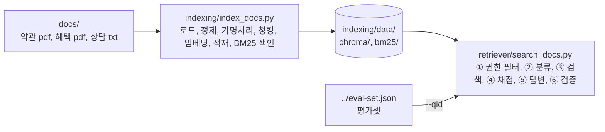

# RAG 실습 예제 — 인덱싱, 검색

하이브리드 AI 교육 3 ~ 4주차 「문서 인덱싱」, 「문서 검색」 실습용 예제임.  
레이어드 아키텍처 없이 **main 1개 + 핵심 모듈 1개**로 짰고, 교육생은 핵심 모듈만 클론 코딩한 뒤 본인 코드로 바꿔 끼움.  
실습 진행 순서와 시간 배분은 [실습계획서](../../../teacher/plan/rag-실습계획서.md)(인덱싱)와  
[검색 개발계획서](../../../teacher/plan/rag-search-개발계획서.md)(검색 워크플로우)에 있음.

## 1. 세 프로그램의 관계



| 폴더 | main | 핵심 모듈(클론 코딩 대상) | 교육생 작업 파일 | 만드는 것 |
|---|---|---|---|---|
| `indexing/` | `index_docs.py` | `core_indexing.py` | `my_indexing.py`(`--mine`이 템플릿에서 만듦) | `data/chroma/`, `data/bm25/` |
| `retriever/` | `search_docs.py` | `core_search.py` | `my_search.py`(`--mine`이 템플릿에서 만듦) | 단계별 검색 화면(결과 파일 없음) |

## 2. 준비물

| 항목 | 값 |
|---|---|
| Python | 3.13 |
| 임베딩 모델 | Cohere `embed-v5.0-fast` (API, 2048차원) |
| LLM | Groq `openai/gpt-oss-120b` (검색의 질문 분류, 질문 변환, 답변 생성) |
| 리랭커 | Cohere `rerank-v4.0-fast` (API) |
| 형태소 분석 | Kiwi(`kiwipiepy`, 로컬. BM25 토큰화) |
| BM25 색인 | `bm25s`(로컬. Lucene 방식, k1 1.5, b 0.75). 인덱싱이 점수표를 미리 계산해 `indexing/data/bm25/`에 저장하고, 검색기는 읽기만 함 |
| API 키 | 저장소 루트 `secrets/.env` 에 `GROQ_API_KEY=...`, `COHERE_API_KEY=...` 두 줄. 다른 곳에 적지 않음 |
| 로컬 모델 | 없음. 임베딩과 리랭크가 모두 API라 GPU, torch, 모델 다운로드가 필요 없음 |

## 3. 가상환경 설정과 패키지 설치

가상환경은 이 폴더의 `.venv` **하나**를 `indexing/`과 `retriever/`가 함께 씀. GPU와 로컬 모델은 필요 없음.  
가상환경을 **활성화(activate)**한 뒤에는 `python`, `pip`이 이 가상환경의 것으로 바뀜. 프롬프트 앞에 `(.venv)`가 보이면 활성화된 것임.  
활성화는 터미널 창마다 한 번 함. 새 터미널을 열면 다시 활성화함.

### 처음 한 번: 만들기, 활성화, 설치

Windows PowerShell

```powershell
cd hands-on\solutions\rag
python -m venv .venv
.venv\Scripts\Activate.ps1
pip install -r requirements.txt
```

Windows Git Bash

```bash
cd hands-on/solutions/rag
python -m venv .venv
source .venv/Scripts/activate
pip install -r requirements.txt
```

macOS, Linux (zsh, bash)

```bash
cd hands-on/solutions/rag
python3.13 -m venv .venv
source .venv/bin/activate
pip install -r requirements.txt
```

설치 확인(활성화한 터미널에서)

```bash
python -c "import langchain, chromadb, kiwipiepy, cohere, bm25s; print('ok')"
```

### 다음부터: 활성화만

| 터미널 | 활성화(`hands-on/solutions/rag` 폴더에서) | 끄기 |
|---|---|---|
| Windows PowerShell | `.venv\Scripts\Activate.ps1` | `deactivate` |
| Windows Git Bash | `source .venv/Scripts/activate` | `deactivate` |
| macOS, Linux | `source .venv/bin/activate` | `deactivate` |

활성화한 뒤 `indexing/`이나 `retriever/` 폴더로 `cd` 해도 활성화는 그대로 유지됨.

### PowerShell에서 활성화가 막힐 때

`.venv\Scripts\Activate.ps1`을 실행했을 때 아래처럼 나오면 PowerShell 실행 정책이 스크립트 실행을 막은 것임.

```text
.venv\Scripts\Activate.ps1 : 이 시스템에서 스크립트를 실행할 수 없으므로 ... 파일을 로드할 수 없습니다.
(영문: ... cannot be loaded because running scripts is disabled on this system.)
```

방법 1(권장): 지금 연 PowerShell 창에서만 허용함. 창을 닫으면 원래대로 돌아가 다른 설정에 영향이 없음

```powershell
Set-ExecutionPolicy -Scope Process -ExecutionPolicy Bypass
.venv\Scripts\Activate.ps1
```

방법 2: 내 계정에서 계속 허용함(한 번만 하면 이후 창에서도 됨. 인터넷에서 받은 서명 없는 스크립트는 여전히 막힘)

```powershell
Set-ExecutionPolicy -Scope CurrentUser -ExecutionPolicy RemoteSigned
```

- 지금 설정 보기: `Get-ExecutionPolicy -List`. 방법 2를 되돌리려면 `Set-ExecutionPolicy -Scope CurrentUser -ExecutionPolicy Undefined`
- 회사 PC처럼 관리자가 정책을 막아 두어 위 명령도 안 되면, 활성화 없이 가상환경의 파이썬을 직접 지정해 실행함  
  (예: `.venv\Scripts\python.exe -m pip install -r requirements.txt`,  
  `..\.venv\Scripts\python.exe search_docs.py --qid Q01`)
- 저장소를 통째로 clone해서 씀. `rag/` 폴더만 복사하면 `docs/`와 `secrets/`를 찾지 못함

### VS Code에서 import 경고 없애기(선택)

`retriever/search_docs.py`의 `import core_indexing as indexing` 줄에  
「Import "core_indexing" could not be resolved」 경고가 보일 수 있음.  
실행할 때는 코드가 `indexing` 폴더를 검색 경로에 넣어 정상 동작함. 편집기(Pylance)는 코드를 실행하지 않아 그 경로를 모르기 때문에 생기는 경고임.  
VS Code에 경로를 알려 주면 경고가 사라지고, 함수 이름 자동 완성과 정의로 이동(F12)도 됨.

저장소 루트(`hybrid-ai`)를 VS Code로 열었다면 루트에 `.vscode/settings.json`을 만들고 아래처럼 적음

```json
{
  "python.analysis.extraPaths": [
    "hands-on/solutions/rag/indexing",
    "hands-on/solutions/graphrag/indexer"
  ]
}
```

- `hands-on/solutions/rag` 폴더만 열었다면 그 폴더에 `.vscode/settings.json`을 만들고 `"python.analysis.extraPaths": ["indexing"]`로 적음
- 이미 `settings.json`이 있으면 파일을 새로 만들지 말고 `"python.analysis.extraPaths"` 항목만 더함
- 둘째 줄(`graphrag/indexer`)은 GraphRAG 실습의 같은 경고용이며 RAG만 할 때는 빼도 됨
- 파이썬 인터프리터도 가상환경으로 맞춤: `Ctrl+Shift+P` → `Python: Select Interpreter` → `hands-on/solutions/rag/.venv`.  
  그래야 langchain, chromadb 같은 패키지 import 경고도 사라짐
- `.vscode/` 폴더는 Git에 올리지 않음(저장소 `.gitignore`에 있음). 각자 PC에서 만듦
- 확인(2026-10-26): 같은 엔진인 pyright로 검사하면 설정 전에는 `core_indexing` 경고가 나고, `extraPaths`를 넣은 뒤에는 사라짐

## 4. 실행 순서

가상환경을 활성화한 터미널에서 실행함(3절). 아래는 Git Bash, macOS, Linux 기준이며 PowerShell은 `cd` 경로의 `/`를 `\`로 씀.

```bash
# 0) 가상환경 활성화(hands-on/solutions/rag 폴더에서). macOS, Linux는 source .venv/bin/activate,
#    PowerShell은 .venv\Scripts\Activate.ps1
source .venv/Scripts/activate

# 1) 인덱싱(7단계, 마지막이 BM25 색인) — 처음엔 --limit 8 로 빨리 확인(결과는 data-limit/). 검색 전에는 전체 실행(data/, 약 1분)
cd indexing
python index_docs.py --limit 8
python index_docs.py

# 2) 검색 워크플로우 — 질문 하나를 ① ~ ⑥ 단계별 출력으로 확인
cd ../retriever
python search_docs.py --qid Q01
python search_docs.py "직전 12개월 동안 카드를 얼마나 쓰면 다음 해 기본 연회비가 면제되나요?"
```

인덱싱이 도는 동안에는 검색 프로그램을 실행하지 않음(같은 Chroma 폴더를 두 프로그램이 열면 결과가 흔들림).  
인덱싱이 안 되는 PC는 강사가 배포하는 `indexing/data/`(`chroma/`와 `bm25/` 두 폴더 모두. chromadb 1.5.9 기준)를 복사해 검색부터 시작해도 됨.

각 단계의 자세한 옵션과 출력 읽는 법은 폴더별 README에 있음:
[indexing](indexing/README.md), [retriever](retriever/README.md).

### 4.1 검색 역할과 테스트용 회원번호

검색기(`retriever/search_docs.py`)는 역할과 회원번호로 볼 수 있는 청크를 검색 전에 거름. 기본 역할은 auditor(감사자)임.

| 실행 | 검색 대상 | BM25 대상 청크 |
|---|---|---|
| 옵션 없음(기본 auditor) | 약관, 혜택 안내, 모든 회원의 상담 이력 | 260개 |
| `--role agent` | 약관, 혜택 안내만(상담 이력 0건) | 212개 |
| `--member-id M-1042` | 그 회원의 상담 이력만 | 4개 |
| `--qid Q14`처럼 평가셋 회원 문항 | 그 회원의 상담 이력만(회원번호 자동) | 4개 |

`--member-id`에는 가명화 전 회원번호를 그대로 넘김(대소문자, 공백까지 같게). 검색기가 인덱서와 같은 식으로 가명 ID로 바꿔 거름.  
상담 이력(`docs/D3_S*.txt`)에는 회원 12명이 있고 회원마다 상담 4건임. 처음에는 평가셋 정답이 있는 **M-1042**, **M-3001**로 확인함.

| 고객군(상담 파일) | 회원번호와 상담 주제 | 평가셋 문항 |
|---|---|---|
| 신규가입(S01) | M-1001 앱 인증 불편 완화, M-1050 명세서 항목 이해 | - |
| 장기보유(S02) | **M-1042 연회비 대비 가치**, M-2048 민원 처리 경과 부재 | M-1042: Q14, Q15, Q21 |
| VIP(S03) | **M-3001 타사 관리 절차 비교**, M-3049 가전 구매 주기 | M-3001: Q16, Q17, Q22 |
| 휴면직전(S04) | M-4001 광고 알림 누적, M-4049 우편 주소 수정 | - |
| 다중카드(S05) | M-5001 카드 중복, M-5049 의심 문자 확인 | - |
| 연회비부담(S06) | M-6001 혜택 불일치, M-6049 생활비 절약 | - |

```bash
python search_docs.py "첫 상담에서 무엇을 비교해 달라고 했나요?" --member-id M-1042   # retriever 폴더에서
```

정상이면 ①단계에 가명 ID(예: `m_59853c3d8e1e3c25`)와 「BM25 대상 청크: 4개」가 찍힘. 번호가 틀리면 「대상 청크 0개」 경고가 남.  
예시 명령과 확인 포인트는 [retriever README 4.1](retriever/README.md#41-테스트용-회원번호)에 더 있음.

## 5. 화면 출력에 쓰인 형식 기호

세 프로그램의 `print`에 공통으로 나오는 f-string 형식 기호임. 처음 보면 어렵게 느껴지지만 뜻은 다섯 가지뿐임.

| 기호 | 뜻 | 예 |
|---|---|---|
| `{값:.3f}` | 소수점 아래 3자리 | `0.836` |
| `{값:,}` | 천 단위 쉼표 | `166,893` |
| `{값:04d}` | 4자리 숫자, 빈자리는 0 | `0007` |
| `{값:>2}` | 2칸 오른쪽 정렬 | `' 7'` |
| `{값:<44}` | 44칸 왼쪽 정렬(표 칸 맞춤) | `D1_개인회원표준약관_합성.pdf      ` |

## 6. 교육생 교체 방법(공통)

1. main 파일을 `--mine` 옵션을 붙여 실행함. 예: `python index_docs.py --mine --limit 8`  
   처음 실행하면 강사 뼈대 `my_indexing.template.py`가 `my_indexing.py`로 복사됨
2. `my_*.py`에 강사 시연을 보며 같은 이름, 같은 인자의 함수를 채움(`my_*.template.py`는 고치지 않음)
3. 같은 명령으로 다시 실행해 단계별 출력을 강사 결과와 비교함
4. 막히면 `--mine`을 빼고 실행해 강사 코드로 뒤 단계를 계속 진행함
5. `index_docs.py --mine`으로 색인을 만들었다면 검색기는 색인의 `manifest.json`을 보고 `my_indexing`으로  
   질문을 토큰화함(따로 바꿀 것 없음). 질문을 색인과 같은 규칙(`tokenize_korean`, 같은 사전)으로 토큰화해야 BM25가 맞기 때문임

### 작업 파일과 pull 충돌

- Git에는 강사 뼈대 `my_*.template.py`만 올라가고, 교육생 파일 `my_*.py`는 Git이 무시함(저장소 루트 `.gitignore`)  
- 강사가 뼈대를 고쳐도 교육생 파일과 겹치지 않으므로 `git pull` 충돌이 나지 않음  
- main 파일(`index_docs.py`, `search_docs.py`)은 고치지 않음. 바꿔 끼우기는 `--mine` 옵션으로만 함  
- 강사가 뼈대를 고친 내용(새 함수, 빈칸 안내)은 `my_*.template.py`와 본인 `my_*.py`를 나란히 열어 비교해 옮김

### 예전 방식(my_*.py를 Git이 관리하던 때)에서 한 번만 옮기기

지금까지 실습한 것은 인덱싱(`my_indexing.py`) 하나뿐이므로, 로컬 저장소를 새로 받는 것이 가장 간단함.  
저장소 폴더를 지우면 Git이 무시하던 파일(API 키, 가상환경, 색인 결과)도 함께 지워지므로 필요한 것만 먼저 백업함.

1. 저장소 밖 폴더(예: 바탕화면)에 아래 파일을 복사해 둠

   | 백업할 것 | 이유 |
   |---|---|
   | `hands-on/solutions/rag/indexing/my_indexing.py` | 본인 코드 |
   | `secrets/.env` | API 키. 저장소를 지우면 함께 지워짐 |
   | `hands-on/solutions/rag/indexing/data/` (선택) | 만든 색인. 두면 임베딩을 다시 돌리지 않아도 됨 |

2. 로컬 저장소 폴더를 지우고 다시 클론함

   ```bash
   git clone https://github.com/unicorn-campus/hybrid-ai.git
   ```

3. 백업한 파일을 새 저장소의 같은 자리에 넣음.  
   본인 코드는 `hands-on/solutions/rag/indexing/` 에 두고, 이름을 바꿔 두었다면 `my_indexing.py` 로 되돌림
4. 가상환경을 3장대로 다시 만듦(가상환경 폴더도 함께 지워졌기 때문임)
5. 이제부터는 `--mine`을 붙여 실행함. 예: `python index_docs.py --mine --limit 8`

## 7. 실측값(강사 PC, 2026-10-21, Cohere 임베딩 기준)

| 항목 | 값 |
|---|---|
| 청크 수 | 260개 (약관 15, 혜택 197, 상담 48). 800토큰(Cohere 토크나이저) 초과 0개 |
| 인덱싱 시간 | 전체 12초(임베딩 API 호출 3회, 6초) |
| 개인정보 잔존 | 고객명, 전화, 이메일, 카드번호 문자열 0건 |
| 검색 워크플로우(2026-10-26) | 평가셋 25문항을 `--qid`로 차례 실행: 답 있는 20문항 답변 완료 18, 근거 적중 18/20, 답 없는 5문항 5/5 확인 필요. 자세한 값은 [retriever README](retriever/README.md) 7장 |

## 8. Cohere 비용과 무료(체험) 키

출처(2026-10-21 확인): [요금 페이지](https://cohere.com/pricing),  
[호출 제한 문서](https://docs.cohere.com/docs/rate-limits).  
요금은 바뀔 수 있으므로 교육 전날 다시 확인함.

### 8.1 요금표(종량제, Production 키)

| 모델 | 쓰는 곳 | 단가 | 과금 단위 |
|---|---|---|---|
| Embed 5 Fast (`embed-v5.0-fast`) | 인덱싱 문서 임베딩, 검색 질문 임베딩 | $0.08 / 1M 토큰 | 입력 토큰 |
| Embed 5 Pro (`embed-v5.0-pro`) | 쓰지 않음(품질 우선 대안. Fast와 같은 벡터 공간) | $0.12 / 1M 토큰 | 입력 토큰 |
| Rerank 4 Fast (`rerank-v4.0-fast`) | 검색 리랭크 | $2.00 / 1K 검색 | 검색 단위 |
| Rerank 4 Pro (`rerank-v4.0-pro`) | 쓰지 않음(품질 우선 대안) | $2.50 / 1K 검색 | 검색 단위 |

검색 단위(search unit) = 질문 1개 + 문서 최대 100개. 문서가 500토큰을 넘으면 여러 조각으로 나뉘어 조각마다 문서 1개로 셈.  
이 예제는 리랭크 후보가 10개(top_k 5 × 2)이고 청크가 최대 780토큰이라 조각이 늘어도 100개를 넘지 않음 → 검색 1회 = 1단위(실측).

### 8.2 무료(체험, Trial) 키

| 항목 | 내용 |
|---|---|
| 요금 | 무료. 상업용과 운영 목적에는 쓸 수 없음 |
| 월 상한 | 키 하나당 월 1,000회 API 호출 |
| 분당 상한 | Embed 2,000건(input) / 분, Rerank 10회 / 분, Tokenize 100회 / 분 |
| Production 키 | 종량제(위 요금표). Embed 2,000건 / 분, Rerank 1,000회 / 분 |

체험 키로 여러 질문을 잇달아 돌리면 리랭크가 분당 10회를 넘어 429가 날 수 있음(복합 질문 한 번에 리랭크 최대 6회).  
그때는 조별 한 대만 실행하고 1 ~ 2분 뒤 다시 돌림.

### 8.3 이 예제의 실제 비용(강사 PC 실측, API 응답의 billed_units 기준)

| 작업 | 호출 | 과금량 | 비용(USD) |
|---|---|---|---|
| 전체 인덱싱 1회(청크 260개) | Embed 3회 | 입력 124,325 토큰 | $0.0099 (약 1센트) |
| 검색 1회(질문 임베딩 + 리랭크) | Embed 1회 + Rerank 1회 | 25 토큰 + 검색 1단위 | $0.0020 |
| 평가셋 25문항(검색 워크플로우, `--qid` 차례 실행) | Embed 46회 + Rerank 41회 | 검색 41단위 | 약 $0.08 |
| 교육생 1명 한 주차(인덱싱 3회, 검색 50회) | 약 160회 | 위 합계 | 약 $0.15 |
| 교육생 25명 두 주차 | 약 9,500회 | — | 약 $9 |

- 비용의 대부분은 리랭크(검색 1회당 $0.002)이고 임베딩은 거의 공짜임(인덱싱 100번 해야 $1)
- 체험 키는 비용이 0이지만 월 1,000회 상한이 있어 교육생 1명이 두 주차를 쓰면 약 380회, 조별 공용 키라면 상한에 걸릴 수 있음
- 토큰 수는 `index_docs.py`가 쓰는 Cohere 오프라인 토크나이저 계산값(124,351)과 과금값(124,325)이 거의 같음
