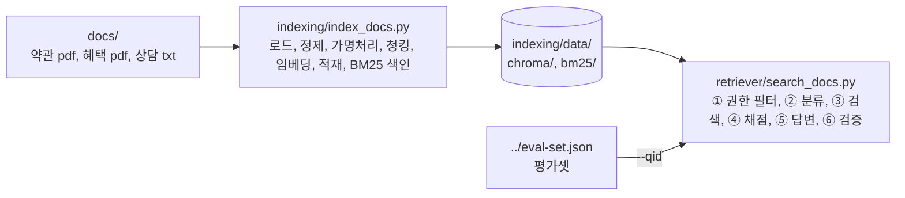

# RAG 실습 예제 — 인덱싱, 검색

하이브리드 AI 교육 3 ~ 4주차 「문서 인덱싱」, 「문서 검색」 실습용 예제임.  
레이어드 아키텍처 없이 **main 1개 + 핵심 모듈 1개**로 짰고, 교육생은 핵심 모듈만 클론 코딩한 뒤 본인 코드로 바꿔 끼움.  
실습 진행 순서와 시간 배분은 [실습계획서](../../../teacher/plan/rag-실습계획서.md)(인덱싱)와  
[검색 개발계획서](../../../teacher/plan/rag-search-개발계획서.md)(검색 워크플로우)에 있음.

## 1. 세 프로그램의 관계



| 폴더 | main | 핵심 모듈(클론 코딩 대상) | 교육생 작업 파일 | 만드는 것 |
|---|---|---|---|---|
| `indexing/` | `index_docs.py` | `core_indexing.py` | `my_indexing.py` | `data/chroma/`, `data/bm25/` |
| `retriever/` | `search_docs.py` | `core_search.py` | `my_search.py` | 단계별 검색 화면(결과 파일 없음) |

## 2. 준비물

| 항목 | 값 |
|---|---|
| Python | 3.13 |
| 임베딩 모델 | Cohere `embed-v5.0-fast` (API, 2048차원) |
| LLM | Groq `openai/gpt-oss-120b` (검색의 질문 분류, 질문 변환, 답변 생성) |
| 리랭커 | Cohere `rerank-v4.0-fast` (API) |
| 형태소 분석 | Kiwi(`kiwipiepy`, 로컬. BM25 토큰화) |
| BM25 색인 | `bm25s`(로컬. Lucene 방식, k1 1.5, b 0.75). 인덱싱이 점수표를 미리 계산해 `indexing/data/bm25/`에 저장하고, 검색기는 읽기만 함 |
| API 키 | 저장소 루트 `secrets/.env` 에 `GROQ_API_KEY=...`, `COHERE_API_KEY=...` 두 줄. 다른 곳에 적지 않음 |
| 로컬 모델 | 없음. 임베딩과 리랭크가 모두 API라 GPU, torch, 모델 다운로드가 필요 없음 |

## 3. 가상환경 설정과 패키지 설치

가상환경은 이 폴더의 `.venv` **하나**를 `indexing/`과 `retriever/`가 함께 씀. GPU와 로컬 모델은 필요 없음.

### Windows PowerShell

```powershell
cd hands-on\solutions\rag
python -m venv .venv
.venv\Scripts\python.exe -m pip install -r requirements.txt
```

### Windows Git Bash

```bash
cd hands-on/solutions/rag
python -m venv .venv
.venv/Scripts/python.exe -m pip install -r requirements.txt
```

### macOS, Linux (zsh, bash)

```bash
cd hands-on/solutions/rag
python3.13 -m venv .venv
.venv/bin/python -m pip install -r requirements.txt
```

설치 확인

```bash
.venv/Scripts/python.exe -c "import langchain, chromadb, kiwipiepy, cohere, bm25s; print('ok')"
```

- macOS와 Linux는 `.venv/Scripts/python.exe` 대신 `.venv/bin/python`을 씀. 아래 실행 명령도 같음
- 가상환경을 "활성화(activate)"하지 않고 venv 안의 파이썬을 직접 지정하는 방식임.  
  PowerShell의 `Activate.ps1`은 실행 정책에 막힐 수 있기 때문임
- 저장소를 통째로 clone해서 씀. `rag/` 폴더만 복사하면 `docs/`와 `secrets/`를 찾지 못함

## 4. 실행 순서

```bash
# 1) 인덱싱(7단계, 마지막이 BM25 색인) — 처음엔 --limit 8 로 빨리 확인(결과는 data-limit/). 검색 전에는 전체 실행(data/, 약 1분)
cd indexing
../.venv/Scripts/python.exe index_docs.py --limit 8
../.venv/Scripts/python.exe index_docs.py

# 2) 검색 워크플로우 — 질문 하나를 ① ~ ⑥ 단계별 출력으로 확인
cd ../retriever
../.venv/Scripts/python.exe search_docs.py --qid Q01
../.venv/Scripts/python.exe search_docs.py "직전 12개월 동안 카드를 얼마나 쓰면 다음 해 기본 연회비가 면제되나요?"
```

인덱싱이 도는 동안에는 검색 프로그램을 실행하지 않음(같은 Chroma 폴더를 두 프로그램이 열면 결과가 흔들림).  
인덱싱이 안 되는 PC는 강사가 배포하는 `indexing/data/`(`chroma/`와 `bm25/` 두 폴더 모두. chromadb 1.5.9 기준)를 복사해 검색부터 시작해도 됨.

각 단계의 자세한 옵션과 출력 읽는 법은 폴더별 README에 있음:
[indexing](indexing/README.md), [retriever](retriever/README.md).

## 5. 화면 출력에 쓰인 형식 기호

세 프로그램의 `print`에 공통으로 나오는 f-string 형식 기호임. 처음 보면 어렵게 느껴지지만 뜻은 다섯 가지뿐임.

| 기호 | 뜻 | 예 |
|---|---|---|
| `{값:.3f}` | 소수점 아래 3자리 | `0.836` |
| `{값:,}` | 천 단위 쉼표 | `166,893` |
| `{값:04d}` | 4자리 숫자, 빈자리는 0 | `0007` |
| `{값:>2}` | 2칸 오른쪽 정렬 | `' 7'` |
| `{값:<44}` | 44칸 왼쪽 정렬(표 칸 맞춤) | `D1_개인회원표준약관_합성.pdf      ` |

## 6. 교육생 교체 방법(공통)

1. `my_*.py` 뼈대 파일에 강사 시연을 보며 같은 이름, 같은 인자의 함수를 채움
2. main 파일의 import 한 줄을 바꿈. 예: `import core_indexing as indexing` → `import my_indexing as indexing`
3. 같은 명령으로 다시 실행해 단계별 출력을 강사 결과와 비교함
4. 막히면 import를 되돌려 강사 코드로 뒤 단계를 계속 진행함
5. `my_indexing.py`로 색인을 만들었다면 `retriever/search_docs.py`의 `import core_indexing as indexing`도  
   `import my_indexing as indexing`로 바꿈.  
   검색기가 질문을 색인과 같은 규칙(`tokenize_korean`, 같은 사전)으로 토큰화해야 BM25가 맞기 때문임

## 7. 실측값(강사 PC, 2026-10-21, Cohere 임베딩 기준)

| 항목 | 값 |
|---|---|
| 청크 수 | 260개 (약관 15, 혜택 197, 상담 48). 800토큰(Cohere 토크나이저) 초과 0개 |
| 인덱싱 시간 | 전체 12초(임베딩 API 호출 3회, 6초) |
| 개인정보 잔존 | 고객명, 전화, 이메일, 카드번호 문자열 0건 |
| 검색 워크플로우(2026-10-26) | 평가셋 25문항을 `--qid`로 차례 실행: 답 있는 20문항 답변 완료 18, 근거 적중 18/20, 답 없는 5문항 5/5 확인 필요. 자세한 값은 [retriever README](retriever/README.md) 7장 |

## 8. Cohere 비용과 무료(체험) 키

출처(2026-10-21 확인): [요금 페이지](https://cohere.com/pricing),  
[호출 제한 문서](https://docs.cohere.com/docs/rate-limits).  
요금은 바뀔 수 있으므로 교육 전날 다시 확인함.

### 8.1 요금표(종량제, Production 키)

| 모델 | 쓰는 곳 | 단가 | 과금 단위 |
|---|---|---|---|
| Embed 5 Fast (`embed-v5.0-fast`) | 인덱싱 문서 임베딩, 검색 질문 임베딩 | $0.08 / 1M 토큰 | 입력 토큰 |
| Embed 5 Pro (`embed-v5.0-pro`) | 쓰지 않음(품질 우선 대안. Fast와 같은 벡터 공간) | $0.12 / 1M 토큰 | 입력 토큰 |
| Rerank 4 Fast (`rerank-v4.0-fast`) | 검색 리랭크 | $2.00 / 1K 검색 | 검색 단위 |
| Rerank 4 Pro (`rerank-v4.0-pro`) | 쓰지 않음(품질 우선 대안) | $2.50 / 1K 검색 | 검색 단위 |

검색 단위(search unit) = 질문 1개 + 문서 최대 100개. 문서가 500토큰을 넘으면 여러 조각으로 나뉘어 조각마다 문서 1개로 셈.  
이 예제는 리랭크 후보가 10개(top_k 5 × 2)이고 청크가 최대 780토큰이라 조각이 늘어도 100개를 넘지 않음 → 검색 1회 = 1단위(실측).

### 8.2 무료(체험, Trial) 키

| 항목 | 내용 |
|---|---|
| 요금 | 무료. 상업용과 운영 목적에는 쓸 수 없음 |
| 월 상한 | 키 하나당 월 1,000회 API 호출 |
| 분당 상한 | Embed 2,000건(input) / 분, Rerank 10회 / 분, Tokenize 100회 / 분 |
| Production 키 | 종량제(위 요금표). Embed 2,000건 / 분, Rerank 1,000회 / 분 |

체험 키로 여러 질문을 잇달아 돌리면 리랭크가 분당 10회를 넘어 429가 날 수 있음(복합 질문 한 번에 리랭크 최대 6회).  
그때는 조별 한 대만 실행하고 1 ~ 2분 뒤 다시 돌림.

### 8.3 이 예제의 실제 비용(강사 PC 실측, API 응답의 billed_units 기준)

| 작업 | 호출 | 과금량 | 비용(USD) |
|---|---|---|---|
| 전체 인덱싱 1회(청크 260개) | Embed 3회 | 입력 124,325 토큰 | $0.0099 (약 1센트) |
| 검색 1회(질문 임베딩 + 리랭크) | Embed 1회 + Rerank 1회 | 25 토큰 + 검색 1단위 | $0.0020 |
| 평가셋 25문항(검색 워크플로우, `--qid` 차례 실행) | Embed 46회 + Rerank 41회 | 검색 41단위 | 약 $0.08 |
| 교육생 1명 한 주차(인덱싱 3회, 검색 50회) | 약 160회 | 위 합계 | 약 $0.15 |
| 교육생 25명 두 주차 | 약 9,500회 | — | 약 $9 |

- 비용의 대부분은 리랭크(검색 1회당 $0.002)이고 임베딩은 거의 공짜임(인덱싱 100번 해야 $1)
- 체험 키는 비용이 0이지만 월 1,000회 상한이 있어 교육생 1명이 두 주차를 쓰면 약 380회, 조별 공용 키라면 상한에 걸릴 수 있음
- 토큰 수는 `index_docs.py`가 쓰는 Cohere 오프라인 토크나이저 계산값(124,351)과 과금값(124,325)이 거의 같음
