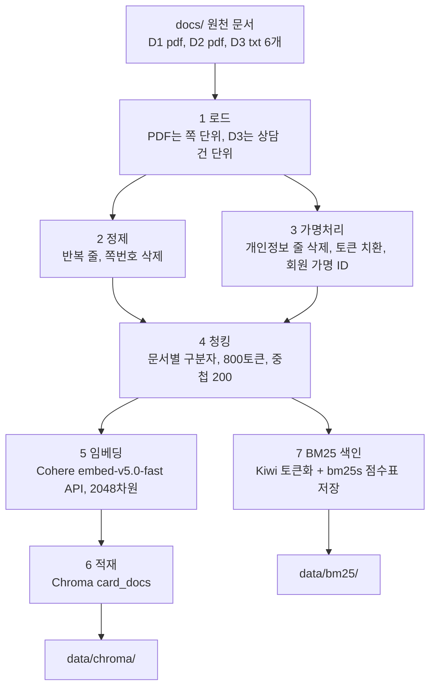

# indexing — 문서 인덱싱 예제 (로드 → 정제 → 가명처리 → 청킹 → 임베딩 → 벡터DB 적재 → BM25 색인)

## 1. 목표 및 주요 기능

교재 3주차 「인덱싱 개요」 8단계 중 원천 확인과 게시를 뺀 7단계를 파이썬 초보자가 따라 칠 수 있는 크기로 구현함.  
약관(D1), 카드 혜택 안내(D2), 상담 이력(D3)을 읽어 검색기(`../retriever/`)가 쓰는 두 가지 결과물을 만듦.

| 결과물 | 위치 | 쓰는 쪽 |
|---|---|---|
| Chroma 벡터DB (collection `card_docs`, 코사인 거리. 본문, 메타데이터, 벡터를 저장) | `data/chroma/` | 검색기의 벡터 검색과 본문 표시 |
| BM25 색인 폴더 (bm25s 점수표 파일 5개, `chunk_ids.json`, `dictionary.json`, `aliases_review.json`, `manifest.json`) | `data/bm25/` | 검색기의 BM25 검색(저장된 색인을 읽기만 함) |

주요 기능

- PDF는 쪽 단위로 읽고, 여러 쪽에 반복되는 머리말과 꼬리말, 쪽번호 줄을 지움
- 상담 이력은 상담 건 단위로 나누고, 개인정보 줄은 삭제하며 발화 안의 고객명, 전화, 이메일, 카드번호, 생년월일은  
  `[고객]`, `[전화번호]` 같은 유형 토큰으로 바꿈. 회원번호는 SHA-256 가명 ID로 바꿔 메타데이터에만 둠
- 문서 유형마다 다른 구분자(조항, 카드 코드, 발화자)를 앞세워 800토큰 상한, 200토큰 중첩으로 나눔
- D2 카드 청크 앞에는 `[카드: 한빛 모아생활 (D2-C001)]` 머리말을 넣어 카드명으로도 검색되게 함
- Cohere 임베딩 API `embed-v5.0-fast`(2048차원)로 벡터를 만들고 Chroma에 저장함. 인덱싱에도 `COHERE_API_KEY`가 필요함
- 청크 본문을 Kiwi로 토큰화하고 bm25s(Lucene 방식, k1 1.5, b 0.75)로 점수표를 미리 계산해 `data/bm25/`에 저장함.  
  카드 사용자 사전(카드 정식명과 별칭을 고유명사로 등록)과 별칭 사전(별칭 토큰을 정식명 토큰으로 치환)을 씀. 본문은 Chroma에서 읽으므로 청크 목록 파일은 만들지 않음
- 별칭은 규칙(원래 이름, 접두어 뗀 이름, 띄어쓰기 없앤 이름에 카드 붙임)으로 만들고, 일반 명사와 겹치는 것 등은 걸러냄.  
  걸러졌지만 사람이 검수해 승인한 별칭은 `aliases_approved.json`(강사 제공)에서 가져옴
- 단계가 끝날 때마다 확인용 숫자와 샘플을 화면에 출력함. 단계 7은 한 문장이 색인 단어가 되는 과정과 네 가지 표기 질문의 자가 테스트도 보여 줌

## 2. 처리 흐름



단계별 호출 함수. main(`index_docs.py`)의 단계 함수가 핵심 모듈(`core_indexing.py`)의 함수를 부름

| 단계 | main의 단계 함수 | main의 보조 함수 | 핵심 모듈 함수 |
|---|---|---|---|
| 1 로드 | `step_load` | `load_pdf_pages`, `load_consult_records` | 없음(로드는 main에 있고 클론 코딩 대상이 아님) |
| 2 정제 | `step_clean` | `build_card_name_table` | `find_repeated_lines`(보조), `clean_document` |
| 3 가명처리 | `step_mask` | `build_consult_body`, `print_mask_sample` | `clean_document`(`mask_private=True`), `member_pseudonym`(보조) |
| 4 청킹 | `step_chunk` | `count_tokens`, `attach_card_header`, 통계와 샘플 출력 함수 | `chunk_document` |
| 5 임베딩 | `step_embed` | 없음(API 오류 처리와 시간 측정) | `embed_chunks` |
| 6 적재 | `step_store` | 없음(적재 뒤 `langchain_chroma`로 다시 읽어 건수 확인) | `store_chunks` |
| 7 BM25 색인 | `step_bm25_index` | `collect_card_names`, `load_approved_aliases`, `print_tokenize_trace`, `run_alias_self_test`, `write_bm25_sidecars` | `make_alias_table`(제공), `build_alias_lookup`(제공), `build_tokenizer`, `tokenize_korean`(안에서 `apply_aliases`를 부름), `build_bm25_index`, `load_bm25_index`(제공) |

핵심 함수는 8개임. 벡터 색인 핵심 4개(`clean_document`, `chunk_document`, `embed_chunks`, `store_chunks`)는 단계 이름과 같고,  
BM25 색인 핵심 4개는 `build_tokenizer`(카드 사용자 사전), `apply_aliases`(별칭 사전 치환), `tokenize_korean`(Kiwi 토큰화),  
`build_bm25_index`(bm25s 점수표 저장)임.  
벡터 색인 보조 함수는 4개임. `find_repeated_lines`, `clean_page_text`는 `clean_document`가 부르고,  
`mask_private_info`, `member_pseudonym`은 가명처리가 씀(`member_pseudonym`은 main이 메타데이터를 만들 때도 직접 부름)  
BM25 색인 제공 함수는 4개(`canonical_card_name`, `make_alias_table`, `build_alias_lookup`, `load_bm25_index`)이고 읽기만 함.  
앞 3개는 별칭 후보를 만들고 거르는 문자열 규칙이고, `load_bm25_index`는 저장한 색인과 `chunk_id` 순서를 다시 읽음(검색기도 씀)

실행 전 점검 함수: `check_docs_dir`(원천 폴더 확인), `check_secrets`(`secrets/.env`와 `COHERE_API_KEY` 확인),  
`remove_old_outputs`(지난 결과인 `chroma/`, `bm25/` 폴더와 예전 버전이 만들던 파일을 삭제.  
임베딩 전에 지움). 작은 도우미: `make_chunk_id`, `print_step`, `print_lines`

단계 7의 상수는 `BM25_DIR_NAME`(색인 폴더 이름 `bm25`), `BM25_K1`(1.5), `BM25_B`(0.75), `TRACE_SENTENCE`(과정을 보여 줄 문장),  
`SELF_TEST_QUESTIONS`(자가 테스트 질문 4개), `ALIASES_APPROVED_PATH`(승인 별칭 파일 `aliases_approved.json`)임.

`count_tokens`는 Cohere 토크나이저(`cohere.ClientV2(...).tokenize(..., offline=True)`)로 토큰 수를 세는 함수임.  
처음 한 번만 토크나이저 파일을 받아 캐시하고 이후에는 API 호출 없이 로컬에서 셈. 청킹 함수에 `length_function`으로  
넘겨 "800토큰"의 기준이 되고, 단계 4의 토큰 통계와 D2 머리말 몫 계산에도 같은 함수를 씀

## 3. 디렉토리 구조

```text
hands-on/solutions/rag/
├── .venv/                 # indexing과 retriever가 함께 쓰는 가상환경(공용)
├── requirements.txt       # 공용 패키지 목록
├── README.md              # 공통 안내(가상환경 설정은 여기 3절)
├── indexing/              # 이 폴더
│   ├── index_docs.py      # main. 설정 상수, 로더, 단계 함수 7개
│   ├── core_indexing.py   # 핵심 모듈(교육생 클론 코딩 대상). 핵심 함수 8개(벡터 색인 4, BM25 색인 4), 보조 함수 4개, 제공 함수 4개
│   ├── my_indexing.py     # 교육생용 뼈대. 같은 함수 12개의 서명과 "할 일" 힌트(embed_chunks, store_chunks, build_bm25_index는 빈칸 채우기)
│   ├── aliases_approved.json  # 사람 검수를 통과한 별칭(강사 제공). 단계 7이 읽음
│   ├── README.md
│   ├── .gitignore         # data/, data-limit/ 를 저장소에 올리지 않음
│   ├── data/              # 전체 실행이 만듦(검색기가 읽음)
│   │   ├── chroma/        # Chroma 저장 폴더(본문, 메타데이터, 벡터)
│   │   └── bm25/          # BM25 색인 폴더(bm25s 점수표, chunk_ids.json, dictionary.json, manifest.json 등)
│   └── data-limit/        # --limit 실행이 만듦(확인용. 검색기는 읽지 않음)
└── retriever/             # 검색기(indexing/data/ 를 읽음)
```

원천 문서는 저장소 루트의 `docs/` 에 있음. `D1_*.pdf`, `D2_*.pdf`, `D3_S*.txt` 6개를 읽고 `D3_README.md`는 읽지 않음.  
`docs/` 위치는 저장소 구조에서 계산하므로 저장소를 통째로 clone하고 `indexing/` 폴더를 다른 곳으로 옮기지 않음.  
API 키는 저장소 루트 `secrets/.env` 의 `COHERE_API_KEY=...` 한 줄에서 읽음(검색기의 리랭커와 같은 키). 키 값은 어디에도 적지 않음.

## 4. 가상환경 설정과 패키지 설치

가상환경은 indexing과 retriever가 함께 쓰므로 **상위 폴더** `hands-on/solutions/rag/.venv` 에 만듦.  
만드는 절차(Windows PowerShell, Git Bash, macOS와 Linux)는 [상위 README 3절](../README.md#3-가상환경-설정과-패키지-설치)을 따름.  
가상환경을 활성화하지 않고 가상환경의 파이썬(`../.venv/Scripts/python.exe` 또는 `../.venv/bin/python`)을 직접 지정해 실행함.

## 5. 실행 방법

`indexing` 폴더 안에서 가상환경의 파이썬을 직접 지정해 실행함.

Windows PowerShell

```powershell
cd hands-on\solutions\rag\indexing
..\.venv\Scripts\python.exe index_docs.py --limit 8    # 빠른 확인: 문서마다 앞 8쪽(또는 8건)만 → data-limit/
..\.venv\Scripts\python.exe index_docs.py              # 전체 실행 → data/
```

Windows Git Bash

```bash
cd hands-on/solutions/rag/indexing
../.venv/Scripts/python.exe index_docs.py --limit 8
../.venv/Scripts/python.exe index_docs.py
```

macOS, Linux

```bash
cd hands-on/solutions/rag/indexing
../.venv/bin/python index_docs.py --limit 8
../.venv/bin/python index_docs.py
```

| 옵션 | 뜻 |
|---|---|
| `--limit N` | 문서마다 앞 N쪽(D3는 파일마다 앞 N건)만 처리함. 흐름 확인용. 기본은 전체 |

실행 규칙

- `--limit` 결과는 `data-limit/` 에 쓰므로 검색기가 읽는 `data/` 에는 영향이 없음. 검색기를 돌리려면 전체 실행이 필요함
- `--limit` 값이 6 미만이면 D2 카드명 표(3 ~ 6쪽)를 못 읽어 카드 머리말이 붙지 않음. 그래서 빠른 확인 예가 `--limit 8` 임
- 인덱싱 중에는 검색 프로그램(`search_docs.py`, `run_eval.py`)을 실행하지 않음. 같은 `data/chroma/` 를 두 프로그램이  
  동시에 열면 결과가 달라질 수 있고, Windows에서는 지난 결과 삭제가 막혀 인덱싱이 시작하지 못함
- 실행 시작 때 지난 `chroma/`와 `bm25/` 폴더를 먼저 지움. 삭제가 막히면 "검색 프로그램 창을 모두 닫고 다시 실행" 안내를 내고 끝남
- 시작 때 `secrets/.env` 와 `COHERE_API_KEY` 를 검사함. 없으면 경로와 변수 이름을 안내하고 끝남.  
  임베딩 호출이 한도 초과(429) 등으로 실패하면 단계 5에서 안내를 내고 끝나므로 잠시 뒤 다시 실행함

걸리는 시간: 전체 실행 약 10 ~ 30초(실측 12초, 네트워크에 따라 1분 안팎까지). 임베딩은 Cohere API 호출 3회(청크 260개 ÷ 96)로  
약 6초이고, 나머지는 PDF 읽기와 토큰 세기 시간임. 단계 7(BM25 색인)은 청크 260개 토큰화가 약 1초(실측)로 더해짐. GPU와 모델 내려받기는 필요 없음. 토크나이저 파일만 첫 실행 때 한 번 받음.

## 6. 단계별 출력 읽는 법

출력은 `[단계 n] 이름` 머리말과 `=` 구분선으로 나뉨.

| 단계 | 보여 주는 것 | 확인 포인트 |
|---|---|---|
| 1 로드 | 파일마다 쪽 수(상담 건수)와 글자 수 | D1 15쪽, D2 196쪽, D3 파일마다 8건이면 정상 |
| 2 정제 | 찾은 반복 줄 목록, D1 첫 쪽의 정제 전 5줄과 후 5줄, D2 카드명 표 개수 | `SYNTHETIC DATA`, `- 1 -` 가 사라졌는지. 카드명 64개 |
| 3 가명처리 | 상담 1건의 처리 전 3줄과 후 3줄, 회원번호와 가명 ID | `가상고객0001` 이 `[고객]` 으로, 접수정보 줄이 사라졌는지 |
| 4 청킹 | 유형별 청크 수, 토큰 길이(최소, 평균, 최대), 800 초과 개수, 샘플 2개 | 초과 0개. D2 샘플에 `[카드: ...]` 머리말. 전체 260개(약관 15, 혜택 197, 상담 48) |
| 5 임베딩 | API 호출 횟수, 걸린 시간, 차원 수, 첫 벡터 앞 5개 숫자 | 차원 2048, 호출 3회. 벡터 숫자는 모델 갱신 시 달라질 수 있어 값이 아니라 검색 순위만 비교함 |
| 6 적재 | Chroma 저장 건수와 경로, langchain_chroma로 다시 읽은 건수 | 두 건수가 모두 청크 수(260)와 같아야 함 |
| 7 BM25 색인 | 카드명과 별칭 개수, 검수 대상 개수, 한 문장이 색인 단어가 되는 과정, 자가 테스트 4문항, 색인 문서 수, 저장 위치 | 카드명 64개 → 별칭 390개, 검수 대상 45개. 자가 테스트 4문항 모두 `✓`이고 "통과". 색인 문서 수, 다시 읽은 문서 수, `chunk_id` 수가 모두 260 |

단계 7 읽는 법

- 검수 대상 45개는 별칭 규칙이 만들었지만 걸러내기 ① 일반 명사와 겹침에 걸려 빠진 후보임(`data/bm25/aliases_review.json`). 사람이 보고 카드 고유 이름이면 승인함  
  승인된 4개(돌봄상자, 모음상자, 수소길, 해오름마을)는 `aliases_approved.json`에 있고 별칭 사전에 들어감
- 자가 테스트는 `모아생활 연회비 안 내려면?` 같은 네 가지 표기의 질문이 모두 정식명 토큰 `한빛모아생활`(붙여 쓴 소문자)로 모이는지 봄
- 색인 문서 수가 청크 수와 다르면 프로그램이 오류를 내고 끝남

토큰 수는 Cohere 토크나이저 기준임. 같은 글이라도 토크나이저마다 토큰 수가 다르며(이전 KURE-v2 기준보다 약 25% 많이 셈),  
그래서 청크 수와 토큰 통계가 다른 모델로 만든 결과와 다름. 비교할 때는 같은 모델로 만든 결과끼리 비교함.

메타데이터 키

| 키 | D1 약관 | D2 혜택 | D3 상담 |
|---|---|---|---|
| `source` | 파일명 | 파일명 | 파일명 |
| `doc_type` | `regulation` | `benefit_guide` | `consult_log` |
| `access_level` | `public` | `public` | `restricted` |
| `page` | 쪽(1부터) | 쪽 | 없음 |
| `card_id`, `card_name` | 없음 | 청크 본문의 첫 카드 코드와 카드명(없으면 키 없음) | 없음 |
| `record_id`, `consult_date`, `channel`, `member_pseudo_id` | 없음 | 없음 | 상담ID, 상담일, 채널, 회원 가명 ID |

`member_pseudo_id` 는 `"m_" + sha256(회원번호).hexdigest()[:16]` 임. 예: `M-1042` → `m_59853c3d8e1e3c25`.  
검색기의 `--member-id` 필터가 같은 식으로 계산하므로 식을 바꾸면 회원별 검색이 어긋남.

Chroma collection 설정(`COLLECTION_METADATA`)

| 키 | 값 | 뜻 |
|---|---|---|
| `hnsw:space` | `cosine` | 코사인 거리. 검색기는 `1 - 거리`를 점수로 씀 |
| `hnsw:M` | 16 | 청크 하나당 최대 연결 수(교재 128쪽 권장 값) |
| `hnsw:construction_ef` | 200 | 색인을 만들 때 후보 폭. 클수록 그래프 품질이 오르고 시간이 늚 |
| `hnsw:search_ef` | 100 | 검색할 때 후보 폭. top_k보다 크게 두어야 재현율이 안정됨 |

검색기도 같은 값으로 collection을 열므로 바꾸면 `../retriever/search_docs.py`의 상수도 함께 바꿈.  
주의: `data/chroma/`는 한 번에 한 프로그램만 열어야 함. 인덱싱이 도는 동안 검색기를 실행하면 결과가 달라질 수 있음.

## 7. 교육생 교체 방법

1. `my_indexing.py` 의 함수 12개를 채움(벡터 색인 8개 + BM25 색인 4개). 파일 맨 위 설명에 채우는 순서가 있음  
   (`member_pseudonym` → `chunk_document` → `clean_page_text` → `find_repeated_lines` → `mask_private_info`  
   → `clean_document` → `embed_chunks` → `store_chunks` → `build_tokenizer` → `apply_aliases` → `tokenize_korean`  
   → `build_bm25_index`).  
   `member_pseudonym` 부터 `clean_document` 까지 6개와 `build_tokenizer`, `apply_aliases`, `tokenize_korean` 3개는  
   `NotImplementedError` 뼈대에 직접 쓰고, `embed_chunks`(빈칸 2곳), `store_chunks`(빈칸 2곳), `build_bm25_index`(빈칸 3곳)는  
   거의 완성된 코드의 빈칸만 채움.  
   `canonical_card_name`, `make_alias_table`, `build_alias_lookup`, `load_bm25_index`는 뼈대에 완성본으로 있으므로 읽기만 함.  
   임베딩은 API를 부르므로 `--limit 8` 로 먼저 확인한 뒤 전체를 돌림.  
   정규식과 여백 줄 수, BM25 색인 상수(`CONTENT_TAGS`, `CODE_PATTERN` 등)는 파일 맨 위에 완성본으로 있으므로 그대로 쓰고,  
   그 값을 쓰는 코드만 작성함
2. 색인을 만드는 `index_docs.py` 의 import 한 줄을 바꿈

   ```python
   import core_indexing as indexing   # 이 줄을
   import my_indexing as indexing     # 이렇게 바꿈
   ```

   검색기(`../retriever/search_docs.py`)도 같은 모듈로 질문을 토큰화해야 하므로 그쪽 import 한 줄도 바꿈  
   (`import core_indexing as indexing` → `import my_indexing as indexing`).  
   두 곳이 다르면 검색기가 시작할 때 경고를 냄
3. `--limit 8` 로 먼저 실행해 오류가 없는지 본 뒤(결과는 `data-limit/`) 전체 실행함(결과는 `data/`)
4. 결과 비교: 단계 4의 청크 수와 토큰 길이, 단계 6의 건수, 단계 7의 자가 테스트 4문항 통과와 색인 문서 수(260)가  
   `core_indexing.py` 결과와 같은지 봄.  
   Chroma에 저장된 본문에 `가상고객`, `@example`, `0000-0000-` 이 남아 있지 않은지 세어 봄  
   (`indexing` 폴더에서 실행. 검색 프로그램은 닫아 둠)

   ```bash
   ../.venv/Scripts/python.exe -c "import chromadb; c = chromadb.PersistentClient(path='data/chroma').get_collection('card_docs'); d = c.get()['documents']; print(len(d), sum('가상고객' in x for x in d))"
   ```

   첫 숫자는 청크 수, 둘째는 `가상고객`이 든 청크 수이며 0이어야 함. 다른 문자열도 `'가상고객'` 자리만 바꿔 같은 방식으로 셈  
   (`010-` 으로 찾으면 카드 코드 `D2-C010-` 이 걸리므로 상담 청크인지 확인함)

함수 이름과 인자는 바꾸지 않음. main이 그 이름으로 부르기 때문임.

## 8. 알려진 단순화

교육용으로 일부러 단순하게 만든 부분임. 실무 수준 구현은 강사가 별도 제공하는 상세 예제(hybrid-ai-lab의  
`indexer/vector-bm25`)를 참고함.

- PDF를 쪽 단위로 나누므로 쪽을 넘는 조항이나 혜택 항목은 두 청크로 끊김
- 머리말과 꼬리말은 글자 좌표 대신 "쪽 위 4줄, 아래 2줄" 영역에서 2쪽 이상 반복되는 줄로 찾음.  
  D2의 항목별 안내문("일반 혜택이 겹치면 ...")도 이 규칙에 걸려 지워짐
- PDF 자동 줄바꿈으로 낱말 가운데가 끊긴 자리("실적\n에서")는 복원하지 않음. 표는 Markdown 표로 바꾸지 않음
- D2 카드 메타데이터는 청크 본문의 **첫** 카드 코드로 정함. 목차(3 ~ 6쪽)와 끝의 참고 목록 청크에도  
  첫 코드의 카드가 붙음. 카드 머리말은 본문(`text`)에 그대로 포함해 저장함
- 상담 이력은 `[상담ID]` 줄에서 회원번호만 떼고 상담ID, 날짜, 채널은 본문에 남김(상담ID로도 검색되게 함)
- 생년월일은 `19xx년`, `19xx-xx-xx` 꼴만 바꿈. 상담일(`2026-03-14`) 같은 업무 날짜를 지키기 위한 규칙임
- 중첩(overlap)은 구분자 위치에 따라 실제 길이가 달라지므로 모든 청크가 정확히 200토큰씩 겹치지는 않음
- 증분 색인(원천 확인)과 게시(세대 교체)는 하지 않음. 실행마다 전체를 다시 만듦
- 튜닝 항목: `embed-v5.0-fast`는 `output_dimension`(256 ~ 2048)을 줄일 수 있음. 줄이면 저장 공간이 줄고 품질은 조금 떨어짐.  
  기본값 2048을 그대로 씀. 바꾸면 검색기의 질문 임베딩도 같은 값이어야 함
