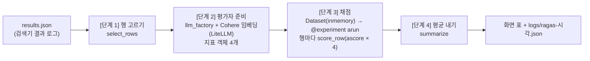

# ragas — 검색기 결과를 RAGAS 핵심 4지표로 채점하기

## 1. 목표 및 주요 기능
- 목표: 검색기(`retriever/run_eval.py`)가 남긴 결과 로그를 RAGAS(RAG 품질을 0 ~ 1 점수로 재는 프레임워크)의  
  핵심 4지표로 채점해, 검색과 답변 중 어디를 고쳐야 하는지 숫자로 보게 함(교재 4주차 「품질 평가」)
- 주요 기능
  - 채점 대상 고르기: 답이 있는 문항(`answerable == true`)이고 근거가 있는 행만 채점. 답 없음 문항 수는 따로 표시
  - 4지표 채점: ContextPrecision, ContextRecall, Faithfulness, AnswerRelevancy를 문항마다 계산
  - 표 출력과 저장: 문항 × 4지표 표, 평균 행, 검색 평균과 생성 평균을 화면에 찍고 `logs/ragas-{시각}.json`에 저장
  - 옵션: 앞 N행만(`--limit`), 같은 행을 N번 채점해 평균과 표준편차(`--repeat`), 판정 이유 출력(`--show-reason`)
- 평가자(채점하는 쪽): LLM은 Groq `openai/gpt-oss-120b`, 임베딩은 인덱싱과 같은 Cohere `embed-v5.0-fast`(API)

## 2. 핵심 4지표 — 「위, 정, 출, 관」(교재 168쪽)
암기팁: "**위**에 깔리고, **정**답 많이 있고, **출**처와 **관**련도가 높은가?"  
왼쪽 2개는 검색 품질, 오른쪽 2개는 생성(답변) 품질을 잼

| 글자 | 지표(클래스) | 묻는 것 | 계산 방법 | 읽는 칸 |
|------|-------------|---------|-----------|---------|
| 위 | ContextPrecision (`ContextPrecisionWithReference`) | 관련 조각이 위에 깔렸나? | 조각마다 쓸모 1/0 판정 → 순위별 평균 정밀도 | 질문, 정답, 근거 |
| 정 | ContextRecall (`ContextRecall`) | 정답 내용이 빠짐없이 검색됐나? | 정답을 문장으로 쪼개 근거에 있는 문장 수 ÷ 전체 문장 수 | 질문, 근거, 정답 |
| 출 | Faithfulness (`Faithfulness`) | 답변이 근거(출처)에서 나왔나? (환각 탐지) | 답변을 주장으로 쪼개 근거로 뒷받침되는 주장 수 ÷ 전체 주장 수 | 질문, 답변, 근거 |
| 관 | AnswerRelevancy (`AnswerRelevancy`) | 답변이 질문에 맞나? | 답변으로 역질문 3개를 만들어 원래 질문과 임베딩 유사도 평균 | 질문, 답변 + 임베딩 |

- 네 지표 모두 0 ~ 1이며 높을수록 좋음. 검색 지표도 LLM이 판정하므로 평가자에 따라 값이 조금 달라질 수 있음
- 결과 로그 한 행 = 4칸(`user_input` 질문, `retrieved_contexts` 근거, `response` 답변, `reference` 정답).  
  지표마다 필요한 칸만 읽음(교재 170쪽, 173쪽)

## 3. 처리 흐름



- `select_rows`, `score_row`, `summarize` 3개가 교육생이 클론 코딩하는 핵심 모듈(`core_scoring.py`)임
- 나머지(옵션 읽기, 평가자 만들기, 반복 실행, 표 출력, 저장)는 `evaluate_ragas.py`(main)가 맡음

## 4. 디렉토리 구조

```
ragas/
├── evaluate_ragas.py   # main. 설정 상수, 평가자 준비, 채점 실행, 표 출력, 저장
├── core_scoring.py     # 핵심 모듈(교육생 클론 코딩 대상). select_rows, score_row, summarize
├── my_scoring.py       # 교육생용 뼈대. 함수 3개의 서명과 TODO 힌트만 있음
├── eval-set.json       # 평가셋 22문항(참고용. 검색기 run_eval.py가 읽어 results.json을 만듦)
├── requirements.txt    # RAGAS 전용 패키지 목록
├── README.md
├── .gitignore          # logs/, .venv/ 제외
├── .venv/              # RAGAS 전용 가상환경(직접 만듦)
└── logs/               # 실행 때 생김. ragas-{YYYYMMDD-HHMMSS}.json
```

입력 파일은 이 폴더 밖에 있음: `../retriever/logs/results.json`(기본 경로, `--results`로 변경 가능)

## 5. 가상환경 설정과 패키지 설치

### 5.1 왜 전용 가상환경인가
`requirements.txt` 주석 그대로임. ragas 0.4.3은 import 때 `langchain_community` 0.3 계열 모듈을 부르는데,  
인덱싱과 검색기가 쓰는 langchain 1.x와 함께 깔리는 `langchain-community` 0.4에는 그 모듈이 없어 import가 실패함  
(2026-10-21 실측). 그래서 `rag/.venv`(인덱싱, 검색기 공용)와 별도로 `rag/ragas/.venv`를 만듦.  
임베딩 호출용 `litellm`은 1.80.0으로 고정함. 1.81 이후는 openai 2.x를 요구해 ragas 평가자(instructor)가 쓰는  
openai 1.109.1과 충돌함(2026-10-21 실측). 패키지 버전은 `requirements.txt`에 고정되어 있으므로 추가하거나 바꾸지 않음

### 5.2 만들기와 설치
절차(Windows PowerShell, Git Bash, macOS와 Linux)는 상위 [`../README.md` 3절「가상환경 설정과 패키지 설치」](../README.md#3-가상환경-설정과-패키지-설치)를
따름. 이 폴더 `rag/ragas/` 안에서 `.venv`를 만들고 이 폴더의 `requirements.txt`를 설치하는 점만 다름.
임베딩은 Cohere API를 쓰므로 torch 같은 로컬 모델 패키지는 설치하지 않음(가볍고 적재 시간이 없음)

### 5.3 비밀값
- `{저장소 루트}/secrets/.env`에 `GROQ_API_KEY=...`(평가자 LLM)와 `COHERE_API_KEY=...`(임베딩) 두 줄을 둠.  
  코드가 `load_dotenv`로 읽고, 둘 중 하나라도 없으면 단계 2에서 안내 후 종료함
- 키 값은 코드, 주석, README, 결과 json 어디에도 적지 않음

## 6. 실행 방법
먼저 검색기 폴더에서 `run_eval.py`를 돌려 `../retriever/logs/results.json`을 만들어 둠.
Groq 호출 제한 때문에 **조별 노트북 한 대만 실행**하고, 먼저 `--limit 3`으로 확인한 뒤 전체를 돌림

```powershell
# 기본 실행(전체 행, 1회 채점)
.\.venv\Scripts\python.exe evaluate_ragas.py

# 앞 2행만 빠르게 확인 + 판정 이유 출력
.\.venv\Scripts\python.exe evaluate_ragas.py --limit 2 --show-reason

# 같은 행을 2번 채점해 평균과 표준편차(±) 보기
.\.venv\Scripts\python.exe evaluate_ragas.py --repeat 2

# 다른 결과 로그로 채점(개발용 샘플 3행)
.\.venv\Scripts\python.exe evaluate_ragas.py --results ../retriever/logs/results-sample.json
```
Git Bash, macOS, Linux에서는 `.venv/Scripts/python.exe`(Windows) 또는 `.venv/bin/python`(macOS, Linux)으로 바꿈

| 옵션 | 뜻 | 기본값 |
|------|----|--------|
| `--results 경로` | 채점할 결과 로그 json | `../retriever/logs/results.json` |
| `--limit N` | 앞 N행만 채점(빠른 확인) | 0(전체) |
| `--repeat N` | 같은 행을 N번 채점해 평균과 표준편차를 냄 | 1 |
| `--show-reason` | 지표별 판정 이유를 문항마다 출력 | 꺼짐 |

- 소요 시간: 채점 대상 17행 기준 약 7 ~ 9분(행당 25 ~ 30초, 지표 4개가 LLM을 7번쯤 부름, 동시 2행).  
  임베딩은 API 호출이라 모델 적재 시간이 없음
- 화면에 `Running experiment` 진행 막대가 섞여 나오는 것은 ragas 실험 실행이 내는 정상 메시지임

## 7. 결과 읽는 법

### 7.1 화면 출력(단계별)
```
============================================================
[단계 1] 결과 로그 읽기
  파일: ..\retriever\logs\results-sample.json
  전체 행 수: 3 | 채점 대상: 2 | 제외(답 없음 또는 근거 없음): 1
============================================================
[단계 2] 평가자 준비
  평가자 LLM: openai/gpt-oss-120b (Groq, OpenAI 호환 주소)
  임베딩 모델: Cohere embed-v5.0-fast (API, 2048차원)
============================================================
[단계 3] 채점 진행 (동시 2행, 반복 1회)
  Q02   ContextPrecision 1.000  ContextRecall 1.000  Faithfulness 1.000  AnswerRelevancy 0.766  (29.6초)
  Q01   ContextPrecision 1.000  ContextRecall 1.000  Faithfulness 1.000  AnswerRelevancy 0.749  (30.1초)
============================================================
[단계 4] 채점 결과 (평가자: openai/gpt-oss-120b, 반복 1회)
문항    ContextPrecision  ContextRecall     Faithfulness      AnswerRelevancy
Q01   1.000             1.000             1.000             0.749
Q02   1.000             1.000             1.000             0.766
평균   1.000             1.000             1.000             0.758
검색 평균(Precision, Recall) 1.000 | 생성 평균(Faithfulness, Relevancy) 0.879
  읽는 법: Recall이 낮으면 검색(청킹, 임베딩, Top-k) 쪽, Faithfulness가 낮으면 답변(프롬프트) 쪽을 봄(교재 176쪽)
  결과 저장: C:\...\rag\ragas\logs\ragas-20261021-013722.json
```
- 단계 3의 행 순서는 끝난 순서라 섞일 수 있음. 단계 4 표는 입력 순서임
- `--repeat 2` 이상이면 표의 칸이 `0.769±0.008` 꼴이 됨(앞은 회차 평균, 뒤는 회차 간 표준편차)
- 점수가 `-`이면 그 지표가 값을 못 냈다는 뜻(예: 답변에서 주장을 하나도 못 뽑아 nan). 평균에서 뺌

### 7.2 어디를 고칠지 고르기(교재 176쪽)
| 낮은 지표 | 원인 | 손볼 곳 |
|-----------|------|---------|
| ContextRecall ↓ | 검색이 근거를 못 가져옴 | 청킹, 임베딩, Top-k |
| ContextPrecision ↓ | 근거 순서가 나쁨 | 리랭커, 하이브리드 비중 |
| Faithfulness ↓ | 답변이 근거 밖으로 나감 | 근거 전달, 답변 프롬프트 |
| AnswerRelevancy ↓ | 질문과 어긋난 답 | 질문 변환, 답변 프롬프트 |

- 고정 합격선보다 직전 버전(기준선) 대비 변화를 봄. 교재 구간표(0.9 이상 매우 우수, 0.7 ~ 0.9 양호,  
  0.5 ~ 0.7 개선 필요, 0.5 미만 재설계)는 참고용이며 공식 합격선이 아님
- LLM 채점이 흔들리면 `--repeat`로 여러 번 채점해 평균을 봄. 표준편차가 크면 그 문항은 사람이 다시 봄

### 7.3 저장 파일 `logs/ragas-{시각}.json`
```json
{
  "created_at": "2026-10-21T01:37:22", "results_path": "...", "judge_model": "openai/gpt-oss-120b",
  "embedding_model": "cohere/embed-v5.0-fast", "repeat": 1,
  "counts": {"total_rows": 3, "scored_rows": 2, "skipped_rows": 1},
  "rows": [{"id": "Q01", "question": "...", "scores": {"context_precision": 1.0, "...": 0.749},
            "stdev": {"...": null}, "reasons": {"...": null}, "rounds": [{"...": 0.749}]}],
  "summary": {"count": 2, "mean": {"...": 0.758}, "retrieval_mean": 1.0, "generation_mean": 0.879}
}
```
- `rounds`: 회차별 원점수. `scores`는 그 평균, `stdev`는 회차가 2개 이상일 때만 값이 있음
- `reasons`: 지표별 판정 이유. ragas 0.4.3의 collections 지표는 점수만 돌려주고 이유를 채우지 않아 `null`임  
  (설치본 소스에서 `MetricResult(value=...)`만 만드는 것을 확인). `--show-reason`도 같은 이유로 「없음」을 찍음.  
  이유가 필요하면 `--repeat`로 흔들림을 보거나 근거와 답변을 직접 대조함

## 8. 코드에서 알아 둘 것

### 8.1 ragas 0.4.3 호출 방법(실행으로 확인한 꼴)
```python
client = AsyncOpenAI(api_key=groq_key, base_url="https://api.groq.com/openai/v1", max_retries=5)
judge_llm = llm_factory("openai/gpt-oss-120b", client=client, temperature=0, max_tokens=4096)
embeddings = LiteLLMEmbeddings(model="cohere/embed-v5.0-fast", api_key=cohere_key, input_type="search_query")
metric = Faithfulness(llm=judge_llm)
result = await metric.ascore(user_input=질문, response=답변, retrieved_contexts=근거)   # result.value가 점수
```
- 교재 173쪽은 OpenAI 기본 주소에 `OpenAIEmbeddings`를 쓰지만, 여기서는 Groq 주소(`base_url`)와  
  Cohere 임베딩(`LiteLLMEmbeddings`)을 씀. 호출 꼴은 같음
- ragas에 Cohere 직접 지원이 없어 LiteLLM(여러 제공사 API를 한 꼴로 부르는 패키지)을 거침. 모델 이름은  
  LiteLLM 규칙대로 "제공사/모델"(`cohere/embed-v5.0-fast`) 꼴임. 인덱싱의 `langchain_cohere.CohereEmbeddings`와  
  같은 모델(2048차원)이라 같은 임베딩 공간에서 비교함
- `input_type="search_query"`: AnswerRelevancy는 역질문과 원 질문을 같은 종류로 임베딩해 비교하므로 하나로 둠
- `max_retries=5`: Groq 분당 호출 제한(429)에 걸리면 openai 클라이언트가 잠시 기다렸다 스스로 다시 부름
- `max_tokens=4096`: ragas 기본값 1024는 한국어 근거가 긴 문항(카드 혜택 Q08)에서 판정 JSON이 잘려 채점이 실패함(2026-10-21 실측)
- 주의: `ragas.embeddings.LiteLLMEmbeddings`는 인덱싱의 `langchain_cohere.CohereEmbeddings`와 다른 패키지의  
  클래스라 인자 이름이 다름(`model="cohere/..."` 와 `model="embed-v5.0-fast"`). 모델 이름 앞의 `cohere/`를 빼먹지 않음

### 8.2 `@experiment()`가 무엇인가
`@`로 시작하는 줄은 데코레이터(바로 아래 함수를 감싸 기능을 덧붙이는 표식)임. `@experiment()`는 아래 실험 함수에
`arun` 기능(Dataset의 행마다 함수를 실행하고 돌려준 dict를 모아 표로 만들기)을 붙임. 그래서 `score_experiment(...)`로
직접 부르지 않고 `score_experiment.arun(dataset, ...)`으로 돌림(교재 174쪽의 `ragas_eval.arun(ds, ...)`과 같음)

### 8.3 async가 무엇인가
ragas의 `ascore`는 `async` 함수(기다리는 동안 다른 일을 할 수 있는 함수)라서 `await`로 결과를 받고,  
맨 바깥에서 `asyncio.run(...)`으로 한 번 감싸 실행함. 교육생은 `score_row` 안에서 `await metric.ascore(...)`  
꼴만 지키면 됨

### 8.4 교재 174쪽 방식과 다른 점
| 항목 | 교재 174쪽 | 이 예제 | 이유 |
|------|-----------|---------|------|
| 실험 함수 | `@experiment` 안에서 지표 6개 직접 호출 | `@experiment` 함수가 `score_row`(지표 4개)를 부름 | 핵심 모듈을 교체 가능하게 분리 |
| 동시 실행 수 | 제한 없음(`arun`이 모든 행을 한꺼번에 시작) | 세마포어로 동시 2행 | Groq 분당 호출 제한 |
| 결과 표 | `to_pandas()`로 열 평균 | `summarize`가 for로 평균 | 초보자가 읽기 쉬운 코드 |
| 실패 행 | `arun`이 경고만 찍고 표에서 뺌 | 빠진 id를 찾아 화면에 알림 | 조용히 사라지는 행 방지 |

## 9. 교육생 교체 방법(my_scoring.py)
1. `core_scoring.py`를 읽고 `my_scoring.py`의 함수 3개(`select_rows`, `score_row`, `summarize`)를 채움.  
   함수 이름과 인자, 반환 dict의 키는 바꾸지 않음(main이 그대로 부름)
2. `evaluate_ragas.py`의 import 한 줄을 바꿈
   ```python
   import core_scoring as scoring   # →  import my_scoring as scoring
   ```
3. 샘플 로그로 빠르게 확인함
   ```powershell
   .\.venv\Scripts\python.exe evaluate_ragas.py --results ../retriever/logs/results-sample.json --limit 2
   ```
4. 점수가 `core_scoring`으로 돌렸을 때와 비슷하게 나오면 완성임(LLM 채점이라 소수점 아래는 조금 다를 수 있음)
