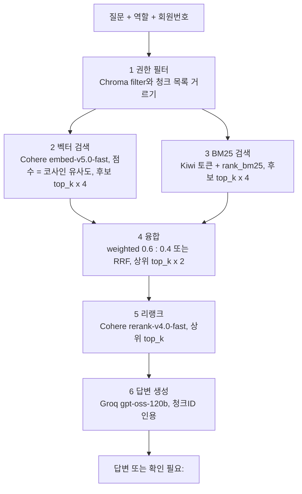

# retriever — 문서 검색 예제 (벡터 검색 + BM25 → 융합 → 리랭크 → 근거 기반 답변)

## 1. 목표 및 주요 기능

교재 4주차 「문서 검색」의 기본 RAG 흐름을 파이썬 초보자가 따라 칠 수 있는 크기로 구현함.  
인덱싱 예제(`../indexing/`)가 만든 Chroma 벡터DB와 `chunks.json`을 읽어 질문에 답하고,  
평가셋 22문항을 일괄 실행해 품질 평가 예제(`../ragas/`)가 읽는 `logs/results.json`을 만듦.

| 입력 | 위치 | 쓰는 곳 |
|---|---|---|
| Chroma 벡터DB (collection `card_docs`, 코사인 거리) | `../indexing/data/chroma/` | 벡터 검색 |
| 청크 목록 JSON (`chunk_id`, `text`, `metadata`) | `../indexing/data/chunks.json` | BM25 색인, 카드명 사전, 본문 표시 |
| 평가셋 (22문항) | `../ragas/eval-set.json` | `run_eval.py` |

주요 기능

- 역할(`agent`, `auditor`)과 회원번호로 **검색 전에** 볼 수 있는 청크를 거름. 권한 판단을 LLM에 맡기지 않음
- 벡터 검색(Cohere `embed-v5.0-fast` 임베딩 + Chroma HNSW 근사 검색)과 BM25 검색(Kiwi 형태소 분석 + rank_bm25)을  
  각각 돌리고 두 결과를 융합함. 임베딩은 API라 모델 적재가 없고, 질문마다 Cohere를 1번 부름
- 융합 2종: 최소-최대 정규화 뒤 가중합(벡터 0.6, BM25 0.4, 기본), RRF(순위의 역수 합, 선택)
- Cohere `rerank-v4.0-fast` API로 융합 후보를 다시 채점해 근거 상위 5개를 고름
- Groq `openai/gpt-oss-120b`가 근거만으로 답하고 문장 끝에 `[D1-0007]` 꼴로 청크ID를 인용함.  
  근거에 답이 없으면 `확인 필요:`로 시작하는 한 문장으로 끝냄
- 단계가 끝날 때마다 순위, 점수, 청크ID, 출처, 본문 앞부분을 화면에 출력함

## 2. 처리 흐름



단계별로 호출하는 함수

| 단계 | main(`search_docs.py`) | 핵심 모듈(`core_hybrid.py`) |
|---|---|---|
| 준비 | `check_secrets`, `check_index_files`, `load_resources` | `build_tokenizer`, `tokenize_korean` (청크 토큰화) |
| 1 권한 필터 | `step_conditions` (`build_chroma_filter`, `filter_chunks`) | `member_pseudonym` |
| 2 벡터 검색 | `step_vector` → `search_vector` (기본 `search_vector_hnsw`, 비교용 `search_vector_exact`) | 없음 |
| 3 BM25 검색 | `step_bm25` (`BM25Okapi` 색인 생성) | `tokenize_korean` (질문), `search_bm25` |
| 4 융합 | `step_fuse` (방식 선택) | `fuse_weighted`, `fuse_rrf` |
| 5 리랭크 | `step_rerank` (모드 판단) | `rerank` |
| 6 답변 | `generate_answer` (LCEL `prompt \| llm \| StrOutputParser()`) | 없음 |

## 3. 검색 모드 4가지

`--mode` 옵션으로 고름. 교재 151쪽 「문서 검색: 기법」의 Sparse, Dense, Hybrid에 리랭크를 더한 구성임.

| 모드 | 하는 일 | 건너뛰는 단계 | 이럴 때 유리함 |
|---|---|---|---|
| `vector` | 벡터 검색 상위 top_k | 3, 4, 5 | 구어체나 돌려 말한 질문 |
| `bm25` | BM25 검색 상위 top_k | 2, 4, 5 | 조항 번호, 카드 코드, 고유명사가 든 질문 |
| `hybrid` | 두 검색을 융합한 상위 top_k | 5 | 용어와 자연어가 섞인 질문 |
| `hybrid_rerank` (기본) | 융합 상위 top_k × 2를 리랭크해 top_k | 없음 | 후보는 맞는데 순서가 아쉬울 때 |

후보 수: 벡터 `top_k × 4`, BM25 `top_k × 4` → 융합 상위 `top_k × 2` → 리랭크 상위 `top_k`.  
건너뛴 단계는 화면에 `[단계 n] ... — 건너뜀 (모드)` 로 표시됨.

## 4. 디렉토리 구조

```text
hands-on/solutions/rag/
├── .venv/                  # indexing과 retriever가 함께 쓰는 가상환경(공용)
├── requirements.txt        # 공용 패키지 목록
├── indexing/data/          # 인덱싱 결과(이 프로그램은 읽기만 함)
├── ragas/eval-set.json     # 평가셋(run_eval.py가 읽음)
└── retriever/              # 이 폴더
    ├── search_docs.py      # main. 설정 상수, 권한 필터, 벡터 검색, 단계 실행, 답변 생성
    ├── core_hybrid.py      # 핵심 모듈(교육생 클론 코딩 대상). 함수 7개
    ├── my_hybrid.py        # 교육생용 뼈대. 같은 함수 7개의 서명과 "할 일" 힌트(핵심 3개 직접 작성)
    ├── run_eval.py         # 평가셋 22문항 일괄 실행 → logs/results.json
    ├── README.md
    ├── .gitignore          # logs/ 를 올리지 않음(results-sample.json만 예외)
    └── logs/
        ├── results-sample.json   # RAGAS 개발용 샘플(고정)
        └── results.json          # run_eval.py가 만듦(ragas/evaluate_ragas.py의 기본 입력)
```

## 5. 가상환경 설정과 패키지 설치

가상환경은 indexing과 함께 쓰므로 **상위 폴더** `hands-on/solutions/rag/.venv` 에 있음.  
만드는 절차(Windows PowerShell, Git Bash, macOS와 Linux)는 상위 [`../README.md`](../README.md) 3절을 따름.  
인덱싱 예제를 이미 실행했다면 이 절을 건너뛰고 6절로 감.

비밀값은 저장소 루트 `secrets/.env` 에 `GROQ_API_KEY`(답변 LLM)와 `COHERE_API_KEY`를 둠.  
`COHERE_API_KEY`는 벡터 검색(질문 임베딩 `embed-v5.0-fast`)과 리랭크(`rerank-v4.0-fast`) 양쪽에 쓰임.  
프로그램이 시작할 때 파일과 키의 존재를 검사하고, 없으면 경로와 키 이름을 알려 준 뒤 끝남(값은 출력하지 않음).  
`--mode bm25 --no-answer` 로 실행하면 두 키 없이도 BM25 검색까지 돌아감(임베딩도 리랭크도 없는 유일한 모드).

## 6. 실행 방법

`retriever` 폴더 안에서 가상환경의 파이썬을 직접 지정해 실행함. 먼저 인덱싱 예제가 끝나 있어야 함.

```
python search_docs.py "질문" [--top-k 5] [--mode vector|bm25|hybrid|hybrid_rerank] [--fusion weighted|rrf]
                              [--role agent|auditor] [--member-id M-1042] [--no-answer]
```

| 옵션 | 뜻 | 기본값 |
|---|---|---|
| `--top-k N` | 최종 근거 수 | 5 |
| `--mode` | 검색 모드(3절) | `hybrid_rerank` |
| `--fusion` | 융합 방식. `weighted`(정규화 가중합) 또는 `rrf` | `weighted` |
| `--role` | `agent`는 public(약관, 혜택)만, `auditor`는 restricted(상담 이력)까지 | `agent` |
| `--member-id` | auditor일 때 그 회원의 상담 이력만 봄(약관, 혜택은 같이 안 봄). 회원번호는 가명 ID로 바꿔 필터에 씀 | 없음 |
| `--no-answer` | 검색만 하고 답변 생성(LLM 호출)을 건너뜀 | 끔 |

질문 예 5가지 (Windows PowerShell. Git Bash는 `../.venv/Scripts/python.exe`, macOS와 Linux는 `../.venv/bin/python`)

```powershell
cd hands-on\solutions\rag\retriever

# 1) 약관: 제10조 청크가 1위, 답변에 3,000,000원과 [D1-0007] 인용
..\.venv\Scripts\python.exe search_docs.py "직전 12개월 동안 카드를 얼마나 쓰면 다음 해 기본 연회비가 면제되나요?"

# 2) 카드 혜택(BM25만): 질문 토큰에 '한빛 모아생활'이 한 토큰으로 잡히고 D2-C001 청크가 상위
..\.venv\Scripts\python.exe search_docs.py "한빛 모아생활 카드의 생활 포인트는 결제액의 몇 %를 적립하나요?" --mode bm25

# 3) 상담 이력(감사자 + 회원): 근거가 전부 그 회원의 D3 청크. 같은 질문을 --role agent로 하면 D3가 나오지 않음
..\.venv\Scripts\python.exe search_docs.py "M-1042 회원은 생활비를 이 카드로 옮기는 것을 왜 원하지 않았나요?" `
    --role auditor --member-id M-1042

# 4) 답이 없는 질문: 답변이 '확인 필요:'로 시작
..\.venv\Scripts\python.exe search_docs.py "연회비를 적립 포인트로 낼 수 있나요?"

# 5) 모드 비교(LLM 호출 없이): 같은 질문을 네 모드로 돌려 상위 5 순위를 비교
..\.venv\Scripts\python.exe search_docs.py "한빛 가족돌봄 카드의 돌봄 바우처는 얼마이고, 언제까지 쓸 수 있나요?" --mode vector --no-answer
..\.venv\Scripts\python.exe search_docs.py "한빛 가족돌봄 카드의 돌봄 바우처는 얼마이고, 언제까지 쓸 수 있나요?" --mode bm25 --no-answer
..\.venv\Scripts\python.exe search_docs.py "한빛 가족돌봄 카드의 돌봄 바우처는 얼마이고, 언제까지 쓸 수 있나요?" --mode hybrid --no-answer
..\.venv\Scripts\python.exe search_docs.py "한빛 가족돌봄 카드의 돌봄 바우처는 얼마이고, 언제까지 쓸 수 있나요?" --mode hybrid_rerank --no-answer
```

걸리는 시간: 모델 적재 없음(임베딩이 API). 청크 토큰화 약 2초, 첫 검색은 Cohere 임베딩 API 왕복 1 ~ 2초, BM25 1초 미만,  
리랭크와 답변 각 1 ~ 3초(모두 네트워크 상태에 따라 다름).

실행할 때 주의할 점

- 인덱싱 중이거나 다른 검색이 돌고 있을 때는 실행하지 않음. 같은 색인 폴더를 동시에 열면 결과가 달라질 수 있음
- Cohere 호출 제한(429)에 걸리면 `--mode hybrid`(리랭크 없음)로 진행함. Groq 제한이면 `--no-answer`로 검색까지만 확인함
- 코드를 고치며 반복 실행할 때는 `--mode bm25 --no-answer`로 API 없이 돌려 봄(키 없이도 돌아가고 몇 초 안에 결과가 나옴)
- 시작할 때 비밀값과 인덱싱 결과(chunks.json, chroma 폴더)를 검사하고, Chroma 건수와 chunks.json 건수가 다르면  
  부분 색인을 의심하라는 경고를 찍음. 그때는 `indexing/index_docs.py`를 `--limit` 없이 전체 실행함

평가셋 일괄 실행

```powershell
..\.venv\Scripts\python.exe run_eval.py             # 22문항 전체, hybrid_rerank, top_k 5
..\.venv\Scripts\python.exe run_eval.py --limit 3   # 앞 3문항만 빠른 확인
..\.venv\Scripts\python.exe run_eval.py --start 14   # 14번째 문항부터 이어서
..\.venv\Scripts\python.exe run_eval.py --mode hybrid --top-k 5
```

`filters`에 `member_id`가 있는 문항은 `auditor` 역할과 그 회원번호로, 나머지는 `agent`로 실행함.  
문항마다 `logs/results.json`을 다시 저장하므로 중간에 끊겨도 앞 결과가 남고, 오류가 난 문항은 `answer`가 `오류:`로 시작함.  
문항 사이에 1초씩 쉬어(`SLEEP_BETWEEN_QUESTIONS`) 호출 제한을 피하며, 끊긴 뒤에는 `--start N`으로 N번째 문항부터 이어서 돌림.  
마지막에 요약 표(답 있는 문항 Hit@5, 답 없는 문항의 `확인 필요:` 비율, 오류 문항 수)를 보여 줌.

## 7. 단계별 출력 읽는 법

출력은 `[단계 n] 이름` 머리말과 `=` 구분선으로 나뉨. 목록의 각 줄은 `순위  점수  청크ID  출처  본문 앞 60자` 임.

| 단계 | 보여 주는 것 | 확인 포인트 |
|---|---|---|
| 준비 | 비밀값 확인, 청크 수, 등록한 카드명 수, 임베딩 모델(Cohere, 2048차원), Chroma 건수 | 청크 262개, 카드명 64개, Chroma 262건 |
| 1 질문과 검색 조건 | 모드, 역할, 회원 가명 ID, Chroma filter, BM25 대상 청크 수 | agent 214개, auditor 262개, 회원 지정 시 그 회원 상담 청크 4개 |
| 2 벡터 검색 | 점수(코사인 유사도, 클수록 가까움) 상위 top_k × 2 | 실측: 정답 청크 0.48 ~ 0.59, 관련 없는 청크 0.2 ~ 0.45. 1위와 2위 차이 0.1 이상이면 벡터가 확신함 |
| 3 BM25 검색 | 질문 토큰 목록과 점수 상위 top_k × 2 | 카드명이 한 토큰(`한빛 모아생활`)으로 잡혔는지. 점수 단위는 벡터와 다름 |
| 4 융합 | 융합 점수와 `[vector, bm25]` 출처 표시 | 양쪽 모두에 나온 청크가 위로 오는지 |
| 5 리랭크 | 리랭크 점수(0 ~ 1)와 `(융합 n위 → m위)` 순위 변화 | 정답 청크는 0.8 이상, 관련 없는 청크는 0.3 이하로 벌어지는지 |
| 6 답변 | 답변 본문과 인용 `[D1-0007]` | 인용한 청크ID가 5단계 목록에 있는지. `확인 필요:`면 사유 한 줄 |

점수 읽기

- 벡터 점수 = 코사인 유사도(= `1 - 코사인 거리`). 같은 방향이면 1, 무관하면 0에 가까움.  
  Cohere embed-v5.0-fast는 정답도 0.5 안팎으로 낮게 나오므로 절댓값보다 순위와 1위, 2위 차이를 봄
- BM25 점수 = 질문 토큰이 그 청크에 얼마나 자주, 전체에서 얼마나 드물게 나오는지의 합. 상한이 없음
- 가중합 점수 = 두 점수를 각각 0 ~ 1로 다시 편 뒤 0.6 : 0.4로 더한 값. 양쪽 1위면 1.0
- RRF 점수 = Σ 1 / (60 + 순위). 양쪽 1위면 약 0.0328
- 리랭크 점수 = Cohere가 질문과 청크를 한 쌍으로 읽고 매긴 관련성(0 ~ 1)

## 8. 교육생 교체 방법

1. `my_hybrid.py`의 함수 7개를 채움. 각 함수 안의 `# 할 일 n:` 줄이 순서대로 할 일을 알려 줌  
   - 직접 작성(핵심 3개): `tokenize_korean`, `search_bm25`, `fuse_weighted`(합산 루프만. 보조 함수 4개는 완성본으로 제공)  
   - 읽고 복사(4개): `build_tokenizer`, `fuse_rrf`, `rerank`, `member_pseudonym` — `core_hybrid.py`를 읽고 이해한 뒤 옮김  
   - 상수 3개(`CONTENT_TAGS`, `CODE_PATTERN`, `NUMBER_COMMA_PATTERN`)는 뼈대 맨 위에 완성본 그대로 있음
2. `search_docs.py`의 import 한 줄을 바꿈

   ```python
   import core_hybrid as hybrid   # 이 줄을
   import my_hybrid as hybrid     # 이렇게 바꿈
   ```

3. 함수 하나씩 채우면서 모드를 좁혀 확인함. 예: `tokenize_korean`과 `search_bm25`를 채웠으면 `--mode bm25 --no-answer`,  
   `fuse_weighted`까지 채웠으면 `--mode hybrid --no-answer`, `rerank`까지 채웠으면 기본 모드
4. 결과 비교: 같은 질문의 단계 3 질문 토큰, 단계 4 상위 순위, 단계 5 리랭크 점수가 `core_hybrid.py` 결과와 같은지 봄
5. `run_eval.py`를 돌려 Hit@5 비율이 같은지 확인함

함수 이름과 인자는 바꾸지 않음. main이 그 이름으로 부르기 때문임.

## 9. 알려진 단순화

교육용으로 일부러 단순하게 만든 부분임. 실무 수준 구현은 강사가 별도 제공하는 상세 예제(hybrid-ai-lab의 `retriever/vector-retriever`)를 참고함.

- 질문 변환(Multi-Query, HyDE, Step-Back), Self-RAG나 CRAG 같은 패턴 분기, 대화 기억은 넣지 않음(기본 RAG 흐름만)
- 임베딩은 Cohere `embed-v5.0-fast`(2048차원) 기본값을 그대로 씀. `output_dimension`(256 ~ 2048)을 줄이면  
  저장 공간이 줄고 품질은 조금 떨어짐 — 튜닝 항목이며 인덱서와 검색기가 같은 값을 써야 함
- 벡터 검색의 기본은 **Chroma HNSW 근사 검색**(`VECTOR_SEARCH_METHOD = "hnsw"`, `similarity_search_with_score`)임.  
  인덱서가 교재 128쪽 권장 HNSW 값(M 16, construction_ef 200, search_ef 100)으로 색인을 만들며,  
  검색기도 `COLLECTION_METADATA`에 같은 값을 넘김. `"exact"`로 바꾸면 권한 필터를 통과한 벡터를 전부 꺼내  
  코사인 유사도를 직접 계산하므로, 근사 검색과 정확 계산의 결과를 비교해 볼 수 있음(비교용)
- 같은 색인 폴더(`../indexing/data/chroma`)를 두 프로그램이 **동시에** 열면 결과가 달라질 수 있음.  
  Chroma는 열 때마다 폴더에 다시 쓰기 때문임. 인덱싱 중이거나 다른 검색이 돌고 있으면 끝날 때까지 기다림
- BM25 색인은 저장하지 않고 실행 때마다 메모리에서 만듦(262개라 1초 안팎). 권한 필터를 통과한 청크만으로 질문마다 다시 만듦
- Kiwi 토큰은 내용어(명사, 숫자, 알파벳, 동사와 형용사 어간)만 남김. 날짜 표기 통일, 불용어 사전, 별칭 사전은 없음.  
  `D2-C001`, `M-1042` 같은 코드만 정규식으로 통째로 한 토큰으로 더함
- 리랭커는 LangChain의 `CohereRerank`(문서 압축기)가 아니라 Cohere SDK를 직접 씀.  
  점수가 메타데이터 안에 숨지 않고 `relevance_score`로 바로 보여 교육용으로 읽기 쉽기 때문임
- `auditor`가 `--member-id`를 주면 **그 회원의 상담 이력(restricted)만** 봄. 약관과 혜택 안내(public)는 같이 보지 않음.  
  같이 보면 회원 질문의 근거 5개 중 절반이 약관 청크로 채워져 상담 내용이 밀리기 때문임(실측).  
  약관까지 함께 보려면 `build_chroma_filter`와 `is_chunk_allowed`를 "public 이거나 그 회원"으로 바꾸면 됨.  
  `agent`는 상담 이력을 볼 수 없으므로 `--member-id`를 주어도 무시하고 그 사실을 출력함
- 답변의 인용 `[D1-0007]`이 실제 근거 안의 문장과 일치하는지 프로그램이 대조하지 않음(품질 평가는 `../ragas/`가 맡음)
- `run_eval.py`의 Hit@5는 정답 문장이 근거 본문에 글자 그대로(공백 제거, NFKC 정규화 뒤) 들어 있는지만 봄.  
  평가셋 `filters`의 `card_id`는 검색 조건으로 쓰지 않음(질문 안의 카드명으로 찾아야 하기 때문)
- 외부 API(Cohere, Groq) 호출에 재시도를 두지 않음. 실패하면 오류 한 줄을 보여 주고(429면 대처법 포함) 끝남
