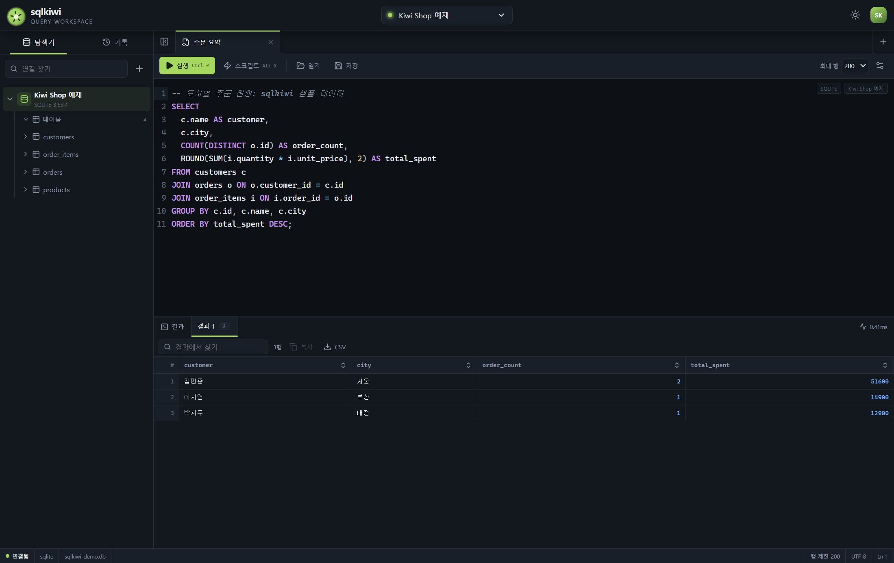

# sqlkiwi

sqlkiwi는 테이블 구조를 살펴보고 SQL을 작성한 뒤 결과를 확인하는 데스크톱 SQL 클라이언트입니다.
설치된 DBeaver Community 25.0.5를 REA로 분석하고, 자주 사용하는 SQL 작업 흐름을 독립적으로 구현했습니다.
프로젝트 폴더 이름은 `sqlkiwi-openai`이며, 앱 이름은 `sqlkiwi`입니다.

처음 실행하면 Kiwi Shop 예제 SQLite 데이터베이스에 연결합니다.
고객, 상품, 주문, 주문 항목이 준비되어 있어 서버를 따로 설치하지 않고 JOIN 쿼리부터 실행할 수 있습니다.



## 실행 방법

개발 환경에서는 Node.js 22.13 이상과 npm이 필요합니다. 이번 검증에는 Node.js 22.23.4를 사용했습니다.
SQLite 실행은 Electron에 포함된 Node.js의 `node:sqlite`를 사용하므로 네이티브 모듈 재빌드가 필요하지 않습니다.
최초 의존성 설치와 Electron 다운로드에는 인터넷 연결이 필요합니다.

```powershell
cd C:\Users\hiond\class\hybrid-ai\hands-on\sqlkiwi-openai
npm ci
npm run build
npm start
```

Windows에서는 프로젝트의 `start.ps1`로 설치, 빌드와 실행을 순서대로 진행할 수도 있습니다.
개발 중 화면을 자동으로 다시 읽으려면 `npm run dev`를 사용합니다.
`npm run dev`, `npm start`, `npm run package:win`은 실행 전에 Electron 바이너리를 확인합니다.
바이너리가 없으면 `install-electron`이 현재 Electron 버전에 맞는 파일을 내려받습니다.

Windows용 앱 폴더를 만들려면 다음 명령을 실행합니다.

```powershell
npm run package:win
```

완성된 앱은 `release/sqlkiwi-win32-x64/sqlkiwi.exe`에서 실행합니다.
다른 PC로 옮길 때는 실행 파일만 복사하지 말고 `sqlkiwi-win32-x64` 폴더 전체를 복사합니다.
이 결과물은 서명된 설치 프로그램이 아닌 Windows x64 앱 폴더입니다.

## SQL을 실행하는 흐름

왼쪽 탐색기에서 연결을 펼치면 테이블과 뷰를 확인할 수 있습니다.
테이블을 펼치면 컬럼의 이름, 자료형과 기본 키를 표시합니다.
테이블을 두 번 누르면 해당 테이블을 조회하는 새 SQL 탭을 엽니다.

가운데 편집기에서 SQL을 작성합니다. 선택한 텍스트가 있으면 선택 영역을 실행하고,
선택 영역이 없으면 실행 명령에 따라 현재 문장 또는 전체 스크립트를 실행합니다.
편집기는 줄 번호, 구문 강조, 실행 취소와 SQL 자동완성을 제공합니다.

| 작업 | 단축키 또는 화면 조작 |
| --- | --- |
| 현재 문장 또는 선택 영역 실행 | `Ctrl+Enter` |
| 스크립트 또는 선택 영역 실행 | `Alt+X` |
| SQL 파일 저장 | `Ctrl+S` |
| SQL 파일 열기 | 도구 모음의 열기 |
| 쿼리 탭 추가 | 탭 오른쪽의 더하기 |
| 테이블 조회 탭 열기 | 탐색기의 테이블 두 번 누르기 |
| 실행 중단 | 실행 중 취소 버튼 |

아래 결과 영역에서는 문장별 결과를 탭으로 나누어 봅니다.
열 제목을 눌러 가져온 행을 정렬하고, 검색어로 결과를 좁힐 수 있습니다.
NULL은 `[NULL]`로 표시하며, 결과 복사와 CSV 파일 저장을 지원합니다.
CSV는 UTF-8 BOM을 포함하고, 수식으로 오인할 수 있는 문자열의 앞에는 작은따옴표를 붙입니다.

처음에는 최대 200행을 표시합니다. 도구 모음에서 500행 또는 1,000행으로 변경할 수 있습니다.
행이 더 있으면 잘림을 표시합니다. 검색, 정렬과 CSV 내보내기는 가져온 결과 범위에 적용됩니다.
실행 이력에서는 이전 SQL과 성공 여부, 실행 시간을 확인하고 SQL을 다시 사용할 수 있습니다.

## 연결을 추가할 때

탐색기의 새 연결 버튼에서 데이터베이스 종류를 선택합니다.
SQLite는 파일 경로를 입력하거나 찾아보기로 파일을 선택합니다.
PostgreSQL과 MySQL은 호스트, 포트, 데이터베이스, 사용자와 비밀번호를 입력합니다.
연결 테스트는 입력한 설정으로 실제 접속한 뒤 연결을 닫습니다.

| 종류 | 기본 포트 | 접속에 사용하는 모듈 |
| --- | --- | --- |
| SQLite | 없음 | Electron 내장 `node:sqlite` |
| PostgreSQL | 5432 | `pg` |
| MySQL | 3306 | `mysql2` |

SSL을 선택하면 서버 인증서를 검증합니다.
연결 정보를 수정할 때 비밀번호를 비워 두면 기존에 저장된 비밀번호를 유지합니다.
기존 DBeaver 연결 설정을 자동으로 가져오는 기능은 제공하지 않습니다.

SQL 변경은 연결의 기본 자동 커밋 설정에 따라 반영됩니다.
여러 실행에 걸쳐 트랜잭션을 사용하려면 `BEGIN`, 변경 SQL, `COMMIT` 또는 `ROLLBACK`을 순서대로 실행합니다.
스크립트에서 오류가 발생하면 뒤에 있는 문장 실행을 중단합니다.
앞에서 이미 커밋한 변경까지 자동으로 되돌리지는 않습니다.

WHERE 조건 없는 UPDATE와 DELETE, DROP 등은 실행 전에 확인합니다.
이 확인은 실수를 줄이는 보조 장치입니다. 읽기 전용 연결도 별도로 선택할 수 있습니다.
프로덕션 데이터베이스는 서버에서도 필요한 권한만 부여한 계정을 사용하는 편이 좋습니다.

## 데이터가 저장되는 위치

앱은 운영체제의 사용자별 앱 데이터 폴더에 설정과 예제 DB를 보관합니다.
Windows의 기본 경로는 `%APPDATA%/sqlkiwi`입니다.
테스트에서는 `SQLKIWI_DATA_DIR`로 별도 폴더를 지정해 사용자 설정과 분리합니다.

- `sqlkiwi-state.json`: 연결 프로파일, 암호화된 비밀번호, 실행 이력과 열린 SQL 탭입니다.
- `sqlkiwi-demo.db`: 앱에서 만든 Kiwi Shop 예제 SQLite 데이터베이스입니다.

비밀번호는 Electron `safeStorage`로 암호화하며, 렌더러에 돌려주는 프로파일에는 포함하지 않습니다.
SQL 탭과 실행 이력에는 사용자가 작성한 SQL이 평문으로 저장됩니다.
운영체제 암호 저장소를 사용할 수 없으면 비밀번호를 평문으로 대체 저장하지 않습니다.

## 코드 구조와 검증

```text
src/main/        연결 서비스, SQLite 실행 프로세스, 파일 대화상자와 IPC 처리
src/preload/     화면에 허용된 기능만 노출하는 브리지
src/renderer/    React 화면과 CodeMirror SQL 편집기
src/shared/      공통 계약과 SQL 문장 처리
test/           SQL 분할, 서비스와 실제 Electron 통합 테스트
scripts/        Windows 패키징과 설치 DBeaver 조사
docs/evidence/  REA 원본 Evidence와 설치 파일의 식별 정보
```

```powershell
npm test
npm run build
npm run test:e2e
```

Electron 테스트는 새 앱 데이터 폴더를 만들고 앱을 실행해 실제 SQLite 조회와 화면 조작을 확인합니다.
외부 DB 테스트는 별도 테스트 컨테이너를 준비하고 `SQLKIWI_TEST_REMOTE=1`일 때만 수행합니다.
준비와 정리는 프로젝트의 테스트 Compose 파일을 사용합니다.

```powershell
docker compose -f test/compose.yml up -d --wait
$env:SQLKIWI_TEST_REMOTE = '1'
npm run test:e2e
Remove-Item Env:SQLKIWI_TEST_REMOTE
docker compose -f test/compose.yml down -v
```

이 테스트는 루프백 주소의 PostgreSQL 55433 포트와 MySQL 53307 포트만 사용합니다.
비밀번호 `local-test-only`는 테스트용 컨테이너에만 사용하는 공개 개발 설정입니다.
자세한 실행 결과와 범위는 [검증 기록](docs/verification.md)에 적습니다.

[DBeaver 분석 기록](docs/dbeaver-analysis.md)은 관찰한 사실과 sqlkiwi의 설계 선택을 구분합니다.
DBeaver의 역컴파일 코드, 이미지와 비밀번호는 이 앱에 포함하지 않습니다.
ER 다이어그램, SSH 터널, JDBC 드라이버 관리자와 DBeaver 플러그인은 구현 범위 밖입니다.
