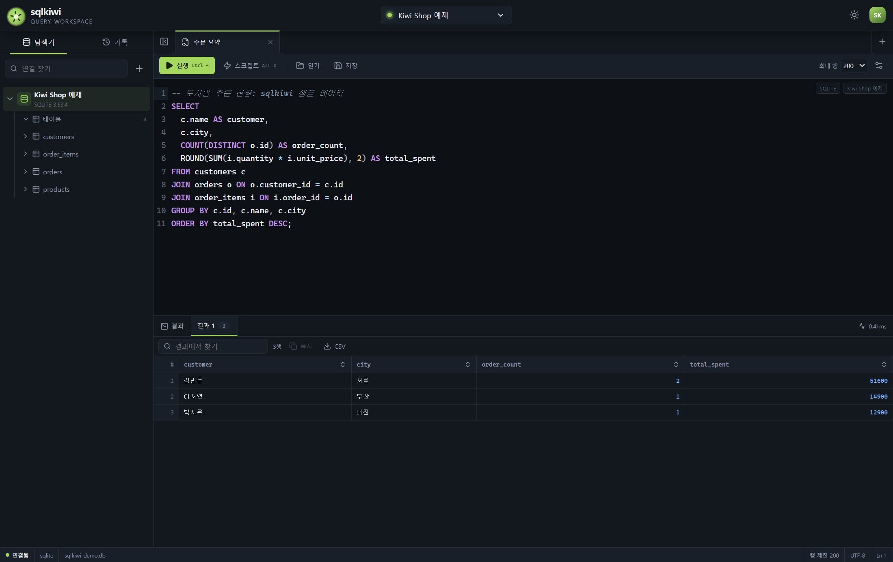
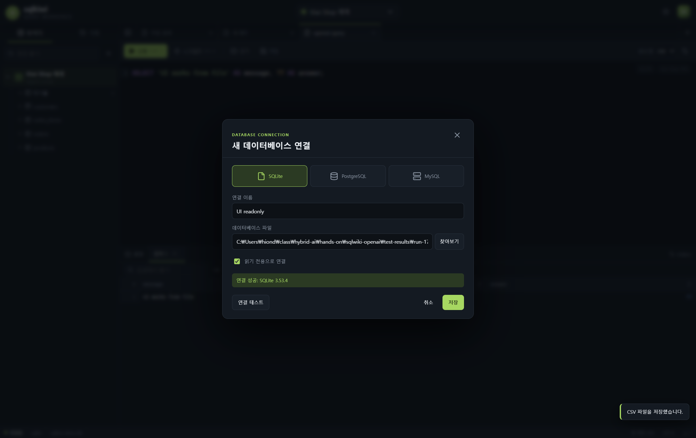
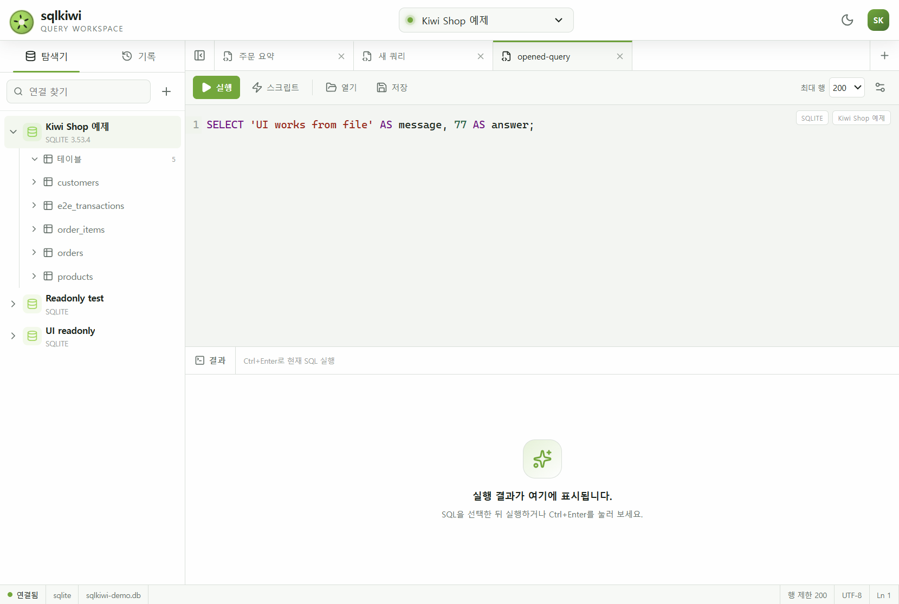

# 실행 검증 기록

2026-11-07에 Windows에서 소스를 빌드하고 실제 Electron 앱을 실행했습니다.
개발용 실행과 Windows 패키지 실행을 각각 검사했으며, 데이터베이스 결과를 모의 데이터로 대체하지 않았습니다.

## 실행 환경과 결과

| 항목 | 확인한 내용 |
| --- | --- |
| 개발용 Node.js | 22.23.4 |
| Electron / 내장 Node.js | 45.2.3 / 24.22.2 |
| Electron 내장 SQLite | 3.53.4 |
| PostgreSQL 테스트 서버 | 18.4, `postgres:18-alpine` 컨테이너 |
| MySQL 테스트 서버 | 8.4.13, `mysql:8.4` 컨테이너 |
| `npm run build` | 타입 검사와 main, preload, renderer 번들 생성 성공 |
| `npm test` | 3개 파일, 13개 시험 통과 |
| 개발용 앱의 실제 Electron E2E | 15개 단계 통과 |
| `npm run package:win` | Windows x64 앱 폴더 생성 성공 |
| 패키지 실행 파일의 실제 Electron E2E | 15개 단계 통과 |

개발용 실행의 결과는 [원본 보고서](evidence/development-e2e-report.json)에 있습니다.
패키지 실행의 결과는 [원본 보고서](evidence/packaged-e2e-report.json)에 있습니다.
패키지 검증은 `release/sqlkiwi-win32-x64/sqlkiwi.exe`를 직접 실행했습니다.
해당 앱 폴더에는 개발 의존성을 제외하고 잠금 파일에 지정된 런타임 의존성 27개를 설치했습니다.

테스트는 매번 `test-results/run-{실행 시각}/app-data`에 새 설정과 SQLite 파일을 만들었습니다.
외부 DB도 이 작업에서 만든 별도 컨테이너만 사용했습니다.
기존 DBeaver 작업 공간, 사용자 데이터베이스와 기존 테스트 컨테이너는 변경하지 않았습니다.

## 실제 앱에서 확인한 동작

1. 예제 SQLite DB의 JOIN 결과가 초기 화면에 표시됩니다.
2. 스키마, 컬럼, 기본 키와 DDL을 실제 DB에서 읽습니다.
3. 문자열 안의 세미콜론, 여러 문장, NULL, 최대 행 수와 오류 이후 중단을 처리합니다.
4. 별도 실행으로 보낸 BEGIN, INSERT와 ROLLBACK이 같은 SQLite 세션에서 동작합니다.
5. WHERE 없는 DELETE와 문자열의 WHERE를 이용한 확인 우회를 차단합니다.
6. 읽기 전용 SQLite 연결에서 변경 SQL을 차단합니다.
7. SQLite 무한 재귀 집계 쿼리를 취소한 뒤 다시 연결해 조회할 수 있습니다.
8. PostgreSQL에서 접속, DDL, DML, 결과 조회, 메타데이터와 롤백이 동작합니다.
9. PostgreSQL의 `pg_sleep`을 서버에서 취소하고 다시 조회할 수 있습니다.
10. MySQL에서 접속, DDL, DML, 결과 조회, 메타데이터와 롤백이 동작합니다.
11. MySQL의 `SLEEP`을 서버에서 취소하고 다시 조회할 수 있습니다.
12. 편집기에 SQL을 입력하고 Ctrl+Enter로 실행하며 결과를 검색할 수 있습니다.
13. SQL 저장, SQL 열기와 CSV 내보내기가 실제 로컬 파일을 읽고 씁니다.
14. 연결 설정 창에서 읽기 전용 SQLite 접속을 테스트하고 저장할 수 있습니다.
15. 앱을 재시작하면 SQL 탭이 복원되며 라이트 테마와 작은 창을 사용할 수 있습니다.

파일 입출력 시험은 Electron 파일 선택 대화상자만 정해진 테스트 경로를 반환하도록 설정했습니다.
앱의 IPC, 파일 읽기와 파일 쓰기는 실제 코드를 실행했습니다.
운영체제 파일 선택 창을 사람이 조작한 시험은 아닙니다.

렌더러의 미처리 JavaScript 오류는 두 실행 모두 0개였습니다.
`contextIsolation: true`, `sandbox: true`와 렌더러에서 `require`를 사용할 수 없는 점도 확인했습니다.
비밀번호가 공개 프로파일이나 설정 파일의 평문으로 남지 않는지도 검사했습니다.

## 검증 중 고친 문제

SQLite의 긴 네이티브 연산은 작업 스레드 종료 요청만으로 멈추지 않았습니다.
그래서 SQLite 연결을 별도 프로세스로 실행하고, 취소할 때 해당 프로세스를 종료하도록 바꿨습니다.
취소하면 미커밋 트랜잭션은 롤백되며, 다음 실행에서 새 연결을 만듭니다.

PostgreSQL 커서는 callback으로 행과 컬럼 정보를 함께 읽도록 수정했습니다.
MySQL 변경 문장은 컬럼 정보를 반환하지 않는 점과,
SLEEP 취소가 오류 대신 값을 반환할 수 있는 점을 반영해 취소 상태를 명시적으로 처리했습니다.

Windows에서는 설정 파일 교체가 일시적인 파일 잠금으로 실패할 수 있었습니다.
설정 저장을 순서대로 처리하고 제한된 횟수로 다시 시도하도록 보완했습니다.
빈 비밀번호로 설정을 수정할 때 기존 비밀번호가 삭제되던 문제도 회귀 시험에 포함했습니다.

## 범위와 남은 제한

이 결과는 위 Windows 환경과 테스트 DB에서 수행한 검증입니다.
다른 운영체제, DB 버전, 운영 서버, SSL 인증서와 복잡한 권한 체계는 검증하지 않았습니다.
PostgreSQL과 MySQL의 읽기 전용 세션 설정은 구현되어 있으나,
이번 E2E의 읽기 전용 변경 차단 시험은 SQLite를 대상으로 했습니다.

SQL 분할기는 문자열과 주석, PostgreSQL 달러 따옴표와 MySQL DELIMITER를 처리합니다.
모든 방언의 프로시저 문법과 SQLite 트리거 본문까지 해석하는 완전한 SQL 파서는 아닙니다.
PostgreSQL 테이블 DDL은 컬럼과 주요 제약에서 재구성하며 원본 전체 DDL의 복제본이 아닙니다.

결과 정렬과 검색은 가져온 행에 적용됩니다.
MySQL은 스트림으로 읽어 보관하는 행 수를 제한하지만 남은 서버 결과는 끝까지 소모합니다.
바이너리 값은 미리보기로 표시하며 CSV도 이 미리보기 값을 내보냅니다.
실행 파일은 서명되지 않은 앱 폴더이며 자동 업데이트와 설치 프로그램은 포함하지 않습니다.

## 실제 화면

아래 화면은 Windows 패키지 검증 중 촬영했습니다.
첫 그림에서는 예제 JOIN 쿼리와 DB에서 읽은 세 행을 확인할 수 있습니다.

연결 설정 창에서는 읽기 전용 SQLite 연결 테스트가 성공한 상태를 확인했습니다.

작은 창에서는 탐색기, 도구 모음과 SQL 편집기가 계속 보이는지 확인했습니다.

## 실제 작업 분담

프로젝트 위임 규칙에 따라 커넥니가 연결 엔진 초안을, 스택니가 화면 초안을 작성했습니다.
두 에이전트는 런타임에 지정된 GPT-5.6 모델을 사용했습니다.
오케스트레이터가 REA 분석, IPC, 패키징과 통합 검증을 수행하고 발견한 오류를 보완했습니다.
Sonnet과 Haiku는 이 런타임의 선택 가능한 모델이 아니므로 사용했다고 보고하지 않습니다.
