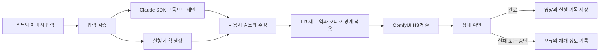

# VideoKiwi H3 실행 하네스

## 왜 실행 하네스가 필요한가

MiniMax H3 영상 생성은 같은 문장이라도 해상도, 프레임 수, 샘플링 단계와 시드에 따라 실행 시간과 결과가 달라집니다.  
VideoKiwi는 사용자의 설명을 보존하면서 H3가 처리할 실행 계획으로 바꾸고, 비교할 조건을 함께 기록합니다.  
프롬프트 개선이나 단계 수 증가가 품질을 보장한다고 표현하지 않습니다. 같은 시드로 결과를 직접 비교하도록 돕습니다.

## 상태 정의

| 상태 | 들어 있는 값 | 다음 단계에서 사용하는 이유 |  
|------|--------------|-----------------------------|  
| 생성 입력 | 원문, 이미지 ID, 길이, 화면 비율, 카메라, 프로파일, 시드 | 요청 검증과 재현에 사용 |  
| 이미지 측정값 | 가로, 세로, 밝기, 대표 색상 | 화면 비율 계산과 사용자 확인에만 사용 |  
| 프롬프트 개선 결과 | 원문, 개선문, 적용 이유, 입력 점검표 | 생성 전에 사용자가 수정할 수 있게 제공 |  
| 실행 계획 | 크기, 프레임, FPS, 단계, 샘플러, Turbo 사용 여부 | ComfyUI 워크플로에 주입 |  
| 실행 기록 | 시작 시각, 완료 시각, 시드, 계획, 출력 경로, 오류 | 비교와 중단 후 확인에 사용 |  

이미지 측정값만으로 피사체나 행동을 알아냈다고 판단하지 않습니다. 이미지 내용은 사용자가 직접 입력한 설명만 사용합니다.

## 실행 흐름



제안 버튼은 상위 서비스가 Claude Agent SDK를 통해 실행합니다. 이 하네스는 Claude 클라이언트를 구현하거나 직접 호출하지 않습니다.  
로컬 규칙은 제안 기능과 별개로 수동 입력을 정리하고 제출 직전 안전 경계를 적용하는 용도로 남깁니다. 상태 확인 루프는  
서버 계층에서 종료 상태 또는 시간 상한을 만나면 끝나야 합니다.

## 노드별 책임

### 입력 검증

`validateInput`은 허용된 열거값과 길이만 통과시킵니다. 길이는 5초, 10초, 15초 중 하나이며, 시드는 32비트 범위의  
정수입니다. 이미지 영상에는 시작 이미지가 필요하고 끝 이미지만 단독으로 사용할 수 없습니다.

### 프롬프트 개선

제안 버튼은 Claude Agent SDK로 초안을 만들고 사용자가 결과를 검토하도록 구성합니다. `optimizePrompt`는 추가 모델이나  
외부 서비스를 호출하지 않는 로컬 규칙 기반 컴파일러입니다. 원문을 그대로 두고 첫 프레임 보존, 선택한 카메라, 시간축  
일관성과 소리 조건을 구역별로 붙입니다. 사용자가 빠른 움직임이나 컷 전환을 요청했다면 이를 제한하는 느린 움직임 또는  
단일 쇼트 규칙을 추가하지 않습니다.

원문에 카메라 이동, 팬, 줌, 고정 샷처럼 분명한 촬영 지시가 있으면 화면에서 선택한 카메라 프리셋을 덧붙이지 않습니다.  
피사체가 카메라 쪽으로 고개를 돌리는 표현은 촬영 지시로 판단하지 않습니다. 점검 결과에는 어느 지시를 우선했는지 남깁니다.

이미 `integrated_multimodal_description`, `overall_soundscape`, `non_diegetic_music` 구역을 사용한 H3 프롬프트는  
같은 구조를 유지합니다. 개선 조건은 영상 설명 끝에 한 번만 붙이며, 다시 개선해도 구역이나 조건을 중복하지 않습니다.

일반 문장도 H3에 제출할 때 다음 세 구역으로 나눕니다.

| H3 구역 | 담는 내용 | 지켜야 할 경계 |  
|---------|-----------|----------------|  
| `integrated_multimodal_description` | 장면, 동작, 카메라, 화면 글자 | 장면 설명을 발화 대본으로 사용하지 않음 |  
| `overall_soundscape` | 환경음, 효과음, 명시적으로 요청한 대사 | 기본값은 대사, 내레이션, 보컬 없음 |  
| `non_diegetic_music` | 배경 음악 | 음악 요청이 없으면 `N/A` 사용 |  

`ensureAudioBoundaries`는 사용자가 검토한 최종 프롬프트에도 같은 경계를 적용합니다. 대사나 내레이션을 분명하게  
요청하지 않았다면 장면 설명을 읽지 않도록 지시합니다. `대사원`, `대사찰`, `대사관`처럼 이름에 `대사`가 들어간 말은  
발화 요청으로 판단하지 않습니다. 사용자가 대사를 직접 요청하면 그 대사만 허용하고 장면 설명 낭독은 계속 막습니다.  
무음을 요청하면 자연 환경음과 배경 음악도 추가하지 않습니다.

음악 요청은 `non_diegetic_music`에, 자막 요청은 영상 설명에 둡니다. 사용자가 자막을 원하지만 표시할 문구를 쓰지  
않았다면 정확한 자막 문구를 입력해 달라는 안내를 남깁니다. 이미지 내용과 마찬가지로 누락된 자막을 임의로 만들지 않습니다.

사용자가 자막이나 화면 글자를 요청하지 않았을 때만 원하지 않는 글자를 제외합니다. 음악도 같은 원칙을 적용합니다.  
짧은 원문에는 새로운 피사체를 상상해서 채우지 않고, 사용자가 행동과 환경을 더 설명하도록 안내합니다.

사용자가 처음 쓰는 원문은 4,000자까지 받습니다. 규칙을 적용하고 사용자가 검토한 최종 프롬프트는 8,000자까지 받습니다.  
`originalPrompt`를 함께 보관하여 검토한 최종 문장과 최초 의도를 구분합니다. 일반 문장 형식도 계속 지원합니다.

서버는 Claude 제안과 사용자 수정을 모두 마친 뒤, ComfyUI에 보내기 직전에 다음 순서로 호출해야 합니다.

```ts
const guardedPrompt = ensureAudioBoundaries(input, finalPrompt)
await comfyClient.submit({ ...request, prompt: guardedPrompt })
```

이 호출은 최종 문장을 다시 쓰는 단계가 아닙니다. 세 구역을 정리하고 장면 설명 낭독 금지 조건을 한 번만 붙이는  
제출 경계입니다.

### 실행 계획

`buildPlan`은 H3의 24 FPS와 `17k+5` 프레임 그리드에 맞춰 요청 길이를 올림합니다. 5초는 124프레임, 10초는  
243프레임, 15초는 362프레임입니다. 화면 크기는 32의 배수로 맞추고, 시작 이미지가 있으면 자동 비율에 사용합니다.

| 프로파일 | 단계 | 샘플러 | 선택 조건 |  
|----------|------|--------|-----------|  
| 빠르게 | 8 | `euler` | Turbo LoRA와 Sigma Shift 준비 확인 |  
| 빠르게 대체 경로 | 20 | `res_multistep` | Turbo 준비를 확인하지 못한 경우 |  
| 균형 | 20 | `res_multistep` | 로컬에서 실제 생성이 확인된 기본값 |  
| 고품질 탐색 | 30 | `res_multistep` | 결과 개선을 보장하지 않는 비교용 |  

Turbo LoRA가 없을 때 기본 모델의 단계 수만 8로 낮추지 않습니다. 이는 설치 안내에서 확인한 기본 20단계 경로를 보존하기 위함입니다.

## 제어와 재시도 정책

| 작업 | 시간 상한 | 자동 재시도 | 상한 도달 시 처리 |  
|------|-----------|-------------|-------------------|  
| 입력 검증 | 동기 처리 | 없음 | 필드별 오류 반환 |  
| 프롬프트 개선 | 동기 처리 | 없음 | 원문을 유지하고 오류 반환 |  
| ComfyUI 제출 | 서버에서 30초 권장 | 없음 | 중복 제출을 막고 수신 여부 확인 |  
| 상태 확인 | 서버에서 30분 상한 권장 | 읽기 실패만 최대 3회 권장 | 작업 ID를 보존하고 `interrupted` 기록 |  
| 사용자가 취소 | 한 번 | 없음 | 해당 작업만 취소하고 다른 큐는 유지 |  

생성 제출은 응답이 끊겼다고 자동 재시도하지 않습니다. 서버가 요청을 받았을 수 있으므로 같은 영상을 두 번 만들 위험이 있습니다.

## 지속성과 재개

작업을 제출하기 전에 생성 입력, 개선문, 실행 계획과 고유 작업 ID를 저장합니다. 제출 후에는 ComfyUI의 `prompt_id`를  
추가합니다. 웹 서버가 다시 시작되면 `prompt_id`가 있는 미완료 작업만 ComfyUI 기록에서 확인합니다. ComfyUI에도 기록이  
없으면 자동으로 다시 제출하지 않고 `interrupted`로 남깁니다.

## 관측과 비교

작업마다 다음 값을 기록하면 설정을 바꾼 효과를 비교할 수 있습니다.

- 원문과 실제 제출 프롬프트
- 시작 이미지 측정 크기
- 시드, 가로와 세로, 프레임, FPS
- 단계 수, 샘플러, Turbo 사용 여부
- 큐 대기 시각, 실행 시작과 완료 시각, 전체 경과 시간
- 출력 영상 경로와 최종 상태
- 엔진 GPU, 전체 VRAM과 남은 VRAM

이전에 `H3-Local`에서 확인한 640×352, 124프레임, 20단계의 약 230.7초는 설치 검증 기록입니다. VideoKiwi에서  
새로 측정한 값이 아니므로 기준 정보로만 표시해야 합니다.

## 선택 근거

Claude Agent SDK 제안은 사용자가 더 구체적인 초안을 검토할 수 있도록 돕습니다. 로컬 규칙 경로도 함께 두는 이유는  
추가 추론 없이 제출 형식을 정리하고, 어떤 안전 문구를 더했는지 확인할 수 있기 때문입니다. 별도 VLM으로 이미지를  
설명하는 방법은 현재 설치 범위를 늘리고 추측을 만들 수 있어 사용하지 않습니다.

이 문서의 오디오 경계 검증은 CPU 단위 테스트로 수행했습니다. 실제 Claude 추론과 GPU 영상 생성 결과를 검증했다는  
뜻은 아닙니다.

세 프로파일을 선택한 이유는 검증된 기본 경로와 설치된 Turbo 경로를 분명하게 나누면서 비교 조건을 남길 수 있기  
때문입니다. 모든 값을 자동으로 탐색하는 방식은 실행 비용이 크고 품질의 정답이 없으므로 사용하지 않습니다.

## 열린 질문

- 864×480과 5초 초과 영상이 현재 16GB GPU에서 안정적으로 끝나는지 실측 필요
- 30단계가 장면별로 어떤 차이를 만드는지 동일 시드 비교 필요
- Turbo 8단계와 기본 20단계 결과를 평가할 사람 기준과 대표 프롬프트 세트 확정 필요
- 밝기와 대표 색상을 프롬프트 문장에 직접 반영할지 사용자 실험 후 판단 필요
