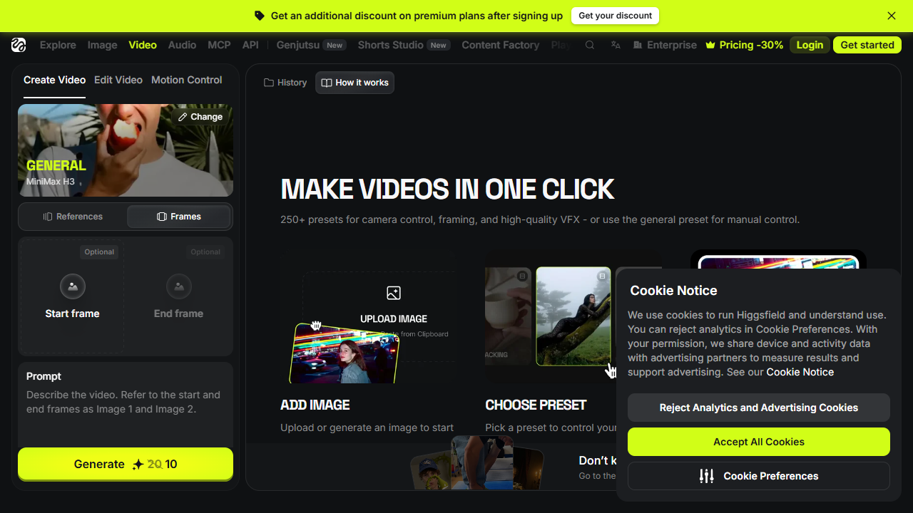

# 관찰에서 로컬 앱으로 연결한 과정

사용자가 익숙한 영상 생성 흐름을 유지하려면 실제 화면이 무엇을 받는지 먼저 확인할 필요가 있습니다.  
Higgsfield는 화면 구성의 참고 대상으로 사용했고, 실행 엔진은 사용자가 지정한 로컬 H3 소스로 정했습니다.

## REA MCP에서 관찰한 내용

2026-11-08에 `capture_browser_scenario`를 두 번 실행했습니다.  
별도의 임시 Chrome 프로필로 공개 페이지를 열고 본문이 나타날 때까지 기다렸습니다.  
로그인, 영상 생성, 결제 또는 기존 계정 데이터 변경은 실행하지 않았습니다.

첫 번째 근거는 다음 ID로 보관했습니다.

`ev_54c8b2f50f7dcd91baa10156b2347712c64a05d9b99563b4e362c5c99a072a60`

`/create/video`가 `/ai-video`로 이동하며 공개 영상 생성 소개를 보여 주었습니다.  
로그인 뒤 실행과 생성 API의 내부 동작은 확인하지 않았습니다.

두 번째 근거는 다음 ID로 보관했습니다.

`ev_b57b30237b275191397aa47819abcb080b32bfa018683341fb203d9816f885dd`

`/ai/video?model=minimax_h3`에서 시작과 끝 프레임, 프롬프트, 길이와 화질, 기록 영역을 확인했습니다.  
생성 버튼을 누르거나 실제 결과 영상을 생성하지 않았습니다.

두 시나리오의 동작 단계는 모두 완료됐습니다. 두 번째 화면 캡처는 요청한 항목이 모두 확보됐습니다.  
첫 번째 시나리오의 네트워크 기록은 종료 시점에 진행 중인 요청이 있어 일부 미완료 상태입니다.  
네트워크 요청의 발생 원인이나 생성 요청의 내부 계약을 그 기록만으로 단정하지 않습니다.

왼쪽 입력과 오른쪽 기록 영역의 관계를 참고했습니다. VideoKiwi의 브랜드와 화면 구성은 새로 작성했습니다.  
Higgsfield의 원본 소스나 로그인 정보를 앱에 포함하지 않았습니다.

접근성 텍스트는 `docs/evidence/studio-accessibility.txt`에 저장했습니다.  
전체 REA 세션은 같은 폴더의 `rea-session.json`에 보관하며, 큰 원본 파일이므로 Git에서는 제외했습니다.

## 로컬 소스에서 확인한 내용

| 참고 파일 | 앱에 반영한 사실 |
|---|---|
| `~/AI/H3-Local/test-generation.py` | `/prompt` 제출과 `/history/{id}` 조회 방식, 기존 작업이 있을 때 제출하지 않는 원칙을 확인했습니다. |
| `~/AI/H3-Local/H3-Q4-16GB-Start.api.json` | Q4 영상 모델, Q2 텍스트 인코더, 영상과 음성 VAE, 20단계 기본 배선을 가져왔습니다. |
| `~/AI/H3-Local/long-video/skyfish-turbo8.api.json` | Turbo LoRA와 Sigma Shift, Euler 8단계가 함께 사용되는 것을 확인했습니다. |
| `comfy_extras/nodes_minimax_h3.py` | 시작과 끝 프레임, 32px 정렬, 24fps, `17k+5` 규칙을 확인했습니다. |
| `~/AI/ComfyUI-H3/server.py` | `prompt_id`를 지정한 취소가 해당 실행 작업에만 적용되는 것을 확인했습니다. |

위 표의 `comfy_extras` 폴더는 `~/AI/ComfyUI-H3` 아래에 있습니다.  
참고 파일은 읽기만 수행했습니다. 모델, 기존 워크플로와 실행 중인 GPU 작업은 변경하지 않았습니다.  
웹에서 사용할 기본과 Turbo 워크플로의 사본은 프로젝트 안에 포함해 운영체제별 절대 경로 의존을 줄였습니다.

## 새로 설계한 부분

이미지 업로드의 형식과 크기를 검사하고, 브라우저와 H3 사이의 파일 전송을 서버에서 중개하도록 했습니다.  
프롬프트 개선과 실행 프로파일은 VideoKiwi에서 추가한 기능이며 Higgsfield에서 같은 내부 구현을 관찰한 것은 아닙니다.  
작업의 원문과 최종 입력, 시드와 실행 계획을 함께 보관해 결과를 비교할 수 있도록 했습니다.

연결 실패와 제출 응답 유실은 구분합니다. 상태 조회 실패는 재연결을 기다리지만, 제출 실패는 자동 재제출하지 않습니다.  
GPU 시험은 처음에 보류했다가 사용자의 허용 후 이미지와 텍스트 경로를 각각 실제 검증했습니다.  
실행 결과와 한계는 [검증 기록](verification.md)에 별도로 적었습니다.

## 영상 확장 기능 관찰 (2026-11-09)

Higgsfield 영상 화면의 **Extend Video** 탭을 REA MCP `capture_browser_scenario`로 다시 열어 관찰했습니다.  
로그인하지 않은 임시 Chrome 프로필에서 탭과 메뉴만 눌렀으며, 생성 버튼과 쿠키 동의 버튼은 누르지 않았습니다.

| 근거 ID | 동작 | 관찰한 사실 |
|---|---|---|
| `ev_261e08b0b46ce9176944bb8800a7811676c3e199bd7f27a869511ebe90c9ad1c` | Extend Video 탭 선택 | 원본 영상 입력(최대 30초), 참고 자료, 방향, 프롬프트, 길이, 화질 영역 |
| `ev_0e6f6670aa4c3b88c3999eb677d392b6babe568a55705fbb95909c1bea785aed` | 방향 메뉴 열기 | `Sequel`(끝 뒤에 이어 만들기, 기본값)과 `Prequel`(시작 앞에 만들기) 두 가지 |
| `ev_f925ee489ef42491f3109343d3be7feaa38999b78c4fa88f85f81e67ff03eec2` | 길이 메뉴 열기 | 길이 설정이 `Total duration` 슬라이더로 표시됨 |
| `ev_0c560c5db427fd68900d528195c5b8a767d348ff9d686780d923005e50507149` | 모델 메뉴 열기 | 탭 전환 시 주소의 모델 값이 `seedance_2_5`에서 `seedance_2_5_extend`로 바뀜 |

관찰로 확인한 범위는 화면 구성과 주소 변화까지입니다.  
서버가 원본 영상을 어떻게 이어 붙이는지, 길이 슬라이더가 원본을 포함한 전체 길이인지는 확인하지 않았습니다.  
앞의 두 근거는 같은 날 먼저 실행한 캡처이며 `rea-extension-session.json`에 보관했습니다.

### VideoKiwi에 옮긴 방식

| Higgsfield 화면 | VideoKiwi 구현 | 근거 구분 |
|---|---|---|
| 확장 전용 탭 | `새 영상`과 `영상 이어 만들기` 작업 방식 전환 | 관찰 |
| 원본 영상 추가 | 완료된 기록에서 고르기, 또는 MP4와 MOV, WebM 업로드(250MB, 5분 이하) | 관찰 + 설계 |
| `Sequel` 방향 | 원본 **끝** 뒤에 이어 만들기만 지원 | 관찰, `Prequel`은 미구현 |
| `Total duration` | 추가 길이(5, 10, 15초)를 고르고 원본, 추가, 예상 합본 길이를 함께 표시 | 설계 |
| 서버 내부 처리 | 로컬 H3 노드로 새로 설계 | 설계 (관찰 아님) |

로컬 H3에서는 `~/AI/ComfyUI-H3/comfy_extras/nodes_minimax_h3.py`의 `MiniMaxH3AddGuide`를 사용했습니다.  
이 노드는 17k+5 프레임(5, 22, 39 등) 길이의 짧은 영상과 소리를 새 영상의 지정 프레임에 고정합니다.  
VideoKiwi는 원본 마지막 22프레임과 그 구간의 소리를 새 영상의 0번 프레임에 고정해 움직임과 소리를 잇습니다.  
생성이 끝나면 새 영상 앞의 22프레임(원본과 겹치는 구간)을 잘라 내고 FFmpeg로 원본 뒤에 붙입니다.  
화면 크기는 원본 크기를 유지합니다. 그래서 이어 붙일 때 새 구간의 크기를 다시 바꾸지 않습니다.
