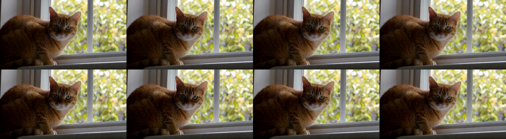
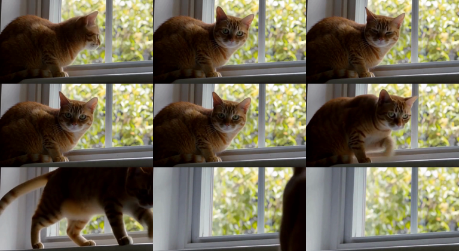

# 구현과 검증 기록

최종 확인 날짜는 2026-11-09입니다. 이 문서는 웹 앱과 실제 GPU에서 확인한 범위를 구분합니다.

## 구현한 기능

텍스트 영상과 이미지 영상, 시작 프레임과 끝 프레임을 로컬 H3 워크플로에 연결했습니다.  
업로드 파일은 서버에서 검사하고, 크기와 밝기, 대표 색상을 측정합니다.  
Claude 구독으로 제안받은 프롬프트를 검토하고 수정할 수 있으며, 최종 문장을 실제 제출 입력에 사용합니다.

실행 프로파일과 시드, 영상 크기와 프레임 수를 기록하고 JSON 레시피로 내보낼 수 있습니다.  
작업 기록, 상태 조회, 완료 영상 재생, 다운로드와 지정 작업 취소를 연결했습니다.  
취소는 ComfyUI의 해당 작업 ID만 대상으로 하며, 다른 사용자의 실행 작업은 중단하지 않습니다.

## 수행한 검사

| 검사 | 결과 | 확인하는 범위 |
|---|---|---|
| TypeScript 검사 | 통과 | 프론트와 서버의 타입 계약을 확인했습니다. |
| 단위와 HTTP 통합 검사 | 76개 통과 | 오디오 분리, 구독 SDK, 프롬프트 보존, 이미지 처리, 진행 이벤트와 API 경계를 확인했습니다. |
| 웹과 서버 빌드 | 통과 | React 정적 파일과 Node 서버, 워크플로 사본이 빌드되는 것을 확인했습니다. |
| Chromium 브라우저 검사 | 7개 흐름 통과 | 업로드부터 수정한 프롬프트의 제출, 테스트 영상 재생과 다운로드까지 확인했습니다. |

브라우저 검사는 별도의 모의 ComfyUI 서버를 사용했습니다.  
테스트용 단색 MP4는 CPU의 FFmpeg `libx264`로 만들었으며, H3 생성 품질의 근거로 사용하지 않습니다.  
Chromium은 `--disable-gpu` 옵션으로 실행했습니다. Windows와 Mac용 브라우저 경로 선택을 지원하지만,  
이번 실행은 Windows Chrome에서 수행했습니다. Mac 하드웨어와 Safari에서의 실제 실행은 확인하지 않았습니다.

모의 엔진에서도 제출한 워크플로에 최종 수정 문장이 그대로 들어가는 것을 검사했습니다.  
영상 파일의 부분 요청(`Range`)과 다운로드 응답도 확인했습니다.  
모바일 폭에서 가로 스크롤이 넘치지 않는 것과 라이브러리 검색, 엔진 상태 화면을 확인했습니다.

## 실제 GPU 생성과 웹 재생

처음에는 사용자 요청에 따라 GPU 시험을 보류했습니다. 이후 사용자가 GPU 사용을 허용하여 시험을 재개했습니다.  
기존 작업 큐가 비어 있는 것을 확인한 뒤 두 작업을 순서대로 제출했습니다. 다른 실행 작업은 취소하지 않았습니다.

| 입력 경로 | 설정 | 경과 시간 | 결과 |
|---|---|---|---|
| 시작 이미지와 텍스트 | 640×352, 124프레임, Euler 8단계, Turbo, 시드 42 | 165초 | 영상과 음성 생성 성공 |
| 텍스트만 입력 | 640×352, 124프레임, Euler 8단계, Turbo, 시드 42 | 138초 | 영상과 음성 생성 성공 |

두 MP4 모두 FFprobe에서 H.264 영상 124프레임과 32kHz 스테레오 AAC 음성을 확인했습니다.  
파일 길이는 5.166688초이며 계획의 5.167초와 일치합니다. 이 시간에는 모델 준비와 상태 조회 간격이 포함됩니다.

각 결과의 첫 프레임, 중간 프레임과 마지막 프레임을 추출해 직접 확인했습니다.  
이미지 입력 결과는 제공한 창가의 고양이와 배경을 유지하면서 고양이가 카메라 쪽으로 고개를 돌렸습니다.  
텍스트 입력 결과에서도 창가의 주황색 고양이와 고개를 돌리는 동작을 확인했습니다.  
이 확인은 단일 사례의 관찰이며 일반적인 영상 품질을 점수로 평가한 결과는 아닙니다.

실제 결과를 웹 화면에서 열어 640×352 영상의 재생 시간이 증가하고, 브라우저 오류가 없는 것을 확인했습니다.  
결과가 미리보기 오른쪽을 벗어나는 화면 문제도 수정하고 다시 확인했습니다. 웹 서버의 페이지, JS와 CSS는 200으로 응답합니다.

로컬 실행 근거는 다음 폴더에 보관했습니다. 파일에는 작업 ID, 입력과 개선문, 실행 계획과 미디어 정보가 있습니다.

- `test-results/gpu-image-1794131597386/verification.json`
- `test-results/gpu-text-1794131777893/verification.json`
- `test-results/live-ui-1794131899073/verification.json`

실제 ComfyUI 작업 ID는 이미지 입력 `2f0d2ced-f5c4-4c84-b356-daf01a389348`,  
텍스트 입력 `158a748e-2861-4a17-8f29-0d9b0db3e505`입니다.

## 아직 확인하지 않은 범위

원문 대비 개선 프롬프트의 품질 우위, 30단계의 품질 효과, 긴 영상과 Mac GPU 실행은 미검증입니다.  
브라우저 재생 시험에서는 음성을 음소거했으므로 대사나 효과음의 청감 품질을 평가하지 않았습니다.  
기존 `H3-Local`의 230.7초 기록은 다른 입력과 설정의 이전 실행이며 위 측정과 직접 비교하지 않습니다.

## Claude 구독 제안과 자동 적용 검증

사용자 요청에 따라 제안 기능을 Claude Agent SDK로 변경했습니다.  
실제 Claude Code 구독 로그인으로 시작 이미지와 끝 이미지, 대사원 장면 설명을 전달했습니다.  
응답 모델은 `claude-sonnet-5-5`, 제공자는 `claude-agent-sdk`, 인증은 `claude-subscription`으로 확인됐습니다.

브라우저에서 제안 버튼을 누르고, 실제 반환된 제안문을 검토 영역에서 수정했습니다.  
이어 영상 만들기를 눌렀을 때 수정한 제안문이 제출 요청의 `prompt`에, 원문이 `originalPrompt`에 들어갔습니다.  
이 검증에서는 영상 제출 요청을 가로채 GPU 생성을 막았고, 작업 기록이 늘지 않는 것도 확인했습니다.  
복사와 붙여넣기 없이 제안문이 연결되는 흐름의 근거는 다음 파일에 있습니다.

`test-results/claude-live-1794140279291/verification.json`

제안문에는 장면, 환경음, 배경 음악이 분리되어 있고 대사와 내레이션 금지 조건이 들어 있었습니다.  
제출 직전에도 같은 경계를 보강합니다. ‘대사원’을 발화 요청으로 오인하지 않는 회귀 검사도 추가했습니다.  
이 수정 이후 H3 영상을 다시 생성해 음성을 청취하는 시험은 수행하지 않았습니다.

운영 데이터가 저장되는 `.data` 폴더의 이미지가 Express의 기본 숨김 경로 제한에 걸리는 문제도 수정했습니다.  
저장소에 등록된 이미지 파일만 이 제한을 해제해 제공하고, 실제 PNG 응답을 확인하는 검사를 추가했습니다.  
업로드된 한글 파일명의 잘못된 문자 인코딩도 보정합니다.

## Opus 5.5와 실시간 진행률 검증 (2026-11-09)

기본 제안 모델과 현재 서버 설정을 `claude-opus-5-5`로 바꿨습니다.  
실제 구독 로그인으로 시작 이미지와 끝 이미지, 대사원 장면 설명을 전달해 해당 모델의 응답을 확인했습니다.  
제안문을 수정한 뒤 생성 요청에 자동 적용되는 흐름도 다시 검사했습니다. 이 검사는 GPU 작업을 제출하지 않았습니다.

`test-results/claude-live-1794169395834/verification.json`

ComfyUI의 WebSocket을 연결하고 제출할 때 같은 클라이언트 ID를 사용합니다.  
실행 중인 작업 ID의 이벤트만 받아 샘플링, 영상 복원, 소리 복원과 저장 단계를 화면에 전달합니다.  
실제 처리 횟수가 있는 경우에만 현재 노드의 퍼센트를 표시합니다. 샘플링 완료를 전체 완료로 처리하지 않습니다.  
연결이 끊겨도 HTTP 상태 확인을 유지하고, 다시 연결해 진행 이벤트를 받습니다.

실제 이미지 입력으로 640×352, 124프레임, Turbo Euler 8단계, 시드 42 영상을 생성했습니다.  
203초 후 완료됐으며 FFprobe에서 5.166688초의 H.264 영상과 AAC 소리를 확인했습니다.  
실행 중 15개의 단계와 진행 수치 표본을 기록했습니다. GPU 큐가 비어 있는 것도 완료 후 확인했습니다.

동시에 브라우저에서 실제 작업의 진행 막대가 `1/8단계, 13%`에서 `2/8단계, 25%`로 갱신되는 것을 확인했습니다.  
브라우저 관찰 검사는 새 GPU 작업을 제출하지 않았으며 브라우저 오류는 없었습니다.  
모의 엔진을 이용한 7개 브라우저 흐름에서도 진행 막대와 이후 완료 상태를 확인했습니다.

- `test-results/gpu-image-1794169479987/verification.json`
- `test-results/live-progress-1794169493461/verification.json`
- `test-results/live-progress-1794169493461/sampling-progress.png`
- `test-results/web-1794169278991/verification.json`

이번 GPU 검사는 진행 전달과 미디어 생성 여부를 확인한 것입니다. 소리를 청취해 내레이션 억제 효과를 평가하지는 않았습니다.

## 작업 분담

클로니가 REA 관찰, 공통 계약과 웹 서버, 상태 저장, 통합 검증을 맡았습니다.  
스택니가 브라우저 화면, 커넥니가 로컬 ComfyUI 연결, 플로니가 프롬프트와 실행 계획을 맡았습니다.  
위임된 세 팀원은 실행 환경에 등록된 `GPT-5.6-sol` 모델로 수행했습니다.

## 영상 이어 만들기 검증 (2026-11-09)

| 검사 | 결과 | 확인 범위 |
|---|---|---|
| `npm run typecheck` | 통과 | 화면 컴포넌트에 확장 속성이 빠져 있던 타입 오류 2건을 고친 뒤 통과 |
| `npm test` | 8개 파일, 88개 통과 | 새 파일 `test/extension-service.test.ts` 3건 포함 |
| `npm run build` | 통과 | 3010 서버를 새 빌드로 다시 실행 |
| 실제 엔진 노드 확인 | `extensionAvailable: true` | `LoadVideo`, `GetVideoComponents`, `MiniMaxH3AddGuide` 등록 확인 |
| 브라우저 화면 | 확인 | 완료 영상 선택, 가이드 준비, 길이 표시, 버튼 활성까지 |

`extension-service.test.ts`는 실제 FFmpeg로 2초 원본과 141프레임 새 구간을 만들어 검사합니다.  
원본 48프레임과 새 구간 119프레임(141 - 겹친 22)이 합쳐져 약 167프레임이 되는지 확인합니다.  
이어 붙이기에 실패하면 완료로 표시하지 않고, 상태 다시 확인으로 이어 붙이기만 재시도하는지도 확인합니다.  
이어 만든 결과를 다시 원본으로 골라 연속 확장할 수 있는지도 확인합니다.

### 실제 GPU 시험

사용자 허용 후 웹 화면에서 직접 제출했습니다. 원본은 기록의 5.167초 고양이 영상(124프레임)입니다.  
설정은 640×352, 추가 5초, 빠르게(Turbo Euler 8단계), 시드 42이며 Claude 제안은 사용하지 않았습니다.  
프롬프트는 `The cat stands up, steps off the windowsill and walks out of frame to the right.`입니다.

| 항목 | 결과 |
|---|---|
| 처리 시간 | 259초(제출부터 이어 붙이기 완료까지), GPU는 RTX 4090 Laptop 16GB |
| 엔진 결과 | ComfyUI `success`, 141프레임 5.875초 새 구간 |
| 합본 | 243프레임(124 + 141 - 22), 10.125초, H.264 영상과 AAC 소리 |
| 가이드 고정 | 새 구간 0 ~ 21번 프레임과 원본 102 ~ 123번 프레임의 PSNR 38.9 ~ 39.4dB |
| 이음새 화면 | 123번과 124번 프레임 사이 PSNR 39.6dB(원본 구간 최저 33.9dB, 새 구간 평균 31.8dB) |
| 이음새 소리 | 4.6 ~ 5.8초 구간 0.1초 단위 RMS가 -50.0 ~ -56.2dB로 고르게 이어짐, 끊김 없음 |

이음새의 프레임 차이는 영상 안의 평범한 움직임보다 작아 장면이 바뀐 것처럼 튀지 않습니다.  
가이드 구간이 원본과 39dB 수준으로 일치해 H3가 원본 끝 장면에서 출발했음을 확인했습니다.  
프레임을 눈으로 확인한 결과 고양이가 원본 자세에서 이어 일어나 오른쪽으로 걸어 나갔습니다.

이 시험은 1회 실행입니다. 소리는 조용한 환경음 수준이라 대사나 음악이 이어지는 경우는 확인하지 않았습니다.  
10초와 15초 추가, 원본 크기 864×480, 업로드한 MOV와 WebM 원본은 실제 GPU로 시험하지 않았습니다.
