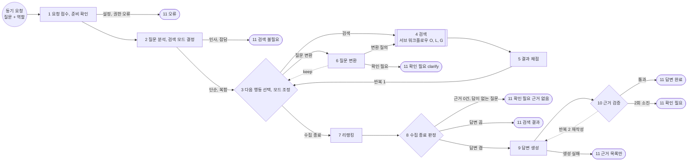

# GraphRAG Agentic 검색 워크플로우 설계 (W-2)

| 항목 | 내용 |
|------|------|
| 상태 | **v2.2** (2026-10-24, 외부 리뷰 `openai_review_graphrag-agentic-search_20261024.md` 반영) |
| 기준 | 벡터 검색 Agentic 워크플로우와 같은 뼈대 |
| 단계 ID | 메인 워크플로우는 일련번호 `1` ~ `11`. 서브 워크플로우는 접두어 + 일련번호: 검색엔진 검색 `O1` ~ `O4`, Local 검색 `L1` ~ `L4`, Global 검색 `G1` ~ `G3`. 반복 구간은 `반복 1`, `반복 2`. 분기 번호는 표시하지 않음 |
| 작성 규칙 | `references/design-workflow-connector.md`의 단계 명세, 반복 구간, 커넥터 형식. 시간 예산, 타임아웃, 최악값은 다루지 않음 |
| 앞선 문서 | `teacher/plan/graphrag-search-flow.md`(Local, Global 검색의 안쪽 흐름과 Best Practice 조사) |
| 슬라이드 | `teacher/plan/graphrag-agentic-search.pptx`(스크립트 `graphrag-agentic-search-slides.md`). 2026-10-24부터 덱은 ReAct 권고안(`graphrag-react-search.md`)을 기준으로 바뀌었고, 이 문서는 툴 안의 서브 워크플로우(O, L, G)와 진단 신호의 상세로 쓰임 |

## 0. 무엇이 바뀌나 (WHY)

- 벡터 검색 워크플로우와 같은 뼈대 위에 「검색 모드 고르기(단계 2)」와 「채점을 보고 모드 바꾸기(단계 3)」를 더함
- 검색 모드는 **local과 global 둘뿐**임. 둘 다 검색엔진(BM25 + 벡터)과 그래프를 함께 쓰므로 이미 하이브리드 검색임
  - 사실 → 보고서(아래에서 위로) = Local 검색의 마지막 단계(L4 커뮤니티 탐색)
  - 보고서 → 사실(위에서 아래로) = Global 검색의 Follow-up 단계(G2, G3)
- 근거를 다 모은 뒤 답을 만들기 전에 **리랭킹(단계 7)** 을 함. 회차마다 모은 근거가 섞여 있어 원 질문 기준으로 다시 줄 세움
- **이 실습의 local과 global은 자체 검색 모드임.** Microsoft GraphRAG의 Global Search는 커뮤니티 보고서를 map-reduce로 처리하지만,  
  이 실습의 Global은 「보고서 선택 + Follow-up Local 검색」을 결합한 구성임. Microsoft DRIFT와 닮은 부분이 있으나 같은 구현은 아님  
  (근거: https://microsoft.github.io/graphrag/query/overview/ , https://microsoft.github.io/graphrag/query/drift_search/ )

| 벡터 검색 워크플로우 | GraphRAG Agentic 워크플로우 | 달라진 점 |
|---------------------|----------------------------|-----------|
| 요청 접수, 준비 확인 | 1 요청 접수, 준비 확인 | 활성 세대와 커뮤니티 보고서 유무를 고정 |
| 질문 분석, 계획 | 2 질문 분석, 검색 모드 결정 | 검색 계획에 모드(local, global)가 들어감 |
| 다음 행동 선택 | 3 다음 행동 선택, 모드 조정 | 채점 신호로 모드를 바꿈 |
| 문서 검색 | 4 검색 | 서브 워크플로우 3개(검색엔진 검색 O, Local 검색 L, Global 검색 G) |
| 결과 채점(규칙) | 5 결과 채점 | 모드별 통과 기준과 진단 신호 |
| 질문 변환 | 6 질문 변환 | 다시 쓰기와 분해만. Follow-up 질문은 Global 검색 안(G2)에서 만듦 |
| (없음) | **7 리랭킹** | 모은 근거 전체를 원 질문 기준으로 다시 줄 세움 |
| 수집 종료 판정 | 8 수집 종료 판정 | 「답이 없는 질문」 판정 추가 |
| 답변 생성 | 9 답변 생성 | 모드별 컨텍스트 몫 |
| 근거 검증(규칙) | 10 근거 검증 | 보고서 인용 규칙 추가 |
| 종료 상태 | 11 종료 상태 | 같음 |
| 반복 구간 2개(진입 최대 6회, 재작성 최대 2회) | 반복 1, 반복 2 | 상한은 같음 |

## 1. 흐름 도식



## 2. 검색 모드 결정과 조정

### 2-1. 단계 2의 처음 결정 (Adaptive)

| 모드 | 고르는 경우 | 하는 일 |
|------|-------------|---------|
| `local` | 특정 카드, 조항, 회원, 금액, 기한 같은 사실. **확신이 낮을 때의 기본값** | Local 검색(L1 ~ L4) |
| `global` | 여러 문서의 경향, 공통점, 주제 나누기. 경향과 그 근거 사실을 함께 물을 때도 | Global 검색(G1 ~ G3) = 커뮤니티 검색 → Follow-up 질문으로 Local 검색 |

- 규칙 신호: 회원번호, 카드명, 조항 번호 → `local`. 「주제별」, 「공통점」, 「경향」, 「고객군별」 → `global`. 신호가 없거나 섞이면 LLM이 고르고, 꼴 오류면 `local`
- 식별자 바꾸기(규칙): 회원번호(M-0000) → 가명 id(`member_pseudo_id`), 카드명과 별칭 → `card_id`.  
  상담 청크 본문에는 회원번호가 없고(48개 중 0개) `member_pseudo_id`는 검색엔진 keyword 필드라서, 식별자는 **두 저장소의 메타데이터 필터**로만 씀
- 커뮤니티 보고서가 없는 세대면 `global`을 고르지 않음

### 2-2. 단계 5의 채점과 진단 신호 (규칙)

| 신호 | 판정 규칙(가정값) | 뜻 |
|------|-------------------|-----|
| `PASS`(local) | 핵심어 포함률 ≥ 0.6, 근거 원문 ≥ 2개, 식별자 일치(근거의 `member_pseudo_id`, `card_id` 메타데이터가 필터와 같음) | 사실 근거로 충분 |
| `PASS`(global) | **관련도 0.35 이상인 보고서 ≥ 2개**, **답에 넣을 주제(`topic_id`)마다 원문 ≥ 1개**. 원문을 못 찾은 주제는 미확인으로 표시하고 답 범위에서 뺌(남은 주제가 1개 이상일 때만 통과) | 경향과 근거로 충분 |
| `NO_COOCCUR` | 질문 핵심 명사 상위 2개가 한 문장 안에 함께 나오는 근거 문장 0건(필터 적용 뒤) | **함께 언급된 근거를 찾지 못함.** 다른 문장이나 문서의 관계를 이어야 답할 수 있는 질문일 수 있어 바로 「답 없음」으로 보지 않음 |
| `NO_SEED` | 검색엔진 검색 결과 0건 | 질문 낱말이 색인과 안 맞음 |
| `LOW_COVERAGE` | 핵심어 포함률 < 0.6, 또는 청크 엔티티가 3개 미만 | 질문의 일부만 근거가 있음 |
| `SCATTERED` | 상위 원문 4개의 출처 문서가 3종 이상이고 포함률 < 0.6. **식별자 필터가 걸린 질의는 제외**(한 회원의 상담 4건은 원래 흩어져 보임) | 질문이 넓어 사실 검색으로는 안 모임 |
| `NO_REPORTS` | 커뮤니티 검색 결과 0건 | 관련 보고서가 없음 |
| `OFF_TOPIC_REPORTS` | 보고서는 있는데 상위 보고서 관련도 < 0.25 | 보고서 주제가 질문과 어긋남(보고서 78개 중 65개가 카드 혜택 계열이라 상담 질문에서 잦음) |
| `ID_MISMATCH` | 식별자 필터 밖 근거가 섞임 | 다른 회원이나 카드 근거 |
| `NO_NEW` | 이전 회차 대비 새 근거 0건 | 더 찾아도 소용없음 |

- 핵심어 포함률의 분모는 일반 명사, 고유 명사, 숫자, 코드 토큰만(동사와 형용사 어간, 식별자 토큰은 뺌). 분모가 5개 미만이면 `NO_COOCCUR`만 봄
- **보고서 관련도**: 질문 임베딩(KURE-v2)과 보고서 요약 임베딩(`kg_community_embedding`)의 코사인 유사도.  
  G1에서 고른 보고서마다 계산함. G1은 LLM이 고르지만 점수는 이 임베딩 유사도로 따로 계산함(LLM이 점수를 내지 않음)
  - `PASS`(global)는 0.35 이상인 보고서가 2개 이상인지로, `OFF_TOPIC_REPORTS`는 최댓값이 0.25 미만인지로 봄
  - 그 사이(최댓값은 0.25 이상인데 0.35 이상 보고서가 2개 미만)는 `LOW_COVERAGE`로 봄
- 분해한 회차는 하위 질문마다 따로 채점함. **단, 원 질문이 `NO_COOCCUR`여서 분해한 경우에는 하위 질문 PASS를 합쳐 PASS로 보지 않음.**  
  하위 근거를 모은 뒤 원 질문의 핵심 명사 2개가 ① 한 문장에 함께 있거나 ② 그래프 관계 1개로 이어진 두 엔티티의 원문 문장에 나뉘어 있는지 다시 봄.  
  둘 다 아니면 「확인할 수 없음」. 문장을 넘는 관계 질문은 ②로 살리고, 함정 질문(예: Q18을 연회비와 포인트로 쪼개면 하위 질문마다 근거가 있음)은 막음
- global 모드의 `NO_COOCCUR`는 원 질문이 아니라 **Follow-up 질문(주제)마다** 판정하고, 걸린 주제만 미확인으로 처리함  
  (Q25 「고객군, 불만」처럼 경향 질문은 원 질문 기준 공존이 0문장이라 원 질문으로 판정하면 늘 걸림)
- 분모 토큰이 5개 미만인 짧은 질문: 공존 문장 1개 이상이고 원문 2개 이상이면 `PASS`, 공존 0건이면 `NO_COOCCUR`, 그 밖에는 수집 종료
- 기준값은 모두 평가셋으로 조정할 가정값임

### 2-3. 단계 3의 조정 (Agentic)

| 단계 5 신호 | 지금 모드 | 단계 3 행동 |
|-----------|-----------|-----------|
| `PASS` | 아무 모드 | 수집 종료 |
| `NO_COOCCUR` | local, 처음 | 질문 변환(분해) → 하위 질문별 local(한 회차 병렬). 하위 질문마다 근거를 찾은 뒤 원 질문 기준으로 다시 확인(2-2) |
| `NO_COOCCUR` | local, 분해 뒤에도 남음 | 수집 종료. 「현재 확보한 근거로는 답을 확인할 수 없음」 표시 |
| `NO_COOCCUR` | global(주제마다 판정) | 재검색하지 않고 그 주제를 미확인으로 표시. 확인된 주제가 남아 있으면 계속 |
| `NO_SEED` | local | 질문 변환(별칭 풀기, 다시 쓰기) → local 재검색 |
| `LOW_COVERAGE` | local, 복합 질문 | 질문 변환(분해) → 하위 질문별 local(한 회차 병렬) |
| `LOW_COVERAGE` | local, 단순 질문 | 질문 변환(다시 쓰기) → local 재검색 |
| `SCATTERED` | local | 모드 전환 → global |
| `NO_REPORTS`, `OFF_TOPIC_REPORTS` | global, `initial_mode`가 global | 모드 전환 → local |
| `NO_REPORTS`, `OFF_TOPIC_REPORTS` | global, `initial_mode`가 local(전환해 옴) | 수집 종료(앞서 모은 local 근거로) |
| `ID_MISMATCH` | local, 필터 강화 전 | 필터를 강화해 같은 모드로 재검색 **1회** |
| `ID_MISMATCH` | local 필터 강화 뒤, 또는 global | 재검색하지 않고 필터 밖 근거를 지운 뒤 수집 종료(통과 여부는 단계 8이 남은 근거로 판정) |
| `NO_NEW` | 아무 모드 | 수집 종료 |
| 신호가 둘 이상, 또는 표에 없는 (신호, 모드) 조합(예: global의 G3에서 나온 `NO_SEED`, `LOW_COVERAGE`) | 아무 모드 | LLM이 **금지 규칙에 걸리지 않는 행동** 중 하나를 고르고 이유를 남김 |

- 금지 규칙(맴돎 방지)
  - 같은 (모드, 질의, 필터) 조합은 두 번 검색하지 않음. 필터가 바뀌면 다른 조합이며, 필터 강화 재검색은 요청당 1회
  - global 검색은 요청당 1회. 모드 전환은 요청당 1회이며 반대 방향 전환은 하지 않음
  - keep은 1회. 질문 분해(`NO_COOCCUR`, `LOW_COVERAGE`)는 요청당 1회이며 어느 신호로 분해했는지 `decomposed_by`에 남김.  
    `LOW_COVERAGE`로 이미 분해한 뒤 `NO_COOCCUR`가 나오면 그 분해 결과를 하위 질문마다 본 것으로 치고 수집 종료함
- **우선순위: 금지 규칙이 행동표보다 앞섬.** 행동표가 고른 행동이 금지 규칙에 걸리면 그 행동을 하지 않고 수집 종료로 감.  
  LLM에게는 금지 규칙을 통과한 행동 목록만 보여 줌
- 한 회차 = 단계 4를 한 번 부르는 것. 하위 질문이나 Follow-up 질문은 한 회차 안에서 병렬로 검색함.  
  Global 검색 안에서 Local 검색을 부르는 것(G3)은 모드 전환이 아니며 세는 값(`global_used`, `mode_switched`)을 건드리지 않음

## 3. 메인 워크플로우 단계별 명세

| 단계ID | 단계명 | 이전 단계 | 비즈니스 목표 | 입력 데이터 | 수행 작업 | 출력 데이터 | 담당자 유형 | 외부시스템 | 예외 처리 |
|--------|--------|-----------|---------------|-------------|-----------|-------------|-------------|-----------|-----------|
| `1` | 요청 접수, 준비 확인 | 트리거 | 같은 세대, 같은 조건으로 끝까지 찾게 함 | `question`, `role`, `answer_on` | 1. 권한 확인 2. 활성 세대 읽기 3. 검색엔진 인덱스와 Neo4j 세대 확인 4. 보고서 유무 확인 | `generation`, `search_index`, `has_reports` | 규칙기반 코드 | OpenSearch, Neo4j | 권한 없음, 세대 없음 → 11 오류 |
| `2` | 질문 분석, 검색 모드 결정 | 1 | 질문에 맞는 모드를 처음에 고름 | `question`, `role`, `has_reports` | 1. 규칙 신호 추출 2. 식별자 바꾸기 3. LLM이 의도, 모드, 하위 질문을 냄 | `intent`, `identifiers`, `mode`, `sub_questions` | 규칙기반 코드 + 생성형AI | LLM | 꼴 오류 → 규칙 신호만으로 결정(없으면 `local`) |
| `3` | 다음 행동 선택, 모드 조정 | 2, 5, 6(keep) | 채점을 보고 다음 행동을 정함 | `mode`, `initial_mode`, `signals`, `evidence`, `history`, `tried_keys`, `step3_entries`, `mode_switched`, `global_used`, `keep_count`, `decomposed_by`, `filter_retried` | 1. 진입 횟수 확인 2. 2-3 표로 행동 결정 3. 표에 없으면 LLM이 선택 4. 행동과 이유를 상태에 기록 | `action: {type, mode, queries, reason}` | 규칙기반 코드 + 생성형AI | LLM | 진입 6회째 → 수집 종료 |
| `4` | 검색 | 3, 6 | 모드에 맞게 근거를 모음 | `action.mode`, `action.queries`, `identifiers`, `generation`, `search_index` | 모드별 서브 워크플로우(4장)를 **노드 안의 함수**로 실행. 질의가 여럿이면 병렬 | `round_evidence: {chunks, entities, reports}` | **서브 워크플로우**(단계마다 다름, 4-0) | OpenSearch, Neo4j, 리랭커, LLM(Global) | 한 저장소 장애 → 남은 저장소 결과로 계속, `warnings` 기록(4-5) |
| `5` | 결과 채점 | 4 | 근거가 충분한지와 부족한 이유를 숫자로 정함 | `question`, `round_evidence`, `evidence`, `identifiers`, `mode`, `topics`, `sub_questions` | 포함률, 문장 공존, 원문 수, 식별자 일치, 출처 흩어짐, 보고서 관련도 계산 → 신호 | `scores`, `signals` | 규칙기반 코드 | 없음 | - |
| `6` | 질문 변환 | 3 | 찾기 쉬운 질의로 바꾸거나 나눔 | `question`, `action`, `identifiers` | 1. 다시 쓰기(별칭 풀기) 2. 분해(하위 질문) 3. 모호하면 확인 필요. **바꾼 질의와 하위 질문은 원 질문의 식별자 필터를 그대로 물려받음. 필터를 푸는 변환은 금지**(풀리면 Q21, Q22가 다른 회원 근거로 답함) | `queries` 또는 `keep` 또는 `clarify` | 생성형AI | LLM | 꼴 오류 → keep |
| `7` | 리랭킹 | 3(수집 종료) | 회차마다 섞여 모인 근거를 원 질문 기준으로 다시 줄 세움 | `question`, `evidence` | 4-4 | `evidence`(정렬, 축소) | 예측형AI | 리랭커 | 실패 → 회차 순서와 RRF 순위 그대로 |
| `8` | 수집 종료 판정 | 7 | 답변을 만들지, 근거만 줄지 정함 | `evidence`, `signals`, `answer_on`, `topics` | 1. 근거 0건, 또는 `NO_COOCCUR`로 끝났으면 확인 필요. 종료 이유는 「분해 뒤에도 남음」과 「분해 기회를 이미 씀」으로 나눠 남김 2. global은 7단계 축소 뒤에도 주제마다 원문이 1개 이상 남았는지 다시 확인, 없는 주제는 미확인 표시 3. 답변 켬, 끔 확인 | 분기, `topics[].status`(확인, 미확인) | 규칙기반 코드 | 없음 | - |
| `9` | 답변 생성 | 8, 10 | 근거만으로 답함 | `question`, `evidence`, `mode`, `feedback` | 모드별 컨텍스트 몫으로 자르고 답과 인용 id 생성 | `answer`, `citations` | 생성형AI | LLM | 실패 → 11 근거 목록만 |
| `10` | 근거 검증 | 9 | 근거에 없는 내용을 막음 | `answer`, `citations`, `evidence` | 인용 id 존재, 숫자와 조항 번호가 인용 원문에 있는지, 보고서 인용은 경향 문장에만 | `verified`, `feedback` | 규칙기반 코드 | 없음 | 실패 → 반복 2 |
| `11` | 종료 상태 | 여러 단계 | 결과와 끝난 이유를 돌려줌 | `answer`, `evidence`, `warnings`, `end_reason` | 종료 상태별로 응답 구성 | 응답 | 규칙기반 코드 | 없음 | - |

## 4. 단계 4 검색의 서브 워크플로우

세 서브 워크플로우는 아래처럼 쌓임. Local 검색이 검색엔진 검색을 품고(L1), Global 검색이 Local 검색을 품음(G3).  
셋 모두 단계 4 노드 안의 함수이며 LangGraph 서브그래프로 쪼개지 않음(단계 3의 금지 규칙과 진입 횟수 판정이 그래프 경계를 넘지 않게 함).

```
검색엔진 검색(O) : O1 벡터 검색 + O2 BM25 검색 → O3 RRF → O4 리랭킹
Local 검색(L)    : L1 검색엔진 검색 → L2 엔티티 축소 → L3 이웃 탐색(1-hop) → L4 커뮤니티 탐색
Global 검색(G)   : G1 커뮤니티 검색 → G2 Follow-up 질문 → G3 Follow-up Local 검색
```

### 4-0. 단계 4의 담당자 유형

단계 4는 한 가지 담당자 유형으로 적을 수 없음. 가이드의 기준(「그 일을 누가 판단하나」)으로 서브 단계마다 정하면 아래와 같음.

| 서브 단계 | 판단하는 것 | 담당자 유형 | 까닭 |
|-----------|-------------|-------------|------|
| O1 벡터 검색 | 질의와 청크가 의미상 가까운가 | 예측형AI | 학습된 임베딩 모델(KURE-v2)의 벡터 유사도가 관련도를 정함 |
| O2 BM25 검색 | 질의 낱말이 청크에 얼마나 나오나 | 규칙기반 코드 | 학습 없는 통계 공식(단어 빈도와 문서 빈도) |
| O3 RRF | 두 순위를 어떻게 합치나 | 규칙기반 코드 | 1/(60 + 순위) 공식 |
| O4 리랭킹 | 질의와 청크를 함께 읽고 관련도 점수를 매김 | 예측형AI | 관련도 점수를 예측하도록 학습된 크로스 인코더 |
| L1 검색엔진 검색 | - | 서브 워크플로우(O) | O1 ~ O4를 부름 |
| L2 엔티티 축소 | 어떤 엔티티가 질문과 가까운가 | 예측형AI | 노드 설명 임베딩과 질문 임베딩의 유사도 |
| L3 이웃 탐색 | 관계 1개로 이어진 이웃 중 무엇을 남기나 | 규칙기반 코드 + 예측형AI | 그래프 이웃 찾기는 Cypher 규칙, 남길 순서는 임베딩 유사도 |
| L4 커뮤니티 탐색 | 어떤 보고서를 붙이나 | 규칙기반 코드 | IN_COMMUNITY 관계와 걸린 횟수 순 |
| G1 커뮤니티 검색 | 어떤 보고서가 질문과 관련 있나 | 생성형AI(실패 시 예측형AI) | LLM이 보고서 제목을 읽고 고름. 실패하면 보고서 벡터 유사도 |
| G2 Follow-up 질문 | 주제마다 무엇을 사실로 확인할까 | 생성형AI | LLM이 질문 문장을 만듦 |
| G3 Follow-up Local 검색 | - | 서브 워크플로우(L) | L1 ~ L4를 질문마다 병렬로 부름 |

- 벡터 검색 워크플로우의 「문서 검색」을 예측형AI로 본 것은 벡터 검색과 리랭킹이 판단의 중심이기 때문임. 이 설계의 단계 4는 Global 모드에서 LLM(생성형AI)이 보고서를 고르고 질문을 만들므로 예측형AI 하나로 적으면 틀림
- 그래서 메인 도식에서는 단계 4를 「서브 워크플로우」로 표시하고, 서브 워크플로우 도식에서 단계마다 담당자 유형을 표시함

### 4-1. 검색엔진 검색(O): 벡터 검색 + BM25 검색 → RRF → 리랭킹

| 단계ID | 단계명 | 하는 일 | 입력 → 출력 | 담당자 유형 |
|--------|--------|---------|-------------|-------------|
| `O1` | 벡터 검색 | 질의 임베딩(KURE-v2)으로 kNN. 식별자 필터와 세대를 걸고, **같은 질의로 O2와 병렬** | 질의 → 후보 최대 25개 | 예측형AI |
| `O2` | BM25 검색 | 질의 토큰(세대 토크나이저)으로 BM25. O1과 같은 필터. **O1과 병렬** | 질의 → 후보 최대 25개 | 규칙기반 코드 |
| `O3` | RRF | O1과 O2의 두 순위를 1/(60 + 순위)로 합치고 중복을 지움(코드) | 최대 50개 → 중복 제거 후 상위 25개 | 규칙기반 코드 |
| `O4` | 리랭킹 | Cohere `rerank-v4.0-fast`로 다시 채점. 후보가 6개 이하면 건너뜀 | 25개 → 최대 6개 | 예측형AI |

| 결정 | 선택 | 이유 |
|------|------|------|
| RRF 위치 | **코드** | O1과 O2가 독립이라 한쪽이 죽어도 남은 순위로 부분결과가 남음. 교육용으로 RRF 식이 코드에 보임. 코퍼스가 260청크라 호출 2번의 지연은 무시 가능.  OpenSearch 2.19.1의 `score-ranker-processor`(rrf)는 파이프라인 생성이 정상임을 확인했으므로(2026-10-24), 호출을 한 번으로 줄이고 싶을 때 바꿀 수 있음 |
| 리랭커 | **Cohere `rerank-v4.0-fast`** | RAG 실습 리랭크 코드와 같은 모델. 단계 7에서도 같은 리랭커를 씀. 로컬 크로스 인코더는 현재 CPU 실습 환경에서 Follow-up 5갈래 × 25건을 처리할 때 병목이 예상되어 제외함(측정하지 않은 판단). OpenSearch rerank 프로세서는 파이프라인 안에만 있어 단계 7에 못 씀 |
| 후보 수 | **25, 25 → 6** | 260청크 중 25개는 9.6%. 식별자 필터가 걸리면 후보가 4개뿐이라 리랭킹을 건너뜀 |

### 4-2. Local 검색(L): 검색엔진 검색 → 엔티티 축소 → 이웃 탐색 → 커뮤니티 탐색

| 단계ID | 단계명 | 하는 일 | 입력 → 출력 | 담당자 유형 |
|--------|--------|---------|-------------|-------------|
| `L1` | 검색엔진 검색 | O1 ~ O4 | 질의 → 청크 6개 | 서브 워크플로우(O) |
| `L2` | 엔티티 축소 | 청크 6개에서 나온 엔티티(FROM_CHUNK 역방향, 중앙값 52개)를 질문 벡터와 노드 설명 임베딩(`kg_entity_embedding`)의 코사인 유사도로 줄 세워 상위만 남김. **청크마다 최소 1개 보장, 전체 16개**. 상담 질문은 `consult_date` 최솟값과 최댓값 엔티티(첫 상담, 가장 최근 상담)를 축소 전에 먼저 고정 | 52개 → 16개 | 예측형AI |
| `L3` | 이웃 탐색(1-hop) | 남은 엔티티마다 관계 1개로 이어진 이웃을 질문 유사도 순 4개 | 16개 → 이웃 ≤ 64개 | 규칙기반 코드 + 예측형AI |
| `L4` | 커뮤니티 탐색 | 남은 엔티티가 속한 커뮤니티 보고서(IN_COMMUNITY)를 걸린 횟수 순 3개 | → 보고서 ≤ 3개 | 규칙기반 코드 |

| 결정 | 선택 | 이유 |
|------|------|------|
| 축소 방법 | **청크 엔티티만 대상으로 Cypher 안에서 코사인 계산** | 벡터 인덱스 상위와의 교집합은 시작점이 빌 위험(엔티티 벡터만으로 시작점을 찾았을 때 Q01, Q09를 놓친 검증 결과가 있음). 인덱스 상위를 더하는 안은 청크와 안 이어진 엔티티가 섞여 단계 10 인용 검증이 약해짐. 이 안은 「엔티티는 늘 청크 근거와 이어짐」이 불변식이 됨 |
| 상한 | **16개(청크마다 1개 이상), 이웃 4개** | 실측 중앙값 52개를 8개로 자르면 규정 질문(청크 하나에 엔티티 30개)에서 답이 든 노드가 떨어짐. 이웃을 6 → 4로 줄여 총량을 맞춤 |
| Neo4j 호출 | **L2 ~ L4를 Cypher 1번** | 세대 필터를 한 쿼리에서 일관되게 걸기 쉽고(쿼리 안에서 빠뜨릴 위험은 남으므로 시험으로 확인), 실패 경로가 「그래프 근거 없음」 하나. Follow-up 5갈래에서 동시 호출이 5개로 세션 상한 8 안에 듦. 상한(16, 4, 3)은 파라미터로 넘김 |
| 검색엔진 장애 | **비상 시작점: `kg_entity_embedding` 상위 3개** | 평상시에는 그래프만으로 시작하는 갈래가 없어서, 검색엔진이 죽으면 Local 검색이 0건이 됨. 장애 때만 엔티티 벡터 검색으로 시작하고 `warnings`에 「그래프만」 기록 |

### 4-3. Global 검색(G): 커뮤니티 검색 → Follow-up 질문 → Follow-up Local 검색

| 단계ID | 단계명 | 하는 일 | 입력 → 출력 | 담당자 유형 |
|--------|--------|---------|-------------|-------------|
| `G1` | 커뮤니티 검색 | 보고서 **제목 전수**(78개, 약 1,150 토큰)를 LLM에 보이고 질문과 관련된 보고서를 고르게 함(상한 12). 고른 보고서마다 보고서 관련도(2-2)를 계산함. 고른 보고서의 요약과 findings를 읽되, **보고서 본문 몫 12,000 토큰**을 넘으면 관련도 낮은 보고서부터 뺌. LLM 실패면 보고서 벡터 상위 5개 | 질문 → 보고서 ≤ 12개 | 생성형AI(실패 시 예측형AI) |
| `G2` | Follow-up 질문 | LLM이 고른 보고서를 주제로 묶어 **주제 id(`topic_id`)** 를 붙이고(주제마다 보고서 id 목록 `report_ids`), 주제마다 「이 주제에서 사실로 확인할 것」을 질문 1개로 냄. **1 ~ 5개**(최소 1개). LLM 실패면 상위 보고서마다 주제 1개로 보고 제목 + 요약 첫 문장을 질문으로 씀 | 보고서 ≤ 12개 → 주제와 질문 1 ~ 5개 | 생성형AI |
| `G3` | Follow-up Local 검색 | 질문마다 L1 ~ L4를 한 회차 안에서 병렬로. 근거에 그 질문의 `topic_id`를 붙임(같은 원문이 여러 주제에서 걸리면 `topic_ids` 목록) | 질문 ≤ 5개 → 원문, 엔티티, 보고서 | 서브 워크플로우(L) |

| 결정 | 선택 | 이유 |
|------|------|------|
| 보고서 고르기 | **제목 전수를 LLM이 보고 고름(상한 12), 실패면 벡터 상위 5** | 상담 계열 보고서가 12개인데 벡터 상위 5개면 12개 중 최대 5개만 담김(보고서 포함 상한 5/12. 계산값이며 실제 검색 재현율 측정은 아님). 「예산 안이면 전부」는 보고서 전문이 약 76,000 토큰이라 발동하지 않음. 제목 전수는 1,150 토큰이라 비용이 작음 |
| 토큰 예산 | **보고서 본문 몫 12,000 토큰, 고른 뒤 실제로 셈** | 12,000은 질문과 지시문을 뺀 보고서 본문 몫임. 측정한 상담 계열 보고서 12개는 약 11,700 토큰이었으나 어떤 12개든 들어간다는 보장은 아님. 그래서 고른 뒤 토큰을 세고, 넘으면 관련도 낮은 보고서부터 뺌 |
| Follow-up 시점 | **항상, 수는 1 ~ 5** | 「사실 요구 표현일 때만」은 단계 2가 놓치면 복구가 안 됨(global은 요청당 1회라 다시 못 함). 또 global PASS가 주제마다 원문을 요구하므로 최소 1개는 반드시 함 |
| 공식 구현과의 관계 | **자체 구성** | Microsoft Global Search(map-reduce)와 다름. 보고서에서 후속 질문을 만들어 Local로 내려가는 점은 DRIFT와 닮았지만, 후속 질문마다 중간 답을 만들지 않고 깊이도 1이라 같은 구현이 아님 |
| 병렬 표현 | **단계 4 노드 안에서 asyncio.gather** | 서브 워크플로우를 LangGraph 서브그래프로 쪼개면 단계 3의 금지 규칙과 진입 횟수 판정이 그래프 경계를 넘나듦. 노드 하나가 합쳐 한 번 반환하면 `evidence` 동시 쓰기가 없음 |

### 4-4. 단계 7 리랭킹(근거 묶음)

- 원 질문(Follow-up 질문이 아님) 기준으로 모은 **원문만** 리랭커로 다시 채점해 8개까지 남김. 남은 원문과 이어진 엔티티만 남기고, 보고서는 걸린 횟수와 관련도 순으로 둠
- global 모드는 **주제(`topic_id`)마다** 원문을 최소 1개 보존함(보고서 id 단위가 아님). Follow-up 원문은 원 질문 기준 점수가 낮아 통째로 잘릴 수 있고,  
  그러면 global PASS 기준이 뒤집힘. 주제는 최대 5개라 상한 8개 안에서 주제별 1개(최대 5개)를 먼저 남기고 나머지를 점수 순으로 채움
- 축소 뒤 단계 8에서 주제마다 원문이 남았는지 다시 확인함(3장 단계 8)
- 회차가 1회이고 원문이 8개 이하면 건너뜀(O4 결과를 그대로 씀)
- 보고서를 원문과 한 목록으로 리랭킹하지 않음. 요약문인 보고서가 원문보다 점수를 받기 쉬워 「보고서 인용은 경향 문장에만」 규칙과 충돌함
- O4와 역할이 겹치지 않음. O4는 회차 질의 기준 25 → 6, 단계 7은 원 질문 기준 누적 → 8

### 4-5. 장애 시 부분결과

| 장애 | Local 검색 | Global 검색 |
|------|-----------|-------------|
| 검색엔진 | 비상 시작점(엔티티 벡터 상위 3) → L2 ~ L4. `warnings`: 그래프만 | G3이 같은 방식으로 내려감 |
| Neo4j | 검색엔진 원문만. `warnings`: 그래프 근거 없음 | `NO_REPORTS` → 단계 3이 local로 전환 |
| 리랭커 | O3 RRF 순위 그대로 6개 | 같음 |
| LLM(G1, G2) | - | 보고서 벡터 상위 5개, 질문은 제목 + 요약 첫 문장 |

## 5. 외부시스템 연동

| 단계ID | 외부시스템 | 연동 유형 | 커넥터ID | 실패 시 처리 |
|--------|-----------|-----------|----------|-------------|
| `1` | OpenSearch, Neo4j 상태 확인 | API | `C-01`, `C-02` | 안전 종료 |
| `2`, `3`, `6`, `9` | 판단과 답변 LLM | LLM | `C-04` | 대체 경로(규칙) 또는 부분결과 |
| `O1`, `O2` | OpenSearch kNN, BM25(병렬 2호출) | API | `C-01` | 한쪽만 실패면 남은 순위, 둘 다 실패면 4-5 |
| `O4`, `7` | Cohere 리랭커 | API | `C-03` | 부분결과(RRF 순서 그대로) |
| `L2` ~ `L4` | Neo4j(Cypher 1번) | API | `C-02` | 부분결과(원문만) |
| `G1` | Neo4j(보고서 제목과 본문), LLM(보고서 고르기) | API, LLM | `C-02`, `C-04` | 4-5 |
| `G2` | LLM(Follow-up 질문) | LLM | `C-04` | 4-5 |

## 6. 반복 구간 명세

| 반복구간ID | 비즈니스 목표 | 단계ID | 재시도 | 착지 단계 |
|-----------|---------------|--------|--------|-----------|
| `반복 1` | 근거가 기준을 넘을 때까지 모드를 조정해 다시 찾음 | `3 ~ 5`(6 경유 포함) | 5 (단계 3 진입 최대 6회) | 부분결과로 계속(단계 7, 모은 근거로) |
| `반복 2` | 근거 검증을 통과할 때까지 답변 재작성 | `9 ~ 10` | 2 | 부분결과(11 확인 필요, 답과 경고) |

- 반복 구간 ID를 `L-1`, `L-2`에서 `반복 1`, `반복 2`로 바꾼 까닭: Local 검색 서브 단계 `L1` ~ `L4`와 겹치지 않게 함

## 7. 커넥터 목록

| ID | 커넥터명 | 연동 방식 | 제공자 |
|----|----------|-----------|--------|
| `C-01` | 청크 검색엔진(OpenSearch 2.19.1) | API | 사내 플랫폼(컨테이너 `hybrid-ai-opensearch`) |
| `C-02` | 지식 그래프(Neo4j, Bolt) | API | 사내 플랫폼(컨테이너 `hybrid-ai-neo4j`) |
| `C-03` | 리랭커(Cohere `rerank-v4.0-fast`) | API | Cohere. 망 차단 환경이면 로컬 크로스 인코더로 바꿀 수 있게 호출부를 함수 하나로 둠 |
| `C-04` | 판단과 답변 LLM(Groq `openai/gpt-oss-120b`) | LLM | 모델 제공 회사 |

## 8. 상태 필드

| 상태 필드 | 쓰는 단계 | 비고 |
|------|-----------|------|
| `question`, `role`, `answer_on` | 1 | 읽기 전용 |
| `generation`, `search_index`, `has_reports` | 1 | 질의 내내 불변 |
| `intent`, `identifiers`, `mode`, `sub_questions` | 2 | |
| `initial_mode` | 2 | 단계 2가 처음 고른 모드. 전환해 온 global인지 가릴 때 씀(읽기 전용) |
| `action`, `step3_entries`, `mode_switched`, `global_used`, `keep_count` | 3 | 세는 값은 단계 3 노드에서만 씀. 단계 4 안의 모드 중첩(G3의 Local 검색)은 건드리지 않음 |
| `history` | 3 | 덧붙이기 리듀서 |
| `evidence{chunks, entities, reports}` | 4, 7 | 중복 제거 리듀서. 근거마다 `round`, `mode`, `topic_ids`(주제 id 목록. 같은 청크가 여러 Follow-up에서 걸림) |
| `query_vectors`, `topics` | 4, 8 | 덧붙이기 리듀서. `topics`는 주제마다 `topic_id`, `report_ids`(보고서 id 목록), `question`, `status`(확인, 미확인) |
| `tried_keys` | 3 | (모드, 질의, 필터) 조합. 필터 강화 재검색 여부를 가림 |
| `decomposed_by`, `filter_retried` | 3 | 질문 분해(어느 신호로 했는지)와 필터 강화 재검색을 요청당 1회로 막는 표시 |
| `scores`, `signals`, `warnings` | 5, 4 | 덧붙이기 리듀서 |
| `queries` | 6 | |
| `answer`, `citations`, `verified`, `rewrite_count` | 9, 10 | |
| `end_reason` | 11 | 종료 상태 구분 |

- 단계 3은 노드 1개(행동을 정해 `action`에 기록)와 분기 함수 1개(상태만 읽어 분기)로 나눔. 반복 상한은 `step3_entries`로 판정하고 프레임워크 재귀 상한은 넉넉히 둠(LangGraph API 이름은 미검증)

## 9. 검토 기록

| 검토자 | 추천 | 반영 |
|--------|------|------|
| 지식니(검색 품질) | RRF 코드, Cohere 리랭커, 축소는 청크 엔티티 코사인(상한 16, 청크마다 1개), 보고서는 제목 전수 LLM 선별(상한 12), Follow-up 항상 1 ~ 5, 단계 7은 원문만(상한 이하면 건너뜀) | 모두 반영. 실측: 보고서 78개(상담 계열 12개), 전문 약 76,000 토큰, 청크당 엔티티 중앙값 9개, 청크 6개 합집합 중앙값 52개(이전 세대 색인 결과 기준) |
| 플로니(실행 흐름) | RRF 코드(부분결과), Cohere 리랭커(단계 7과 같은 리랭커), Local은 Cypher 1번, 축소는 청크 엔티티 코사인, 보고서 벡터 상위 5, Follow-up 항상, 병렬은 단계 4 노드 안 asyncio.gather, 단계 7 원문만과 topic마다 1개 보존 | 보고서 고르기만 지식니 안으로(실측 재현율 근거). 나머지 모두 반영. 검색엔진 장애용 비상 시작점, `topic_ids` 목록, `query_vectors` 리듀서, 모드 중첩은 세는 값 안 건드림 |
| 클로니 확인 | OpenSearch 2.19.1에서 `score-ranker-processor`(rrf) 파이프라인 생성이 정상임을 확인(시험 파이프라인은 지움) | 코드 RRF를 기본으로 두고, 파이프라인 RRF는 선택지로 남김 |

- 엇갈린 의견과 결정: 보고서 고르기. 플로니 「벡터 상위 5(단순, Follow-up 상한과 숫자가 맞음)」 대 지식니 「제목 전수 LLM 선별(상담 보고서 12개를 5개로는 못 담음)」  
  → 지식니 안. LLM 실패 시 플로니 안으로 내려가므로 둘 다 구현됨
- 사용자 결정(2026-10-24)
  - 메인 단계 ID는 일련번호 `1` ~ `11`, 서브 워크플로우는 `O`, `L`, `G` 접두어 + 일련번호, 분기 번호 표시 안 함
  - 반복 구간 ID는 `반복 1`, `반복 2`(Local 접두어 L과 겹치지 않게)
  - 시간 예산 제외, 단계 4 이름은 「검색」, 모드는 local과 global만, 수집 종료 판정 전 리랭킹
- 담당자 유형 정정(v2.1): 단계 4를 예측형AI로 적었던 것을 「서브 워크플로우」로 고치고, 서브 단계마다 유형을 적음(4-0)

### 9-1. 외부 리뷰 반영 (v2.2)

리뷰 원문: `teacher/plan/openai_review_graphrag-agentic-search_20261024.md`(10건)

| # | 지적 | 판정 | 반영 위치 |
|---|------|------|-----------|
| 1 | `NO_COOCCUR`로 바로 종료하면 문장을 넘는 관계 질문을 놓침 | 부분 수용: 뜻을 「함께 언급된 근거를 찾지 못함」으로 바꾸고, 처음에는 질문 분해로 한 번 더 찾은 뒤 남으면 「확인할 수 없음」으로 종료. 함정 질문을 거르는 기능은 유지 | 2-2, 2-3, 3장 단계 8 |
| 2 | 행동표와 금지 규칙이 충돌 | 수용: 금지 규칙 우선, 비교 키에 필터 포함, 필터 강화 재검색 1회, 전환해 온 global의 `NO_REPORTS`는 수집 종료, global의 `ID_MISMATCH`는 근거만 지움 | 2-3 |
| 3 | Global 통과 기준과 주제별 보존 기준이 안 맞음 | 수용: 보고서 id와 주제 id 구분, 주제마다 원문 1개 이상, 없는 주제는 미확인, 단계 8에서 다시 확인 | 2-2, 4-3, 4-4, 3장 단계 8, 8장 |
| 4 | 보고서 관련도 점수의 출처가 없음 | 수용: 질문과 보고서 요약 임베딩의 코사인 유사도, 최댓값으로 판정 | 2-2 |
| 5 | O1과 O2가 도식에서 직렬로 보임 | 수용: 병렬로 갈라졌다 O3로 합치는 도식, 개수 표기 | 4-1, 슬라이드 6장 |
| 6 | 화면에서 분기 조건 생략, 신호 이름 불일치 | 수용: 슬라이드에 SCATTERED 포함률 조건, LOW_COVERAGE 복합과 단순 구분, `OFF_TOPIC_REPORTS`로 통일 | 슬라이드 4, 5장 |
| 7 | Global이 자체 구성임을 밝혀야 함 | 수용 | 0장, 4-3, 슬라이드 3, 8장 |
| 8 | 보고서 개수 제한과 토큰 예산 구분 | 수용: 본문 몫 12,000 토큰, 고른 뒤 실제로 세고 넘으면 관련도 낮은 것부터 뺌 | 4-3 |
| 9 | 측정값과 계산값, 기대 효과 구분 | 수용: 「포함 상한 5/12(계산값)」, 「일관되게 걸기 쉬움」, 「CPU 실습 환경에서 병목 예상(측정 안 함)」 | 4-1, 4-2, 4-3, 슬라이드 10장 |
| 재검토 | 플로니: 전환 방향을 가릴 `initial_mode`, 단계 5 입력에 `topics`, global `ID_MISMATCH` 뒤 갈 곳, 분해 1회를 먼저 쓴 경우의 종료 이유, 단계 3 입력 필드, 표에 없는 (신호, 모드) 조합 | 수용 | 2-3, 3장 단계 3, 5, 8, 8장 |
| 재검토 | 지식니(실측): 분해가 함정 질문을 풀어 줌(Q18 하위 「포인트 사용」 23문장), 하위 질문의 필터 상속, global은 주제마다 `NO_COOCCUR` 판정(Q25 원 질문 공존 0문장), 짧은 질문의 기본 행동, 관련도 빈 구간 | 수용 | 2-2, 2-3, 3장 단계 6 |
| 10 | 상세 보기 링크 404 | 수용(배포 전 확인): 원인은 이 문서가 아직 저장소에 올라가지 않았기 때문(git 미추적). push 뒤 수강생 계정으로 링크 점검. 교재 문서가 계속 바뀌므로 커밋 고정 링크 대신 main 링크 유지 | 배포 전 점검 |
